# 3. Formal semantics

## 3.1 Continuous clock

There is one continuous clock denoted $\mathfrak{C}$. It represents the Newtonian time. All time instants $t$ in $\mathfrak{C}$ are real numbers: $t \in \mathbb{R}$, where $\mathbb{R}$ is the domain of real numbers. Therefore, time has no upper or lower bounds.

The time scale of $\mathfrak{C}$ depends on an arbitrary time origin $t_0$. Therefore, the value of $t_0$ can have any value (i.e., can be chosen arbitrarily). Only time differences (or delays) $t-t_0$ between any time instant $t$ and the time origin $t_0$ have unique values (i.e., they cannot be chosen arbitrarily). It is customary to take $t_0=0$ so that $t=t-t_0$ has a unique value, but the choice of $t_0$ on the time axis is still arbitrary.

In the following figures, the continuous clock is represented by a continuous horizontal arrow.

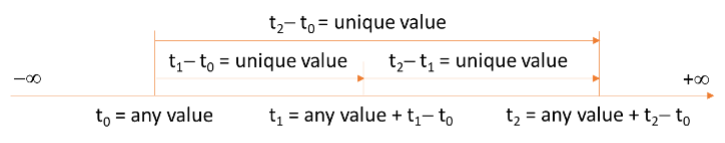

*Fig. 7. The continuous clock*

In the sequel, all variables are functions of time $t \in \mathfrak{C}$: $x=x(t)$ where $x$ denotes any variable.

Let $f$ be a function of several variables:

$$
\begin{aligned}
f &: \mathbb{D}_1 \times \mathbb{D}_2 \times \ldots \times \mathbb{D}_n \longrightarrow \mathbb{D} \\
(x_1, x_2, \ldots, x_n) &\longmapsto y = f(x_1, x_2, \ldots, x_n)
\end{aligned}
$$

where the $\mathbb{D}_i$ and $\mathbb{D}$ stand of any domain.

Unless specified otherwise, the values of all variables $x_i$ are taken at the same instant $t \in \mathfrak{C}$.

## 3.2 4-valued Booleans

4-valued Booleans $\varphi$ satisfy the following algebra:

$$\varphi := \varphi \mid \neg\varphi \mid \varphi_1 \wedge \varphi_2 \tag{1}$$

The logical negation ($\neg$) and conjunction ($\wedge$) operators are defined with the following truth tables:

Table 1. Truth table for the logical negation

| not | Logical negation | | | |
| --- | --- | --- | --- | --- |
| $\varphi$ | true | false | undecided | undefined |
| $\neg\varphi$ | false | true | undecided | undefined |

Table 2. Truth table for the logical conjunction

| and | Logical conjunction | | | |
| --- | --- | --- | --- | --- |
| $\varphi_1 \wedge \varphi_2$ | true | false | undecided | undefined |
| true | true | false | undecided | true |
| false | false | false | false | false |
| undecided | undecided | false | undecided | undecided |
| undefined | true | false | undecided | undefined |

The rationale for Table 1 and Table 2 is the following:

1. The truth table reduced to the values true and false are the same as the one for the classical 2-valued Booleans.
2. $\varphi$ is undecided means that it not known whether $\varphi$ is true or false. Hence, if $\varphi$ is undecided, then it is not known whether $\neg\varphi$ is true or false, and therefore $\neg\varphi$ is undecided. If $\varphi_1$ is undecided and $\varphi_2$ is true, then it is not known whether $\varphi_1 \wedge \varphi_2$ is true or false, because it is true if $\varphi_1$ is true, and false if $\varphi_1$ is false. Therefore $\varphi_1 \wedge \varphi_2$ is undecided. However, if $\varphi_2$ is false, then $\varphi_1 \wedge \varphi_2$ is false whatever the value of $\varphi_1$.
3. $\varphi$ is undefined means that $\varphi$ should not have any influence on the result of the Boolean operation because it is not applicable (cf. Section 1.2.2). Therefore, undefined is the neutral element for all Boolean operators.

The negation and conjunction operators verify the following properties of Boolean algebra:

* Involution: $\forall\varphi,\ \neg(\neg\varphi)=\varphi$
* Commutativity: $\forall\varphi_1,\ \forall\varphi_2,\ \varphi_1 \wedge \varphi_2 = \varphi_2 \wedge \varphi_1$
* Associativity: $\forall\varphi_1,\ \forall\varphi_2,\ (\varphi_1 \wedge \varphi_2) \wedge \varphi_3 = \varphi_1 \wedge (\varphi_2 \wedge \varphi_3)$
* Idempotence: $\forall\varphi,\ \varphi \wedge \varphi = \varphi$

But the following property is not verified:

* Contradiction: $\forall\varphi,\ \varphi \wedge \neg\varphi = \mathit{false}$

All other logical operators are defined using the Morgan laws:

* Logical disjunction:

  $$\varphi_1 \vee \varphi_2 := \neg(\neg\varphi_1 \wedge \neg\varphi_2) \tag{2}$$

* Logical exclusive disjunction (or parity):

  $$\varphi_1 \oplus \varphi_2 := (\varphi_1 \wedge \neg\varphi_2) \vee (\neg\varphi_1 \wedge \varphi_2) \tag{3}$$

* Logical inference:

  $$\varphi_1 \Longrightarrow \varphi_2 := \neg\varphi_1 \vee \varphi_2 \tag{4}$$

It is easy to verify that the operators defined with the Morgan laws make sense considering the meaning given to undecided and undefined. For instance, for the logical disjunction, the truth table obtained using Eq. (2) and the truth table obtained using the rationale given for the logical conjunction operator are equal, cf. Table 3.

Table 3. Truth table for the logical disjunction

| or | Logical disjunction | | | |
| --- | --- | --- | --- | --- |
| $\varphi_1 \vee \varphi_2$ | true | false | undecided | undefined |
| true | true | true | true | true |
| false | true | false | undecided | false |
| undecided | true | undecided | undecided | undecided |
| undefined | true | false | undecided | undefined |

For clarity, the truth table of the equality operator (=) is given in the following table.

Table 4. Truth table for the logical equality

| equal | Logical equality | | | |
| --- | --- | --- | --- | --- |
| $\varphi_1 = \varphi_2$ | true | false | undecided | undefined |
| true | true | false | false | false |
| false | false | true | false | false |
| undecided | false | false | true | false |
| undefined | false | false | false | true |

The logical difference operator is defined as

$$\varphi_1 \neq \varphi_2 := \neg(\varphi_1 = \varphi_2) \tag{5}$$

Contrary to 2-valued Boolean algebra, in the 4-valued Boolean algebra, the negation operator is different from the difference operator: $\varphi_1 \neq \varphi_2$ does not imply $\varphi_1 = \neg\varphi_2$ and reciprocally. Therefore, one must be cautious not to confound negation with difference when using 4-valued Boolean algebra.

The domain of 4-valued Booleans { true, false, undecided, undefined } is denoted $\mathbb{B}$ or $\mathbb{B}_4$.
The domain of 2-valued Booleans { true, false } is denoted $\mathbb{B}_2$.
It is worthwhile noting that the two domains of 3-valued Booleans { true, false, undecided } and { true, false, undefined } are indeed Boolean algebras (they satisfy the Morgan laws). They are respectively denoted $\mathbb{B}_3$ and $\mathbb{B}'_3$.

Thus:

* $\mathbb{B}=\mathbb{B}_4=\{\mathit{true},\mathit{false},\mathit{undecided},\mathit{undefined}\}$
* $\mathbb{B}_3=\{\mathit{true},\mathit{false},\mathit{undecided}\}$
* $\mathbb{B}'_3=\{\mathit{true},\mathit{false},\mathit{undefined}\}$
* $\mathbb{B}_2=\{\mathit{true},\mathit{false}\}$

## 3.3 Events

An event $E$ corresponds to the single occurrence of a 4-valued Boolean $\varphi$ becoming true, which is denoted $\varphi{\uparrow}$:

$$E := \varphi{\uparrow} \tag{6}$$

Notice that before the event, the value of $\varphi$ can be false, undecided or undefined.
Events always occur in the continuous time domain $\mathfrak{C}$.

The instant $t$ of occurrence of event $\varphi{\uparrow}$ is denoted $@\varphi{\uparrow}$:

$$t := @\varphi{\uparrow} \tag{7}$$

where $t$ is the instant of occurrence of $\varphi{\uparrow}$.

The event that corresponds to the current time $t \in \mathfrak{C}$ is denoted $\mathfrak{C}{\uparrow}$. Therefore $t=@\mathfrak{C}{\uparrow}$.

The event corresponding to the current instant in the continuous clock $\mathfrak{C}$ is denoted $\mathfrak{C}{\uparrow}$. Therefore, the current instant is $t=@\mathfrak{C}{\uparrow}$.

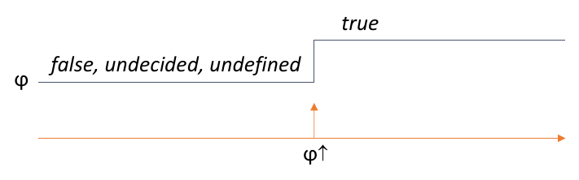

*Fig. 8. Event generated by a Boolean*

The domain of events is denoted $\mathcal{E}$.

At instant time $t$, $\mathcal{E}$ contains all events that have occurred before $t$, including $t$. It does not contain future events that will occur after $t$ excluding $t$ because it is not decidable at $t$ whether future events will actually occur. Therefore, the domain of events $\mathcal{E}$ is time dependent and the number of its elements increases in time as the number of occurred events increases in time. Before the occurrence of the first event, $\mathcal{E}$ is the empty set.

The domain of non-empty events is denoted $\mathcal{E}^*$. Therefore $\mathcal{E}^*$ always contains the first event.

$$
\begin{cases}
|\mathcal{E}| \geq 0 \\
|\mathcal{E}^*| > 0
\end{cases}
\tag{8}
$$

where $|S|$ denotes the number of elements in set $S$.

$\mathcal{E}^*$ is an ordered set because the events in $\mathcal{E}$ are ordered by increasing occurrences in time:

$$\mathcal{E}^*(t) := \{\varphi_1{\uparrow}, \varphi_2{\uparrow}, \ldots, \varphi_i{\uparrow}, \ldots, \varphi_n{\uparrow}\} \quad \text{such that} \quad \forall i,\ \forall j>i,\ @\varphi_i{\uparrow} \leq @\varphi_j{\uparrow} \tag{9}$$

where the $\varphi_i{\uparrow}$ are all the events that have occurred before $t$.

Because $\varphi_n{\uparrow}$ is the last event in $\mathcal{E}^*(t)$, the following relation holds:

$$\mathcal{E}^*(t) = \mathcal{E}^*(\varphi_n{\uparrow}) \tag{10}$$

where $\mathcal{E}^*(\varphi_n{\uparrow})$ denotes the value of $\mathcal{E}^*$ at the instant of occurrence of $\varphi_n{\uparrow}$ ($\mathcal{E}^*(\varphi_n{\uparrow})=\mathcal{E}^*(@\varphi_n{\uparrow})$).

Therefore

$$\mathcal{E}^*(\varphi_n{\uparrow}) := \{\varphi_1{\uparrow}, \varphi_2{\uparrow}, \ldots, \varphi_i{\uparrow}, \ldots, \varphi_n{\uparrow}\} \quad \text{such that} \quad \forall i,\ \forall j>i,\ @\varphi_i{\uparrow} \leq @\varphi_j{\uparrow} \tag{11}$$

Hence:

* $\varphi_i{\uparrow}$ occurs before $\varphi_j{\uparrow}$ can be formally expressed as $\varphi_j{\uparrow} \notin \mathcal{E}^*(\varphi_i{\uparrow})$ if it is not known whether $\varphi_j$ will occur or not, or $\varphi_i{\uparrow} \in \mathcal{E}^*(\varphi_j{\uparrow})$ or $@\varphi_i{\uparrow} \leq @\varphi_j{\uparrow}$ if $\varphi_j$ has occurred.
* $\mathcal{E}^* = \mathcal{E}^*(\varphi_{|\mathcal{E}^*|}{\uparrow})$.

The set of events obtained after the disjunction of two events $\varphi_1{\uparrow}$ and $\varphi_2{\uparrow}$ (i.e., after at least one of the events $\varphi_1{\uparrow}$ or $\varphi_2{\uparrow}$ has occurred) is denoted $\mathcal{E}^*(\varphi_1{\uparrow} \vee \varphi_2{\uparrow})$. Therefore:

$$
\mathcal{E}^*(\varphi_1{\uparrow} \vee \varphi_2{\uparrow}) :=
\begin{cases}
\mathcal{E}^*(\varphi_1{\uparrow}) & \text{if } \varphi_2{\uparrow} \notin \mathcal{E}^*(\varphi_1{\uparrow}) \\
\mathcal{E}^*(\varphi_2{\uparrow}) & \text{if } \varphi_1{\uparrow} \notin \mathcal{E}^*(\varphi_2{\uparrow})
\end{cases}
\tag{12}
$$

The set of events obtained after the conjunction of two events $\varphi_1{\uparrow}$ and $\varphi_2{\uparrow}$ (i.e., after the two events $\varphi_1{\uparrow}$ and $\varphi_2{\uparrow}$ have occurred) is denoted $\mathcal{E}^*(\varphi_1{\uparrow} \wedge \varphi_2{\uparrow})$. Therefore:

$$
\mathcal{E}^*(\varphi_1{\uparrow} \wedge \varphi_2{\uparrow}) :=
\begin{cases}
\mathcal{E}^*(\varphi_1{\uparrow}) & \text{if } \varphi_2{\uparrow} \in \mathcal{E}^*(\varphi_1{\uparrow}) \\
\mathcal{E}^*(\varphi_2{\uparrow}) & \text{if } \varphi_1{\uparrow} \in \mathcal{E}^*(\varphi_2{\uparrow})
\end{cases}
\tag{13}
$$

## 3.4 Multiple events

A multiple event $\Omega$ is a subset of $\mathcal{E}$: $\Omega \in 2^{\mathcal{E}}$.
It is therefore a set of events ordered by increasing occurrences in time:

$$\Omega := \{\varphi_1{\uparrow}, \varphi_2{\uparrow}, \ldots, \varphi_i{\uparrow}, \ldots\} \quad \text{such that} \quad \forall i,\ \forall j>i,\ @\varphi_i{\uparrow} \leq @\varphi_j{\uparrow} \tag{14}$$

Let us consider a Boolean $\psi$ that becomes true at each event $\varphi_i{\uparrow}$ (there are infinitely many of such Booleans). Then $\Omega$ is generated by $\psi$. This is denoted $\Omega(\psi)$:

$$\Omega(\psi) := \{\psi(t_1){\uparrow}, \psi(t_2){\uparrow}, \ldots, \psi(t_i){\uparrow}, \ldots\} \tag{15}$$

Where the $t_i=@\varphi_i{\uparrow}$ are the time instants when $\psi$ becomes true (i.e., such that $\psi(t_i){\uparrow} = \varphi_i{\uparrow}$) for all $i \in \mathbb{N}^*,\ 1 \leq i \leq |\Omega(\psi)|$.

The chosen Boolean $\psi$ that generates $\Omega(\psi)$ is denoted $\psi(\Omega)$.

Note that the number of elements $|\Omega(\psi)|$ is time dependent as the set $\Omega(\psi)$ increases in time like any subset of $\mathcal{E}$:

$$
|\Omega(\psi)| =
\begin{cases}
0 & \text{if } t < t_1 \\
i & \text{if } t_i \leq t < t_{i+1}
\end{cases}
\tag{16}
$$

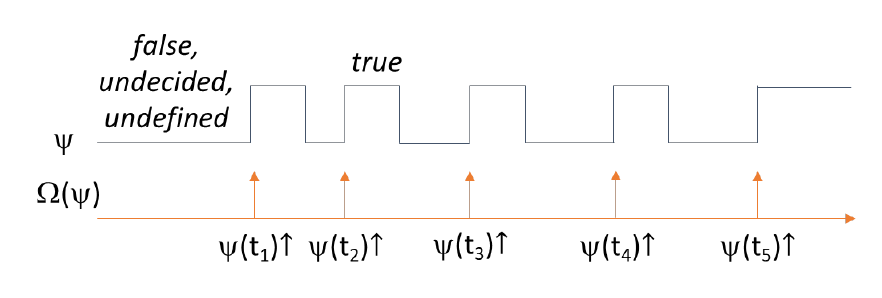

*Fig. 9. Multiple event generated by a Boolean*

The domain of multiple events is denoted $\mathcal{D}$. Then $\mathcal{D}=2^{\mathcal{E}}$ (the set of the subsets of $\mathcal{E}$).

## 3.5 Operators on events

### 3.5.1 Equal operator

The equal operator tells whether two events $\varphi_1{\uparrow}$ and $\varphi_2{\uparrow}$ are equal, i.e. whether they occur at the same time instant. It is formally defined as follows:

$$
\begin{aligned}
=\ &: \mathcal{E} \times \mathcal{E} \longrightarrow \mathbb{B} \\
(\varphi_1{\uparrow}, \varphi_2{\uparrow}) &\longmapsto \varphi_1{\uparrow} = \varphi_2{\uparrow} :=
\begin{cases}
\text{true} & \text{if } \varphi_2{\uparrow} \in \mathcal{E}^*(\varphi_1{\uparrow}) \wedge \varphi_1{\uparrow} \in \mathcal{E}^*(\varphi_2{\uparrow}) \\
\text{false} & \text{if } \neg\left(\varphi_2{\uparrow} \in \mathcal{E}^*(\varphi_1{\uparrow}) \wedge \varphi_1{\uparrow} \in \mathcal{E}^*(\varphi_2{\uparrow})\right) \\
\text{undecided} & \text{if } \varphi_1{\uparrow} \notin \mathcal{E} \text{ and } \varphi_2{\uparrow} \notin \mathcal{E}
\end{cases}
\end{aligned}
\tag{17}
$$

Eq. (17) means that $\varphi_1{\uparrow} = \varphi_2{\uparrow}$ is true if $\varphi_1{\uparrow}$ and $\varphi_2{\uparrow}$ occur at the same time instant. It is undecided if none of the two events $\varphi_1{\uparrow}$ or $\varphi_2{\uparrow}$ occurs. It is false otherwise. Therefore, the value of $\varphi_1{\uparrow} = \varphi_2{\uparrow}$ is always known, even if $\varphi_1{\uparrow}$ and/or $\varphi_2{\uparrow}$ have not occurred.

Also notice that $\varphi_1{\uparrow} = \varphi_2{\uparrow}$ does not imply that $\varphi_1 = \varphi_2$ (but the converse is true, cf. Fig. 10).

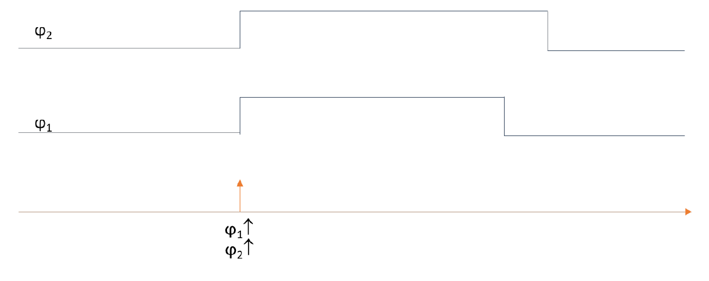

*Fig. 10. Event equal operator*

### 3.5.2 Different operator

The different operator tells whether two events $\varphi_1{\uparrow}$ and $\varphi_2{\uparrow}$ are different, i.e. whether they occur at different time instants. It is formally defined as follows:

$$
\begin{aligned}
\neq\ &: \mathcal{E} \times \mathcal{E} \longrightarrow \mathbb{B} \\
(\varphi_1{\uparrow}, \varphi_2{\uparrow}) &\longmapsto \varphi_1{\uparrow} \neq \varphi_2{\uparrow} := \neg(\varphi_1{\uparrow} = \varphi_2{\uparrow})
\end{aligned}
\tag{18}
$$

The value of $\varphi_1{\uparrow} \neq \varphi_2{\uparrow}$ is always known, even if $\varphi_1{\uparrow}$ and/or $\varphi_2{\uparrow}$ have not occurred.

Notice that Eq. (18) is consistent with the definition of the different operator from first principles:

$$
\varphi_1{\uparrow} \neq \varphi_2{\uparrow} :=
\begin{cases}
\text{true} & \text{if } \neg\left(\varphi_2{\uparrow} \in \mathcal{E}^*(\varphi_1{\uparrow}) \wedge \varphi_1{\uparrow} \in \mathcal{E}^*(\varphi_2{\uparrow})\right) \\
\text{false} & \text{if } \varphi_2{\uparrow} \in \mathcal{E}^*(\varphi_1{\uparrow}) \wedge \varphi_1{\uparrow} \in \mathcal{E}^*(\varphi_2{\uparrow}) \\
\text{undecided} & \text{if } \varphi_1{\uparrow} \notin \mathcal{E} \text{ and } \varphi_2{\uparrow} \notin \mathcal{E}
\end{cases}
$$

### 3.5.3 Before operator

The before operator tells whether a first event $\varphi_1{\uparrow}$ occurs before a second event $\varphi_2{\uparrow}$. It is formally defined as follows:

$$
\begin{aligned}
\leq\ &: \mathcal{E} \times \mathcal{E} \longrightarrow \mathbb{B} \\
(\varphi_1{\uparrow}, \varphi_2{\uparrow}) &\longmapsto \varphi_1{\uparrow} \leq \varphi_2{\uparrow} :=
\begin{cases}
\text{true} & \text{if } \varphi_2{\uparrow} \notin \mathcal{E}^*(\varphi_1{\uparrow}) \vee \varphi_1{\uparrow} = \varphi_2{\uparrow} \\
\text{false} & \text{if } \varphi_1{\uparrow} \notin \mathcal{E}^*(\varphi_2{\uparrow}) \\
\text{undecided} & \text{if } \varphi_1{\uparrow} \notin \mathcal{E} \text{ and } \varphi_2{\uparrow} \notin \mathcal{E}
\end{cases}
\end{aligned}
\tag{19}
$$

Eq. (19) means that $\varphi_1{\uparrow} \leq \varphi_2{\uparrow}$ is:

* undecided if neither $\varphi_1{\uparrow}$ nor $\varphi_2{\uparrow}$ have occurred,
* true if $\varphi_1{\uparrow}$ has occurred first, or if $\varphi_1{\uparrow}$ and $\varphi_2{\uparrow}$ occur simultaneously,
* false if $\varphi_2{\uparrow}$ has occurred first.

Therefore, the value of $\varphi_1{\uparrow} \leq \varphi_2{\uparrow}$ is always known, even if $\varphi_1{\uparrow}$ and/or $\varphi_2{\uparrow}$ have not occurred.

The strictly before operator is defined as follows:

$$
\begin{aligned}
<\ &: \mathcal{E} \times \mathcal{E} \longrightarrow \mathbb{B} \\
(\varphi_1{\uparrow}, \varphi_2{\uparrow}) &\longmapsto \varphi_1{\uparrow} < \varphi_2{\uparrow} := (\varphi_1{\uparrow} \leq \varphi_2{\uparrow}) \wedge (\varphi_1{\uparrow} \neq \varphi_2{\uparrow})
\end{aligned}
\tag{20}
$$

The value of $\varphi_1{\uparrow} < \varphi_2{\uparrow}$ is always known, even if $\varphi_1{\uparrow}$ and/or $\varphi_2{\uparrow}$ have not occurred.

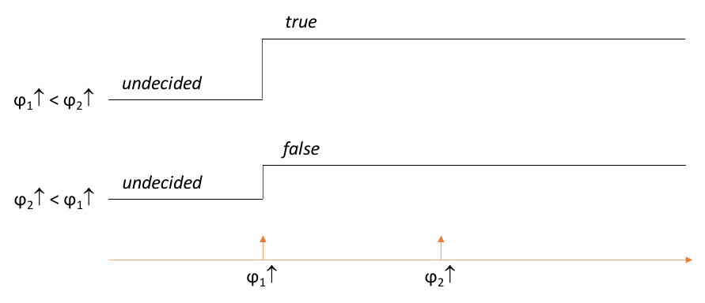

*Fig. 11. Event before operator*

### 3.5.4 After operator

The after operator tells whether a first event $\varphi_1{\uparrow}$ occurs after a second event $\varphi_2{\uparrow}$. It is formally defined as follows:

$$
\begin{aligned}
\geq\ &: \mathcal{E} \times \mathcal{E} \longrightarrow \mathbb{B} \\
(\varphi_1{\uparrow}, \varphi_2{\uparrow}) &\longmapsto \varphi_1{\uparrow} \geq \varphi_2{\uparrow} := \varphi_2{\uparrow} \leq \varphi_1{\uparrow}
\end{aligned}
\tag{21}
$$

Notice that Eq. (21) is consistent with the definition of the after operator from first principles:

$$
\begin{aligned}
\geq\ &: \mathcal{E} \times \mathcal{E} \longrightarrow \mathbb{B} \\
(\varphi_1{\uparrow}, \varphi_2{\uparrow}) &\longmapsto \varphi_1{\uparrow} \geq \varphi_2{\uparrow} :=
\begin{cases}
\text{true} & \text{if } \varphi_1{\uparrow} \notin \mathcal{E}^*(\varphi_2{\uparrow}) \vee \varphi_2{\uparrow} = \varphi_1{\uparrow} \\
\text{false} & \text{if } \varphi_2{\uparrow} \notin \mathcal{E}^*(\varphi_1{\uparrow}) \\
\text{undecided} & \text{if } \varphi_1{\uparrow} \notin \mathcal{E} \text{ and } \varphi_2{\uparrow} \notin \mathcal{E}
\end{cases}
\end{aligned}
$$

Eq. (21) means that $\varphi_1{\uparrow} \geq \varphi_2{\uparrow}$ is:

* undecided if neither $\varphi_1{\uparrow}$ nor $\varphi_2{\uparrow}$ have occurred,
* true if $\varphi_2{\uparrow}$ has occurred first or if $\varphi_2{\uparrow}$ and $\varphi_1{\uparrow}$ occur simultaneously,
* false if $\varphi_1{\uparrow}$ has occurred first.

Therefore, the value of $\varphi_1{\uparrow} \geq \varphi_2{\uparrow}$ is always known, even if $\varphi_1{\uparrow}$ and/or $\varphi_2{\uparrow}$ have not occurred.

The strictly after operator is defined as follows:

$$
\begin{aligned}
>\ &: \mathcal{E} \times \mathcal{E} \longrightarrow \mathbb{B} \\
(\varphi_1{\uparrow}, \varphi_2{\uparrow}) &\longmapsto \varphi_1{\uparrow} > \varphi_2{\uparrow} := \varphi_2{\uparrow} < \varphi_1{\uparrow}
\end{aligned}
\tag{22}
$$

The value of $\varphi_1{\uparrow} > \varphi_2{\uparrow}$ is always known, even if $\varphi_1{\uparrow}$ and/or $\varphi_2{\uparrow}$ have not occurred.

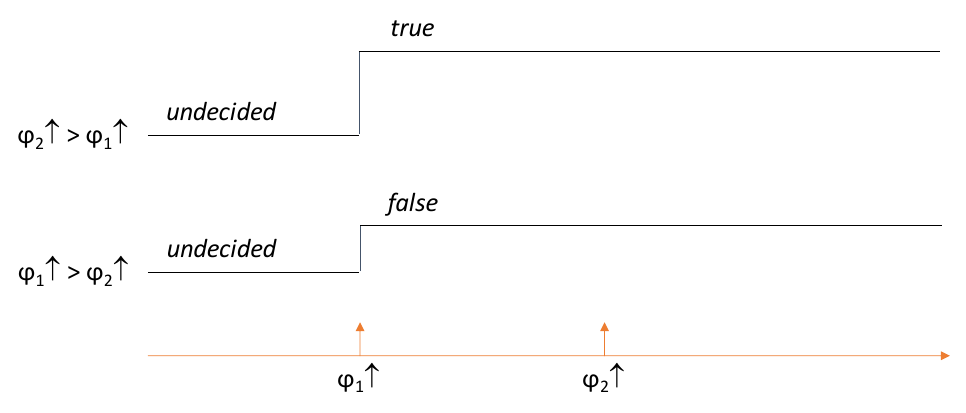

*Fig. 12. Event after operator*

### 3.5.5 Min operator

The min operator computes the first occurring event between two events $\varphi_1{\uparrow}$ and $\varphi_2{\uparrow}$, $\varphi_2{\uparrow}$ occurring before or after $\varphi_1{\uparrow}$. It is formally defined as follows:

$$
\begin{aligned}
\min\ &: \mathcal{E} \times \mathcal{E} \longrightarrow 2^{\mathcal{E}} \\
(\varphi_1{\uparrow}, \varphi_2{\uparrow}) &\longmapsto \min(\varphi_1{\uparrow}, \varphi_2{\uparrow}) :=
\begin{cases}
\{\varphi_1{\uparrow}\} & \text{if } (\varphi_1{\uparrow} \leq \varphi_2{\uparrow}) = \text{true} \\
\{\varphi_2{\uparrow}\} & \text{if } (\varphi_2{\uparrow} \leq \varphi_1{\uparrow}) = \text{true} \\
\emptyset & \text{else}
\end{cases}
\end{aligned}
\tag{23}
$$

Eq. (23) produces a multiple time event to cope with the possibility of non-occurrence of $\varphi_1{\uparrow}$ and $\varphi_2{\uparrow}$.

Notice that Eq. (23) is consistent with the definition of the min operator from first principles:

$$
\min(\varphi_1{\uparrow}, \varphi_2{\uparrow}) :=
\begin{cases}
\{\varphi_1{\uparrow}\} & \text{if } \varphi_2{\uparrow} \notin \mathcal{E}^*(\varphi_1{\uparrow}) \vee \varphi_1{\uparrow} = \varphi_2{\uparrow} \\
\{\varphi_2{\uparrow}\} & \text{if } \varphi_1{\uparrow} \notin \mathcal{E}^*(\varphi_2{\uparrow}) \vee \varphi_2{\uparrow} = \varphi_1{\uparrow} \\
\emptyset & \text{else}
\end{cases}
$$

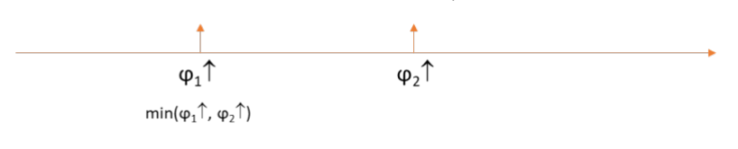

*Fig. 13. Event min operator*

### 3.5.6 Max operator

The max operator computes the last occurring event between two events $\varphi_1{\uparrow}$ and $\varphi_2{\uparrow}$, $\varphi_2{\uparrow}$ occurring before or after $\varphi_1{\uparrow}$. It is formally defined as follows:

$$
\begin{aligned}
\max\ &: \mathcal{E} \times \mathcal{E} \longrightarrow 2^{\mathcal{E}} \\
(\varphi_1{\uparrow}, \varphi_2{\uparrow}) &\longmapsto \max(\varphi_1{\uparrow}, \varphi_2{\uparrow}) :=
\begin{cases}
\{\varphi_1{\uparrow}\} & \text{if } \varphi_2{\uparrow} \in \mathcal{E}^*(\varphi_1{\uparrow}) \\
\{\varphi_2{\uparrow}\} & \text{if } \varphi_1{\uparrow} \in \mathcal{E}^*(\varphi_2{\uparrow}) \\
\emptyset & \text{else}
\end{cases}
\end{aligned}
\tag{24}
$$

Eq. (24) produces a multiple time event to cope with the possibility of non-occurrence of $\varphi_1{\uparrow}$ and $\varphi_2{\uparrow}$.

Notice that the following definition is not correct because $\varphi_1{\uparrow}$ and $\varphi_2{\uparrow}$ must have occurred to provide a non-empty value for $\max(\varphi_1{\uparrow}, \varphi_2{\uparrow})$:

$$
\max(\varphi_1{\uparrow}, \varphi_2{\uparrow}) \ \mathrel{:\neq}
\begin{cases}
\{\varphi_1{\uparrow}\} & \text{if } \varphi_1{\uparrow} \geq \varphi_2{\uparrow} \\
\{\varphi_2{\uparrow}\} & \text{if } \varphi_2{\uparrow} \geq \varphi_1{\uparrow} \\
\emptyset & \text{else}
\end{cases}
$$

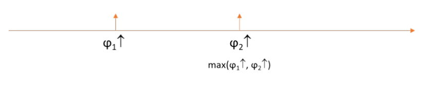

*Fig. 14. Event max operator*

### 3.5.7 Elapsed operator

The elapsed operator computes the elapsed time between two events $\varphi_1{\uparrow}$ and $\varphi_2{\uparrow}$, $\varphi_2{\uparrow}$ occurring after $\varphi_1{\uparrow}$, which means that $\varphi_1{\uparrow} \in \mathcal{E}^*(\varphi_2{\uparrow})$. It is denoted $-$:

$$
\begin{aligned}
-\ &: \mathcal{E}^*(\varphi_2{\uparrow}) \times \mathcal{E}^*(\varphi_2{\uparrow}) \longrightarrow \mathbb{R}^+ \quad \text{such that } \varphi_2{\uparrow} \geq \varphi_1{\uparrow} \\
(\varphi_1{\uparrow}, \varphi_2{\uparrow}) &\longmapsto \varphi_2{\uparrow} - \varphi_1{\uparrow} = d
\end{aligned}
\tag{25}
$$

where $d \in \mathbb{R}^+$. $d$ is the elapsed time, or delay between $\varphi_1{\uparrow}$ and $\varphi_2{\uparrow}$. The value of $\varphi_2{\uparrow} - \varphi_1{\uparrow}$ is not known until $\mathcal{E}^*(\varphi_2{\uparrow})$ exists, i.e. until the second event $\varphi_2{\uparrow}$ has occurred.

Notice that Eq. (25) is consistent with Eq. (17), (19) and (20), but not equivalent since they have different definition domains:

$$
\begin{aligned}
\varphi_1{\uparrow} - \varphi_2{\uparrow} = 0 &\iff \varphi_1{\uparrow} = \varphi_2{\uparrow} \\
\varphi_2{\uparrow} - \varphi_1{\uparrow} \geq 0 &\iff \varphi_2{\uparrow} \geq \varphi_1{\uparrow} \\
\varphi_2{\uparrow} - \varphi_1{\uparrow} > 0 &\iff \varphi_2{\uparrow} > \varphi_1{\uparrow}
\end{aligned}
$$

If $\varphi_1{\uparrow}$ occurs at time $t_1$ and $\varphi_2{\uparrow}$ occurs at time $t_2$, then the elapsed time between the two events is given by $\varphi_2{\uparrow} - \varphi_1{\uparrow}$.

$$t_2 - t_1 = @\varphi_2{\uparrow} - @\varphi_1{\uparrow} = \varphi_2{\uparrow} - \varphi_1{\uparrow} \tag{26}$$

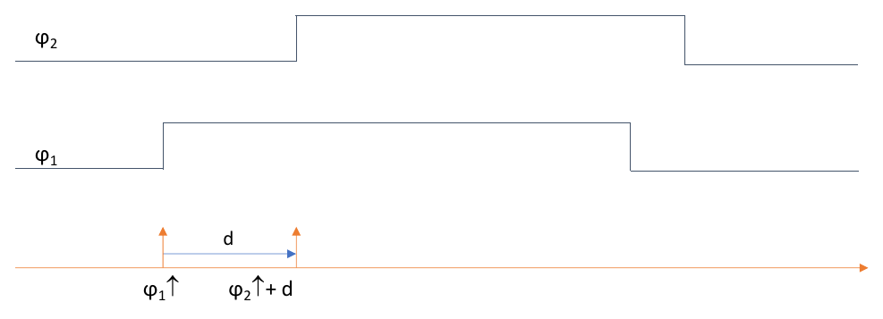

*Fig. 15. Event elapsed operator*

### 3.5.8 Delay operator

The delay operator applied on event $\varphi_1{\uparrow}$ generates a second event $\varphi_2{\uparrow} = \varphi_1{\uparrow} + d$ after $\varphi_1{\uparrow}$ where $d \in \mathbb{R}^+$ is the delay between $\varphi_1{\uparrow}$ and $\varphi_2{\uparrow}$. It is formally defined as follows:

$$
\begin{aligned}
+\ &: \mathcal{E} \times \mathbb{R}^+ \longrightarrow 2^{\mathcal{E}} \\
(\varphi_1{\uparrow}, d) &\longmapsto \varphi_1{\uparrow} + d := \{\varphi_2{\uparrow} \text{ such that } @\varphi_2{\uparrow} = @\varphi_1{\uparrow} + d\}
\end{aligned}
\tag{27}
$$

Therefore $\varphi_1{\uparrow} + d$ is the empty set as long as $\varphi_1{\uparrow} + d$ has not occurred, and a set that contains one event when $\varphi_1{\uparrow} + d$ has occurred.

Notice that Eq. (27) is consistent with Eq. (25) because:

$$@\varphi_2{\uparrow} = @\varphi_1{\uparrow} + d \iff \varphi_2{\uparrow} - \varphi_1{\uparrow} = d$$

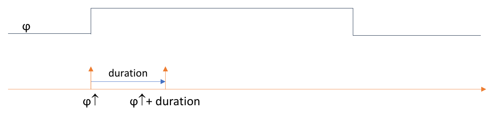

*Fig. 16. Event delay operator*

### 3.5.9 Conjunction operator

The conjunction operator $\wedge$ applied on two events $\varphi_1{\uparrow}$ and $\varphi_2{\uparrow}$ generates the event $\varphi{\uparrow} = \varphi_1{\uparrow} = \varphi_2{\uparrow}$ if $\varphi_1{\uparrow}$ and $\varphi_2{\uparrow}$ occur at the same instant in time. It is formally defined as follows:

$$
\begin{aligned}
\wedge\ &: \mathcal{E} \times \mathcal{E} \longrightarrow 2^{\mathcal{E}} \\
(\varphi_1{\uparrow}, \varphi_2{\uparrow}) &\longmapsto \varphi_1{\uparrow} \wedge \varphi_2{\uparrow} := \{\varphi{\uparrow} \text{ such that } \varphi{\uparrow} = \varphi_1{\uparrow} = \varphi_2{\uparrow}\}
\end{aligned}
\tag{28}
$$

Therefore $\varphi_1{\uparrow} \wedge \varphi_2{\uparrow}$ is the empty set if $\varphi_1{\uparrow}$ or $\varphi_2{\uparrow}$ have not occurred, or if $\varphi_1{\uparrow} \neq \varphi_2{\uparrow}$, and a set that contains the event $\varphi_1{\uparrow}$ if $\varphi_1{\uparrow}$ has occurred and $\varphi_1{\uparrow} = \varphi_2{\uparrow}$.

The conjunction operator $\wedge$ applied on an event $\varphi{\uparrow}$ and a multiple event $\Omega$ yields a multiple event $\{\varphi{\uparrow}\}$ if $\varphi{\uparrow}$ is an event of $\Omega$. It is formally defined as follows:

$$
\begin{aligned}
&\mathcal{E} \times \mathcal{D} \longrightarrow \mathcal{D} \\
(\varphi{\uparrow}, \Omega) &\longmapsto \varphi{\uparrow} \wedge \Omega := \{\varphi{\uparrow}\} \cap \Omega
\end{aligned}
\tag{29}
$$

### 3.5.10 Disjunction operator

The disjunction operator $\vee$ applied on two events $\varphi_1{\uparrow}$ and $\varphi_2{\uparrow}$ yields a multiple event $\Omega$ that contains the two events $\varphi_1{\uparrow}$ and $\varphi_2{\uparrow}$. It is formally defined as follows:

$$
\begin{aligned}
\vee\ &: \mathcal{E} \times \mathcal{E} \longrightarrow \mathcal{D} \\
(\varphi_1{\uparrow}, \varphi_2{\uparrow}) &\longmapsto \varphi_1{\uparrow} \vee \varphi_2{\uparrow} := \{\varphi_1{\uparrow}, \varphi_2{\uparrow}\}
\end{aligned}
\tag{30}
$$

Therefore $\varphi_1{\uparrow} \vee \varphi_2{\uparrow}$ is the empty set if $\varphi_1{\uparrow}$ and $\varphi_2{\uparrow}$ have not occurred, and a set that contains the event $\varphi_1{\uparrow}$ if $\varphi_1{\uparrow}$ has occurred and the event $\varphi_2{\uparrow}$ if $\varphi_2{\uparrow}$ has occurred.

The disjunction operator $\vee$ applied on an event $\varphi{\uparrow}$ and a multiple event $\Omega$ yields a multiple event $\Phi$ that contains $\varphi{\uparrow}$ and the events of $\Omega$. It is formally defined as follows:

$$
\begin{aligned}
&\mathcal{E} \times \mathcal{D} \longrightarrow \mathcal{D} \\
(\varphi{\uparrow}, \Omega) &\longmapsto \varphi{\uparrow} \vee \Omega := \{\varphi{\uparrow}\} \cup \Omega
\end{aligned}
\tag{31}
$$

### 3.5.11 Composition of Booleans with events

A Boolean $\varphi$ can be composed with and event $\psi{\uparrow}$ as follows:

$$
\begin{aligned}
\mathit{op}\ &: \mathbb{B} \times \mathcal{E} \longrightarrow \mathbb{B} \\
(\varphi, \psi{\uparrow}) &\longmapsto \varphi \ \mathit{op}\ \psi{\uparrow} := \varphi \ \mathit{op}
\begin{cases}
\text{true} & \text{if } t = @\psi{\uparrow} \\
\text{undefined} & \text{if } t \neq @\psi{\uparrow}
\end{cases}
\end{aligned}
\tag{32}
$$

where $\mathit{op}$ denotes the binary logical operators $\wedge$ or $\vee$.

A Boolean $\varphi$ can be composed with a multiple event $\Omega$ as follows:

$$
\begin{aligned}
\mathit{op}\ &: \mathbb{B} \times \mathcal{D} \longrightarrow \mathbb{B} \\
(\varphi, \Omega) &\longmapsto \varphi \ \mathit{op}\ \Omega := ((\varphi \ \mathit{op}\ \Omega^1) \ \mathit{op}\ \Omega^2) \ldots \mathit{op}\ \Omega^{|\Omega|}
\end{aligned}
\tag{33}
$$

where $\mathit{op}$ denotes the binary logical operators $\wedge$ or $\vee$.

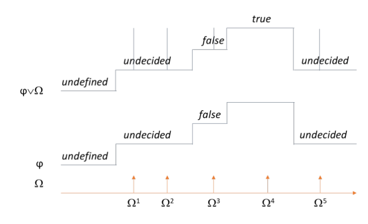

*Fig. 17. Composition of Booleans with events*

## 3.6 Discrete clocks

A discrete clock $\Omega$ is a multiple event $\Omega$. Therefore, the terms ‘discrete clock’ and ‘multiple event’ are synonymous.

It is therefore a set of events ordered by increasing occurrences in time:

$$\Omega := \{\varphi_1{\uparrow}, \varphi_2{\uparrow}, \ldots, \varphi_i{\uparrow}, \ldots\} \quad \text{such that} \quad \forall i,\ \forall j>i,\ @\varphi_i{\uparrow} \leq @\varphi_j{\uparrow} \tag{34}$$

The $\varphi_i{\uparrow}$ in Eq. (34) are called the clock ticks. The rank of the clock tick $\varphi_i{\uparrow}$ in $\Omega$ is denoted $\mathrm{rank}(\varphi_i{\uparrow} \in \Omega)$.

Let us consider a Boolean $\psi$ that becomes true at each event $\varphi_i{\uparrow}$ (e.g., $\psi = \mathit{false} \vee \Omega$). Then $\Omega$ is generated by $\psi$. This is denoted $\Omega(\psi)$:

$$\Omega(\psi) := \{\psi(t_1){\uparrow}, \psi(t_2){\uparrow}, \ldots, \psi(t_i){\uparrow}, \ldots\} \tag{35}$$

where the $t_i = @\varphi_i{\uparrow}$ are the time instants when $\psi$ becomes true (i.e., such that $\psi(t_i){\uparrow} = \varphi_i{\uparrow}$) for all $i \in \mathbb{N}^*,\ 1 \leq i \leq |\Omega(\psi)|$. When no confusion is possible between clocks and events, it is also possible to write $\Omega(\psi) = \psi{\uparrow}$.

The chosen Boolean $\psi$ that generates $\Omega(\psi)$ is denoted $\psi(\Omega)$. If the clock $\Omega(\psi)$ is written $\Omega(\psi) = \psi{\uparrow}$, then $\psi(\Omega) = \psi$.

Note that $\Omega(\mathit{false}) = \emptyset$, which can be denoted $\mathit{false}{\uparrow} = \emptyset$.

The discrete time associated to a discrete clock is given by the sequence number $i$ of the clock tick, but each clock tick is associated with its time occurrence in the continuous clock domain. The $i$th tick of clock $\Omega$ is denoted $\Omega^i = \psi(t_i){\uparrow}$. It is occurring at discrete time $i \in \mathbb{N}^*$ in the discrete clock domain $\Omega$ and at continuous time $t_i \in \mathbb{R}$ in the continuous clock domain $\mathfrak{C}$.

$$\Omega(\psi) := \{\Omega^1, \Omega^2, \ldots, \Omega^i, \ldots\} \tag{36}$$

where $\Omega^i = \psi(t_i){\uparrow}$ for all $i \in \mathbb{N}^*,\ 1 \leq i \leq |\Omega(\psi)|$.

If the notation $\psi{\uparrow}$ is used to denote clock $\Omega(\psi)$, then $\Omega^i = (\psi{\uparrow})^i$. Then the event $\psi{\uparrow}$ can be considered as the first tick of clock $\psi{\uparrow}$:

$$\psi{\uparrow} \equiv (\psi{\uparrow})^1 \tag{37}$$

The rank function is defined as:

$$
\begin{aligned}
\mathrm{rank}\ &: \Omega \longrightarrow \mathbb{N} \\
\Omega^i &\longmapsto \mathrm{rank}(\Omega^i) = i
\end{aligned}
\tag{38}
$$

The discrete time associated to clock $\Omega$ is given by the number of ticks $|\Omega|$ of $\Omega$. $|\Omega|$ increases in time by one unit at each new tick $\Omega^{|\Omega|}$. $\Omega^{|\Omega|}$ is thus called the current tick of clock $\Omega$. $|\Omega| = 0$ before the first tick (the set $\Omega$ is empty). The discrete time associated to $\Omega$ is not defined when $\Omega$ is empty because when $|\Omega| = 0$, $\Omega^{|\Omega|}$ is not defined ($\Omega^i$ is defined for $i \geq 1$).

$$
|\Omega| =
\begin{cases}
0 & \text{if } t < @\Omega^1 \\
i & \text{if } @\Omega^i \leq t < @\Omega^{i+1}
\end{cases}
\tag{39}
$$

where $@\Omega^i$ denotes the instant of occurrence of tick $\Omega^i$.

$\Omega(i)$ denotes the value of $\Omega$ at instant $@\Omega^i$:

$$\Omega(i) := \Omega(\Omega^i) = \{\Omega^1, \Omega^2, \ldots, \Omega^i\} \tag{40}$$

Therefore, $\Omega \neq \emptyset \Longrightarrow \Omega = \Omega(|\Omega|)$.

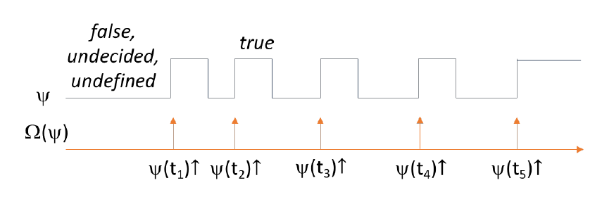

*Fig. 18. Discrete clock generated by a Boolean*

The domain of discrete clocks is denoted $\mathcal{D}$. Then $\mathcal{D} = 2^{\mathcal{E}}$ (the set of the subsets of $\mathcal{E}$).

The set of the subsets of $\mathcal{E}(\varphi{\uparrow})$ is denoted $\mathcal{D}(\varphi{\uparrow})$: $\mathcal{D}(\varphi{\uparrow}) = 2^{\mathcal{E}(\varphi{\uparrow})}$.

## 3.7 Operators on discrete clocks

### 3.7.1 Projection operator

The projection $\varphi{\uparrow} / \Omega$ of an event $\varphi{\uparrow}$ on a discrete clock $\Omega$ is the first tick of $\Omega$ that follows $\varphi{\uparrow}$. It is formally defined as follows:

$$
\begin{aligned}
/\ &: \mathcal{E} \times \mathcal{D} \longrightarrow \mathcal{D} \\
(\varphi{\uparrow}, \Omega) &\longmapsto \varphi{\uparrow} / \Omega :=
\begin{cases}
\left\{\Omega^i = \min\limits_{j \geq i}(\Omega^j \geq \varphi{\uparrow}) \ \text{ if } \exists k \text{ such that } \Omega^k \geq \varphi{\uparrow}\right\} \\
\emptyset \quad \text{if } \nexists k \text{ such that } \Omega^k \geq \varphi{\uparrow}
\end{cases}
\end{aligned}
\tag{41}
$$

The projection operator $\Omega_1 / \Omega_2$ of a discrete clock $\Omega_1$ on a discrete clock $\Omega_2$ is defined as follows:

$$
\begin{aligned}
/\ &: \mathcal{D} \times \mathcal{D} \longrightarrow \mathcal{D} \\
(\Omega_1, \Omega_2) &\longmapsto \Omega_1 / \Omega_2 := \bigcup_{i=1}^{|\Omega_1|} \Omega_1^i / \Omega_2
\end{aligned}
\tag{42}
$$

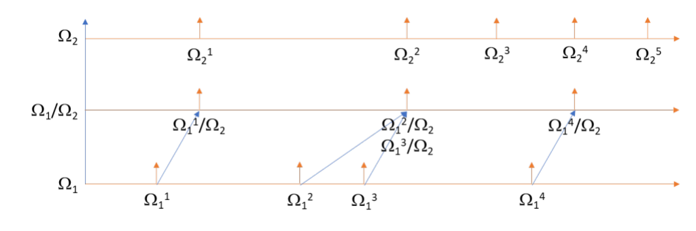

*Fig. 19. Discrete clock projection operator*

The projection $t / \Omega$ of a time instant $t \in \mathfrak{C}$ on a discrete clock $\Omega$ is the first tick of $\Omega$ that follows $t$. It is formally defined as follows:

$$
\begin{aligned}
/\ &: \mathfrak{E} \times \mathcal{D} \longrightarrow \mathcal{D} \\
(t, \Omega) &\longmapsto t / \Omega :=
\begin{cases}
\left\{\Omega^i = \min\limits_{j \geq i}(@\Omega^j \geq t) \ \text{ if } \exists k \text{ such that } @\Omega^k \geq t\right\} \\
\emptyset \quad \text{if } \nexists k \text{ such that } @\Omega^k \geq t
\end{cases}
\end{aligned}
\tag{43}
$$

It follows from this definition that the projection of the continuous clock $\mathfrak{C}$ on a discrete clock $\Omega$ and that the projection of a discrete clock $\Omega$ on the continuous clock $\mathfrak{C}$ are the discrete clock $\Omega$ itself:

$$\mathfrak{C} / \Omega = \Omega \tag{44}$$

$$\Omega / \mathfrak{C} = \Omega \tag{45}$$

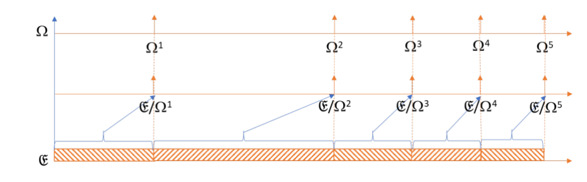

*Fig. 20. Continuous clock projection operator on a discrete clock*

### 3.7.2 Bounded projection operator

The bounded projection $\varphi{\uparrow} \mathbin{/^{d}} \Omega$ of an event $\varphi{\uparrow}$ on a discrete clock $\Omega$ is the first tick of $\Omega$ that follows $\varphi{\uparrow}$ if it is delayed by at most $d \in \mathbb{R}^+$ from $\varphi{\uparrow}$. Otherwise, the projection is lost. It is formally defined as follows:

$$
\begin{aligned}
\mathbin{/^{d}}\ &: \mathcal{E} \times \mathcal{D} \times \mathbb{R}^+ \longrightarrow \mathcal{D} \\
(\varphi{\uparrow}, \Omega, d) &\longmapsto \varphi{\uparrow} \mathbin{/^{d}} \Omega :=
\begin{cases}
\left\{\Omega^i = \min\limits_{j \geq i}(\varphi{\uparrow} + d \geq \Omega^j \geq \varphi{\uparrow}) \ \text{ if } \exists k \text{ such that } \varphi{\uparrow} + d \geq \Omega^k \geq \varphi{\uparrow}\right\} \\
\emptyset \quad \text{if } \nexists k \text{ such that } \varphi{\uparrow} + d \geq \Omega^k \geq \varphi{\uparrow}
\end{cases}
\end{aligned}
\tag{46}
$$

The projection operator $\Omega_1 \mathbin{/^{d}} \Omega_2$ of a discrete clock $\Omega_1$ on a discrete clock $\Omega_2$ is defined as follows:

$$
\begin{aligned}
\mathbin{/^{d}}\ &: \mathcal{D} \times \mathcal{D} \longrightarrow \mathcal{D} \\
(\Omega_1, \Omega_2) &\longmapsto \Omega_1 \mathbin{/^{d}} \Omega_2 := \bigcup_{i=1}^{|\Omega_1|} \Omega_1^i \mathbin{/^{d}} \Omega_2
\end{aligned}
\tag{47}
$$

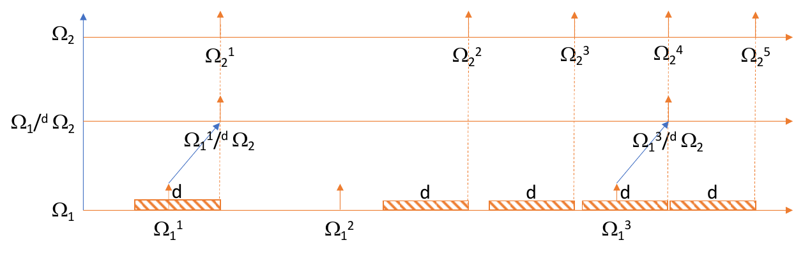

*Fig. 21. Discrete clock bounded projection operator*

The bounded projection $t \mathbin{/^{d}} \Omega$ of a time instant $t \in \mathfrak{C}$ on a discrete clock $\Omega$ is the first tick of $\Omega$ that follows $t$ if it is delayed by at most $d \in \mathfrak{C}$ from $t$. Otherwise, the projection is lost. It is formally defined as follows:

$$
\begin{aligned}
/\ &: \mathfrak{E} \times \mathcal{D} \times \mathbb{R}^+ \longrightarrow \mathcal{D} \\
(t, \Omega, d) &\longmapsto t \mathbin{/^{d}} \Omega :=
\begin{cases}
\left\{\Omega^i = \min\limits_{j \geq i}(t + d \geq @\Omega^j \geq t) \ \text{ if } \exists k \text{ such that } t + d \geq @\Omega^k \geq t\right\} \\
\emptyset \quad \text{if } \nexists k \text{ such that } t + d \geq @\Omega^k \geq t
\end{cases}
\end{aligned}
\tag{48}
$$

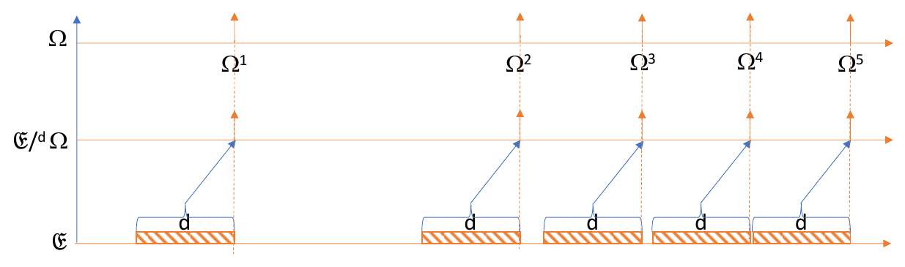

*Fig. 22. Continuous clock bounded projection operator on a discrete clock*

Note that $d$ is a function of time (it is not a fixed quantity).

### 3.7.3 Delay operator

The delay operator denoted $+$ applied on tick $\Omega^i$ of clock $\Omega$ delays $\Omega^i$ by $n$ ticks. It is formally defined as follows:

$$
\begin{aligned}
+\ &: \Omega \times \mathbb{N} \longrightarrow \Omega \\
(\Omega^i, n) &\longmapsto \Omega^i + n := \Omega^{i+n}
\end{aligned}
\tag{49}
$$

where $n \in \mathbb{N}$ is the delay expressed in number of ticks of $\Omega$.

Note that tick $\Omega^{i+n}$ can never occur.

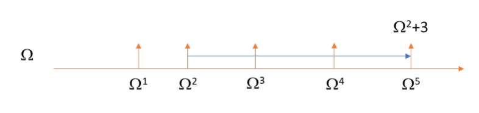

*Fig. 23. Clock tick delay operator*

The delay operator denoted $+$ applied on clock $\Omega_1(\Omega_1^i)$ generates a second clock $\Omega_2$ whose ticks are delayed by $n$ ticks of $\Omega_1$. It is formally defined as follows:

$$
\begin{aligned}
+\ &: \mathcal{D} \times \mathbb{N} \longrightarrow \mathcal{D} \\
(\Omega_1(\Omega_1^i), n) &\longmapsto \Omega_2 = \Omega_1 + n := \{\Omega_1^j + n,\ i \leq j \leq |\Omega_1|\}
\end{aligned}
\tag{50}
$$

where $n \in \mathbb{N}$ is the delay expressed in number of ticks of $\Omega_1$.

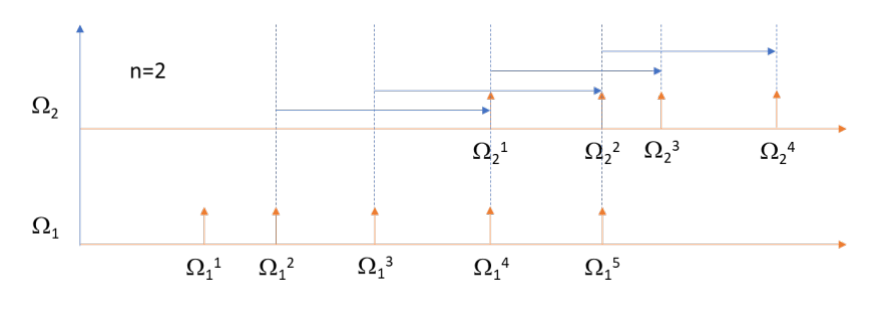

*Fig. 24. Discrete clock delay operator*

### 3.7.4 Elapsed operator

The elapsed operator denoted $-$ applied on two ticks $\Omega^i$ and $\Omega^j$ of clock $\Omega$, $\Omega^j$ occurring after $\Omega^i$, yields the elapsed time (or delay) between $\Omega^i$ and $\Omega^j$. It is formally defined as follows:

$$
\begin{aligned}
-\ &: \Omega(\Omega^i) \times \Omega(\Omega^j) \longrightarrow \mathbb{N} \quad \text{such that } j \geq i \\
(\Omega^i, \Omega^j) &\longmapsto \Omega^j - \Omega^i := j - i
\end{aligned}
\tag{51}
$$

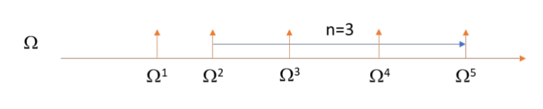

*Fig. 25. Discrete clock elapsed operator*

### 3.7.5 Conjunction operator

The conjunction operator $\wedge$ applied on two clocks $\Omega_1$ and $\Omega_2$ yields a third clock $\Omega$ that contains all ticks of $\Omega_1$ and $\Omega_2$ that are equal. It is formally defined as follows:

$$
\begin{aligned}
\wedge\ &: \mathcal{D} \times \mathcal{D} \longrightarrow \mathcal{D} \\
(\Omega_1, \Omega_2) &\longmapsto \Omega = \Omega_1 \wedge \Omega_2 := \Omega_1 \cap \Omega_2
\end{aligned}
\tag{52}
$$

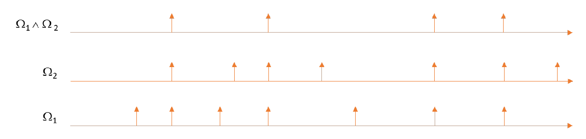

*Fig. 26. Discrete clock conjunction operator*

### 3.7.6 Disjunction operator

The disjunction operator $\vee$ applied on two clocks $\Omega_1$ and $\Omega_2$ yields a third clock $\Omega$ that contains all ticks of $\Omega_1$ and $\Omega_2$. It is formally defined as follows:

$$
\begin{aligned}
\vee\ &: \mathcal{D} \times \mathcal{D} \longrightarrow \mathcal{D} \\
(\Omega_1, \Omega_2) &\longmapsto \Omega = \Omega_1 \vee \Omega_2 := \Omega_1 \cup \Omega_2
\end{aligned}
\tag{53}
$$

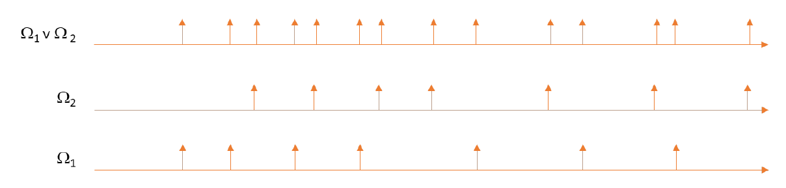

*Fig. 27. Discrete clock disjunction operator*

### 3.7.7 Filter operator

The filter operator applied on clock $\Omega$ filters (i.e., removes) all ticks that do not satisfy a Boolean condition. It is formally defined as follows:

$$
\begin{aligned}
\mathrm{filter}\ &: \mathcal{D} \times \mathbb{O}(\Omega \longrightarrow \mathbb{B}) \longrightarrow \mathcal{D} \\
(\Omega_1, \mathit{cond}) &\longmapsto \Omega_2 = \Omega_1(\mathit{cond}(*)) := \{\Omega_1^i \in \Omega_1 \text{ such that } \mathit{cond}(\Omega_1^i) = \text{true}\}
\end{aligned}
\tag{54}
$$

where $*$ denotes a dummy variable that represent any element $\Omega_1^i \in \Omega_1$, and $\mathit{cond}$ is a Boolean condition on $\Omega_1^i$.

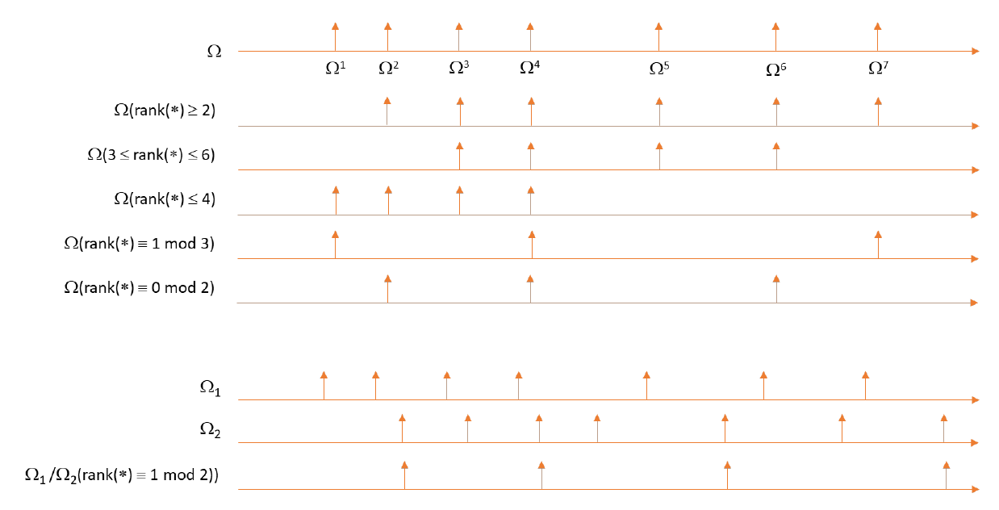

*Fig. 28. Discrete clock filter operator*

### 3.7.8 Extending operators on a discrete clock to the continuous time domain

To be simulated, operators defined on a discrete clock must be extended to the continuous time domain $\mathfrak{C}$.

Let $f(\Omega)$ be a function that takes the clock $\Omega$ as argument:

$$
\begin{aligned}
f\ &: \mathcal{D} \longrightarrow \mathbb{D} \\
\Omega &\longmapsto f(\Omega)
\end{aligned}
\tag{55}
$$

where $\mathbb{D}$ can be any domain.

The extension $\bar{f}$ of $f$ to the continuous time domain $\mathfrak{C}$ is defined as follows:

$$
\begin{aligned}
[\,@\Omega^1, +\infty\,[\ &\longrightarrow \mathbb{D} \\
t &\longmapsto \bar{f}(t) =
\begin{cases}
f(\Omega^i) & \text{for } @\Omega^i \leq t < @\Omega^{i+1} \text{ if } 1 \leq i < |\Omega| \\
f(\Omega^{|\Omega|}) & \text{for } t \geq @|\Omega|
\end{cases}
\end{aligned}
\tag{56}
$$

The definition given by Eq. (56) can be extended to functions $f(\Omega_1, \ldots, \Omega_i, \ldots, \Omega_n)$ defined on multiple clocks $\Omega_1, \ldots \Omega_i, \ldots \Omega_n$ as follows:

$$
\begin{aligned}
[\,@\Omega_1^1, +\infty\,[ \times \ldots \times [\,@\Omega_i^1, +\infty\,[ \times \ldots \times [\,@\Omega_n^1, +\infty\,[\ &\longrightarrow \mathbb{D} \\
(t_1, \ldots t_i, \ldots t_n) &\longmapsto \bar{f}(t_1, \ldots t_i, \ldots t_n) = f\left(\Omega_1^{j_1}, \ldots, \Omega_i^{j_i}, \ldots, \Omega_n^{j_n}\right) \quad \text{for } @\Omega_i^{j_i} \leq t_i < @\Omega_i^{j_i+1}
\end{aligned}
\tag{57}
$$

with the convention that $@\Omega_i^{j_i+1} = +\infty$ if $j_i = |\Omega_i|$. Note that $\bar{f}$ is undefined until all clocks have their first tick.

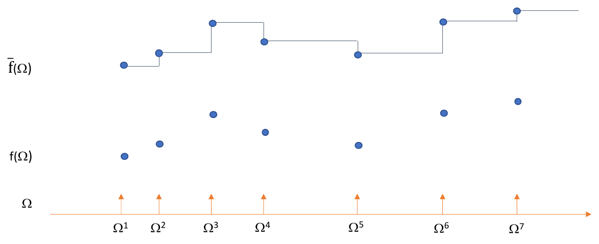

*Fig. 29. Extending operators on discrete clocks to the continuous time domain*

## 3.8 Single time periods

A single time period $P$ is a time interval between two events $\varphi_1{\uparrow}$ and $\varphi_2{\uparrow}$. The left and right boundaries can be included or excluded (this is indicated by the notation [ | ]).

$$P := [\,|\,]\ \varphi_1{\uparrow}, \varphi_2{\uparrow}\ [\,|\,] \tag{58}$$

$\varphi_1{\uparrow}$ is called the opening event. It is denoted $P{\uparrow}$.
$\varphi_2{\uparrow}$ is called the closing event. It is denoted $P{\downarrow}$.

Therefore, Eq. (58) can be rewritten as follows:

$$P := [\,|\,]\ P{\uparrow}, P{\downarrow}\ [\,|\,] \tag{59}$$

The domain of single time periods is denoted $\mathcal{P}$.

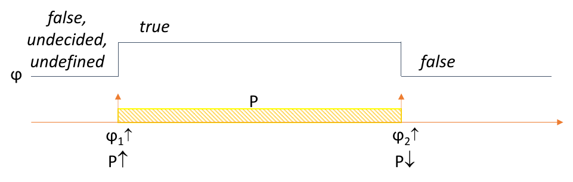

*Fig. 30. Single time period*

## 3.9 Multiple time periods

A multiple time period $\mathbf{P}$ is a set of single time periods $P_i$ ordered by opening events increasing in time:

$$\mathbf{P} := \{P_1, P_2, \ldots, P_i, \ldots\} \quad \text{such that} \quad \forall i,\ \forall j,\ j>i \Rightarrow P_j{\uparrow} \geq P_i{\uparrow} \tag{60}$$

Multiple time periods $\mathbf{P}$ containing single time periods opened at all occurrences of $\varphi_1{\uparrow}$ and closed at all occurrences of $\varphi_2{\uparrow}$ are denoted

$$\mathbf{P} := \Pi\left([\,|\,]\ \varphi_1{\uparrow}, \varphi_2{\uparrow}\ [\,|\,]\right) \tag{61}$$

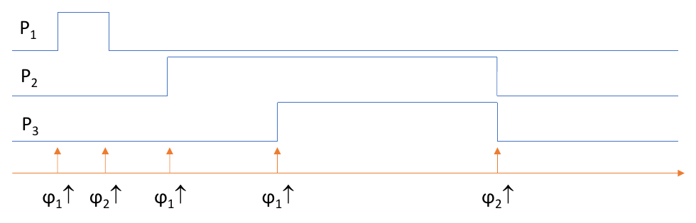

*Fig. 31. Multiple time period*

The domain of multiple time periods is denoted $2^{\mathcal{P}}$.

A non-overlapping time period $\mathbf{P}$ is a multiple time period such that there is no time overlaps between the single time periods $P_i$ of the multiple time period $\mathbf{P}$. It is formally defined as follows:

$$\mathbf{P} := \{P_1, P_2, \ldots, P_i, \ldots\} \quad \text{such that} \quad \forall i \in [1, |\mathbf{P}|-1],\ P_i{\downarrow} < P_{i+1}{\uparrow} \tag{62}$$

The non-overlapping time period $\mathbf{P}(\psi)$ generated by the Boolean $\psi$ is defined as:

$$\mathbf{P}(\psi) := \Pi\left([\,|\,]\ \psi{\uparrow}, \psi{\downarrow}\ [\,|\,]\right) \tag{63}$$

where $\psi{\downarrow} := \neg\psi{\uparrow}$.

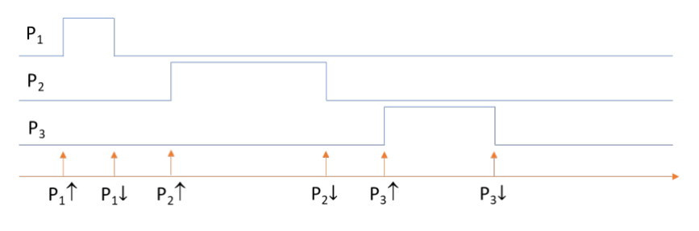

*Fig. 32. Non-overlapping time period*

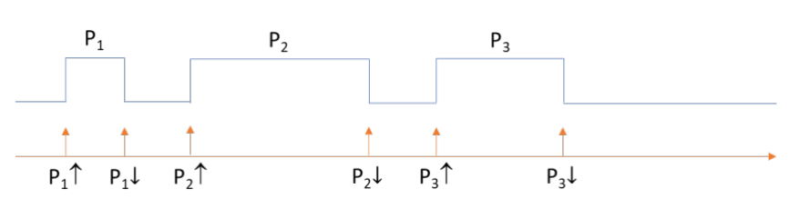

*Fig. 33. Reduced graphical representation of a non-overlapping time period*

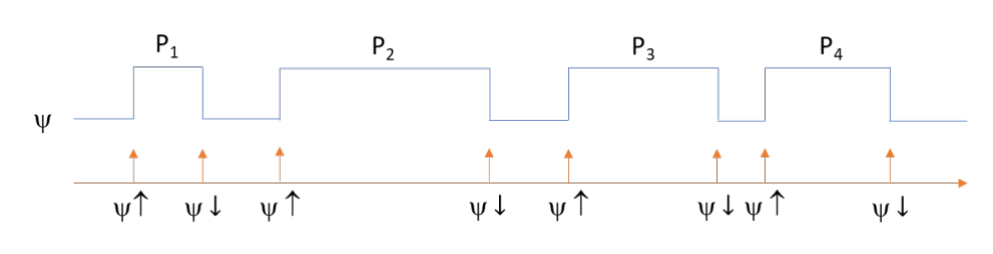

*Fig. 34. Non-overlapping time period generated by a Boolean*

## 3.10 Operators on multiple time periods

### 3.10.1 Intersection operator

The intersection operator between two single time periods $P_1$ and $P_2$ produces a multiple time period $\mathbf{P}$ that contains a single time period made of all time instants common to $P_1$ and $P_2$. It is formally defined as follows:

$$
\begin{aligned}
\cap\ &: \mathcal{P} \times \mathcal{P} \longrightarrow 2^{\mathcal{P}} \\
(P_1, P_2) &\longmapsto \mathbf{P} = P_1 \cap P_2 :=
\begin{cases}
\{[\max(P_1{\uparrow}, P_2{\uparrow}),\ \min(P_1{\downarrow}, P_2{\downarrow})]\} & \text{if } \max(P_1{\uparrow}, P_2{\uparrow}) \leq \min(P_1{\downarrow}, P_2{\downarrow}) \\
\emptyset & \text{if } \max(P_1{\uparrow}, P_2{\uparrow}) > \min(P_1{\downarrow}, P_2{\downarrow})
\end{cases}
\end{aligned}
\tag{64}
$$

$P_1 \cap P_2$ is a multiple time period which can be empty or contains one single time period. Therefore:

$$0 \leq |P_1 \cap P_2| \leq 1 \tag{65}$$

### 3.10.2 Truncation operator

The truncation operator between a non-overlapping multiple time period $\mathbf{P}_1 = \{P_{1,i}\}_{1 \leq i \leq |\mathbf{P}_1|}$ and a multiple time period $\mathbf{P}_2 = \{P_{1,j}\}_{1 \leq j \leq |\mathbf{P}_2|}$ produces a multiple time period $\mathbf{P} = \{P_k\}_{1 \leq k \leq |\mathbf{P}|}$ such that all its single time periods $P_k$ are the single time periods $P_{2,j}$ of $\mathbf{P}_2$ truncated by the single time periods $P_{1,i}$ of $\mathbf{P}_1$. It is formally defined as follows:

$$
\begin{aligned}
\supset\ &: 2^{\mathcal{P}} \times 2^{\mathcal{P}} \longrightarrow 2^{\mathcal{P}} \\
(\mathbf{P}_1, \mathbf{P}_2) &\longmapsto \mathbf{P} = \mathbf{P}_1 \supset \mathbf{P}_2 := \bigcup_{1 \leq i \leq |\mathbf{P}_1|,\ 1 \leq j \leq |\mathbf{P}_2|} P_{1,i} \cap P_{2,j}
\end{aligned}
\tag{66}
$$

From Eq. (66), in general:

$$0 \leq |\mathbf{P}_1 \supset \mathbf{P}_2| \leq |\mathbf{P}_1|\,|\mathbf{P}_2| \tag{67}$$

The non-overlapping time period $\mathbf{P}_1$ such that $\mathbf{P}_1 \supset \mathbf{P}_2$ is called the frame time period of $\mathbf{P}_2$.

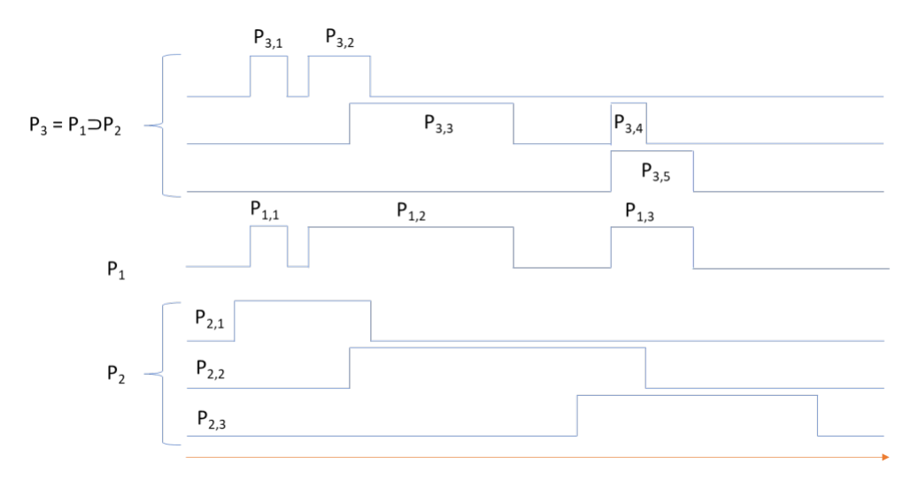

*Fig. 35. Truncation of a multiple time period*

## 3.11 Temporal operators on Booleans

### 3.11.1 Accumulation operator

The accumulation operator, denoted $+$, is applied on two different values of the same Boolean $\varphi$ at two different instants $t_1$ and $t_2$:

$$
\begin{aligned}
+\ &: \mathbb{B} \times \mathbb{B} \longrightarrow \mathbb{B} \\
(\varphi(t_1), \varphi(t_2)) &\longmapsto \varphi(t_1) + \varphi(t_2)
\end{aligned}
\tag{68}
$$

The values of the accumulation operator are given by the following truth table:

Table 5. Truth table for the Boolean accumulation operator

| + | Accumulation operator | | | |
| --- | --- | --- | --- | --- |
| $\varphi(t_1)+\varphi(t_2)$ | true | false | undecided | undefined |
| true | true | false | true | true |
| false | false | false | false | false |
| undecided | true | false | undecided | undecided |
| undefined | true | false | undecided | undefined |

The purpose of the accumulation operator is to define the policy of requirement satisfaction (cf. Section 3.12).

The accumulation operator verifies the following properties:

* Commutativity: $\varphi(t_1)+\varphi(t_2)=\varphi(t_2)+\varphi(t_1)$
* Associativity: $(\varphi(t_1)+\varphi(t_2))+\varphi(t_3)=\varphi(t_1)+(\varphi(t_2)+\varphi(t_3))$
* Idempotence: $\varphi(t)+\varphi(t)=\varphi(t)$

### 3.11.2 Filter operator

The filter operator is formally defined as follows:

$$
\begin{aligned}
\times\ &: \mathbb{B} \times \mathbb{B} \longrightarrow \mathbb{B} \\
(a, \varphi) &\longmapsto a \times \varphi
\end{aligned}
\tag{69}
$$

where $a$ and $\varphi$ are two Booleans at the same instant in time. $a$ is the filter.

The truth table of the filter operator is given below.

Table 6. Truth table for the Boolean filter operator

| × | Filter operator | | | |
| --- | --- | --- | --- | --- |
| $a \times \varphi$ | true | false | undecided | undefined |
| true | true | false | undecided | undefined |
| false | undecided | undecided | undecided | undefined |
| undecided | undecided | undecided | undecided | undefined |
| undefined | undefined | undefined | undefined | undefined |

The purpose of the filter operator is to filter out events that are not decision events.

### 3.11.3 Duration operator

The duration of a Boolean $\varphi$ over a single time period $P$ is the elapsed time while $\varphi$ equals true inside $P$. It is formally defined as follows:

$$
\begin{aligned}
\mathrm{duration}\ &: \mathbb{B} \times \mathcal{P} \longrightarrow \mathbb{R}^+ \\
(\varphi, P) &\longmapsto \mathrm{duration}(\varphi, P) := \int_{t \in P} [\![\varphi]\!]\ dt
\end{aligned}
\tag{70}
$$

where $[\![\ ]\!]$ is the indicator function:

$$
\begin{aligned}
[\![\ ]\!]\ &: \mathbb{B} \longrightarrow \{0, 1\} \\
\varphi &\longmapsto [\![\varphi]\!] =
\begin{cases}
1 & \text{if } \varphi = \text{true} \\
0 & \text{if } \varphi \neq \text{true}
\end{cases}
\end{aligned}
\tag{71}
$$

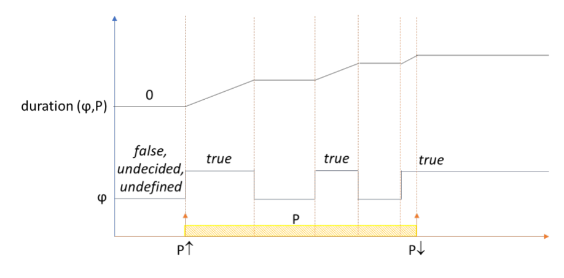

*Fig. 36. Boolean duration operator*

### 3.11.4 Delay operator

The delay operator applied on Boolean $\varphi_1$ generates a second Boolean $\varphi_2$ as formally defined below:

$$
\begin{aligned}
+\ &: \mathbb{B} \times \mathbb{R}^+ \longrightarrow \mathbb{B} \\
(\varphi_1, d) &\longmapsto \varphi_2 = (\varphi_1 + d)(t) := \varphi_1(t - d)
\end{aligned}
\tag{72}
$$

where $d \in \mathbb{R}^+$ is the delay or elapsed time between $\varphi_1$ and $\varphi_2$.

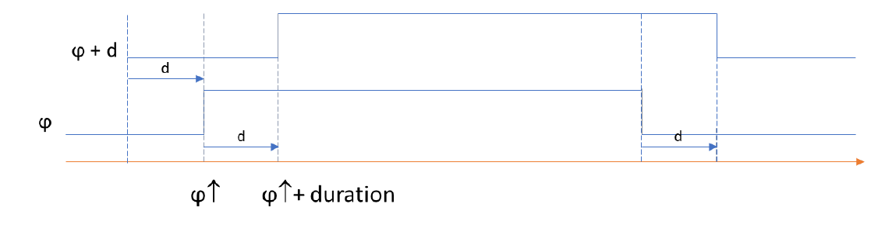

*Fig. 37. Boolean delay operator*

### 3.11.5 Sum operator

The sum operator of Boolean $\varphi$ over the single time period $P$ is formally defined for a discrete clock $\Omega$ as follows:

$$
\begin{aligned}
\sum\ &: \mathbb{B} \times \mathcal{P} \times \mathcal{D} \longrightarrow \mathbb{B} \\
(\varphi, P, \Omega) &\longmapsto \sum_{P,\Omega} \varphi :=
\begin{cases}
\text{undefined} & \text{if } \Omega = \emptyset \\
\displaystyle\sum_{@\Omega^{|\Omega|} \in P} \varphi\left(@\Omega^{|\Omega|}\right) & \text{if } \Omega \neq \emptyset
\end{cases}
\end{aligned}
\tag{73}
$$

where $\displaystyle\sum_{@\Omega^{|\Omega|} \in P} \varphi\left(@\Omega^{|\Omega|}\right) = \varphi(t_1) + \cdots + \varphi(t_i) + \cdots$ is an accumulator that accumulates the values of $\varphi(t_i)$ such that $t_i = @\Omega^{|\Omega|}$ and $t_i \in P$. Its value is undefined when the accumulator is empty, and varies at each time instant $t_i \in P$ when $|\Omega|$ increases by one unit.

The term undefined is introduced to provide a value to the sum even if there are no ticks of $\Omega$ within $P$. Therefore, the value of the sum is undefined if there are no ticks of $\Omega$ within $P$, and the sum has a value for any value of $t \in \mathfrak{C}$.

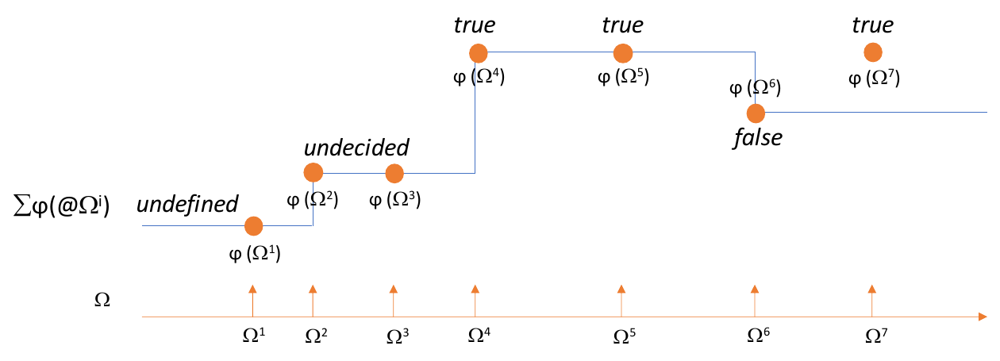

*Fig. 38. Sum operator*

### 3.11.6 Integral operator

Let us consider a Boolean $\varphi(t) \in \mathbb{B}$ which is a function of time $t \in \mathfrak{C}$ (like any other variable). Let us consider the single time period $P$, a time quantum $dt \in \mathbb{R}^{*+}$ and the discrete clock $\Omega$ such that

$$\Omega \neq \emptyset \Longrightarrow \Omega^1 = P{\uparrow} \ \text{ and } \ \forall i \in [1, |\Omega|-1],\ \Omega^{i+1} = \Omega^i + dt \tag{74}$$

Then the integral operator of $\varphi(\tau)$ over the single time period $P$ is formally defined as follows:

$$
\begin{aligned}
\int\ &: \mathbb{B} \times \mathcal{P} \longrightarrow \mathbb{B} \\
(\varphi, P) &\longmapsto \int_P \varphi := \lim_{dt \to 0} \sum_{P,\Omega} \varphi
\end{aligned}
\tag{75}
$$

It corresponds to the extension of the definition of the sum operator for the continuous clock $\mathfrak{C}$. The integral operator sums $\varphi$ at any time instant $t \in P$. Before $P{\uparrow}$, $\int_P \varphi = \text{undefined}$. Note that the value of $\int_P \varphi$ varies in time between $P{\uparrow}$ and $P{\downarrow}$, and stays constant after $P{\downarrow}$.

## 3.12 Requirements

### 3.12.1 Definition

A requirement $R$ corresponding to a Boolean $\varphi$ associated to a single time period $P$ is denoted $R = \varphi \otimes \{P\}$ and formally defined as the following function:

$$
\begin{aligned}
\otimes\ &: \mathbb{B} \times \mathcal{P} \longrightarrow \mathbb{B} \\
(\varphi, P) &\longmapsto \varphi \otimes \{P\} := \int_P a(\varphi, P) \times \varphi
\end{aligned}
\tag{76}
$$

The filter $a(\varphi, P) \in \mathbb{B}$ depends on $\varphi \in \mathbb{B}$ and $P \in \mathcal{P}$. $R = \varphi \otimes P$ varies with time $t \in \mathfrak{C}$ when $t \leq P{\downarrow}$ and stays constant for $t > P{\downarrow}$.

A decision event is an event that occurs when the decision whether $R$ is satisfied or not can be made, cf. Section 3.12.3. The decision events for condition $\varphi \in \mathbb{B}$ and single time period $P \in \mathcal{P}$ constitute a clock whose ticks are denoted $\mathrm{dev}(\varphi, P){\uparrow}$. Then

$$\mathrm{dev}(\varphi, P){\uparrow} = \left(a(\varphi, P) \times \varphi \ \vee\ \neg(a(\varphi, P) \times \varphi)\right){\uparrow} \tag{77}$$

Eq. (77) states that decision events occur when $a(\varphi, P) \times \varphi$ becomes true or false.

In principle, the value $\varphi \otimes P$ should be the same at all decision events, but there may be some situations where the value of $\varphi \otimes P$ can differ from one decision event to the other. If the decision over the satisfaction of $\varphi \otimes P$ is final at the first decision event (i.e., is not reversed at the next decision event):

$$\forall t \geq @(\mathrm{dev}(\varphi, P){\uparrow})^1,\ \varphi \otimes P(t) = \varphi \otimes P\left(@(\mathrm{dev}(\varphi, P){\uparrow})^1\right) \tag{78}$$

A requirement $R$ corresponding to a Boolean $\varphi$ associated to a multiple time period $\mathbf{P} = \{P_1, P_2, \ldots, P_{|\mathbf{P}|}\}$ is denoted $R = \varphi \otimes \mathbf{P}$ and formally defined as the following function:

$$
\begin{aligned}
\otimes\ &: \mathbb{B} \times 2^{\mathcal{P}} \longrightarrow \mathbb{B} \\
(\varphi, \mathbf{P}) &\longmapsto \varphi \otimes \mathbf{P} := \bigwedge_{i=1}^{|\mathbf{P}|} \varphi \otimes \{P_i\} = \varphi \otimes \{P_1\} \wedge \varphi \otimes \{P_2\} \wedge \ldots \wedge \varphi \otimes \{P_{|\mathbf{P}|}\}
\end{aligned}
\tag{79}
$$

$\varphi \in \mathbb{B}$ is called the condition of the requirement.

$\mathbf{P} \in 2^{\mathcal{P}}$ is called the time period of the requirement (the term ‘multiple’ is eventually dropped as all time periods of requirement are considered to be multiple time periods, even if the multiple time period contains only one single time period, i.e. if $|\mathbf{P}| = 1$).

$R(\varphi, \mathbf{P}) = \varphi \otimes \mathbf{P} \in \mathbb{B}$ is called the value of the requirement. It depends on time $t \in \mathfrak{C}$.

The multiple time period $\mathbf{P}$ associated with $R = \varphi \otimes \mathbf{P}$ is denoted $\otimes R$. Similarly, the condition $\varphi$ associated with $R = \varphi \otimes \mathbf{P}$ is denoted $R \otimes$. Thus, $\mathbf{P} = {\otimes R}$, $\varphi = R \otimes$ and $R = R \otimes\, \otimes R$.

The filter $a(\varphi, P)$ filters out the events of $\varphi$ which are not decision events and ensures that the closing event of $P$ is always a decision event if $\varphi \in \mathbb{B}_2$. The filter is composed of two terms, one that depends only on $\varphi$ and the other that depends only on $P$:

$$
\begin{aligned}
a\ &: \mathbb{B} \times \mathcal{P} \longrightarrow \mathbb{B} \\
a(\varphi, P) &= a'(\varphi) \vee P{\downarrow}
\end{aligned}
\tag{80}
$$

$\mathrm{dev}'(\varphi, P){\uparrow} = \left(a'(\varphi, P) \times \varphi \ \vee\ \neg(a'(\varphi, P) \times \varphi)\right){\uparrow}$ is called the early decision event because if it occurs, it occurs before $P{\downarrow}$.

There is no general algorithm for computing $a'(\varphi)$ from the condition $\varphi$, but a general procedure to write $a'(\varphi)$ is given in Section 3.19. Therefore, $a'(\varphi)$ must be given together with $\varphi$. Examples of $a'(\varphi)$ are $a'(\varphi)=\varphi$, $a'(\varphi)=\neg\varphi$, $a'(\varphi)=\mathit{true}$ or $a'(\varphi)=\mathit{false}$. If $a'(\varphi)=\varphi$, then the requirement is satisfied as soon as the condition $\varphi$ is true. If $a'(\varphi)=\neg\varphi$, then the requirement is violated as soon as the condition $\varphi$ is true. If $a'(\varphi)=\mathit{true}$, then all events generated by $\varphi$ can be considered as decision events: as soon as $\varphi$ becomes true or false, the decision is made. If $a'(\varphi)=\mathit{false}$, then no event generated by $\varphi$ can be considered as decision event: the decision can only be made at the end of $P$.

If at the end of a single time period $P$, $a'(\varphi) \in \mathbb{B}_2$, then $a(\varphi, P) \in \mathbb{B}_2$. If in addition $\varphi \in \mathbb{B}_2$, then $\varphi \otimes P \in \mathbb{B}_2$:

$$a'(\varphi(@P{\downarrow})) \in \mathbb{B}_2 \ \text{ and } \ \varphi(@P{\downarrow}) \in \mathbb{B}_2 \Longrightarrow \varphi \otimes P \in \mathbb{B}_2 \tag{81}$$

Example 1 with $a'(\varphi)=\neg\varphi$. Let us consider a requirement $R = \varphi \otimes P$ that specifies that the number of events generated by a Boolean $\psi$ inside $P$ must be less than a given number $N$.

The number of events of $\psi$ inside $P$ is given by:

$$
\begin{aligned}
\mathrm{count}\ &: \mathbb{B} \times \mathcal{P} \longrightarrow \mathbb{N} \\
\mathrm{count}(\psi, P) &= \left|\left\{(\psi{\uparrow})^i \ \text{such that} \ P{\uparrow} \leq (\psi{\uparrow})^i \leq P{\downarrow},\ i \in [1, |\psi{\uparrow}|]\right\}\right|
\end{aligned}
\tag{82}
$$

The condition $\varphi$ is given by:

$$\varphi = (\mathrm{count}(\psi, P) \leq N) \tag{83}$$

where $N \in \mathbb{N}$ is a constant.

Then $a'(\varphi)=\neg\varphi$ because the decision that the requirement is not satisfied can be made as soon as $\mathrm{count}(\psi,P) > N$. $\varphi \in \mathbb{B}_2 \Longrightarrow a'(\varphi) \in \mathbb{B}_2$. Because Eq. (81) is satisfied, the value of $\varphi \otimes P$ is true or false (it cannot be undecided or undefined).

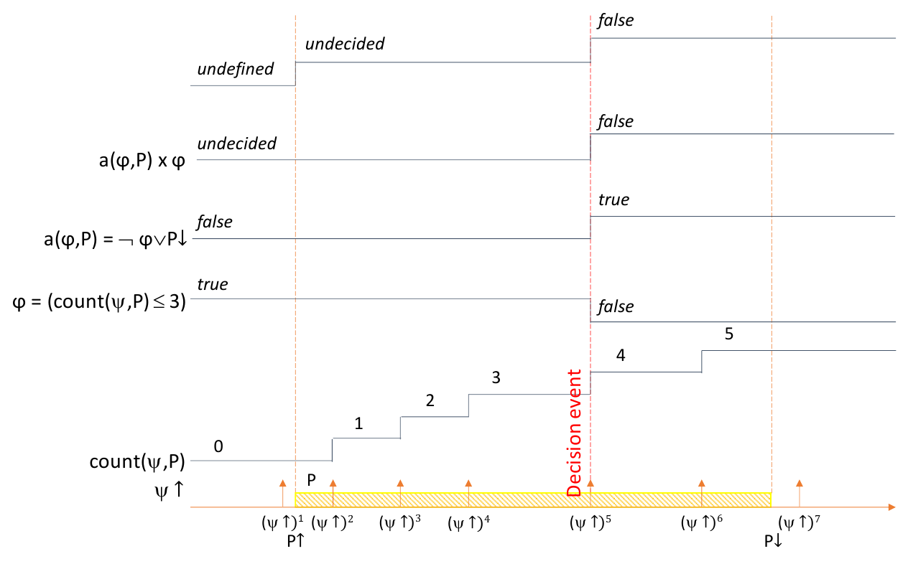

*Fig. 39. Example 1 with the decision event inside the time period*

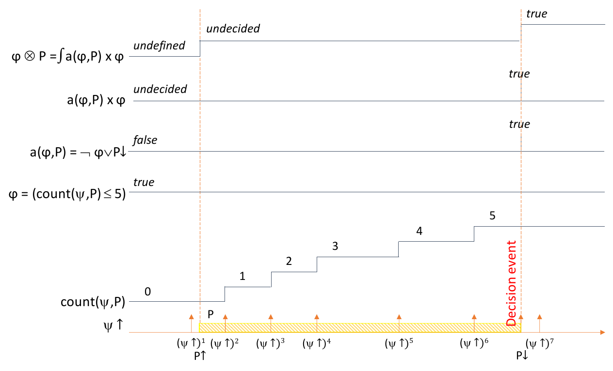

*Fig. 40. Example 1 with the decision event at the end of the time period*

The domain of requirements is denoted $\mathcal{R}$.

### 3.12.2 Composition of requirements with logical operators

The composition of a requirement $R = \varphi \otimes P$ with a unary logical operator $\mathit{op}$ is given by:

$$
\begin{aligned}
\mathit{op}\ &: \mathcal{R} \longrightarrow \mathbb{B} \\
R &\longmapsto \mathit{op}\ R
\end{aligned}
\tag{84}
$$

where $\mathit{op}$ denotes any logical unary operator ($\neg$ …).

The composition of two requirements $R_1 = \varphi_1 \otimes P_1$ and $R_2 = \varphi_2 \otimes P_2$ with a binary logical operator $\mathit{op}$ is given by:

$$
\begin{aligned}
\mathit{op}\ &: \mathcal{R} \times \mathcal{R} \longrightarrow \mathbb{B} \\
(R_1, R_2) &\longmapsto R_1\ \mathit{op}\ R_2
\end{aligned}
\tag{85}
$$

where $\mathit{op}$ denotes any binary logical operator ($\wedge$, $\vee$, $\oplus$, $\Longrightarrow$, …).

$R = R_1\ \mathit{op}\ R_2$ does not satisfy the definition of requirements given by Eq. (79), because two time periods being involved (one for $R_1$ and the other for $R_2$) that cannot be combined into one, it does not belong to $\mathbb{B} \times 2^{\mathcal{P}}$ (it belongs to $\mathbb{B}$). $R$ will be called a composed requirement, or somewhat imprecisely but more conveniently, a requirement when there is no ambiguity to do so.

The composition of multiple requirements follows the same rule:

$$
\begin{aligned}
\mathcal{R}^n &\longrightarrow \mathbb{B} \\
(R_1, R_2, \ldots, R_n) &\longmapsto R_1\ \mathit{op}_1\ R_2 \ldots \mathit{op}_{n-1}\ R_n
\end{aligned}
\tag{86}
$$

where $\mathit{op}_1 \ldots \mathit{op}_{n-1}$ denote any logical binary operators ($\wedge$, $\vee$, $\oplus$, $\Longrightarrow$, …).

Note that in general,

$$t \in [P{\uparrow}, P{\downarrow}[\ \not\Longrightarrow\ (\varphi_1\ \mathit{op}\ \varphi_2) \otimes P = \varphi_1 \otimes P\ \mathit{op}\ \varphi_2 \otimes P \tag{87}$$

although there are cases where $(\varphi_1\ \mathit{op}\ \varphi_2) \otimes P = \varphi_1 \otimes P\ \mathit{op}\ \varphi_2 \otimes P$ holds within $[P{\uparrow}, P{\downarrow}[$, depending on the logical operator $\mathit{op}$.

However,

$$t \notin [P{\uparrow}, P{\downarrow}[\ \Longrightarrow\ (\varphi_1\ \mathit{op}\ \varphi_2) \otimes P = \varphi_1 \otimes P\ \mathit{op}\ \varphi_2 \otimes P \tag{88}$$

Example 1: $\forall t,\ (\mathrm{count}(\psi,P)=N) \otimes P = \left((\mathrm{count}(\psi,P) \leq N) \wedge (\mathrm{count}(\psi,P) \geq N)\right) \otimes P$


*Fig. 41. Example 1 with N = 5*

Example 2: $(\mathrm{count}(\psi,P) \geq N) \otimes P \neq \left((\mathrm{count}(\psi,P) > N) \vee (\mathrm{count}(\psi,P) = N)\right) \otimes P$ within $P$

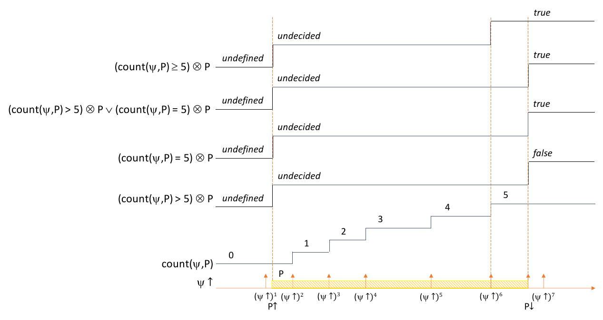

*Fig. 42. Example 2 with N = 5*

### 3.12.3 Satisfaction of requirements

A requirement $R = \varphi \otimes P$ is satisfied iff $\varphi \otimes P = \mathit{true}$ at the decision event $\mathrm{dev}(\varphi, P){\uparrow}$. The satisfaction of $R = \varphi \otimes P$ is denoted $P \models \varphi$ which means that condition $\varphi$ is satisfied over time period $P$:

$$
\begin{aligned}
\models\ &: 2^{\mathcal{P}} \times \mathbb{B} \longrightarrow \mathbb{B}_2 \\
(\mathbf{P}, \varphi) &\longmapsto \mathbf{P} \models \varphi := (\varphi \otimes \mathbf{P})(@\mathrm{dev}(\varphi, \mathbf{P}){\uparrow}) = \mathit{true}
\end{aligned}
\tag{89}
$$

Because $\varphi = R \otimes$ and $\mathbf{P} = {\otimes R}$, the satisfaction of $R$ can be denoted ${\otimes R} \models R \otimes$.

From Eq. (89), $\mathbf{P} \models \varphi$ is a 2-valued Boolean:

* If $R = \varphi \otimes \mathbf{P}$ is satisfied, then $(\varphi \otimes \mathbf{P})(@\mathrm{dev}(\varphi, \mathbf{P}){\uparrow}) = \mathit{true}$ and $\mathbf{P} \models \varphi = \mathit{true}$.
* If $R = \varphi \otimes \mathbf{P}$ is not satisfied, then $(\varphi \otimes \mathbf{P})(@\mathrm{dev}(\varphi, \mathbf{P}){\uparrow}) = \mathit{false}$ and $\mathbf{P} \models \varphi = \mathit{false}$.

Therefore

$$\mathbf{P} \models \varphi = (\varphi \otimes \mathbf{P})(@\mathrm{dev}(\varphi, \mathbf{P}){\uparrow})$$

The value of $(\varphi \otimes \mathbf{P})(t)$ is:

$$
(\varphi \otimes \mathbf{P})(t) =
\begin{cases}
\text{undefined} & \text{if } t < @P_1{\uparrow} \\
\text{undecided} & \text{if } @P_1{\uparrow} \leq t < @\mathrm{dev}(\varphi, \mathbf{P}){\uparrow} \\
\mathbf{P} \models \varphi & \text{if } t \geq @\mathrm{dev}(\varphi, \mathbf{P}){\uparrow}
\end{cases}
\tag{90}
$$

with $\mathbf{P} = \{P_1, P_2, \ldots, P_{|\mathbf{P}|}\}$.

### 3.12.4 Applying frame time periods to requirements

Applying the frame time period $M$ to requirement $R = \varphi \otimes \mathbf{P}$ consists in applying $M$ to $\mathbf{P}$. It is formally defined as:

$$
\begin{aligned}
\supset\ &: 2^{\mathcal{P}} \times \mathcal{R} \longrightarrow \mathcal{R} \\
(M, R) &\longrightarrow M \supset R := \varphi \otimes (M \supset \mathbf{P})
\end{aligned}
\tag{91}
$$

### 3.12.5 Simulating requirements

The continuous time domain $\mathfrak{C}$ spans from $-\infty$ to $+\infty$. However, the simulation time window spans from $t_0$ to $t_f$.

Therefore, the user must ensure that all events to be verified occur between $t_0$ and $t_f$, excluding $t_0$ and $t_f$ because the behavior of the simulator is uncertain at instant time $t \leq t_0$ and instant time $t \geq t_f$. This can be done by encapsulating all events in a single frame time period, that defines the beginning and the end of the experiment.

According to Eq. (90), before the beginning of the frame time period, all requirements are evaluated to undefined: testing has not started. After the end of the frame time period, all requirements are evaluated in general to true or false, and sometimes to undecided. If some requirements are still undefined, that means that not all events are within the frame time period and testing is incomplete. If some requirements are still undecided, it means that not all events are within the frame time period and testing is incomplete, or more rarely that decisions could not be made due to uncertainties on thresholds.

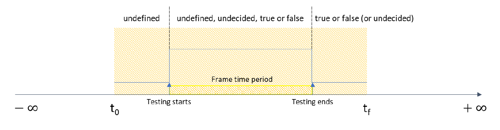

*Fig. 43. Frame time period to define the simulation period*

## 3.13 Stochastic requirements

The satisfaction $x$ of requirement $R = \varphi \otimes \mathbf{P}$ is defined as $x = \mathbf{P} \models \varphi$, cf. Eq. (89). $x$ is a 2-valued Boolean that takes the value true if $R$ is satisfied, or false otherwise.

A realistic requirement cannot be satisfied with absolute certainty. To that end, the satisfaction of a probabilistic requirement $R$ is defined as a condition to be satisfied on the probability $p$ that $x = \mathit{true}$, e.g. $p \geq 99.9\%$, or $p \geq f(t)$ where $f(t)$ is a function of time.

Then $x \in \mathbb{B}_2$ is replaced by a random variable $X$ that associates probabilistic events to the outcomes true or false:

$$X : \Omega \longrightarrow \mathbb{B}_2 \tag{92}$$

where $\Omega$ denotes the domain of probabilistic events. $\Omega$ is the randomized version of domain $2^{\mathcal{P}} \times \mathbb{B}$.

Examples of probabilistic events can be whether a tank level subject to random fluctuations exceeds a maximum level within a given time period, or whether a system goes out of its authorized operating domain according to measurements subject to random errors.

The probability that $X$ takes the value $x \in \mathbb{B}_2$ at time $t$ is denoted $\mathbb{P}(X=x \mid t)$. If time $t$ is the instant of occurrence of an event $b{\uparrow}$, i.e. if $t = @b{\uparrow}$, then the probability that $X$ takes the value $x \in \mathbb{B}_2$ when event $b{\uparrow}$ occurs is denoted $\mathbb{P}(X=x \mid b{\uparrow})$ (it can also be denoted $\mathbb{P}(X=x \mid @b{\uparrow})$). The Boolean $b$ that triggers the event $b{\uparrow}$ can itself be the outcome of a random variable $B$.

The probability that requirement $R = \varphi \otimes \mathbf{P}$ is satisfied is then $\mathbb{P}(X=\mathit{true} \mid \mathrm{dev}(\varphi, \mathbf{P}){\uparrow})$, the outcomes of $X$ being $x = \mathbf{P} \models \varphi$.

We are now interested in computing $p = \mathbb{P}(X=\mathit{true} \mid t)$. This equivalent to writing $p = \mathbb{E}([\![X=\mathit{true}]\!] \mid t)$ where $[\![\bullet]\!]$ is the indicator function:

$$
[\![x]\!] =
\begin{cases}
1 & \text{if } x = \mathit{true} \\
0 & \text{if } x = \mathit{false}
\end{cases}
$$

$X$ is a Bernoulli distributed random variable:

$$
\mathbb{P}(X=x \mid t) =
\begin{cases}
p & \text{if } [\![x]\!] = 1 \\
1-p & \text{if } [\![x]\!] = 0
\end{cases}
$$

or equivalently

$$\mathbb{P}(X=x \mid t) = p^{[\![x]\!]} \cdot (1-p)^{1-[\![x]\!]},\quad x \in \{\mathit{true}, \mathit{false}\}$$

An estimate $\hat{p}$ of $p$ is given by an estimate $\hat{\mu}_X$ of $\mu_X = \mathbb{E}([\![X=\mathit{true}]\!] \mid t)$. An estimate of the error on $\hat{\mu}_X$ is given by an estimate $\hat{\sigma}_X^2$ of $\sigma_X^2 = \mathbb{V}\mathrm{ar}[[\![X=\mathit{true}]\!] \mid t] = \mathbb{E}\left[\left([\![X=\mathit{true}]\!] \mid t\right)^2\right] - \mathbb{E}\left[[\![X=\mathit{true}]\!] \mid t\right]^2$.

For a normally distributed variable $X \sim \mathcal{N}(\mu_X, \sigma_X^2)$, there is 95% probability that the true value $p = \mu_X$ lies in the uncertainty range $[\hat{\mu}_X - \lambda_{95\%} \cdot \sigma_X,\ \hat{\mu}_X + \lambda_{95\%} \cdot \sigma_X]$, with $\lambda_{95\%} = 1.96$ (but we only have an estimate $\hat{\sigma}_X$ of $\sigma_X$, which implies some uncertainty on the uncertainty range which is not computed).

The estimator $\hat{\mu}_X$ is given by

$$\hat{\mu}_X = \frac{1}{n} \cdot \sum_{i=1}^{n} y_i \tag{93}$$

where $y_i = [\![x_i]\!]$, $x_i$ being the outcome of $X$ in the $i$th Monte Carlo simulation of $R$, and where $n$ is the number of simulations.

The estimator $\hat{\sigma}_X^2$ is given by:

$$\hat{\sigma}_X^2 = \frac{1}{n-1} \cdot \sum_{i=1}^{n} (y_i - \hat{\mu}_X)^2 \tag{94}$$

Because Monte Carlo simulations generate random deviates from the same distribution, $\mathbb{E}[y_i] = \mu_X$ and $\mathbb{V}\mathrm{ar}[y_i] = \sigma_X^2$ for all $y_i$.

Then, Eq. (93) is an unbiased estimator because

$$\mathbb{E}[\hat{\mu}_X] = \frac{1}{n} \cdot \sum_{i=1}^{n} \mathbb{E}[y_i] = \frac{1}{n} \cdot \sum_{i=1}^{n} \mu_X = \mu_X$$

Because the generated deviates are independent, $\mathbb{C}\mathrm{ov}[y_i, y_j] = \mathbb{E}[y_i \cdot y_j] - \mathbb{E}[y_i] \cdot \mathbb{E}[y_j] = 0$ for $i \neq j$, which implies that $\mathbb{E}[y_i \cdot y_j] = \mu_X^2$ for all $y_i$ and $y_j$ such that $i \neq j$.

Then, Eq. (94) is an unbiased estimator because

$$
\begin{aligned}
\mathbb{E}[\hat{\sigma}_X^2] &= \frac{1}{n-1} \cdot \mathbb{E}\left[\sum_{i=1}^{n} \left(y_i - \frac{1}{n} \cdot \sum_{i=1}^{n} y_i\right)^2\right] \\
&= \frac{1}{n-1} \cdot \mathbb{E}\left[\sum_{i=1}^{n} \left(y_i^2 - \frac{2}{n} \cdot y_i \cdot \sum_{j=1}^{n} y_j + \frac{1}{n^2} \cdot \left(\sum_{i=1}^{n} y_i\right)^2\right)\right] \\
&= \frac{1}{n-1} \cdot \mathbb{E}\left[\sum_{i=1}^{n} y_i^2 - \frac{2}{n} \cdot \sum_{j=1}^{n} y_j \cdot \sum_{i=1}^{n} y_i + n \cdot \frac{1}{n^2} \cdot \left(\sum_{i=1}^{n} y_i\right)^2\right] \\
&= \frac{1}{n-1} \cdot \mathbb{E}\left[\sum_{i=1}^{n} y_i^2 - \frac{2}{n} \cdot \sum_{j=1}^{n} y_j \cdot \sum_{k=1}^{n} y_k + \frac{1}{n} \cdot \sum_{j=1}^{n} y_j \cdot \sum_{k=1}^{n} y_k\right] \\
&= \frac{1}{n-1} \cdot \mathbb{E}\left[\sum_{i=1}^{n} y_i^2 - \frac{1}{n} \cdot \sum_{j=1}^{n} y_j \cdot \sum_{k=1}^{n} y_k\right] \\
&= \frac{1}{n-1} \cdot \mathbb{E}\left[\left(1 - \frac{1}{n}\right) \cdot \sum_{i=1}^{n} y_i^2 - \frac{1}{n} \cdot \sum_{j \neq k} y_j \cdot y_k\right] \\
&= \frac{1}{n-1} \cdot \left(\left(1 - \frac{1}{n}\right) \cdot \sum_{i=1}^{n} \mathbb{E}[y_i^2] - \frac{1}{n} \cdot \sum_{j \neq k} \mathbb{E}[y_j \cdot y_k]\right) \\
&= \frac{1}{n-1} \cdot \left(\left(1 - \frac{1}{n}\right) \cdot n \cdot (\sigma_X^2 + \mu_X^2) - \frac{1}{n} \cdot (n^2 - n) \cdot \mu_X^2\right) \\
&= \sigma_X^2
\end{aligned}
$$

$\hat{\mu}_X$ and $\hat{\sigma}_X^2$ are not defined for $n \leq 1$.

We are now interested in assessing the number of $n$ of simulations to compute the estimator $\hat{\mu}_X$. According to the central limit theorem applied to Eq. (93),

$$\lim_{n \to \infty} \hat{\mu}_X = \lim_{n \to \infty} \frac{1}{n} \cdot \sum_{i=1}^{n} y_i \sim \mathcal{N}\left(\mu_X, \frac{\sigma_X}{\sqrt{n}}\right)$$

where $\sigma_X^2 = \mu_X \cdot (1 - \mu_X)$ is the variance of the Bernoulli distribution.

Because $\hat{\mu}_X \sim \mathcal{N}\left(\mu_X, \frac{\sigma_X}{\sqrt{n}}\right)$ for $n$ sufficiently large,

$$\mathbb{P}\left(|\hat{\mu}_X - \mu_X| < \lambda_{95\%} \cdot \frac{\sigma_X}{\sqrt{n}}\right) = 95\%$$

Then

$$\mathbb{P}\left(|\hat{\mu}_X - \mu_X| < \lambda_{95\%} \cdot \sqrt{\frac{\mu_X \cdot (1 - \mu_X)}{n}}\right) = 95\%$$

which yields the 95% probability confidence range for $\hat{\mu}_X$ for $n$ sufficiently large.

We are now interested in assessing a condition for the value of $n$. When dealing with the satisfaction of requirements, the expected probability $\mu_X$ is close to 1, or equivalently, $1 - \mu_X$ is small (close to zero). The precision of the computation of the confidence range should increase when $1 - \mu_X$ decreases. For small values of $1 - \mu_X$, the maximum relative precision error $\varepsilon$ of the estimator $\hat{\mu}_X$ is defined such that $|\hat{\mu}_X - \mu_X| / (1 - \mu_X) < \varepsilon$.

Then, the condition giving the confidence range for the estimator is satisfied with precision $\varepsilon$ if

$$\lambda_{95\%} \cdot \frac{1}{1 - \mu_X} \cdot \sqrt{\frac{\mu_X \cdot (1 - \mu_X)}{n}} < \varepsilon$$

Consequently, $n$ is given by the condition

$$n > \frac{\lambda_{95\%}^2}{\varepsilon^2} \cdot \frac{\mu_X}{1 - \mu_X}$$

For instance, computing an estimator for an almost sure event of expected probability $\mu_X \sim 1 - 10^{-3}$ requires $n \sim 3.84 \cdot 10^5$ simulations to be in the 95% confidence range with relative precision error $\varepsilon = 10\%$.

## 3.14 Domains

### 3.14.1 Definition

A domain is a finite or infinite set of elements of the same kind.

List of domains:

* $\mathfrak{T}$: type definitions
* $\mathfrak{C}$: continuous clock
* $\mathbb{N}$: natural numbers (positive integers including zero)
* $\mathbb{Z}$: positive or negative integers
* $\mathbb{R}$: real numbers
* $\mathbb{C}$: complex numbers
* $\mathbb{B}_2$: 2-valued Booleans { true, false }
* $\mathbb{B}_3$: 3-valued Booleans { true, false, undecided }
* $\mathbb{B}'_3$: 3-valued Booleans { true, false, undefined }
* $\mathbb{B}$, $\mathbb{B}_4$: 4-valued Booleans { true, false, undecided, undefined }
* $\mathbb{S}$: character strings
* $\mathcal{E}$: events
* $2^{\mathcal{E}}$, $\mathcal{D}$: discrete clocks
* $\mathcal{P}$: single time periods
* $2^{\mathcal{P}}$: multiple time periods
* $\mathcal{R}$: requirements. $\mathcal{R} = \mathbb{B} \times 2^{\mathcal{P}} \longrightarrow \mathbb{B}$
* $\mathbb{O}(\mathbb{D}_1 \longrightarrow \mathbb{D}_2)$: operators from $\mathbb{D}_1$ to $\mathbb{D}_2$
* $\mathcal{C}(\mathbb{D}_1 \longrightarrow \mathbb{D}_2)$: categories from $\mathbb{D}_1$ to $\mathbb{D}_2$
* $\mathcal{S}$: sets
* $\mathcal{C}$: class definitions
* $\mathcal{C}_C$: class $C$
* $2^{\mathcal{C}_C}$: sets of objects of class $C$
* $\mathcal{M}$: models
* $\mathcal{L}$: librairies
* $\mathcal{T}$: packages

Any domain is denoted $\mathbb{D}$.

To emphasize that $x \in \mathbb{D}$, $x$ can be denoted $\mathbb{D}: x$.

The domain of $x$ is denoted $\mathrm{domain}(x)$. Thus $\mathrm{domain}(\mathbb{D}: x) = \mathbb{D}$.

### 3.14.2 Domain extensions

Existing domains can be extended to create new domains. For instance, $\mathbb{R}$ can be extended to define the domain of physical quantities.

A domain $\mathbb{D}'$ that extends domain $\mathbb{D}$ is denoted $\mathbb{D}' \subset \mathbb{D}$ because if $x$ is an element of $\mathbb{D}'$, then it is an element of $\mathbb{D}$.

$$x \in \mathbb{D}' \ \text{ and } \ \mathbb{D}' \subset \mathbb{D} \Longrightarrow x \in \mathbb{D} \tag{95}$$

A domain $\mathbb{D}''$ that extends a domain $\mathbb{D}' \subset \mathbb{D}$ also extends $\mathbb{D}$:

$$\mathbb{D}'' \subset \mathbb{D}' \ \text{ and } \ \mathbb{D}' \subset \mathbb{D} \Longrightarrow \mathbb{D}'' \subset \mathbb{D} \tag{96}$$

If $\mathbb{D}'$ extends $\mathbb{D}$, then all operators on $\mathbb{D}$ can be applied on $\mathbb{D}'$, unless specified otherwise (e.g., it is not possible to add or multiply temperatures which are quantities that extend real numbers).

An operator $\mathit{op}$ defined on $\mathbb{D}$ and forbidden on $\mathbb{D}'$ is denoted $\mathit{op} \notin \mathbb{O}(\mathbb{D}' \longrightarrow *)$.

Then:

$$\mathit{op} \in \mathbb{O}(\mathbb{D} \longrightarrow *) \ \text{ and } \ \mathbb{D}' \subset \mathbb{D} \Longrightarrow \mathit{op} \in \mathbb{O}(\mathbb{D}' \longrightarrow *) \tag{97}$$

unless it is specified that $\mathit{op} \notin \mathbb{O}(\mathbb{D}' \longrightarrow *)$.

The definition $\hat{\mathbb{D}}'$ of the extension $\mathbb{D}'$ of a domain $\mathbb{D}$ is given as follows:

$$\hat{\mathbb{D}}' = \mathbb{D}: z(a_1, \ldots a_i, \ldots a_n) + \{\mathbb{D}_1: a_1, \ldots \mathbb{D}_i: a_i, \ldots \mathbb{D}_n: a_n\} \tag{98}$$

where the $a_i$ denote the attributes of $\hat{\mathbb{D}}'$. $z$ is a variable of domain $\mathbb{D}$ that represents the definition of the variables of domain $\mathbb{D}'$ as a function of the attributes $a_i$. If no such function is necessary for the definition (i.e., if $z$ has the same definition in $\mathbb{D}$ and $\mathbb{D}'$), then it can be omitted. Therefore $\hat{\mathbb{D}}' = \mathbb{D}: z \iff \hat{\mathbb{D}}' = \mathbb{D}$. In the following, when there is no confusion between $\hat{\mathbb{D}}'$, the definition of the domain, and $\mathbb{D}'$, the domain itself, the hat above the name of the domain will be omitted.

Example 1: defining the domain $\mathbb{Z}/n\mathbb{Z}$ of residual integers $r$ modulo $n$.

$$\mathbb{Z}_n = \mathbb{Z}: r = p \bmod n + \{\mathbb{Z}: p,\ \mathbb{Z}: n\}$$

In this example, $r$ is a dummy variable that represents any element of $\mathbb{Z}_n$. $r$ is an integer that is computed from $p$ and $n$: $r$ is equal to $p$ modulo $n$.

For instance, for $n=7$ and $p=22$, $r=1$.

$\mathbb{D}''$ can in tun extend $\mathbb{D}'$:

$$\mathbb{D}'' = \mathbb{D}': z(a_1, \ldots a_i, \ldots a_n, a'_1, \ldots a'_i, \ldots a'_{n'}) + \{\mathbb{D}_1: a'_1, \ldots \mathbb{D}_i: a'_i, \ldots \mathbb{D}_{n'}: a'_{n'}\} \tag{99}$$

where the $a'_i$ denote the additional attributes of $\mathbb{D}''$. $z$ represents the variable of $\mathbb{D}'$ that is a function of the attributes $a_i$ and $a'_i$.

However, a domain $\mathbb{D}$ cannot extend two different domains $\mathbb{D}_1$ and $\mathbb{D}_2$:

$$\mathbb{D} \subset \mathbb{D}_1 \ \text{ and } \ \mathbb{D} \subset \mathbb{D}_2 \Longrightarrow \mathbb{D}_1 = \mathbb{D}_2 \tag{100}$$

A variable $x \in \mathbb{D}'$ is obtained by assigning values to the attributes $a_i$, hence yielding a value for $z$:

$$\mathbb{D}': x = z(a_i = v_i,\ i \in [1, n]) \tag{101}$$

Example 2: finding the residual of 22 modulo 7

$$\mathbb{Z}_n: r(p=22, n=7)$$

### 3.14.3 Domain specializations

A domain $\mathcal{D}$ can specialize another domain $\mathbb{D}'$ that extends a domain $\mathbb{D}$ by assigning fixed values to some attributes of $\mathbb{D}'$:

$$\mathcal{D} = \mathbb{D}'(a_i = v_i,\ i \in F \subset [1, n]) \tag{102}$$

where $F$ denotes the indices of the fixed attributes.

Example 1: defining the domain of integer residuals modulo 7

$$\mathbb{Z}_7 = \mathbb{Z}_n(n=7)$$

$\mathcal{D}$ specializes $\mathbb{D}'$ is denoted $\mathcal{D} \prec \mathbb{D}'$. Then a variable $x \in \mathcal{D}$ is obtained by assigning values to the remaining non-fixed attributes $a_i \in \bar{F} = [1, n] - F$:

$$\mathcal{D}: x(a_i = v_i,\ i \in \bar{F} = [1, n] - F) \tag{103}$$

Example 2: finding the residual of 22 modulo 7

$$\mathbb{Z}_7: r(p=22)$$

A domain $\mathcal{D}'$ can in turn specialize $\mathcal{D}$ by assigning fixed values to some non-fixed attributes of $\mathcal{D}$.

$$\mathcal{D}' = \mathcal{D}(a_i = v_i,\ i \in F' \subset \bar{F}) \tag{104}$$

where $F'$ denotes the indices of the fixed attributes.

Then a variable $x \in \mathcal{D}'$ is obtained by assigning values to the remaining non-fixed attributes $a_i \in \bar{F'} = \bar{F} - F'$:

$$\mathcal{D}': x(a_i = v_i,\ i \in \bar{F'} = \bar{F} - F') \tag{105}$$

If there is only one free attribute left, i.e. if $|\bar{F'}| = 1$, then it is also possible to write without ambiguity

$$\mathcal{D}': x = v \tag{106}$$

to assign a value to $x$.

Example 3: finding the residual of 22 modulo 7 can be written

$$\mathbb{Z}_7: r = 22$$

because $p$ is the only attribute in $\mathbb{Z}_7$.

If there are no free attribute left, i.e. if $|\bar{F'}| = 0$, then $\mathcal{D}'$ contains a single element.

Example 4: $\mathbb{Z}_{7:21} = \mathbb{Z}_7(p=21)$ has no attribute. It is the domain that contains the single integer $\{1\}$.

A domain $\mathcal{D}''$ that specializes domain $\mathcal{D}' \prec \mathbb{D}'$ extends $\mathbb{D}'$:

$$\mathcal{D}'' \prec \mathcal{D}' \ \text{ and } \ \mathcal{D}' \prec \mathbb{D}' \Longrightarrow \mathcal{D}'' \subset \mathbb{D}' \tag{107}$$

If a domain $\mathcal{D}(s)$ with an alias $s$ specializes a domain $\mathbb{D}'$, then any variable $x \in \mathcal{D}(s)$ can be denoted $\mathbb{D}': x\ s$. The alias $s$ must be unique for domain $\mathbb{D}'$ which means that two domains $\mathcal{D}_1(s_1)$ and $\mathcal{D}_2(s_2)$ that extend the same domain $\mathbb{D}'$ must have different aliases $s_1$ and $s_2$.

$$\mathcal{D}_1(s_1) \subset \mathbb{D}' \ \text{ and } \ \mathcal{D}_2(s_2) \subset \mathbb{D}' \Longrightarrow s_1 \neq s_2 \tag{108}$$

This feature is used to express physical units outside of the domain name.

### 3.14.4 Partial domains

A partial domain $\mathbb{D}$ is a domain that cannot have any elements because it is incompletely defined. It is then expected that its definition will be completed by extending or specializing $\mathbb{D}$. A partial domain $\mathbb{D}$ is denoted $\mathrm{partial}\ \mathbb{D}$. Then:

$$\mathrm{partial}\ \mathbb{D} \Longrightarrow \mathbb{D} = \emptyset \tag{109}$$

### 3.14.5 Domain aliases

An alias $s \in \mathbb{S}$ can be associated to a domain $\mathbb{D}$. This is denoted $\mathbb{D}(s)$. Then $x \in \mathbb{D}(s)$ can be denoted $x\ s$. In other words, $x\ s$ has the same meaning as $\mathbb{D}(s): x$.

If a domain $\mathbb{D}'(s)$ with an alias $s$ extends or specializes a domain $\mathbb{D}$, then any variable $x \in \mathbb{D}'(s)$ can be denoted $\mathbb{D}: x\ s$. The alias $s$ must be unique for any domain extension or specialization $\mathbb{D}'$ of domain $\mathbb{D}$ which means that two domains $\mathbb{D}'_1(s_1)$ and $\mathbb{D}'_2(s_2)$ that extend or specialize the same domain $\mathbb{D}$ must have different aliases $s_1$ and $s_2$.

$$\left(\mathbb{D}'_1(s_1) \subset \mathbb{D} \text{ or } \mathbb{D}'_1(s_1) \prec \mathbb{D}\right) \text{ and } \left(\mathbb{D}'_2(s_2) \subset \mathbb{D} \text{ or } \mathbb{D}'_2(s_2) \prec \mathbb{D}\right) \Longrightarrow s_1 \neq s_2 \tag{110}$$

This feature is used to express physical units outside of the domain name.

Example 1: defining the domain $\mathcal{Q}$ of physical quantities in SI units by extending $\mathbb{R}$.

$$\mathrm{partial}\ \mathcal{Q} = (\mathbb{R}: q = r \times u + o) + \{\mathbb{S}: \mathit{SIUnit},\ \mathbb{S}: \mathit{userUnit},\ \mathbb{R}: u,\ \mathbb{R}: r,\ \mathbb{R}: o\} \tag{111}$$

where $\mathit{SIUnit}$ is the SI unit for quantity $q$, $\mathit{userUnit}$ is the user unit for quantity $q$, $q$ is the quantity expressed in SI units, $u$ is the quantity expressed in user units, $r$ is the rate and $o$ is the offset to convert the user unit into the SI unit. Partial indicates that this domain must be extended or specialized.

Example 2: defining physical units by specializing the domain of physical quantities $\mathcal{Q}$.

The domain of pressures is obtained by specializing domain $\mathcal{Q}$:

$$\mathrm{partial}\ \mathrm{Pressure} = \mathcal{Q}(\mathit{SIUnit} = \text{"Pa"}) \tag{112}$$

The domain of pressures with user units in bars is obtained by specializing domain Pressure:

$$\mathrm{PressureBar}(\mathrm{bar}) = \mathrm{Pressure}(\mathit{userUnit} = \text{"bar"},\ r = 10^5,\ o = 0) \tag{113}$$

Then a pressure of 3 bars can be expressed as $\mathrm{PressureBar}: P(u=3)$, $\mathrm{PressureBar}: P = 3$ or, more conveniently, as $\mathrm{Pressure}: P = 3\ \mathrm{bar}$ (or even $\mathbb{R}: P = 3\ \mathrm{bar}$). Note that the word bar is written without quotes because it cannot be confounded with the name of a variable.

The domain of pressures with user units in Pa is obtained by another specialization of domain Pressure:

$$\mathrm{PressurePa}(\mathrm{Pa}) = \mathrm{Pressure}(\mathit{userUnit} = \text{"Pa"},\ r = 1,\ o = 0) \tag{114}$$

It then possible to write $\mathrm{Pressure}: P = 3\ \mathrm{bar} + 10000\ \mathrm{Pa}$. The conversion of 3 bar to SI units is made automatically using $3\ \mathrm{bar} = r \times u + o = 10^5 \times 3 + 0 = 3 \cdot 10^5\ \mathrm{Pa}$. Then the value of $P$ is $P = 3 \cdot 10^5 + 10000 = 3.1 \cdot 10^5\ \mathrm{Pa}$.

If one omits the unit when writing $\mathrm{Pressure}: P = 3$, then an error will be raised at variable definition time because Pressure is a partial domain that cannot have any elements.

If one writes a wrong unit such as $\mathrm{Pressure}: P = 3\ \mathrm{s}$, or an unknown unit such as $\mathrm{Pressure}: P = 3\ \mathrm{sz}$, then an error will be raised because neither s nor sz are aliases for Pressure.

The domain of absolute temperatures is obtained by specializing domain $\mathcal{Q}$:

$$\mathrm{partial}\ \mathrm{AbsoluteTemperature} = \mathcal{Q}(\mathit{SIUnit} = \text{"K"}) \tag{115}$$

To express the fact that absolute temperatures cannot be added, one can state that the $+$ operator cannot be using on the AsoluteTemperature domain: $+ \notin \mathbb{O}(\mathrm{AsoluteTemperature} \longrightarrow *)$. Then a special domain should be created to express temperature differences that can be added to absolute temperatures to produce another absolute temperature.

The domain of temperatures with user units in Celsius is obtained by specializing domain Temperature:

$$\mathrm{TemperatureCelsius}(\mathrm{Celsius}) = \mathrm{AbsoluteTemperature}(\mathit{userUnit} = \text{"Celsius"},\ r = 1,\ o = 273.15) \tag{116}$$

Then a temperature of 20 Celsius can be expressed as $\mathrm{TemperatureCelsius}: t(u=20)$, $\mathrm{TemperatureCelsius}: t = 20$, $\mathrm{AbsoluteTemperature}: t = 20\ \mathrm{Celsius}$, $\mathbb{R}: t = 20\ \mathrm{Celsius}$.

The domain of time is obtained by specializing domain $\mathcal{Q}$:

$$\mathrm{partial}\ \mathrm{Time} = \mathcal{Q}(\mathit{SIUnit} = \text{"s"}) \tag{117}$$

The domain of time with user units in seconds is obtained by specializing domain Time:

$$\mathrm{TimeSecond}(\mathrm{s}) = \mathcal{Q}(\mathit{userUnit} = \text{"s"},\ r = 1,\ o = 0) \tag{118}$$

Then a duration of 2 seconds can be expressed as $\mathrm{TimeSecond}: d(u=2)$, $\mathrm{TimeSecond}: d = 2$, $\mathrm{Time}: d = 2\ \mathrm{s}$, $\mathbb{R}: d = 2\ \mathrm{s}$.

The domain of time with user units in hours is obtained by specializing domain Time:

$$\mathrm{TimeHour}(\mathrm{h}) = \mathrm{Time}(\mathit{userUnit} = \text{"h"},\ r = 3600,\ o = 0) \tag{119}$$

Then a duration of 2 hours can be expressed as $\mathrm{TimeHour}: d(u=2)$, $\mathrm{TimeHour}: d = 2$, $\mathrm{Time}: d = 2\ \mathrm{h}$, $\mathbb{R}: d = 2 \times 3600\ \mathrm{s}$, etc.

## 3.15 Types

A type $\mathbb{T}$ is defined as a domain $\mathbb{D}$, a domain extension $\mathbb{D}' \subset \mathbb{D}$, or a domain specialization $\mathcal{D} \prec \mathbb{D}'$.

As domain extensions and domain specializations can be considered as domains, the notion of type is equivalent to the notion of domain. Therefore, the words ‘type’ and ‘domain’ are synonymous.

If $x \in \mathbb{D}$ then $x$ is of type $\mathbb{D}$. This can be denoted $\mathbb{D}: x$.

If $x$ is of type $\mathbb{D}'$ and type $\mathbb{D}'$ extends type $\mathbb{D}$, then $x$ is also of type $\mathbb{D}$:

$$x \in \mathbb{D}' \ \text{ and } \ \mathbb{D}' \subset \mathbb{D} \Longrightarrow x \in \mathbb{D} \tag{120}$$

If $x$ is of type $\mathcal{D}$ and type $\mathcal{D}$ specializes $\mathbb{D}'$, then $x$ is also of type $\mathbb{D}'$:

$$x \in \mathcal{D} \ \text{ and } \ \mathcal{D} \prec \mathbb{D}' \Longrightarrow x \in \mathbb{D}' \tag{121}$$

The domain of types (the domains of domains) is denoted $\mathfrak{T}$.

## 3.16 Variables

A variable is an element that belongs to the following domains, or extension of the following domains:

* $\mathfrak{C}$: continuous clock
* $\mathbb{N}$: natural numbers (positive integers)
* $\mathbb{Z}$: positive or negative integers
* $\mathbb{R}$: real numbers
* $\mathbb{C}$: complex numbers
* $\mathbb{B}_2$: 2-valued Booleans { true, false }
* $\mathbb{B}_3$: 3-valued Booleans { true, false, undecided }
* $\mathbb{B}'_3$: 3-valued Booleans { true, false, undefined }
* $\mathbb{B}$, $\mathbb{B}_4$: 4-valued Booleans { true, false, undecided, undefined }
* $\mathbb{S}$: character strings
* $\mathcal{E}$: events
* $2^{\mathcal{E}}$, $\mathcal{D}$: discrete clocks
* $\mathcal{P}$: single time periods
* $2^{\mathcal{P}}$: multiple time periods
* $\mathcal{R}$: requirements. $\mathcal{R} = \mathbb{O}(\mathbb{B} \times 2^{\mathcal{P}} \longrightarrow \mathbb{B})$

Any domain of variables is denoted $\mathbb{V}$.

Any variable $x \in \mathbb{V}$ is a function of time $t \in \mathfrak{C}$: $\mathbb{V}: x = x(\mathfrak{C}: t)$.

A variable that keeps the same value at all time instants $t$ is called a fixed variable or a constant variable: $x = \mathit{constant}$.

When time is implicit in an equation, it is always implied that the values of all variables $x$ are taken at the same instant in time $t \in \mathfrak{C}$.

Example 1:

$$x_1 \vee x_2 := \neg(\neg x_1 \wedge \neg x_2)$$

means

$$x_1(t) \vee x_2(t) := \neg(\neg x_1(t) \wedge \neg x_2(t)),\quad t \in \mathfrak{C}$$

If the values of some variables are taken at different instants in time in an equation, then time is explicit in the equation, but not necessarily in the time definition domain of the equation. It is then implied that time belongs to the continuous clock $\mathfrak{C}$.

Example 2:

$$x(t_2) - x(t_1) := t_2 - t_1$$

means

$$x(t_2) - x(t_1) := t_2 - t_1,\quad t_1 \in \mathfrak{C},\ t_2 \in \mathfrak{C}$$

The fact that time $t$ belongs to a discrete clock $\Omega$ is denoted by $t \in \Omega$. This means that the projection operator $/\Omega$ defined in Eq. (43) must be applied to all time instants.

Example 3:

$$x_1 \vee x_2 := \neg(\neg x_1 \wedge \neg x_2),\quad t \in \Omega$$

means

$$x_1(@\,t/\Omega) \vee x_2(@\,t/\Omega) := \neg(\neg x_1(@\,t/\Omega) \wedge \neg x_2(@\,t/\Omega)),\quad t \in \mathfrak{C}$$

Example 4:

$$x(t_2) - x(t_1) := t_2 - t_1,\quad t_1 \in \Omega,\ t_2 \in \Omega$$

means

$$x(@\,t_2/\Omega) - x(@\,t_2/\Omega) := @\,t_2/\Omega - @\,t_1/\Omega,\quad t_1 \in \mathfrak{C},\ t_2 \in \mathfrak{C}$$

## 3.17 Operators

An operator $f$ is a function between a source domain $\mathbb{D}_1 \times \ldots \times \mathbb{D}_n$ that can be composed of several domains if $n \geq 2$ and a target domain $\mathbb{D}$:

$$
\begin{aligned}
f\ &: \mathbb{D}_1 \times \ldots \times \mathbb{D}_n \longrightarrow \mathbb{D} \\
(x_1, \ldots, x_n) &\longmapsto y := f(x_1, \ldots, x_n)
\end{aligned}
\tag{122}
$$

A unary operator $\mathit{op}$ is a function from $\mathbb{D}_1$ to $\mathbb{D}$ (the source and the target can be different domains):

$$
\begin{aligned}
\mathit{op}\ &: \mathbb{D}_1 \longrightarrow \mathbb{D} \\
x &\longmapsto y := \mathit{op}\ x
\end{aligned}
\tag{123}
$$

A binary operator $\mathit{op}$ on domain $\mathbb{D}$ is a function from $\mathbb{D} \times \mathbb{D}$ to $\mathbb{D}$ (the sources and the target are the same domain):

$$
\begin{aligned}
\mathit{op}\ &: \mathbb{D} \times \mathbb{D} \longrightarrow \mathbb{D} \\
(x_1, x_2) &\longmapsto y := x_1\ \mathit{op}\ x_2
\end{aligned}
\tag{124}
$$

The domain of operators from $\mathbb{D}_1$ to $\mathbb{D}_2$ is denoted $\mathbb{O}(\mathbb{D}_1 \longrightarrow \mathbb{D}_2)$.

The domain of operators from $\mathbb{D}_1$ to any domain is denoted $\mathbb{O}(\mathbb{D}_1 \longrightarrow *)$.

The domain of operators from any domain to $\mathbb{D}_2$ is denoted $\mathbb{O}(* \longrightarrow \mathbb{D}_2)$.

The domain of operators from any domain to any domain is denoted $\mathbb{O}(* \longrightarrow *)$.

## 3.18 Templates

Templates are operators taking Booleans as arguments and Booleans as values:

$$\mathrm{template} : \mathbb{B}^n \longrightarrow \mathbb{B} \tag{125}$$

Example 1: mission change. If requirement $R_1$ fails, then switch to $R_2$: requirement $R_2$ should be satisfied at most one hour after $R_1$ fails.

$$
\begin{aligned}
\mathrm{switch}\ &: \mathbb{B}^2 \longrightarrow \mathbb{B} \\
\mathrm{switch}(R_1, R_2) &:= R_2 \otimes [R_1{\downarrow},\ R_1{\downarrow} + 1\mathrm{h}]
\end{aligned}
\tag{126}
$$

$$
\begin{aligned}
\mathrm{missionChange}\ &: \mathbb{B}^2 \longrightarrow \mathbb{B} \\
\mathrm{missionChange}(R_1, R_2) &:= \neg R_1 \Longrightarrow \mathrm{switch}(R_1, R_2)
\end{aligned}
\tag{127}
$$

Example 2: if mission change fails, then switch to requirement $R_3$: requirement $R_3$ should be satisfied at most one hour after the switching to $R_2$ fails

$$\neg\mathrm{missionChange}(R_1, R_2) \Longrightarrow \mathrm{missionChange}(\neg\mathrm{switch}(R_1, R_2), R_3) \tag{128}$$

Example 3: elicitation rule. if assumption $A$ is verified then $R_1$ should be satisfied, else $R_2$ should be satisfied.

$$
\begin{aligned}
\mathrm{rule}\ &: \mathcal{R} \times \mathcal{R} \times \mathcal{R} \longrightarrow \mathcal{R} \\
\mathrm{rule}(A, R_1, R_2) &:= (A \Longrightarrow R_1) \wedge (\neg A \Longrightarrow R_2)
\end{aligned}
\tag{129}
$$

Example 4: definition of the disjunction of requirements from the conjunction and negation of requirements.

$$
\begin{aligned}
\vee\ &: \mathcal{R} \times \mathcal{R} \longrightarrow \mathbb{B} \\
R_1 \vee R_2 &:= \neg(\neg R_1 \wedge \neg R_2)
\end{aligned}
\tag{130}
$$

## 3.19 Categories

Categories are operators on operators. They are introduced to handle the computation of the filter $a'(\varphi, P)$ in Eq. (80). They are formally defined as follows:

$$
\begin{aligned}
c\ &: \mathbb{O}(\mathbb{D}_1 \longrightarrow \mathbb{D}_2) \longrightarrow \mathbb{O}(\mathbb{D}_1 \longrightarrow \mathbb{D}_2) \\
f &\longmapsto g = c(f)
\end{aligned}
\tag{131}
$$

where $f$ and $g$ are operators

$$
\begin{aligned}
f\ &: \mathbb{D}_1 \longrightarrow \mathbb{D}_2 \\
g\ &: \mathbb{D}_1 \longrightarrow \mathbb{D}_2
\end{aligned}
$$

The domain of categories $c$ from $\mathbb{D}_1$ to $\mathbb{D}_2$ is denoted $\mathcal{C}(\mathbb{D}_1 \longrightarrow \mathbb{D}_2)$. $\mathcal{C}(\mathbb{D}_1 \longrightarrow \mathbb{D}_2)$ can be formally defined as $\mathcal{C}(\mathbb{D}_1 \longrightarrow \mathbb{D}_2) := \mathbb{O}(\mathbb{O}(\mathbb{D}_1 \longrightarrow \mathbb{D}_2) \longrightarrow \mathbb{O}(\mathbb{D}_1 \longrightarrow \mathbb{D}_2))$

Let us consider two operators $f$ and $g$:

$$
\begin{aligned}
f\ &: \mathbb{D}_1 \longrightarrow \mathbb{D}_2 \\
g\ &: \mathbb{D}_2 \longrightarrow \mathbb{D}_3
\end{aligned}
\tag{132}
$$

and the category

$$
\begin{aligned}
c\ &: \mathbb{O}(\mathbb{D}_1 \longrightarrow \mathbb{D}_2) \longrightarrow \mathbb{O}(\mathbb{D}_1 \longrightarrow \mathbb{D}_2) \\
f &\longmapsto c(f)
\end{aligned}
\tag{133}
$$

Let us consider the operator

$$
\begin{aligned}
h\ &: \mathbb{D}_1 \longrightarrow \mathbb{D}_3 \\
h &= g \circ c(f)
\end{aligned}
\tag{134}
$$

and the category

$$
\begin{aligned}
c'\ &: \mathbb{O}(\mathbb{D}_1 \longrightarrow \mathbb{D}_3) \longrightarrow \mathbb{O}(\mathbb{D}_1 \longrightarrow \mathbb{D}_3) \\
h &\longmapsto c'(h) =
\begin{cases}
h & \text{if } c \in \mathcal{C}(h) \\
g \circ f & \text{if } c \notin \mathcal{C}(h)
\end{cases}
\end{aligned}
\tag{135}
$$

where $\circ$ denotes the composition of operators $g \circ f(x) = g(f(x))$, and $\mathcal{C}(h)$ denotes the set of categories associated to operator $h$. $c'$ is called the adjoint of $c$ and is denoted $c' = \mathrm{adj}\ c$.

Then, if a category $c$ is defined, the following procedure is applied:

1. The adjoint category $\mathrm{adj}\ c$ is applied to all operators $h$, whether $c \in \mathcal{C}(h)$ or $c \notin \mathcal{C}(h)$.
2. If $h$ is of the form $h = g \circ c(f)$, which means that category $c$ is used in the expression of $h$, then
    1. If $c \in \mathcal{C}(h)$, then $(\mathrm{adj}\ c)(h) = h$: the effect of $c$ on $f$ is left unchanged and $\mathrm{adj}\ c$ has no effect on $h$.
    2. If $c \notin \mathcal{C}(h)$, then $(\mathrm{adj}\ c)(h) = g \circ f$: the effect of $c$ on $f$ is cancelled and $\mathrm{adj}\ c$ has an effect on $h$.
3. If $h$ is not of the form $h = g \circ c(f)$, which means that category $c$ is not used in the expression of $h$, then $(\mathrm{adj}\ c)(h) = h$. $\mathrm{adj}\ c$ has no effect on $h$.

Then $a'(\varphi)$ in Eq. (80) is obtained by:

1. Writing the condition $\varphi$ as:

   $$\varphi = \lambda \circ c(\psi) \tag{136}$$

   where $\lambda$ and $\psi$ are conditions, and $c$ is a category that depends on some properties of the condition $\varphi$ (e.g., whether $\varphi$ is monotonously increasing or decreasing in time). This allows to encode in $\varphi$ the properties of $\varphi$ that are relevant to compute $a'(\varphi)$.

2. Not associating the category $c$ to $\varphi$:

   $$c \notin \mathcal{C}(\varphi) \tag{137}$$

   Then the introduction of $c$ in $\varphi$ does not modify the value of $\varphi$.

3. Writing $a'(\varphi)$ as:

   $$a'(\varphi) = \varphi \tag{138}$$

   Then $a'(\varphi)$ is the condition $\varphi$.

4. Associating the category $c$ to $a'(\varphi)$:

   $$c \in \mathcal{C}(a'(\varphi)) \tag{139}$$

   Then $a'(\varphi)$ is the condition $\varphi$ with the right properties to raise the proper decision events.

5. Applying the above procedure.

A category $c$ can be associated to several operators $f_i$. This is individually denoted $c \in \mathcal{C}(f_i)$ for each $f_i$, or collectively denoted $c \in \bigcap \{\mathcal{C}(f_i)\}_{1 \leq i \leq n}$ for all $f_i$.

Several categories $c_j$ can be associated to the same operator $f$. This is individually denoted $c_j \in \mathcal{C}(f)$ for each $c_j$, or collectively denoted $\bigcup \{c_j\}_{1 \leq i \leq p} \subset \mathcal{C}(f)$ for all $c_j$.

Several categories $c_j$ can be associated to several operators $f_i$. This is individually denoted $c_j \in \mathcal{C}(f_i)$ for each couple $(c_j, f_i)$, or collectively denoted $\bigcup \{c_j\}_{1 \leq i \leq p} \subset \left(\bigcap \{\mathcal{C}(f_i)\}_{1 \leq i \leq n}\right)$ for all $(c_j, f_i)$.

Example 1: Generalization of Example 1 in Section 3.12.1. $\mathbb{O}(\mathbb{N}^2 \longrightarrow \mathbb{B}) = \{>, \geq, =, \neq, <, \leq\}$

$$
\begin{aligned}
\mathrm{cat1}\ &: \mathbb{O}(\mathbb{N}^2 \longrightarrow \mathbb{B}) \longrightarrow \mathbb{O}(\mathbb{N}^2 \longrightarrow \mathbb{B}) \\
> &\longmapsto > \\
\geq &\longmapsto \geq \\
= &\longmapsto > \\
\neq &\longmapsto > \\
< &\longmapsto \geq \\
\leq &\longmapsto >
\end{aligned}
\tag{140}
$$

Let us consider requirement $R = \varphi \otimes P$ with $\varphi(\psi, P) = \mathrm{count}(\psi, P)\ \mathit{op}\ N$, $\psi$ being a Boolean, $N$ being a fixed integer and $\mathit{op}$ being one of the operators listed in Eq. (140).

Then $\varphi$ is rewritten as

$$\varphi(\psi, P) = \mathrm{count}(\psi, P)\ \mathrm{cat1}(\mathit{op})\ N$$

Because cat1 is not associated with $\varphi$, we have still $\varphi = \mathrm{count}(\psi, P)\ \mathit{op}\ N$, but because cat1 is associated with $a'(\varphi)$, we have $a'(\varphi) = \mathrm{count}(\psi, P)\ \mathrm{cat1}(\mathit{op})\ N$ where the properties of $\varphi$ for the satisfaction of requirement $R$ is embedded in $\mathrm{cat1}(\mathit{op})$. Then for $\mathit{op} = \leq$, the decision event is raised when $a'(\varphi) = \mathrm{count}(\psi, P) > N$, therefore as soon as condition $\varphi = \mathrm{count}(\psi, P) \leq N$ is violated. For $\mathit{op} = \neq$, the decision event is raised when $a'(\varphi) = \mathrm{count}(\psi, P) > N$, therefore as soon as condition $\varphi = \mathrm{count}(\psi, P) \neq N$ is satisfied again ($\varphi = \mathrm{count}(\psi, P) > N$), after being violated ($\varphi = (\mathrm{count}(\psi, P) = N)$), and after being initially satisfied ($\varphi = \mathrm{count}(\psi, P) < N$), as the initial value for $\mathrm{count}(\psi, P)$ is always zero. This exemplifies the difference between the satisfaction of condition $\varphi$ and the satisfaction of requirement $R$: the satisfaction of $\varphi$ is different from the satisfaction of $R$ because $\mathrm{cat1}(\mathit{op}) \neq \mathit{op}$.

Example 2: $\mathbb{O}(\mathbb{B} \longrightarrow \mathbb{B}) = \{\mathrm{id}, \mathrm{false}\}$ where $\mathrm{id}$ is the identity function

$$
\begin{aligned}
\mathrm{id}\ &: \mathbb{B} \longrightarrow \mathbb{B} \\
x &\longmapsto x
\end{aligned}
\tag{141}
$$

and $\mathrm{false}$ is the constant function

$$
\begin{aligned}
\mathrm{false}\ &: \mathbb{B} \longrightarrow \mathbb{B} \\
x &\longmapsto \mathit{false}
\end{aligned}
\tag{142}
$$

$$
\begin{aligned}
\mathrm{cat2}\ &: \mathbb{O}(\mathbb{B} \longrightarrow \mathbb{B}) \longrightarrow \mathbb{O}(\mathbb{B} \longrightarrow \mathbb{B}) \\
\mathrm{id} &\longmapsto \mathrm{false}
\end{aligned}
\tag{143}
$$

Let us consider requirement $R = \varphi \otimes P$ with $\varphi(\psi) = \psi$, $\psi$ being a Boolean.

Then $\varphi$ is written as

$$\varphi(\psi) = \mathrm{cat2}(\psi)$$

Because cat2 is not associated with $\varphi$, $\varphi = \psi$, and because cat2 is associated with $a'(\varphi)$, $a'(\varphi) = \mathrm{cat2}(\psi) = \mathit{false}$. Thus, no decision event is triggered by $\psi$ (or $\varphi$), and the only decision event is the closing of the single time period $P$: the decision whether $R$ is satisfied is made at the end of $P$, and $R$ is always undecided within $P$ before the end of $P$.

Example 3: $\mathbb{O}(\mathbb{B} \longrightarrow \mathbb{B}) = \{\mathit{true}, \mathit{false}, \mathit{undecided}, \mathit{undefined}\}$.

$$
\begin{aligned}
\mathrm{cat3}\ &: \mathbb{O}(\mathbb{B} \longrightarrow \mathbb{B}) \longrightarrow \mathbb{O}(\mathbb{B} \longrightarrow \mathbb{B}) \\
\mathit{true} &\longmapsto \mathit{true} \\
\mathit{false} &\longmapsto \mathit{true} \\
\mathit{undecided} &\longmapsto \mathit{false} \\
\mathit{undefined} &\longmapsto \mathit{false}
\end{aligned}
\tag{144}
$$

Let us consider requirement $R = \varphi \otimes P$ with $\varphi(\psi) = \psi$, $\psi$ being a Boolean.

Then $\varphi$ is written as

$$\varphi(\psi) = \mathrm{cat3}(\psi)$$

Because cat3 is not associated with $\varphi$, $\varphi = \psi$, and because cat3 is associated with $a'(\varphi)$, $a'(\varphi) = \mathrm{cat3}(\psi)$. Thus, if $\varphi \in \mathbb{B}_2$ any value of $\psi$ (or $\varphi$) generates a decision event, which means that decision events occur as soon as $\psi$ (or $\varphi$) becomes true or false. Therefore $R$ is always satisfied or violated within or after $P$ and never undecided.

## 3.20 Sets

### 3.20.1 Definition

A set $S$ is a finite collection of elements $e_i$ of domains $\mathbb{D}_i$:

$$S = \{\mathbb{D}_1: e_1, \ldots \mathbb{D}_i: e_i, \ldots \mathbb{D}_{|S|}: e_{|S|}\} \tag{145}$$

where $|S|$ is the number of elements in $S$. The elements of the set can be separated using the comma (,) or the semicolon (;).

There are no duplicates in a set: $\forall i, j \in [1, |S|],\ i \neq j \Longrightarrow e_i \neq e_j$.

Two sets $S_1 = \{\mathbb{D}_{1,1}: e_{1,1}, \ldots \mathbb{D}_{1,i}: e_{1,i}, \ldots \mathbb{D}_{1,|S_1|}: e_{1,|S_1|}\}$ and $S_2 = \{\mathbb{D}_{2,1}: e_{2,1}, \ldots \mathbb{D}_{2,i}: e_{2,i}, \ldots \mathbb{D}_{2,|S_2|}: e_{2,|S_2|}\}$ are equal if they have the same elements, even if their elements are listed in different orders.

$$S_1 = S_2 \iff |S_1| = |S_2| \text{ and } \exists \text{ permutation } \sigma \text{ such that } \forall i \in [1, |S_1|]\ \ e_{1,\sigma(i)} = e_{2,i} \tag{146}$$

The number of elements $|S|$ of a set $S$ can be fixed or can vary in time. Typically, the number of elements in sets of events or time periods vary in time.

The usual set operators, union ($\cup$), intersection ($\cap$), difference ($-$), subset of ($\subset$), superset of ($\supset$), etc. can be applied to sets.

The domain of sets is denoted $\mathbb{S}$.

The set of subsets of $S = \{\mathbb{D}_1: e_1, \ldots \mathbb{D}_i: e_i, \ldots \mathbb{D}_{|S|}: e_{|S|}\} \in \mathbb{S}$ is denoted $2^S$. Therefore $S \in 2^S$ and $2^S \subset 2^{\bigcup_{i=1}^{|S|} \mathbb{D}_i}$.

The flattening $\Cup S$ of a set $S$ that contains subsets $\{S_i\}_i$ that in turn contain subsets $\{S_{i,j}\}_j$, etc. is defined as the set that contains all elements in set $S$, subsets $\{S_i\}_i$, subsets $\{S_{i,j}\}_j$ brought up to the level of set $S$.

Example 1: flattening of $S = \{e_1, e_2, \{e_3, e_4, \{e_5, e_6\}\}, \{e_7, e_8\}, e_9\}$

$$\Cup S = \{e_1, e_2, e_3, e_4, e_5, e_6, e_7, e_8, e_9\}$$

### 3.20.2 Set namespace

Each element $e_i$ of a set $S = \{\mathbb{D}_1: e_1, \ldots \mathbb{D}_i: e_i, \ldots \mathbb{D}_{|S|}: e_{|S|}\}$ is given a name $a_i \in S$ and possibly a value $v_i \in \mathbb{D}_i$: $e_i \equiv (a_i = v_i)$. Then

$S = \{\mathbb{D}_1: a_1 = v_1, \ldots \mathbb{D}_i: a_i = v_i, \ldots \mathbb{D}_{|S|}: a_{|S|} = v_{|S|}\}$.

The names $a_i$ given to elements $e_i$ are unique within the namespace of $S$: $\forall i, j \in [1, |S|],\ i \neq j \Longrightarrow a_i \neq a_j$. Two different sets $S$ and $S'$ have different namespaces.

The value $v_i$ of element $e_i$ in set $S$ with name $a_i$ is denoted $S.a_i$: $v_i = S.a_i$.

Let us consider two sets $S_1 = \{\mathbb{D}_{1,i}: a_{1,i} = v_{1,i}\}_{1 \leq i \leq |S_1|}$ and $S_2 = \{\mathbb{D}_{2,j}: a_{2,j} = v_{2,j}\}_{1 \leq j \leq |S_2|}$.

Let set $\mathcal{S}_1 = \{S_{1,i}\}_{1 \leq i \leq n_1}$ be the increasing ordered set of sets that contain $S_1$: $S_1 \in S_{1,1} \in \cdots \in S_{1,n_1}$. Therefore, $S_1$ is in the namespace of $S_{1,1}$, and each $S_{1,i}$ is in the namespace of $S_{1,i+1}$.

Let set $\mathcal{S}_2 = \{S_{2,j}\}_{1 \leq j \leq n_2}$ be the increasing ordered set of sets that contain $S_2$: $S_2 \in S_{2,1} \in \cdots \in S_{2,n_2}$. Therefore, $S_2$ is in the namespace of $S_{2,1}$, and each $S_{2,j}$ is in the namespace of $S_{2,j+1}$.

Let $S$ be the smallest set such that $S \in \mathcal{S}_1 \cap \mathcal{S}_2$.

If $S$ exists, then $\exists\, m_2 \in [1, n_2]$ such that $S = S_{2,m_2}$. Then the value $v_{1,i}$ of an element $e_{1,i}$ of set $S_1$ can be set to the value of an element $e_{2,j}$ of set $S_2$ by writing $v_{1,i} = S_{2,m_2}.S_{2,m_2-1} \ldots S_{2,1}.S_2.a_{2,j}$. $S_{2,m_2}.S_{2,m_2-1} \ldots S_{2,1}$ is called the relative path of element $e_{2,j}$ within the namespace of $S$.

If $S$ does not exist, then one assumes that there exists a universal set $U$ that contains all sets except itself. Then the value $v_{1,i}$ of an element $e_{1,i}$ of set $S_1$ can be set to the value of an element $e_{2,j}$ of set $S_2$ by writing $v_{1,i} = U.S_{2,n_2}.S_{2,n_2-1} \ldots S_{2,1}.S_2.a_{2,j}$. $U.S_{2,n_2}.S_{2,n_2-1} \ldots S_{2,1}$ is called the absolute path of element $e_{2,j}$.

## 3.21 Operators on sets

### 3.21.1 Unary operators

Unary operators can be iteratively applied to all elements of a set $S$ in the following way.

Let us consider the left-hand unary operator $\mathit{op1}$:

$$
\begin{aligned}
\mathit{op1}\ &: \mathbb{D}_1 \longrightarrow \mathbb{D} \\
x &\longmapsto \mathit{op1}\ x
\end{aligned}
\tag{147}
$$

Then, the operator $\mathit{op1}$ can be applied to set $S = \{e_1, \ldots e_i, \ldots e_{|S|}\}$ such that $|S| \geq 1$ as follows:

$$
\begin{aligned}
\mathit{op1}\ &: 2^{\mathbb{D}_1} \longrightarrow 2^{\mathbb{D}} \\
S &\longmapsto \mathit{op1}\ S := \{\mathit{op1}\ e_1, \ldots \mathit{op1}\ e_i, \ldots \mathit{op1}\ e_{|S|}\}
\end{aligned}
\tag{148}
$$

Let us consider the right-hand unary operator $\mathit{op1}$:

$$
\begin{aligned}
\mathit{op1}\ &: \mathbb{D}_1 \longrightarrow \mathbb{D} \\
x &\longmapsto x\ \mathit{op1}
\end{aligned}
\tag{149}
$$

Then, the operator $\mathit{op1}$ can be applied to set $S = \{e_1, \ldots e_i, \ldots e_{|S|}\}$ such that $|S| \geq 1$ as follows:

$$
\begin{aligned}
\mathit{op1}\ &: 2^{\mathbb{D}_1} \longrightarrow 2^{\mathbb{D}} \\
S &\longmapsto S\ \mathit{op1} := \{e_1\ \mathit{op1}, \ldots e_i\ \mathit{op1}, \ldots e_{|S|}\ \mathit{op1}\}
\end{aligned}
\tag{150}
$$

Let us now consider the operator $\mathit{op2}$ with two arguments:

$$
\begin{aligned}
\mathit{op2}\ &: \mathbb{D}_1 \times \mathbb{D}_2 \longrightarrow \mathbb{D} \\
(x_1, x_2) &\longmapsto x_1\ \mathit{op2}\ x_2
\end{aligned}
\tag{151}
$$

Let us consider the left-hand unary operator $\mathit{op1} = x_1\ \mathit{op2}$:

$$
\begin{aligned}
x_1\ \mathit{op2}\ &: \mathbb{D}_2 \longrightarrow \mathbb{D} \\
x_2 &\longmapsto (x_1\ \mathit{op2})\ x_2 = x_1\ \mathit{op2}\ x_2
\end{aligned}
\tag{152}
$$

Then $\mathit{op1} = x_1\ \mathit{op2}$ can be applied to set $S = \{e_1, \ldots e_i, \ldots e_{|S|}\}$ following the rule given by Eq. (148):

$$
\begin{aligned}
x_1\ \mathit{op2}\ &: 2^{\mathbb{D}_2} \longrightarrow 2^{\mathbb{D}} \\
S &\longmapsto (x_1\ \mathit{op2})\ S = x_1\ \mathit{op2}\ S = \{x_1\ \mathit{op2}\ e_1, \ldots x_1\ \mathit{op2}\ e_i, \ldots x_1\ \mathit{op2}\ e_{|S|}\}
\end{aligned}
\tag{153}
$$

Let us consider the right-hand unary operator $\mathit{op1} = \mathit{op2}\ x_2$:

$$
\begin{aligned}
\mathit{op2}\ x_2\ &: \mathbb{D}_1 \longrightarrow \mathbb{D} \\
x_1 &\longmapsto x_1\ (\mathit{op2}\ x_2) = x_1\ \mathit{op2}\ x_2
\end{aligned}
\tag{154}
$$

Then $\mathit{op1} = \mathit{op2}\ x_2$ can be applied to set $S = \{e_1, \ldots e_i, \ldots e_{|S|}\}$ following the rule given by Eq. (150):

$$
\begin{aligned}
\mathit{op2}\ x_2\ &: 2^{\mathbb{D}_1} \longrightarrow 2^{\mathbb{D}} \\
S &\longmapsto S\ (\mathit{op2}\ x_2) = S\ \mathit{op2}\ x_2 = \{e_1\ \mathit{op2}\ x_2, \ldots e_i\ \mathit{op2}\ x_2, \ldots e_{|S|}\ \mathit{op2}\ x_2\}
\end{aligned}
\tag{155}
$$

It follows that unary operators $\mathit{op1}: \mathbb{D}_1 \longrightarrow \mathbb{D}$ are extended in the following manner:

$$
\begin{aligned}
\mathit{op1} \in \mathbb{O}(\mathbb{D}_1 \longrightarrow \mathbb{D}) &\Longrightarrow \mathit{op1} \in \mathbb{O}(2^{\mathbb{D}_1} \longrightarrow 2^{\mathbb{D}}) \\
&\Longrightarrow \mathit{op1} \in \mathbb{O}(\mathbb{D}_1 \cup 2^{\mathbb{D}_1} \longrightarrow \mathbb{D} \cup 2^{\mathbb{D}}) \\
&\Longrightarrow \mathit{op1} \in \mathbb{O}(2^{\mathbb{D}_1 \cup 2^{\mathbb{D}_1}} \longrightarrow 2^{\mathbb{D} \cup 2^{\mathbb{D}}}) \\
&\Longrightarrow \mathit{op1} \in \mathbb{O}(\mathbb{D}_1 \cup 2^{\mathbb{D}_1} \cup 2^{\mathbb{D}_1 \cup 2^{\mathbb{D}_1}} \longrightarrow \mathbb{D} \cup 2^{\mathbb{D}} \cup 2^{\mathbb{D} \cup 2^{\mathbb{D}}}) \\
&\ \ \vdots
\end{aligned}
\tag{156}
$$

Note that $\{x_i\}_i\ \mathit{op2}\ \{y_j\}_j$ is ambiguous as it could mean either $(\{x_i\}_i\ \mathit{op2})\ \{y_j\}_j$ or $\{x_i\}_i\ (\mathit{op2}\ \{y_j\}_j)$, and that the two expressions are not equal:

$$
\left.
\begin{aligned}
(\{x_i\}_i\ \mathit{op2})\ \{y_j\}_j &= \{\{x_i\}_i\ \mathit{op2}\ y_j\}_j = \{\{x_i\ \mathit{op2}\ y_j\}_i\}_j \\
\{x_i\}_i\ (\mathit{op2}\ \{y_j\}_j) &= \{x_i\ \mathit{op2}\ \{y_j\}_j\}_i = \{\{x_i\ \mathit{op2}\ y_j\}_j\}_i
\end{aligned}
\right\} \Longrightarrow (\{x_i\}_i\ \mathit{op2})\ \{y_j\}_j \neq \{x_i\}_i\ (\mathit{op2}\ \{y_j\}_j)
$$

Example 1: negation of a set of requirements $R = \{R_1, \ldots R_i, \ldots R_{|R|}\} \in 2^{\mathbb{R}}$:

$$\neg R = \{\neg R_1, \ldots \neg R_i, \ldots \neg R_{|R|}\} \tag{157}$$

Example 2: frame period $M \in 2^{\mathbb{P}}$ applied to a set of requirements $R = \{R_1, \ldots R_i, \ldots R_{|R|}\} \in 2^{\mathbb{R}}$:

$$M \sqsupset R = \{M \sqsupset R_1, \ldots M \sqsupset R_i, \ldots M \sqsupset R_{|R|}\} \tag{158}$$

Example 3: same condition $\varphi \in \mathbb{B}$ applied to a set of multiple time periods $P = \{P_1, \ldots P_i, \ldots P_{|P|}\} \in 2^{2^{\mathbb{P}}}$:

$$\varphi \otimes P = \{\varphi \otimes P_1, \ldots \varphi \otimes P_i, \ldots \varphi \otimes P_{|P|}\} \tag{159}$$

Example 4: same multiple time period $P \in 2^{\mathbb{P}}$ applied to a set of conditions $\Phi = \{\varphi_1, \ldots \varphi_i, \ldots \varphi_{|\Phi|}\} \in 2^{\mathbb{B}}$:

$$\Phi \otimes P = \{\varphi_1 \otimes P, \ldots \varphi_i \otimes P, \ldots \varphi_{|\Phi|} \otimes P\} \tag{160}$$

Example 5: getting the values of same attribute $a_i$ for a set of objects $S = \{O_1, \ldots O_i, \ldots O_{|S|}\} \in 2^{C_O}$ with $C_O = \{\mathbb{D}_1: a_1, \ldots \mathbb{D}_i: a_i, \ldots \mathbb{D}_n: a_n\}$:

$$S.a_i = \{O_1.a_i, \ldots O_i.a_i, \ldots O_{|S|}.a_i\} \tag{161}$$

Example 6: negation of a set containing requirements and sets of requirements:

$R = \{R_1, R_2, \{R_3, R_4\}, \{R_5, R_6\}\}$

$$\neg R = \{\neg R_1, \neg R_2, \neg\{R_3, R_4\}, \neg\{R_5, R_6\}\} = \{\neg R_1, \neg R_2, \{\neg R_3, \neg R_4\}, \{\neg R_5, \neg R_6\}\} \tag{162}$$

### 3.21.2 Binary operators

Binary operators can be iteratively applied to all elements of a set $S$ in the following way.

Let us consider the binary operator $\mathit{op2}$:

$$
\begin{aligned}
\mathit{op2}\ &: \mathbb{D} \times \mathbb{D} \longrightarrow \mathbb{D} \\
(x_1, x_2) &\longmapsto x_1\ \mathit{op2}\ x_2
\end{aligned}
\tag{163}
$$

Then, the operator $\mathit{op2}$ can be applied to set $S = \{e_1, \ldots e_i, \ldots e_{|S|}\}$ such that $|S| \geq 2$ as follows:

$$
\begin{aligned}
\mathit{op2}\ &: 2^{\mathbb{D}} \longrightarrow \mathbb{D} \\
S &\longmapsto \mathit{op2}\ S := e_1\ \mathit{op2}\ e_2 \ldots \mathit{op2}\ e_i \ldots \mathit{op2}\ e_{|S|}
\end{aligned}
\tag{164}
$$

From Eq. (163) and (164), it follows that binary operators $\mathit{op2}: \mathbb{D} \times \mathbb{D} \longrightarrow \mathbb{D}$ are extended in the following manner:

$$
\begin{aligned}
\mathit{op2} \in \mathbb{O}(\mathbb{D} \times \mathbb{D} \longrightarrow \mathbb{D}) &\Longrightarrow \mathit{op2} \in \mathbb{O}(2^{\mathbb{D}} \longrightarrow \mathbb{D}) \\
&\Longrightarrow \mathit{op2} \in \mathbb{O}((\mathbb{D} \times \mathbb{D}) \cup 2^{\mathbb{D}} \longrightarrow \mathbb{D})
\end{aligned}
\tag{165}
$$

Because $\mathbb{D} \times \mathbb{D}$ and $2^{\mathbb{D}}$ involve different number of arguments (or because $\mathbb{D} \times 2^{\mathbb{D}} \not\subset (\mathbb{D} \times \mathbb{D}) \cup 2^{\mathbb{D}}$) it is not possible to mix elements and sets of elements with binary operators. Then $x\ \mathit{op2}\ \{y_j\}_j$ means necessarily $(x\ \mathit{op2})\ \{y_j\}_j$ (indeed, it cannot mean $x\ (\mathit{op2}\ \{y_j\}_j)$ because $x\ (\mathit{op2}\ \{y_j\}_j) = x\ (y_1\ \mathit{op2}\ y_2 \ldots \mathit{op2}\ y_n)$ is meaningless). However, $x\ \mathit{op2}\ \mathit{op2}\ \{y_j\}_j$ makes sense because $x\ \mathit{op2}\ \mathit{op2}\ \{y_j\}_j = (x\ \mathit{op2})\ (\mathit{op2}\ \{y_j\}_j) = (x\ \mathit{op2})\ (y_1\ \mathit{op2}\ y_2 \ldots \mathit{op2}\ y_n) = x\ \mathit{op2}\ y_1\ \mathit{op2}\ y_2 \ldots \mathit{op2}\ y_n$.

Example 1: conjunction of a set of requirements $R = \{R_1, \ldots R_i, \ldots R_{|R|}\} \in 2^{\mathbb{R}}$:

$$\wedge R = R_1 \wedge R_2 \ldots \wedge R_i \ldots \wedge R_{|R|} \tag{166}$$

Example 2: inference chain of a set of requirements $R = \{R_1, \ldots R_i, \ldots R_{|R|}\} \in 2^{\mathbb{R}}$:

$$\Rightarrow R = R_1 \Rightarrow R_2 \ldots \Rightarrow R_i \ldots \Rightarrow R_{|R|} \tag{167}$$

### 3.21.3 Filter operator

Let us consider a set $S$ of elements $e_i$ of the same type $\mathbb{D}$:

$$S = \{\mathbb{D}: e_1, \ldots \mathbb{D}: e_i, \ldots \mathbb{D}: e_{|S|}\} \tag{168}$$

A filter on $S$ is defined as the following function:

$$
\begin{aligned}
\mathrm{filter}\ &: 2^{\mathbb{D}} \times \mathbb{O}(\mathbb{D} \longrightarrow \mathbb{B}) \longrightarrow 2^{\mathbb{D}} \\
(S, \mathit{cond}) &\longmapsto S(\mathit{cond}(*)) = \{e_i \in S \text{ such that } \mathit{cond}(e_i) = \mathit{true}\}
\end{aligned}
\tag{169}
$$

where $\mathit{cond}$ is a Boolean condition on each element $e_i$ and $*$ denotes a dummy variable that represents any element $e_i$ of $S$:

$$
\begin{aligned}
\mathit{cond}\ &: \mathbb{D} \longrightarrow \mathbb{B} \\
e &\longmapsto \mathit{cond}(e)
\end{aligned}
\tag{170}
$$

Example 1: all pumps that are started and close to their nominal regime.

Let us consider the class Pump defined by Eq. (189) and the following set of pumps:

$\mathit{Pumps} = \{\mathit{Pump}: P_1, \mathit{Pump}: P_2, \mathit{Pump}: P_3, \mathit{Pump}: P_4\}$

Then the set of pumps that are started and close to their nominal regime is:

$$\mathit{PumpsInOperation} = \mathit{Pumps}(*.s = \mathit{true} \wedge *.\eta > 0.90) \tag{171}$$

Example 2: all even ticks of a clock $\Omega$ (cf. also Eq. (54)).

$$\mathit{EvenTicks} = \Omega(\mathrm{rank}(*) = 0 \bmod 2) \tag{172}$$

Example 3: all ticks of a clock $\Omega$ that occur after time $t$:

$$\mathit{FutureTicks} = \Omega(@* \geq t) \tag{173}$$

Example 4: all requirements of a set of requirements $R$ that are satisfied.

$$\mathit{SatisfiedRequirements} = R(\otimes * \models * \otimes) \tag{174}$$

Example 5: requirement satisfaction for all elements in a set of requirements $R$.

$$\mathit{AllRequirementsSatisfied} = \wedge R(\otimes * \models * \otimes) \tag{175}$$

Example 6: requirement satisfaction for at least one element in a set of requirements $R$.

$$\mathit{AtLeastOneRequirementSatisfied} = \vee R(\otimes * \models * \otimes) \tag{176}$$

## 3.22 Objects

An object $O$ is a set of elements $e_i$ such that the values $v_i$ of all elements $e_i$ can be calculated. The element $e_i$ is also called an attribute of $O$. Each element $e_i \in O$ must have a:

* Declaration that states the name $a_i \in S$ and the domain $\mathbb{D}_i$ of $e_i$. To declare an element $e_i$ in object $O$, the following notations are possible: $\mathbb{D}_i: a_i \in O$ or $O.\mathbb{D}_i: a_i$. $a_i$ must be unique within the name space of object $O$.

    $$\forall i, j \in [1, |O|],\ i \neq j \Longrightarrow a_i \neq a_j \tag{177}$$

* Definition that provides a value $v_i$ to $e_i$. To define an element $e_i$, one writes $a_i = v_i$, where $v_i$ denotes the CRML expression that provides a value to $e_i$.

There is an exception to the above rule that concerns external elements. An external element is an element that is declared in object $O$ and defined in another object $O' \neq O$ of any kind that is not necessarily expressed in CRML: requirement model, behavioral model, etc. The declaration of an external element $e_i$ is denoted $\mathbb{D}_i: a_i \in O'$ or $O'.\mathbb{D}_i: a_i$ if object $O'$ is known. Otherwise, it is denoted $\mathbb{D}_i: a_i \in *$ or $*.\mathbb{D}_i: a_i$ where $*$ indicates another object to be defined later via a binding mechanism.

An object $O$ can contain the following elements $e_i$:

* Variables $x_i \in \mathbb{V}$ of any of the domains listed in Section 3.16.
* Other objects $O_i$.
* Sets $S_i$ containing elements $e_{ij}$ (recursive definition).
* At most one frame period $F$ that truncates all time periods defined in the object.

According to the above definitions, an object $O$ can be denoted as a set of valued attributes $a_i$:

$$O = \{\mathbb{D}_1: a_1 = v_1, \ldots \mathbb{D}_i: a_i = v_i, \ldots \mathbb{D}_{|O|}: a_{|O|} = v_{|O|}\} \tag{178}$$

where each attribute $a_i$ denotes a variable $x_i \in \mathbb{V}$, an object $O_i \neq O$, a set $S_i$ of variables or objects, or at most one frame period $F$. $\mathbb{D}_i$ is the domain of $a_i$, and each attribute $a_i$ is being assigned a value $v_i$, which can be a fixed value, or a value obtained by an operator $f_i$ which depends on the values $v_{j \neq i}$ and on the values $v'_{kl}$ of attributes of external objects $O'_k$. The assignments of the values $v_i$ must be done in explicit form (i.e., so that they do not generate implicit equations).

The value $v_i$ of attribute $a_i$ is denoted $O.a_i$: $v_i = O.a_i$.

Assigning a value $v_i$ to attribute $a_i$ of object $O$ is denoted $O.a_i = v_i$ or $O(a_i = v_i)$.

Two objects $O_1 = \{\mathbb{D}_{1,1}: a_{1,1} = v_{1,1}, \ldots \mathbb{D}_{1,i}: a_{1,i} = v_{1,i}, \ldots \mathbb{D}_{1,|O_1|}: a_{1,|O_1|} = v_{1,|O_1|}\}$ and $O_2 = \{\mathbb{D}_{2,1}: a_{2,1} = v_{2,1}, \ldots \mathbb{D}_{2,i}: a_{2,i} = v_{2,i}, \ldots \mathbb{D}_{2,|O_2|}: a_{2,|O_2|} = v_{2,|O_2|}\}$ belong to the same class $C_O$ if they have the same attributes with the same types.

$$\{\mathbb{D}_{1,1}: a_{1,1}, \ldots \mathbb{D}_{1,i}: a_{1,i}, \ldots \mathbb{D}_{1,|O_1|}: a_{1,|O_1|}\} = \{\mathbb{D}_{2,1}: a_{2,1}, \ldots \mathbb{D}_{2,i}: a_{2,i}, \ldots \mathbb{D}_{2,|O_2|}: a_{2,|O_2|}\} \iff O_1 \in C_O \text{ and } O_2 \in C_O \tag{179}$$

The two objects are not considered to be equal because at the same instant $t$ in time, their respective attributes can have different values.

Therefore:

* The domain of object $O$ is the class $C_O$. Therefore, $O$ belongs to $C_O$: $O \in C_O$. The objects $O \in C_O$ are called the instances of $C_O$. $O \in C_O$ is also denoted $C_O: O$.
* Two objects $O_1$ and $O_2$ of the same class $C_O$ only differ in the values of their attributes: for all $i$, the value of $O_1.a_i$ can be different from the value of $O_2.a_i$.
* A class $C_O$ is the domain of all objects $O$ having the same attributes.
* $C_O$ is a set: $C_O \in \mathbb{S}$.

The domain of sets $S$ of objects $O_i$ that belong to the same class $C_O$ is denoted $2^{C_O}$. Therefore $C_O \in 2^{C_O}$.

Example 1: object Pump.

$$
\begin{aligned}
C_{\mathit{Pump}}: \mathit{Pump} = \{ &*.\mathbb{R}: c,\ *.\mathbb{R}: \eta,\ *.\mathbb{B}_2: s,\ \mathbb{B}_2: *.\mathit{cav}; \\
&\mathbb{R}: R_{\mathit{noCav}} = \neg \mathit{cav} \otimes [s{\uparrow},\ \neg s{\uparrow}]\ \}
\end{aligned}
$$

where $c$ is the pump characteristic, $\eta$ is the pump efficiency, $s$ is the state started or not of the pump and $\mathit{cav}$ indicates whether the pump is cavitating or not. The requirement $R_{\mathit{noCav}}$ states that the pump must not cavitate during operation. The values of the external attributes are to be provided via the binding mechanism.

In this example, all attributes are variables.

Example 2: object CoolingSystem that contains three pumps.

$$C_{\mathit{CoolingSystem}}: \mathit{CoolingSystem} = \{C_{\mathit{Pump}}: P_1,\ C_{\mathit{Pump}}: P_2,\ C_{\mathit{Pump}}: P_3,\ \mathbb{B}_2: s\}$$

where $s$ is the state started or not of the cooling system.

In this example, three attributes are objects ($P_1$, $P_2$ and $P_3$), and one attribute is a variable ($s$). The requirement $R_{\mathit{noCav}}$ applies automatically to all pumps in the cooling system.

Example 3: object CoolingSystem that contains an external set of pumps.

$$C_{\mathit{CoolingSystem}}: \mathit{CoolingSystem} = \{*.2^{C_{\mathit{Pump}}}: \mathit{pumps},\ \mathbb{B}_2: s\}$$

where $s$ is the state started or not of the cooling system. The value of the set of pumps, i.e. the pumps that are in the set, are to be provided via the binding mechanism. There are thus two binding mechanisms involved in forming the value of the set: one that gets the list of pumps that are in the set, and for each pump, one that gets the values of the external attributes of the pump.

In this example, one attribute is a set of objects, and one attribute is a variable. The requirement $R_{\mathit{noCav}}$ applies automatically to all pumps in the cooling system.

## 3.23 Classes

### 3.23.1 Definition

A class $C_O$ is the domain of all objects $O$ having the same attributes $\mathbb{D}_i: a_i$ regardless of their values $v_i$. The definition $\hat{C}_O$ of a class $C_O$ is the set of the common attributes of all objects $O \in C_O$. It is denoted as follows:

$$\hat{C}_O = \{\mathbb{D}_1: a_1, \ldots \mathbb{D}_i: a_i, \ldots \mathbb{D}_n: a_n\} \tag{180}$$

This notation emphasizes that all objects $O \in C_O$ (i.e., all instances of $C_O$) have the same structure given by $\hat{C}_O$ although the values of their variables (i.e., of the attributes that are not objects) can be different from one object to the other. Therefore, $\hat{C}_O$ is the template for all objects $O \in C_O$. In the following, the hat above the name of the class will be omitted when there is no confusion between the definition of the class, which is a set of attributes, and the class itself, which is a set of objects. $\hat{C}_O \in \mathbb{S}$.

To emphasize that $a_i$ is an attribute of class $C_O$, $a_i$ can be denoted $C_O.a_i$.

The domain of class definitions is denoted $\mathbb{C}$. Therefore, $\hat{C}_O$ can be denoted $\mathbb{C}: \hat{C}_O$ to emphasize that it is a class definition.

### 3.23.2 Class extensions

Like any domain, a class $C_{O'}$ can extend another class $C_O \neq C_{O'}$. This is denoted $C_{O'} \subset C_O$. If $C_{O'}$ extends $C_O$, then:

$$C_{O'} = C_O + \{\mathbb{D}'_1: a'_1, \ldots \mathbb{D}'_i: a'_i, \ldots \mathbb{D}'_{n'}: a'_{n'}\} \tag{181}$$

where the $a'_i$ are the additional attributes of $C_{O'}$.

If $C_{O'}$ extends $C_O$, it is possible to redeclare in $C_{O'}$ an attribute $\mathbb{D}_i: a_i$ of $C_O$ by adding in $C_{O'}$ the attribute $\mathbb{D}'_i: a_i$, where $\mathbb{D}'_i$ is the new domain of $a_i$ such that $\mathbb{D}'_i$ extends $\mathbb{D}_i$. Then the declaration $\mathbb{D}'_i: a_i$ is compatible with the initial declaration $\mathbb{D}_i: a_i$ because $a_i \in \mathbb{D}'_i$ and $\mathbb{D}'_i \subset \mathbb{D}_i \Longrightarrow a_i \in \mathbb{D}_i$. It is also possible to modify the name of the redeclared attribute to a new name $a'_i$ by writing $a_i \to a'_i$ to ensure traceability between the old name and the new name. Then the complete redeclaration of $a_i$ in $C_O$ writes $a_i \to \mathbb{D}'_i: a'_i$ in $C_{O'}$. In the following equation, all attributes of $C_O$ are redeclared, provided that $\forall i \in [1, n]\ \ \mathbb{D}'_i \subset \mathbb{D}_i$:

$$C_{O'} = C_O + \{\mathbb{D}'_1: a_1 \to a'_1, \ldots \mathbb{D}'_i: a_i \to a'_i, \ldots \mathbb{D}'_n: a_n \to a'_{n}\} \tag{182}$$

It is possible to mix redeclared and non-redeclared attributes in the definition of $C_{O'}$. The value $v'_i$ of the redeclared attribute $\mathbb{D}'_i: a_i \to a'_i$ in an instance $O'$ of $C_{O'}$ is denoted $v'_i = O'.a'_i$, or $v'_i = O'.a_i \to a'_i$ if one wants to emphasize the traceability between $a_i$ and $a'_i$ in case $a'_i \neq a_i$.

Contrary to domains that are not classes, a class $C_{O'}$ can extend several classes $C_{O_i}$. This is denoted $C_{O'} \subset C_{O_1} + \cdots C_{O_i} + \cdots C_{O_n}$. Then

$$C_{O'} = C_{O_1} + \cdots C_{O_i} + \cdots C_{O_n} + \{\mathbb{D}'_1: a'_1, \ldots \mathbb{D}'_i: a'_i, \ldots \mathbb{D}'_{n'}: a'_{n'}\} \tag{183}$$

where the $a'_i$ are the additional attributes of $C_{O'}$.

### 3.23.3 Class specializations

Like any domain extension, a class $C_{O'}$ can specialize another class $C_O$ by assigning fixed values to some attributes of $C_O$:

$$C_{O'} = C_O(a_i = v_i,\ i \in F_{O'} \subset [1, n]) \tag{184}$$

where $F_{O'}$ denotes the indices of the fixed attributes of $O'$. Here, the word 'fixed' means that a value has been assigned to an attribute of a class, but the value can still depend on time.

$C_{O'}$ specializes $C_O$ is denoted $C_{O'} \prec C_O$. Then an instance of $C_{O'}$ is obtained by assigning values to the remaining non-fixed attributes $a_i$, $i \in \overline{F}_{O'} = [1, n] - F_{O'}$:

$$C_{O'}: O'(a_i = v_i,\ i \in \overline{F}_{O'} = [1, n] - F_{O'}) \tag{185}$$

and the values of the fixed attributes in $C_{O'}$ will be the same for all instances $O'$ of $C_{O'}$:

$$\forall i \in F_{O'},\ \forall (O'_1, O'_2) \in C_{O'} \times C_{O'},\ O'_1.a_i = O'_2.a_i \tag{186}$$

Contrary to domains that are not classes, it is also possible to redefine a fixed attribute $O'.a_{i \in F_{O'}}$ of $O' \in C_{O'}$ by changing the value of $O'.a_{i \in F_{O'}}$.

### 3.23.4 Partial classes

Like any domains, a class can be partial. A partial class $C_O$ is a class that cannot have any instances because it is incompletely defined. It is then expected that its definition will be completed by extending or specializing $C_O$. A partial class $C_O$ is denoted $\mathrm{partial}\ C_O$. Then:

$$\mathrm{partial}\ C_O \Longrightarrow C_O = \emptyset \tag{187}$$

Example 1: class Equipment.

$$\mathrm{partial}\ C_{\mathit{Equipment}} = \{*.\mathbb{B}_2: s\} \tag{188}$$

where $s$ is the equipment state in operation or not. Partial means that this class provides an attribute, the equipment state, that is common to all types of equipment, but does not give a sufficient description to create an equipment.

Example 2: class Pump that extends class Equipment.

$$
\begin{aligned}
C_{\mathit{Pump}} = C_{\mathit{Equipment}} + \{ &*.\mathbb{R}: c,\ *.\mathbb{R}: \eta,\ \mathbb{B}_2: *.\mathit{cav}; \\
&\mathbb{R}: R_{\mathit{noCav}} = \neg \mathit{cav} \otimes [s{\uparrow},\ \neg s{\uparrow}]\ \}
\end{aligned}
\tag{189}
$$

This definition states that a pump is an equipment with additional attributes:

* $c$: pump characteristic,
* $\eta$: pump efficiency,
* $\mathit{cav}$: indicates whether the pump is cavitating or not,
* $R_{\mathit{noCav}}$ is a requirement that states that the pump must not cavitate when being in operation.

The values of the external attributes are to be provided via the binding mechanism.

In this example, all attributes are variables.

Example 3: class CoolingSystem that extends class Equipment and uses class Pump.

$$C_{\mathit{CoolingSystem}} = C_{\mathit{Equipment}} + \{C_{\mathit{Pump}}: P_1,\ C_{\mathit{Pump}}: P_2,\ C_{\mathit{Pump}}: P_3\} \tag{190}$$

In this example, three attributes are objects ($P_1$, $P_2$ and $P_3$), and one attribute is a variable ($s$, defined in the class Equipment).

Example 4: class CentrifugalPump that extends class Pump with redeclaration.

$$C_{\mathit{CentrifugalPump}} = C_{\mathit{Pump}} + \{*.\mathbb{R}: c \to c_f\} \tag{191}$$

In this example, only the name of the attribute $c$ of the class Pump has been changed to $c_f$ that means full characteristic.

Example 5: class $\mathit{CoolingSystem}'$ that extends class CoolingSystem to use class CentrifugalPump instead of class Pump.

$$C_{\mathit{CoolingSystem}'} = C_{\mathit{CoolingSystem}} + \{C_{\mathit{CentrifugalPump}}: P_1,\ C_{\mathit{CentrifugalPump}}: P_2,\ C_{\mathit{CentrifugalPump}}: P_3\} \tag{192}$$

In this example, all pumps have been redeclared as centrifugal pumps without changing their names.

Example 6: class $\mathit{CoolingSystem}'$ that extends class CoolingSystem to use class CentrifugalPump instead of class Pump.

$$C_{\mathit{CoolingSystem}'} = C_{\mathit{CoolingSystem}} + \{C_{\mathit{CentrifugalPump}}: P_1 \to P'_1,\ C_{\mathit{CentrifugalPump}}: P_2 \to P'_2,\ C_{\mathit{CentrifugalPump}}: P_3 \to P'_3\} \tag{193}$$

In this example, all pumps have been redeclared as centrifugal pumps with new names.

## 3.24 Models

### 3.24.1 Definition

A model $M$ is a set of elements $e_i$ such that the values $v_i$ of all elements $e_i$ can be calculated. To that end, each element $e_i \in M$ is composed of a:

* Declaration that states the name and the domain $\mathbb{D}_i$ of $e_i$. To declare an element $e_i$ in model $M$, the following notations are possible: $\mathbb{D}_i: a_i \in M$ or $M.\mathbb{D}_i: a_i$, where $a_i$ is the name of $e_i$ and must be unique within the name space of model $M$.
* Definition that provides a value $v_i$ to $e_i$. To define an element $e_i$, one writes $a_i = v_i$, where $v_i$ denotes the CRML expression that provides a value to $e_i$.

There is an exception to the above rule that concerns external elements. An external element is an element that is declared in model $M$ and defined in another model $M' \neq M$ of any kind that is not necessarily expressed in CRML: requirement model, behavioral model, etc. The declaration of an external element $e_i$ is denoted $\mathbb{D}_i: a_i \in M'$ or $M'.\mathbb{D}_i: a_i$ if model $M'$ is known. Otherwise, it is denoted $\mathbb{D}_i: a_i \in *$ or $*.\mathbb{D}_i: a_i$ where $*$ indicates another model to be defined later via a binding mechanism.

A model $M$ can contain the following elements $e_i$:

* Other models $M'_i \neq M$.
* Domain extensions $\mathbb{D}'_i$.
* Domain specializations $\mathbb{D}_i$.
* Class definitions $C_i$.
* Operators $f_i$.
* Categories $c_i$.
* Objects $O_i$.
* Variables $x_i \in \mathbb{V}$ of any of the domains listed in Section 3.16.
* Sets $S_i$.
* At most one frame period $F$ that truncates all time periods defined in the model. It is denoted $\sqsupset M = F$.

The domain of models is denoted $\mathbb{M}$. $\mathbb{M} \subset \mathbb{S}$.

Thus, the definition of models is very similar to the definition of objects, the main differences being that domains can be extended and specialized in models, categories and classes can be defined in models and that models are not instances of classes but belong to a dedicated domain $\mathbb{M}$.

### 3.24.2 Model extensions

In the same way as for classes (cf. Section 3.23), a model $M'$ can extend a model $M$. This is denoted $M' \subset M$:

$$M' = M + \{\mathbb{D}'_1: a'_1, \ldots \mathbb{D}'_i: a'_i, \ldots \mathbb{D}'_{n'}: a'_{n'}\} \tag{194}$$

where the $a'_i$ are the additional attributes of $M'$.

If $M'$ extends $M$ and if $F$ is the frame period of $M$, then $F$ is the frame period of $M'$:

$$M' \subset M \text{ and } F = \sqsupset M \Longrightarrow F = \sqsupset M' \tag{195}$$

In the same way as for classes (cf. Section 3.23), it is possible to redeclare in $M'$ some or all of the attributes of $M$. The following equation redeclares all the attributes of $M$:

$$M' = M + \{\mathbb{D}'_1: a_1 \to a'_1, \ldots \mathbb{D}'_i: a_i \to a'_i, \ldots \mathbb{D}'_n: a_n \to a'_n\} \tag{196}$$

Example 1: a simple cooling system. This model expresses requirements on the pumps of the system only.

$M: \mathit{CoolingSystem} = \{$

1. Define the class $C_{\mathit{Equipment}}$:

    * $\mathit{id}$ is a unique identifier for the equipment.
    * $s$ is the state of the equipment declared as an external variable: started ($s = \mathit{true}$) or not started ($s = \mathit{false}$).

    $$\mathbb{C}: C_{\mathit{Equipment}} = \{\mathbb{S}: \mathit{id},\ *.\mathbb{B}_2: s\};$$

2. Define the class $C_{\mathit{Pump}}$ as an equipment with additional features that are declared as external variables that are elaborated by a behavioral model of the pump:

    * $\omega$ is the rotational velocity of the pump.
    * $\omega_n$ is the nominal rotational velocity of the pump.
    * $\mathit{cav}$ indicates whether the pump cavitates ($\mathit{cav} = \mathit{true}$) or not ($\mathit{cav} = \mathit{false}$). Cavitation occurs when the pressure $P_i$ at the inlet of the pump is below a threshold $P_{\min}$. The determination of $\mathit{cav}$ includes a margin that considers the uncertainty $\Delta P_i$ on the measurement of $P_i$. There are two possibilities for defining $\mathit{cav}$:
        1. If $P_i \geq P_{\min} + \Delta P_i$, then $\mathit{cav} = \mathit{true}$, else $\mathit{cav} = \mathit{false}$.
        2. If $P_i \geq P_{\min} + \Delta P_i$, then $\mathit{cav} = \mathit{true}$, else if $P_{\min} - \Delta P_i < P_i < P_{\min} + \Delta P_i$ then $\mathit{cav} = \mathit{undecided}$, else $\mathit{cav} = \mathit{false}$. This possibility yields more precise results by making the difference between cases where the pressure measurement is outside of the uncertainty margin or not.

    $$
    \begin{aligned}
    \mathbb{C}: C_{\mathit{Pump}} = C_{\mathit{Equipment}} + \{ &*.\mathbb{R}: \omega,\ *.\mathbb{R}: \omega_n,\ *.\mathbb{B}_3: \mathit{cav}; \\
    &\mathbb{R}: R_{\mathit{noCav}} = [s{\uparrow},\ \neg s{\uparrow}] \models \neg \mathit{cav}\ \}
    \end{aligned}
    $$

3. Define the class $C_{\mathit{CoolingSystem}}$. The cooling system is defined as an equipment that contains a set of pumps that must not cavitate. The definition of the requirement $C_{\mathit{CoolingSystem}}.R_{\mathit{noCav}}$ "All pumps must not cavitate while they are in operation" is given as follows: when instantiating the objects pumps from the class $C_{\mathit{Pump}}$, the individual requirement $C_{\mathit{Pump}}.R_{\mathit{noCav}}$ will be automatically added to the model for each pump. Then the logical conjunction of all individual requirements $C_{\mathit{Pump}}.R_{\mathit{noCav}}$ is taken to form the $C_{\mathit{CoolingSystem}}.R_{\mathit{noCav}}$ requirement.

    There are two possibilities:

    * Declare an external variable for the set of pumps. Then the set of pumps will be defined in another model. This way, the current model is insensitive to the number and characteristics of the pumps that will be chosen at the detailed design step.

        $$\mathbb{C}: C_{\mathit{CoolingSystem}} = C_{\mathit{Equipment}} + \{*.2^{C_{\mathit{Pump}}}: \mathit{Pumps},\ \mathbb{R}: R_{\mathit{noCav}} = \wedge\, \mathit{Pumps}.R_{\mathit{noCav}}\};$$

    * Define the set of pumps in the current model. The only attribute to be specified is the identifier $\mathit{id}$ as it is the only attribute that is not external.

        $$\mathbb{C}: C_{\mathit{CoolingSystem}} = C_{\mathit{Equipment}} + \{2^{C_{\mathit{Pump}}}: \mathit{Pumps},\ \mathbb{R}: R_{\mathit{noCav}} = \wedge\, \mathit{Pumps}.R_{\mathit{noCav}}\};$$

4. Instantiate the object $\mathit{CoolingSystem}$ from the class $C_{\mathit{CoolingSystem}}$.

    * If the set of pumps is an external variable, then:

        $$C_{\mathit{CoolingSystem}}: \mathit{CoolingSystem};$$

    * Else:

        $$C_{\mathit{CoolingSystem}}: \mathit{CoolingSystem}(\mathit{Pumps} = \{C_{\mathit{Pump}}: P_1(\mathit{id} = \text{"P1"}),\ C_{\mathit{Pump}}: P_2(\mathit{id} = \text{"P2"}),\ C_{\mathit{Pump}}: P_3(\mathit{id} = \text{"P3"})\});$$

    After instantiation of the object $\mathit{CoolingSystem}$, the requirement $C_{\mathit{CoolingSystem}}.R_{\mathit{noCav}}$ "All pumps must not cavitate while they are in operation" is automatically generated.

$\}$

Example 2: refinement of the simple cooling system. This model expresses additional requirements on the pumps of the system following design choices regarding the pumps.

$M: \mathit{CoolingSystem}' = \mathit{CoolingSystem} + \{$

1. Extend the class $C_{\mathit{Pump}}$ defined in $\mathit{CoolingSystem}$ to include the additional requirement due to pump technology limitations "The pump must not be started more than twice in a sliding time period of one day". The function $\mathrm{count}$ is given by Eq. (82).

    $$\mathbb{C}: C_{\mathit{Pump}'} = \mathbb{C}: C_{\mathit{Pump}} + \{2^{\mathbb{P}}: P = [s{\uparrow},\ s{\uparrow} + 1\,\mathrm{d}[,\ \mathbb{R}: R_{\mathit{noStart}} = P \models (\mathrm{count}(s, P) \leq 2)\};$$

2. Extend the class $C_{\mathit{CoolingSystem}}$ to redeclare the set of pumps as being instances of the new class $C_{\mathit{Pump}'}$.

    $$\mathbb{C}: C_{\mathit{CoolingSystem}'} = \mathbb{C}: C_{\mathit{CoolingSystem}} + \{2^{C_{\mathit{Pump}'}}: \mathit{Pumps}\}$$

3. Redeclare the object $\mathit{CoolingSystem}$ to be an instance of the new class $C_{\mathit{CoolingSystem}'}$. In the new design, only two pumps are considered.

    * If the set of pumps is an external variable, then:

        $$C_{\mathit{CoolingSystem}'}: \mathit{CoolingSystem};$$

    * Else:

        $$C_{\mathit{CoolingSystem}'}: \mathit{CoolingSystem}(\mathit{Pumps} = \{C_{\mathit{Pump}'}: P_1(\mathit{id} = \text{"P1"}),\ C_{\mathit{Pump}'}: P_2(\mathit{id} = \text{"P2"})\})$$

    Then in the refined model $\mathit{CoolingSystem}'$, the additional requirement on the pumps will be automatically taken into account.

$\}$

## 3.25 Libraries

The purpose of libraries is to contain elements that can be reused in models.

A library $L$ is a set that can contain the following elements $e_i$:

* Other libraries $L'_i \neq L$.
* Domain extensions $\mathbb{D}'_i$.
* Domain specializations $\mathbb{D}_i$.
* Class definitions $C_i$.
* Operators $f_i$.
* Categories $c_i$.

Elements $e_i$ that belong to library $L$ are denoted $e_i \in L$ or $L.e_i$.

The domain of libraries is denoted $\mathbb{L}$. $\mathbb{L} \subset \mathbb{S}$.

Example 1: a library that contains the definition of the classes used in Example 1 of Section 3.24.

$L: \mathit{CoolingLib} = \{$

1. $\mathbb{C}: C_{\mathit{Equipment}} = \{\mathbb{S}: \mathit{id},\ *.\mathbb{B}_2: s\};$

    * $\mathit{id}$ is a unique identifier for the equipment.
    * $s$ is the state of the equipment: started ($s = \mathit{true}$) or not started ($s = \mathit{false}$).

2. $$
    \begin{aligned}
    \mathbb{C}: C_{\mathit{Pump}} = C_{\mathit{Equipment}} + \{ &*.\mathbb{R}: \omega,\ *.\mathbb{R}: \omega_n,\ *.\mathbb{B}_3: \mathit{cav}; \\
    &\mathbb{R}: R_{\mathit{noCav}} = \neg \mathit{cav} \otimes [s{\uparrow},\ \neg s{\uparrow}]\ \}
    \end{aligned}
    $$

    * $\omega$ is the rotational velocity of the pump.
    * $\omega_n$ is the nominal rotational velocity of the pump.
    * $\mathit{cav}$ indicates whether the pump cavitates ($\mathit{cav} = \mathit{true}$) or not ($\mathit{cav} = \mathit{false}$). Cavitation occurs when the pressure $P_i$ at the inlet of the pump is below a threshold $P_{\min}$. The determination of $\mathit{cav}$ includes a margin that considers the uncertainty $\Delta P_i$ on the measurement of $P_i$. There are two possibilities for defining $\mathit{cav}$:
        1. If $P_i \geq P_{\min} + \Delta P_i$, then $\mathit{cav} = \mathit{true}$, else $\mathit{cav} = \mathit{false}$.
        2. If $P_i \geq P_{\min} + \Delta P_i$, then $\mathit{cav} = \mathit{true}$, else if $P_{\min} - \Delta P_i < P_i < P_{\min} + \Delta P_i$ then $\mathit{cav} = \mathit{undecided}$, else $\mathit{cav} = \mathit{false}$. This possibility yields more precise results by making the difference between cases where the pressure measurement is outside of the uncertainty margin or not.

3. $\mathbb{C}: C_{\mathit{CoolingSystem}} = C_{\mathit{Equipment}} + \{*.2^{C_{\mathit{Pump}}}: \mathit{Pumps},\ \mathbb{R}: R_{\mathit{noCavitation}} = \wedge\, \mathit{Pumps}.R_{\mathit{noCav}}\};$

    or

    $\mathbb{C}: C_{\mathit{CoolingSystem}} = C_{\mathit{Equipment}} + \{2^{C_{\mathit{Pump}}}: \mathit{Pumps},\ \mathbb{R}: R_{\mathit{noCavitation}} = \wedge\, \mathit{Pumps}.R_{\mathit{noCav}}\};$

$\}$

Then the model $\mathit{CoolingSystem}$ can be defined using the library $\mathit{CoolingLib}$:

$M: \mathit{CoolingSystem} = \{\mathit{CoolingLib}.C_{\mathit{CoolingSystem}}: \mathit{CoolingSystem}\}$

or

$$
\begin{aligned}
M: \mathit{CoolingSystem} = \{ &\mathit{CoolingLib}.C_{\mathit{CoolingSystem}}: \mathit{CoolingSystem}(\mathit{Pumps} = \{C_{\mathit{Pump}}: P_1(\mathit{id} = \text{"P1"}), \\
&C_{\mathit{Pump}}: P_2(\mathit{id} = \text{"P2"}),\ C_{\mathit{Pump}}: P_3(\mathit{id} = \text{"P3"})\})\ \}
\end{aligned}
$$

depending on whether the set of pumps is an external variable or not.

## 3.26 Packages

The purpose of a package is to contain all elements that are needed to compute a model.

A package $P$ is a set that can contain the following elements $e_i$:

* Other packages $P'_i \neq P$.
* Libraries $L_i$.
* Models $M_i$.

Elements $e_i$ that belong to package $P$ are denoted $e_i \in P$ or $P.e_i$.

The domain of packages is denoted $\mathbb{T}$. $\mathbb{T} \subset \mathbb{S}$.

Example 1: a package for the cooling system of Example 1 in Section 3.25.

```
T:CoolingSystemPackage={ CoolingLib,CoolingSystem }
```
