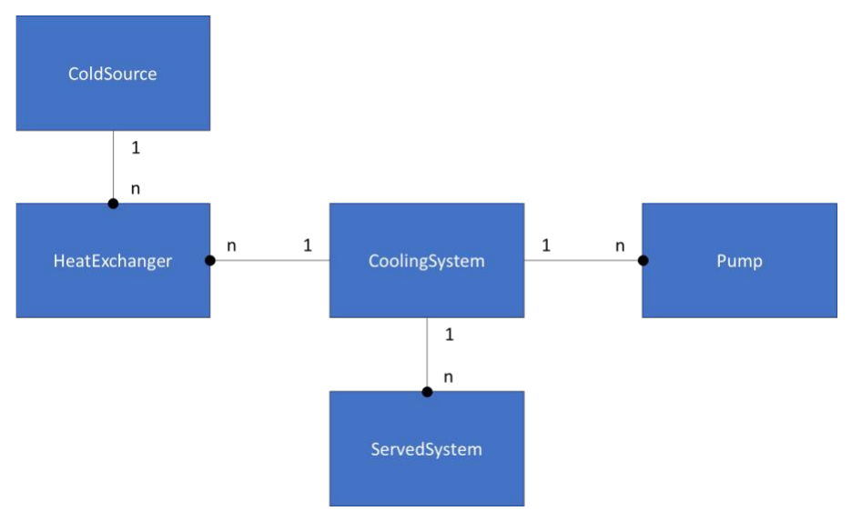

# 4. Syntax

## 4.1 Notation

[ expr ] denotes an optional expression expr when the color of the square brackets is black.

{ expr } denotes an expression that is repeated one or more times when the color of the curly braces is black.

expr_1 | expr_2 | … | expr_n denotes n possible alternatives between the expressions expr_1 to expr_n.

'c' denotes the character c.

"keyword" denotes the String keyword.

Built-in keywords are written in ${\color{teal}blue}$.

User-defined objects names are written in ${\color{orange}orange}$.

Categories names are written in ${\color{red}red}$.

## 4.2 Keywords

### 4.2.1 Types

| Keyword | Semantics | Comments |
| --- | --- | --- |
| ${\color{teal}Boolean}$ | $\mathbb{B}$ | 4-valued Booleans. |
| ${\color{teal}Category}$ | $\mathcal{C}(\mathbb{O}_1 \longrightarrow \mathbb{O}_2)$ | Categories. |
| ${\color{teal}class}$ | $\mathcal{C}$ | Class definitions. |
| ${\color{teal}Clock}$ | $2^{\mathcal{E}}$ or $\mathcal{D}$ | Clocks. |
| ${\color{teal}Event}$ | $\mathcal{E}$ | Events. |
| ${\color{teal}Integer}$ | $\mathbb{Z}$ | Positive and negative integers. |
| ${\color{teal}library}$ | $\mathcal{L}$ | Libraries. |
| ${\color{teal}model}$ | $\mathcal{M}$ | Models. |
| ${\color{teal}Operator}$ | $\mathbb{O}(\mathbb{D}_1 \longrightarrow \mathbb{D}_2)$ | Operators. The names of the domains $\mathbb{D}_1$ and $\mathbb{D}_2$ are given in the declaration of the operator. |
| ${\color{teal}package}$ | $\mathcal{T}$ | Packages. |
| ${\color{teal}Period}$ | $\mathcal{P}$ | Single time periods. |
| ${\color{teal}Periods}$ | $2^{\mathcal{P}}$ | Multiple time periods. |
| ${\color{teal}Probability}$ | $\mathbb{O}(\mathbb{B}_2 \longrightarrow \mathbb{R})$ | Probabilities. |
| ${\color{teal}Real}$ | $\mathbb{R}$ | Real numbers. |
| ${\color{teal}String}$ | $\mathbb{S}$ | Strings. |
| ${\color{teal}Template}$ | $\mathbb{O}(\mathbb{B}^n \longrightarrow \mathbb{B})$ | Templates. |
| ${\color{teal}type}$ | $\mathfrak{T}$ | Type definitions. |

### 4.2.2 Special values

| Values | Semantics | Comments |
| --- | --- | --- |
| ${\color{teal}false}$ | $\mathit{false}$ | |
| ${\color{teal}true}$ | $\mathit{true}$ | |
| ${\color{teal}undecided}$ | $\mathit{undecided}$ | |
| ${\color{teal}undefined}$ | $\mathit{undefined}$ | |
| ${\color{teal}time}$ | | |

### 4.2.3 Special characters

| Characters | Semantics | Comments |
| --- | --- | --- |
| `(` | ( | |
| `)` | ) | |
| `[` | [ | |
| `]` | ] | |
| `{` | { | Opens sets. |
| `}` | } | Closes sets. |
| `,` | , | Set element separator. |
| `;` | ; | Set element separator. |
| `.` | . | Decimal point. Path element separator. |
| `"` | " | String delimiter. |
| `'` | | Quote string delimiter. |
| `E` | | Decimal exponent. |
| `e` | | Decimal exponent. |
| `//` | | Start of comment line. |
| `/*` | | Begins comment. |
| `*/` | | Ends comment. |
| `0` \| `1` \| `2` \| `3` \| `4` \| `5` \| `6` \| `7` \| `8` \| `9` | | Digits. |

### 4.2.4 Operators

| Operators | Comments/Support status |
| --- | --- |
| `=` | :white_check_mark: |
| `+` | :white_check_mark: |
| `-` | :white_check_mark: |
| `*` | :white_check_mark: |
| `/` | :white_check_mark: |
| `<` | :white_check_mark: |
| `<=` | :white_check_mark: |
| `>` | :white_check_mark: |
| `>=` | :white_check_mark: |
| `==` | :white_check_mark: |
| `<>` | :white_check_mark: |
| `^` | :white_check_mark: |
| `acos` | :white_check_mark: |
| `alias` | :x: |
| `and` | :white_check_mark: |
| `asin` | :white_check_mark: |
| `associate` | :x: |
| `at` | :x: |
| `card` | :x: |
| `constant` | :white_check_mark: |
| `cos` | :white_check_mark: |
| `duration` | :x: |
| `element` | :x: |
| `else` | :white_check_mark: |
| `end` | :white_check_mark: |
| `estimator` | :x: |
| `exp` | :white_check_mark: |
| `extends` | :x: |
| `external` | :white_check_mark: |
| `filter` | :x: |
| `flatten` | :x: |
| `forbid` | :x: |
| `if` | :white_check_mark: |
| `integrate` | :x: |
| `is` | :white_check_mark: |
| `log` | :white_check_mark: |
| `log10` | :white_check_mark: |
| `mod` | |
| `new` | :white_check_mark: |
| `not` | :white_check_mark: |
| `on` | :x: |
| `or` | :white_check_mark: |
| `parameter` | :white_check_mark: |
| `partial` | :x: |
| `proj` | :x: |
| `redeclare` | :x: |
| `sin` | :white_check_mark: |
| `start` | :white_check_mark: |
| `then` | :white_check_mark: |
| `tick` | :white_check_mark: |
| `time from` | :x: |
| `union` | :x: |
| `variance` | :x: |
| `while` | :x: |
| `with` | :x: |

## 4.3 Expressions

The CRML expression for the declaration and/or definition of any CRML element is of the form:

| Natural language syntax | Mathematical syntax | Semantics | Reference |
| --- | --- | --- | --- |
| `[ [ type ] ident is ] [ value \| external ] [; \| ,]` | `[ [ type ] ident = ] [ value \| external ] [; \| ,]` | $\mathit{type}: \mathit{ident} = \mathit{value}$<br>$*.\mathit{type}: \mathit{ident}$ | 3.20.2<br>3.22<br>3.24.1 |

The semicolon (;) can be replaced by the comma (,), and is only mandatory when two or more expressions must be separated in sets or operator calls.

`type ident` is the declaration of the element of `type` type and name `ident`.

`type` is the type of the expression, to be chosen among ${\color{teal}Real}$, ${\color{teal}Integer}$, ${\color{teal}String}$, ${\color{teal}Boolean}$, ${\color{teal}Event}$, etc., or user-defined types.

`ident` is the identifier of the expression which is unique within its scope (or namespace). An identifier is a character string composed of a non-digit optionally followed by digits or non-digits:

```
ident: non-digit [{digit | non-digit}]

non-digit: '_' | characters 'a' to 'z' | characters 'A' to 'Z'

digit: characters '0' to '9'
```

The identifier, and therefore the type, are not explicitly written when the expression is an argument in the call of an operator: the type and the identifier are automatically inferred by the argument binding mechanism from the position of the argument in the function call, and the alias of the argument type if any.

The identifier is omitted for anonymous sets.

There is a special syntax for the declaration of an operator in the natural language syntax, cf. Section 4.13.

The type is not explicitly written when the expression is an argument in the constructor of an object. It is automatically inferred from its identifier and from the object's class definition.

`value` is the definition of the element. It denotes the value of the expression, which depends on the type of the element. It is expressed by an expression using a constructor or an operator that take expressions as arguments and return a value of the element type. Expressions are thus recursively defined until they involve constructors with no arguments or external expressions:

```
expr: [[type] ident is] [value | external]
value: ([new] constructor [{expr}]) | (operator {expr})
```

The value of the expression is always explicit: it cannot be obtained by solving an equation. The keyword `external` stands for the value when the element is external.

If the name of the constructor is the same as the name of a user-defined class, then the keyword `new` must be used to create an instance of the class.

There are two kinds of CRML elements: sets and set elements. Sets contain set elements. A set can be a set element of another set.

A set can depend on time, depending on its type, which means that the set elements can be added or removed dynamically. Dynamic sets are of the type ${\color{teal}Clock}$ or ${\color{teal}Periods}$.

A set can be empty.

There are three kinds of sets: typed sets, special sets, and the universal set. In a typed set, all elements are of the same type. In a special set, elements can be of different types. The special sets are of the type ${\color{teal}type}$, ${\color{teal}class}$, ${\color{teal}model}$, ${\color{teal}library}$ or ${\color{teal}package}$. The universal set is the only set that has no expression: it has no identifier and is implicitly defined as being the set that contains all sets except itself.

The scope of an expression is the set where it belongs.

The implicit type of the universal set (the set that contains all sets) is `package`, because `package` is the only set that can contain (directly or indirectly) all sets of the language.

An expression refers to another expression outside of its scope by appending the relative path of the outside expression to the identifier of the outside expression (absolute path is not possible because the universal set has no identifier).

## 4.4 Comments

Comments are identical to C++ (or Modelica).

There are two kinds of comments, single-line comment and multiline comments.

```
// This is a single-line comment
```

The characters from `//` until the end of the line are ignored.

```
/* This is a
multiline comment */
```

The characters enclosed between `/*` and `*/` are ignored, including return carriages. Multiline comments cannot be nested.

Expressions in comments are not part of the CRML language.

## 4.5 Type Real

### 4.5.1 Constructors

| Natural language syntax | Mathematical syntax | Semantics | Reference |
| --- | --- | --- | --- |
| `Real x is decimal_value;` | `Real x = decimal_value;` | $\mathbb{R}: x = \mathit{decimal\_value}$ | |
| `Integer n;`<br>`Real x is new Real n;` | `Integer n;`<br>`Real x = new Real n;` | $\mathbb{N}: n$<br>$\mathbb{R}: x = n$ | |

A decimal value is defined as

```
decimal_value: [sign] [{' '}] {digit} ['.'] [{digit}] [exponent]
sign: '+' | '-'
exponent: ('E' | 'e') [sign] {digit}
digit: characters '0' to '9'
```

where:

* `'+' | '-'` denotes the + or the − sign,
* `{' '}` denotes one or more spaces,
* `{digit}` denotes one or more digits,
* `'.'` is the decimal point,
* `'E'` is the decimal exponent: $1\mathrm{E}n = 10^n$ where $n$ is a positive or negative integer,
* `'e'` can be used instead of `'E'`.

Example 1: correct expressions

https://github.com/lenaRB/crml-compiler/blob/a4ab9f7dcc78ca5ae964feeaeef5ca7414cb5d5e/src/test/resources/testFiles/spec-doc-examples/RealConstructorsExample1.crml#L1-L7

Example 2: incorrect expressions

```
Real x6 is .7; // No digit before the decimal point
Real x7 is -28.775E +3; // Space after the decimal exponent
Real x8 is -28.775 E+3; // Space before the decimal exponent
Real x9 is -28.775E+ 3; // Space after the + sign
Real x10 is E+3; // No digit before the decimal exponent
Real x11 is 1.E+3.14; // Decimal point in the decimal exponent
```

### 4.5.2 Operators

| Name | Natural language syntax | Mathematical syntax | Semantics | Reference |
| --- | --- | --- | --- | --- |
| Binary addition | `Real x1, x2;`<br>`Real x is x1 + x2;` | `Real x1, x2;`<br>`Real x = x1 + x2;` | $\mathbb{R}: x_1,\ \mathbb{R}: x_2$<br>$\mathbb{R}: x = x_1 + x_2$ | |
| Binary subtraction | `Real x1, x2;`<br>`Real x is x1 - x2;` | `Real x1, x2;`<br>`Real x = x1 - x2;` | $\mathbb{R}: x_1,\ \mathbb{R}: x_2$<br>$\mathbb{R}: x = x_1 - x_2$ | |
| Unary addition | `Real x1;`<br>`Real x2 is +x1;` | `Real x1;`<br>`Real x2 = +x1;` | $\mathbb{R}: x_1$<br>$\mathbb{R}: x_2 = +x_1$ | |
| Unary subtraction | `Real x1;`<br>`Real x2 is -x1;` | `Real x1;`<br>`Real x2 = -x1;` | $\mathbb{R}: x_1$<br>$\mathbb{R}: x_2 = -x_1$ | |
| Multiplication | `Real x1, x2;`<br>`Real x is x1 * x2;` | `Real x1, x2;`<br>`Real x = x1 * x2;` | $\mathbb{R}: x_1,\ \mathbb{R}: x_2$<br>$\mathbb{R}: x = x_1 \times x_2$ | |
| Division | `Real x1, x2;`<br>`Real x is x1 / x2;` | `Real x1, x2;`<br>`Real x = x1 / x2;` | $\mathbb{R}: x_1,\ \mathbb{R}^*: x_2$<br>$\mathbb{R}: x = x_1 / x_2$ | |
| Exponentiation | `Real x1, x2;`<br>`Real x is x1 ^ x2;` | `Real x1, x2;`<br>`Real x = x1 ^ x2;` | $\mathbb{R}: x_1,\ \mathbb{R}: x_2$<br>$\mathbb{R}: x = x_1^{x_2}$ | |
| Greater than | `Real x1, x2;`<br>`Boolean b is x1 >= x2;` | `Real x1, x2;`<br>`Boolean b = x1 >= x2;` | $\mathbb{R}: x_1,\ \mathbb{R}: x_2$<br>$\mathbb{B}_2: b = x_1 \geq x_2$ | |
| Less than | `Real x1, x2;`<br>`Boolean b is x1 <= x2;` | `Real x1, x2;`<br>`Boolean b = x1 <= x2;` | $\mathbb{R}: x_1,\ \mathbb{R}: x_2$<br>$\mathbb{B}_2: b = x_1 \leq x_2$ | |
| Strictly greater than | `Real x1, x2;`<br>`Boolean b is x1 > x2;` | `Real x1, x2;`<br>`Boolean b = x1 > x2;` | $\mathbb{R}: x_1,\ \mathbb{R}: x_2$<br>$\mathbb{B}_2: b = x_1 > x_2$ | |
| Strictly less than | `Real x1, x2;`<br>`Boolean b is x1 < x2;` | `Real x1, x2;`<br>`Boolean b = x1 < x2;` | $\mathbb{R}: x_1,\ \mathbb{R}: x_2$<br>$\mathbb{B}_2: b = x_1 < x_2$ | |
| Sine | `Real x1, x2;`<br>`Real x2 is sin x1;` | `Real x1, x2;`<br>`Real x2 = sin (x1);` | $\mathbb{R}: x_1$<br>$\mathbb{R}: x_2 = \sin x_1$ | |
| Cosine | `Real x1, x2;`<br>`Real x2 is cos x1;` | `Real x1, x2;`<br>`Real x2 = cos (x1);` | $\mathbb{R}: x_1$<br>$\mathbb{R}: x_2 = \cos x_1$ | |
| Inverse sine | `Real x1, x2;`<br>`Real x2 is asin x1;` | `Real x1, x2;`<br>`Real x2 = asin x1;` | $\mathbb{R}: x_1$<br>$\mathbb{R}: x_2 = \mathrm{asin}\ x_1$ | |
| Inverse cosine | `Real x1, x2;`<br>`Real x2 is acos x1;` | `Real x1, x2;`<br>`Real x2 = acos x1;` | $\mathbb{R}: x_1$<br>$\mathbb{R}: x_2 = \mathrm{acos}\ x_1$ | |
| Exponential | `Real x1, x2;`<br>`Real x2 is exp x1;` | `Real x1, x2;`<br>`Real x2 = exp (x1);` | $\mathbb{R}: x_1$<br>$\mathbb{R}: x_2 = e^{x_1}$ | |
| Logarithm | `Real x1, x2;`<br>`Real x2 is log x1;` | `Real x1, x2;`<br>`Real x2 = log (x1);` | $\mathbb{R}^*_+: x_1$<br>$\mathbb{R}: x_2 = \log_e x_1$ | |
| Base 10 logarithm | `Real x1, x2;`<br>`Real x2 is log10 x1;` | `Real x1, x2;`<br>`Real x2 = log10 (x1);` | $\mathbb{R}^*_+: x_1$<br>$\mathbb{R}: x_2 = \log_{10} x_1$ | |
| If then else | `Boolean b;`<br>`Real x1, x2;`<br>`Real x is if b then x1 else x2;` | `Boolean b;`<br>`Real x1, x2;`<br>`Real x = if b then x1 else x2;` | $\mathbb{B}: b,\ \mathbb{R}: x_1,\ \mathbb{R}: x_2$<br>$\mathbb{R}: x = \begin{cases} x_1 & \text{if } b = \mathit{true} \\ x_2 & \text{else} \end{cases}$ | |
| At event | `Real x1;`<br>`Clock c;`<br>`Real x2 is x1 at c;` | `Real x1;`<br>`Clock c;`<br>`Real x2 = x1 at c;` | $\mathbb{R}: x_1,\ \mathcal{D}: c$<br>$\mathbb{R}: x_2 = x_1(@\, t/\Omega)$ | 3.7.1 |

The expression

```
x2 is x1 at c;
```

takes the value of `x1` at every tick of clock `c`. The value of `x2` between two ticks `t1` and `t2` is equal to the value of `x1` at tick `t1`.

Example 1: verifying that `x1` is greater than `x2` when `y` becomes positive.

```
Real x1;
Real x2;
Real y;
Clock c is new Clock (y > 0);
Boolean b is (x1 > x2) at c;
```

It is also possible to write:

```
Boolean b is (x1 at c) > (x2 at c);
```

## 4.6 Type Integer

### 4.6.1 Constructors

| Natural language syntax | Mathematical syntax | Semantics | Reference |
| --- | --- | --- | --- |
| `Integer n is integer_value;` | `Integer n = integer_value;` | $\mathbb{Z}: n = \mathit{integer\_value}$ | |
| `Real x;`<br>`Integer n is new Integer x;` | `Real x;`<br>`Integer n = new Integer x;` | $\mathbb{R}: x$<br>$\mathbb{Z}: n = x$ | |

An integer value is defined as

```
integer_value: [sign] [{' '}] {digit} [exponent]
sign: '+' | '-'
exponent: ('E' | 'e') {digit}
digit: characters '0' to '9'
```

where:

* `'+' | '-'` denotes the + or the − sign,
* `{' '}` denotes one or more spaces,
* `{digit}` denotes one or more digits,
* `'E'` is the decimal exponent: $1\mathrm{E}n = 10^n$ where $n$ is a positive or negative integer,
* `'e'` can be used instead of `'E'`.

Example 1: correct expressions

```
Integer x1 is 25;
Integer x2 is + 25;
Integer x3 is -25;
Integer x4 is -28E3;
Integer x5 is new Integer -25.8; // The value of x is -25
```

Example 2: incorrect expressions

```
Integer x6 is -25.8; // Decimal point
Integer x7 is -28E 3; // Space after the decimal exponent
Integer x8 is -28 E+3; // Space before the decimal exponent
Integer x9 is -28E+3; // Sign after the decimal exponent
Integer x10 is E3; // No digit before the decimal exponent
Integer x11 is 1E3.; // Decimal point in the decimal exponent
```

### 4.6.2 Operators

| Name | Natural language syntax | Mathematical syntax | Semantics | Reference |
| --- | --- | --- | --- | --- |
| Binary addition | `Integer n1, n2;`<br>`Integer n is n1 + n2;` | `Integer n1, n2;`<br>`Integer n = n1 + n2;` | $\mathbb{Z}: n_1,\ \mathbb{Z}: n_2$<br>$\mathbb{Z}: n = n_1 + n_2$ |  |
| Binary subtraction | `Integer n1, n2;`<br>`Integer n is n1 - n2;` | `Integer n1, n2;`<br>`Integer n = n1 - n2;` | $\mathbb{Z}: n_1,\ \mathbb{Z}: n_2$<br>$\mathbb{Z}: n = n_1 - n_2$ |  |
| Unary addition | `Integer n1;`<br>`Integer n2 is +n1;` | `Integer n1;`<br>`Integer n2 = +n1;` | $\mathbb{Z}: n_1$<br>$\mathbb{Z}: n_2 = +n_1$ |  |
| Unary subtraction | `Integer n1;`<br>`Integer n2 is -n1;` | `Integer n1;`<br>`Integer n2 = -n1;` | $\mathbb{Z}: n_1$<br>$\mathbb{Z}: n_2 = -n_1$ |  |
| Multiplication | `Integer n1, n2;`<br>`Integer n is n1 * n2;` | `Integer n1, n2;`<br>`Integer n = n1 * n2;` | $\mathbb{Z}: n_1,\ \mathbb{Z}: n_2$<br>$\mathbb{Z}: n = n_1 \times n_2$ |  |
| Integer division | `Integer n1, n2;`<br>`Integer n is n1 / n2;` | `Integer n1, n2;`<br>`Integer n = n1 / n2;` | $\mathbb{Z}: n_1,\ \mathbb{Z}^*: n_2$<br>$\mathbb{Z}: n = n_1 / n_2$ |  |
| Exponentiation | `Integer n1, n2;`<br>`Integer n is n1 ^ n2;` | `Integer n1, n2;`<br>`Integer n = n1 ^ n2;` | $\mathbb{Z}: n_1,\ \mathbb{N}: n_2$<br>$\mathbb{Z}: n = n_1^{n_2}$ |  |
| Greater than | `Integer n1, n2;`<br>`Boolean b is n1 >= n2;` | `Integer n1, n2;`<br>`Boolean b = n1 >= n2;` | $\mathbb{Z}: n_1,\ \mathbb{Z}: n_2$<br>$\mathbb{B}_2: b = n_1 \geq n_2$ |  |
| Less than | `Integer n1, n2;`<br>`Boolean b is n1 <= n2;` | `Integer n1, n2;`<br>`Boolean b = n1 <= n2;` | $\mathbb{Z}: n_1,\ \mathbb{Z}: n_2$<br>$\mathbb{B}_2: b = n_1 \leq n_2$ |  |
| Strictly greater than | `Integer n1, n2;`<br>`Boolean b is n1 > n2;` | `Integer n1, n2;`<br>`Boolean b = n1 > n2;` | $\mathbb{Z}: n_1,\ \mathbb{Z}: n_2$<br>$\mathbb{B}_2: b = n_1 > n_2$ |  |
| Strictly less than | `Integer n1, n2;`<br>`Boolean b is n1 < n2;` | `Integer n1, n2;`<br>`Boolean b = n1 < n2;` | $\mathbb{Z}: n_1,\ \mathbb{Z}: n_2$<br>$\mathbb{B}_2: b = n_1 < n_2$ |  |
| Equal to | `Integer n1, n2;`<br>`Boolean b is n1 == n2;` | `Integer n1, n2;`<br>`Boolean b = n1 == n2;` | $\mathbb{Z}: n_1,\ \mathbb{Z}: n_2$<br>$\mathbb{B}_2: b = (n_1 = n_2)$ |  |
| Different from | `Integer n1, n2;`<br>`Boolean b is n1 <> n2;` | `Integer n1, n2;`<br>`Boolean b = n1 <> n2;` | $\mathbb{Z}: n_1,\ \mathbb{Z}: n_2$<br>$\mathbb{B}: b = (n_1 \neq n_2)$ |  |
| Modulo | `Integer n1, n2;`<br>`Integer n is n1 mod n2;` | `Integer n1, n2;`<br>`Integer n = n1 mod n2;` | $\mathbb{Z}: n_1,\ \mathbb{Z}: n_2$<br>$\mathbb{Z}/n_2\mathbb{Z}: n = n_1 \bmod n_2$ |  |
| If then else | `Boolean b;`<br>`Integer n1, n2;`<br>`Integer n is if b then n1 else n2;` | `Boolean b;`<br>`Integer n1, n2;`<br>`Integer n = if b then n1 else n2;` | $\mathbb{B}: b,\ \mathbb{Z}: n_1,\ \mathbb{Z}^*: n_2$<br>$\mathbb{Z}: n = \begin{cases} n_1 & \text{if } b = \mathit{true} \\ n_2 & \text{else} \end{cases}$ |  |
| At event | `Integer n1;`<br>`Clock c;`<br>`Integer n2 is n1 at c;` | `Integer n1;`<br>`Clock c;`<br>`Integer n2 = n1 at c;` | $\mathbb{Z}: n_1,\ \mathcal{D}: c$<br>$\mathbb{Z}: n_2 = n_1(@\, t/\Omega)$ | 3.7.1 |

The expression

```
n2 is n1 at c;
```

takes the value of `n1` at every tick of clock `c`. The value of `n2` between two ticks `t1` and `t2` is equal to the value of `n1` at tick `t1`.

Example 1: verifying that `n1` is greater than `n2` when `y` becomes positive.

```
Integer n1;
Integer n2;
Real y;
Clock c is new Clock (y > 0);
Boolean b is (n1 > n2) at c;
```

It is also possible to write:

```
Boolean b is (n1 at c) > (n2 at c);
```

## 4.7 Type String

### 4.7.1 Constructors

| Natural language syntax | Mathematical syntax | Semantics | Reference |
| --- | --- | --- | --- |
| `String s is string_value;` | `String s = string_value;` | $\mathbb{S}: x = \mathit{string\_value}$ | |
| `Real x;`<br>`String s is new String x;` | `Real x;`<br>`String s = new String x;` | $\mathbb{R}: x$<br>$\mathbb{S}: s = \mathrm{string}\ x$ | |
| `Integer n;`<br>`String s is new String n;` | `Integer n;`<br>`String s = new String n;` | $\mathbb{N}: n$<br>$\mathbb{S}: s = \mathrm{string}\ n$ | |
| `Boolean b;`<br>`String s is new String b;` | `Boolean b;`<br>`String s = new String b;` | $\mathbb{B}: b$<br>$\mathbb{S}: s = \mathrm{string}\ b$ | |

A string value is defined as:

```
string_value: '"' [ { digit | non-digit | special_char | escape_char} ] '"'
non-digit: '_' | characters 'a' to 'z' | characters 'A' to 'Z'
digit: characters '0' to '9'
special_char: '!' | '#' | '$' | '%' | '&' | '(' | ')' | '*' |     '+' | ','
              | '-' | '.' | '/' | ':' | ';' | '<' | '>' | '=' | '?' | '@' |
              '[' | ']' | '^' | '{' | '}' | '|' | '~' | ' '
escape_char: '\"' | '\\' | '\''
```

Example 1: correct expressions

```
String s1 is "This is a string";
String s2 is new String "This is a \"nice\" string"; // The value of s is " This is a "nice" string "
String s3 is ""; // Empty string
String s4 is "$PO1_ is the identifier of the pump";
String s5 is new String -23; // The value of s is "-23"
String s6 is new String 10.5E7; // The value of s is "10.5E7"
String s7 is new String true; // The value of s is "true"
String s8 is new String false; // The value of s is "false"
String s9 is new String undecided; // The value of s is "undecided"
String s10 is new String undefined; // The value of s is "undefined"
```

Example 2: incorrect expressions

```
String s11 is This is a string"; // First double quote missing
String s12 is "This is " a string"; // Escape char \ missing before second double quote
```

### 4.7.2 Operators

| Name | Natural language syntax | Mathematical syntax | Semantics | Reference |
| --- | --- | --- | --- | --- |
| Concatenation | `String s1, s2;`<br>`String s is s1 + s2;` | `String s1, s2;`<br>`String s = s1 + s2;` | $\mathbb{S}: s_1,\ \mathbb{S}: s_2$<br>$\mathbb{S}: s = s_1 + s_2$ | |

Example 1: string concatenation

```
Integer n is 3;
Real x is 2.5;
String s is "The " + new String n + " ships follow each other from a distance of " + new String x + " kilometers.";
```

The value of `s` is "The 3 ships follow each other from a distance of 2.5 kilometers."

Example 2: string concatenation

```
String s is "The set of 4-valued Booleans is { " + new String undecided + ", " + new String undefined + ", " + new String false + ", " + new String true + " }. ";
```

The value of `s` is "The set of 4-valued Booleans is { undecided, undefined, false, true }."

## 4.8 Type Boolean

### 4.8.1 Constructors

| Natural language syntax | Mathematical syntax | Semantics | Reference |
| --- | --- | --- | --- |
| `Boolean b is true;` | `Boolean b = true;` | $\mathbb{B}: b = \mathit{true}$ | 3.2 |
| `Boolean b is false;` | `Boolean b = false;` | $\mathbb{B}: b = \mathit{false}$ | 3.2 |
| `Boolean b is undecided;` | `Boolean b = undecided;` | $\mathbb{B}: b = \mathit{undecided}$ | 3.2 |
| `Boolean b is undefined;` | `Boolean b = undefined;` | $\mathbb{B}: b = \mathit{undefined}$ | 3.2 |
| `Clock c;`<br>`Boolean b is new Boolean c;` | `Clock c;`<br>`Boolean b = new Boolean c;` | $\mathcal{D}: c$<br>$\mathbb{B}: b = b(c)$ | 3.6 |

### 4.8.2 Operators

| Name | Natural language syntax | Mathematical syntax | Semantics | Reference |
| --- | --- | --- | --- | --- |
| Conjunction | `Boolean b1, b2;`<br>`Boolean b is b1 and b2;` | `Boolean b1, b2;`<br>`Boolean b = b1 and b2;` | $\mathbb{B}: b_1,\ \mathbb{B}: b_2$<br>$\mathbb{B}: b = b_1 \wedge b_2$ | 3.2 |
| Disjunction | `Boolean b1, b2;`<br>`Boolean b is b1 or b2;` | `Boolean b1, b2;`<br>`Boolean b = b1 or b2;` | $\mathbb{B}: b_1,\ \mathbb{B}: b_2$<br>$\mathbb{B}: b = b_1 \vee b_2$ | 3.2 |
| Conjunction with event | `Boolean b1;`<br>`Event e;`<br>`Boolean b2 is b1 and e;` | `Boolean b1;`<br>`Event e;`<br>`Boolean b2 = b1 and e;` | $\mathbb{B}: b_1,\ \mathcal{E}: e$<br>$\mathbb{B}: b_2 = b_1 \wedge e$ | 3.5.11 |
| Disjunction with event | `Boolean b1;`<br>`Event e;`<br>`Boolean b2 is b1 or e;` | `Boolean b1;`<br>`Event e;`<br>`Boolean b2 = b1 or e;` | $\mathbb{B}: b_1,\ \mathcal{E}: e$<br>$\mathbb{B}: b_2 = b_1 \vee e$ | 3.5.11 |
| Negation | `Boolean a;`<br>`Boolean b is not a;` | `Boolean a;`<br>`Boolean b = not a;` | $\mathbb{B}: a$<br>$\mathbb{B}: b = \neg a$ | 3.2 |
| Filter | `Boolean b1, b2;`<br>`Boolean b is b1 * b2;` | `Boolean b1, b2;`<br>`Boolean b = b1 * b2;` | $\mathbb{B}_3: b_1,\ \mathbb{B}: b_2$<br>$\mathbb{B}: b = b_1 \times b_2$ | 3.11.2 |
| Accumulation | `Boolean b1, b2;`<br>`Boolean b is b1 + b2;` | `Boolean b1, b2;`<br>`Boolean b = b1 + b2;` | $\mathbb{B}: b_1,\ \mathbb{B}: b_2$<br>$\mathbb{B}: b = b_1 + b_2$ | 3.11.1 |
| Integration | `Boolean a;`<br>`Period P;`<br>`Boolean b is integrate a on P;` | `Boolean a;`<br>`Period P;`<br>`Boolean b = integrate (a, P);` | $\mathbb{B}: a,\ \mathcal{P}: P$<br>$\mathbb{B}: b = \int_P a$ | 3.11.6 |
| Duration | `Boolean a;`<br>`Period P;`<br>`Real d is duration a on P;` | `Boolean a;`<br>`Period P;`<br>`Real d = duration (a, P);` | $\mathbb{B}: a,\ \mathcal{P}: P$<br>$\mathbb{R}^+: d = \mathrm{duration}(a, P)$ | 3.11.3 |
| Equality | `Boolean b1, b2;`<br>`Boolean b is b1 == b2;` | `Boolean b1, b2;`<br>`Boolean b = (b1 == b2);` | $\mathbb{B}: b_1,\ \mathbb{B}: b_2$<br>$\mathbb{B}: b = (b_1 = b_2)$ | 3.2 |
| If then else | `Boolean b;`<br>`Boolean b1, b2;`<br>`Boolean b3 is if b then b1 else b2;` | `Boolean b;`<br>`Boolean b1, b2;`<br>`Boolean b3 = if b then b1 else b2;` | $\mathbb{B}: b,\ \mathbb{B}: b_1,\ \mathbb{B}: b_2$<br>$\mathbb{B}: b_3 = \begin{cases} b_1 & \text{if } b = \mathit{true} \\ b_2 & \text{else} \end{cases}$ |  |
| At event | `Boolean b1;`<br>`Clock c;`<br>`Boolean b2 is b1 at c;` | `Boolean b1;`<br>`Clock c;`<br>`Boolean b2 = b1 at c;` | $\mathbb{B}: b_1,\ \mathcal{D}: c$<br>$\mathbb{B}: b_2 = b_1(@\, t/\Omega)$ | 3.7.1 |

The expression

```
b2 is b1 at c;
```

takes the value of `b1` at every tick of clock `c`. The value of `b2` between two ticks `t1` and `t2` is equal to the value of `b1` at tick `t1`.

Example 1: verifying that `b1` is equal to `b2` when `y` becomes positive.

```
Boolean b1;
Boolean b2;
Real y;
Clock c is new Clock (y > 0);
Boolean b is (b1 == b2) at c;
```

It is also possible to write:

```
Boolean b is (b1 at c) == (b2 at c);
```

## 4.9 Type Event

### 4.9.1 Constructors

| Name | Natural language syntax | Mathematical syntax | Semantics | Reference |
| --- | --- | --- | --- | --- |
|  | `Boolean b;`<br>`Event e is new Event b;` | `Boolean b;`<br>`Event e = new Event b;` | $\mathbb{B}: b$<br>$\mathcal{E}: e = b{\uparrow}\ \text{(first occurrence of } b{\uparrow})$ | 3.3 |

### 4.9.2 Operators

| Name | Natural language syntax | Mathematical syntax | Semantics | Reference |
| --- | --- | --- | --- | --- |
| Projection | `Event e1;`<br>`Clock c;`<br>`Event e2 is e1 proj c;` | `Event e1;`<br>`Clock c;`<br>`Event e2 = proj (e1, c);` | $\mathcal{E}: e_1,\ \mathcal{D}: c$<br>$\mathcal{E}: e_2 = e_1/c$ | 3.7.1 |
| Bounded projection | `Event e1;`<br>`Clock c;`<br>`Real d;`<br>`Event e2 is e1 proj(d) c;` | `Event e1;`<br>`Clock c;`<br>`Real d;`<br>`Event e2 = e1 proj (e1, c, d);` | $\mathcal{E}: e_1,\ \mathcal{D}: c,\ \mathbb{R}^+: d$<br>$\mathcal{E}: e_2 = e_1/_d\, c$ | 3.7.2 |
| Delay | `Event e1;`<br>`Real d;`<br>`Event e2 is e1 + d;` | `Event e1;`<br>`Real d;`<br>`Event e2 = e1 + d;` | $\mathcal{E}: e_1,\ \mathbb{R}^+: d$<br>$\mathcal{E}: e_2 = e_1 + d$ | 3.5.8 |
| Elapsed | `Event e1, e2;`<br>`Real d is e2 - e1;` | `Event e1, e2;`<br>`Real d = e2 - e1;` | $\mathcal{E}: e_1,\ \mathcal{E}: e_2$<br>$\mathbb{R}^+: d = e_2 - e_1$ | 3.5.7 |
| Before | `Event e1, e2;`<br>`Boolean b is e1 <= e2;` | `Event e1, e2;`<br>`Boolean b = e1 <= e2;` | $\mathcal{E}: e_1,\ \mathcal{E}: e_2$<br>$\mathbb{R}^+: b = e_1 \leq e_2$ | 3.5.3 |
| After | `Event e1, e2;`<br>`Boolean b is e1 >= e2;` | `Event e1, e2;`<br>`Boolean b = e1 >= e2;` | $\mathcal{E}: e_1,\ \mathcal{E}: e_2$<br>$\mathbb{R}^+: b = e_1 \geq e_2$ | 3.5.4 |
| Strictly before | `Event e1, e2;`<br>`Boolean b is e1 < e2;` | `Event e1, e2;`<br>`Boolean b = e1 < e2;` | $\mathcal{E}: e_1,\ \mathcal{E}: e_2$<br>$\mathbb{R}^+: b = e_1 < e_2$ | 3.5.3 |
| Strictly after | `Event e1, e2;`<br>`Boolean b is e1 > e2;` | `Event e1, e2;`<br>`Boolean b = e1 > e2;` | $\mathcal{E}: e_1,\ \mathcal{E}: e_2$<br>$\mathbb{R}^+: b = e_1 > e_2$ | 3.5.4 |
| Elapsed physical time | `Event e;`<br>`Real d is time from e;` | `Event e;`<br>`Real d = time - e;` | $\mathcal{E}: e$<br>$\mathbb{R}^+: d = \mathfrak{C}{\uparrow} - e$ | 3.3<br>3.5.7 |
| Conjunction | `Event e1, e2;`<br>`Clock e is e1 and e2;` | `Event e1, e2;`<br>`Clock e = e1 and e2;` | $\mathcal{E}: e_1,\ \mathcal{E}: e_2$<br>$\mathcal{D}: c = e_1 \wedge e_2$ | 3.5.9 |
| Disjunction | `Event e1, e2;`<br>`Clock e is e1 or e2;` | `Event e1, e2;`<br>`Clock e = e1 or e2;` | $\mathcal{E}: e_1,\ \mathcal{E}: e_2$<br>$\mathcal{D}: c = e_1 \vee e_2$ | 3.5.10 |

## 4.10 Type Clock

### 4.10.1 Constructors

| Name | Natural language syntax | Mathematical syntax | Semantics | Reference |
| --- | --- | --- | --- | --- |
|  | `Boolean b;`<br>`Clock c is new Clock b;` | `Boolean b;`<br>`Clock c = new Clock b;` | $\mathbb{B}: b$<br>$\mathcal{D}: c = c(b)$ | 3.6 |

### 4.10.2 Operators

| Name | Natural language syntax | Mathematical syntax | Semantics | Reference |
| --- | --- | --- | --- | --- |
| Delay | `Clock c1;`<br>`Integer d;`<br>`Clock c2 is c1 + d;` | `Clock c1;`<br>`Integer d;`<br>`Clock c2 = c1 + d;` | $\mathcal{D}: c_1,\ \mathbb{N}: d$<br>$\mathcal{D}: c_2 = c_1 + d$ | 3.7.3 |
| Projection | `Clock c1, c2;`<br>`Clock c is c1 proj c2;` | `Clock c1, c2;`<br>`Clock c = proj (c1, c2);` | $\mathcal{D}: c_1,\ \mathcal{D}: c_2$<br>$\mathcal{D}: c = c_1/c_2$ | 3.7.1 |
| Bounded projection | `Clock c1, c2;`<br>`Real d;`<br>`Clock c is c1 proj (d) c2;` | `Clock c1, c2;`<br>`Real d;`<br>`Clock c = proj (c1, c2, d);` | $\mathcal{D}: c_1,\ \mathcal{D}: c_2,\ \mathbb{R}^+: d$<br>$\mathcal{D}: c = c_1/_d\, c_2$ | 3.7.2 |
| Current tick | `Clock c;`<br>`Event e is tick c;` | `Clock c;`<br>`Event e = tick (c);` | $\mathcal{D}: c$<br>$\mathcal{E}: e = c\,\vert c\vert$ | 3.6 |
| Filter | `Clock c1, c2;`<br>`Operator cond [ Boolean ] Integer i = value (i);`<br>`Clock c2 is c1 filter cond tick;` | `Clock c1, c2;`<br>`Operator cond [ Boolean ] Integer i = value (i);`<br>`Clock c2 = c1 filter cond tick;` | $\mathcal{D}: c_1,\ \mathbb{O}(\mathbb{N} \longrightarrow \mathbb{B}): \mathit{cond}$<br>$\mathcal{D}: c_2 = c_1(\mathit{cond}(\mathrm{rank}(*)))$ | 3.6<br>3.7.7 |
| Conjunction of clocks | `Clock c1, c2;`<br>`Clock c is c1 and c2;` | `Clock c1, c2;`<br>`Clock c = c1 and c2;` | $\mathcal{D}: c_1,\ \mathcal{D}: c_2$<br>$\mathcal{D}: c = c_1 \wedge c_2$ | 3.7.5 |
| Conjunction of event and clock | `Event e;`<br>`Clock c1`<br>`Clock c2 is e and c1;` | `Event e;`<br>`Clock c1`<br>`Clock c2 = e and c1;` | $\mathcal{E}: e,\ \mathcal{D}: c_1$<br>$\mathcal{D}: c_2 = e \wedge c_1$ | 3.5.9 |
| Conjunction of clock and event | `Clock c1`<br>`Event e;`<br>`Clock c2 is c1 and e;` | `Clock c1`<br>`Event e;`<br>`Clock c2 = c1 and e;` | $\mathcal{D}: c_1,\ \mathcal{E}: e$<br>$\mathcal{D}: c_2 = c_1 \wedge e$ | 3.5.9 |
| Disjunction of clocks | `Clock c1, c2;`<br>`Clock c is c1 or c2;` | `Clock c1, c2;`<br>`Clock c = c1 or c2;` | $\mathcal{D}: c_1,\ \mathcal{D}: c_2$<br>$\mathcal{D}: c = c_1 \vee c_2$ | 3.7.6 |
| Disjunction of event and clock | `Event e;`<br>`Clock c1`<br>`Clock c2 is e or c1;` | `Event e;`<br>`Clock c1`<br>`Clock c2 = e or c1;` | $\mathcal{E}: e,\ \mathcal{D}: c_1$<br>$\mathcal{D}: c_2 = e \vee c_1$ | 3.5.10 |
| Disjunction of clock and event | `Clock c1`<br>`Event e;`<br>`Clock c2 is c1 or e;` | `Clock c1`<br>`Event e;`<br>`Clock c2 = c1 or e;` | $\mathcal{D}: c_1,\ \mathcal{E}: e$<br>$\mathcal{D}: c_2 = c_1 \vee e$ | 3.5.10 |
| Number of ticks | `Clock c;`<br>`Integer n is card c;` | `Clock c;`<br>`Integer n = card (c);` | $\mathcal{D}: c$<br>$\mathbb{N}: n = \vert c\vert$ | 3.6 |

## 4.11 Type Period

### 4.11.1 Constructors

| Name | Natural language syntax | Mathematical syntax | Semantics | Reference |
| --- | --- | --- | --- | --- |
|  | `Event e1, e2;`<br>`Period P is [ e1, e2 ];` | `Event e1, e2;`<br>`Period P = [ e1, e2 ];` | $\mathcal{E}: e_1,\ \mathcal{E}: e_2$<br>$\mathcal{P}: P = [e_1, e_2]$ | 3.8 |
|  | `Event e1, e2;`<br>`Period P is ] e1, e2 ];` | `Event e1, e2;`<br>`Period P = ] e1, e2 ];` | $\mathcal{E}: e_1,\ \mathcal{E}: e_2$<br>$\mathcal{P}: P = ]e_1, e_2]$ | 3.8 |
|  | `Event e1, e2;`<br>`Period P is [ e1, e2 [;` | `Event e1, e2;`<br>`Period P = [ e1, e2 [;` | $\mathcal{E}: e_1,\ \mathcal{E}: e_2$<br>$\mathcal{P}: P = [e_1, e_2[$ | 3.8 |
|  | `Event e1, e2;`<br>`Period P is ] e1, e2 [;` | `Event e1, e2;`<br>`Period P = ] e1, e2 [;` | $\mathcal{E}: e_1,\ \mathcal{E}: e_2$<br>$\mathcal{P}: P = ]e_1, e_2[$ | 3.8 |

### 4.11.2 Operators

| Name | Natural language syntax | Mathematical syntax | Semantics | Reference |
| --- | --- | --- | --- | --- |
| Opening event | `Period P;`<br>`Event e is P start;` | `Period P;`<br>`Event e = start (P);` | $\mathcal{P}: P$<br>$\mathcal{E}: e = P{\uparrow}$ | 3.8 |
| Closing event | `Period P;`<br>`Event e is P end;` | `Period P;`<br>`Event e = end (P);` | $\mathcal{P}: P$<br>$\mathcal{E}: e = P{\downarrow}$ | 3.8 |

## 4.12 Type Periods

### 4.12.1 Constructors

| Name | Natural language syntax | Mathematical syntax | Semantics | Reference |
| --- | --- | --- | --- | --- |
|  | `Period P1, P2, …, Pn;`<br>`Periods P is { P1, P2, …, Pn };` | `Period P1, P2, …, Pn;`<br>`Periods P = { P1, P2, …, Pn };` | $\mathcal{P}: P_1,\ \mathcal{P}: P_2, \ldots,\ \mathcal{P}: P_n$<br>$2^{\mathcal{P}}: P = \{P_1, P_2, \ldots, P_n\}$ | 3.9 |
|  | `Clock c1, c2;`<br>`Periods P is [ c1, c2 ];` | `Clock c1, c2;`<br>`Periods P = [ c1, c2 ];` | $\mathcal{D}: c_1,\ \mathcal{D}: c_2$<br>$2^{\mathcal{P}}: P = \Pi([c_1, c_2])$ | 3.9 |
|  | `Clock c1, c2;`<br>`Periods P is ] c1, c2 ];` | `Clock c1, c2;`<br>`Periods P = ] c1, c2 ];` | $\mathcal{D}: c_1,\ \mathcal{D}: c_2$<br>$2^{\mathcal{P}}: P = \Pi(]c_1, c_2])$ | 3.9 |
|  | `Clock c1, c2;`<br>`Periods P is [ c1, c2 [;` | `Clock c1, c2;`<br>`Periods P = [ c1, c2 [;` | $\mathcal{D}: c_1,\ \mathcal{D}: c_2$<br>$2^{\mathcal{P}}: P = \Pi([c_1, c_2[)$ | 3.9 |
|  | `Clock c1, c2;`<br>`Periods P is ] c1, c2 [;` | `Clock c1, c2;`<br>`Periods P = ] c1, c2 [;` | $\mathcal{D}: c_1,\ \mathcal{D}: c_2$<br>$2^{\mathcal{P}}: P = \Pi(]c_1, c_2[)$ | 3.9 |

### 4.12.2 Operators

| Name | Natural language syntax | Mathematical syntax | Semantics | Reference |
| --- | --- | --- | --- | --- |
| While | `Periods P1;`<br>`Periods P2;`<br>`Periods P is P2 while P1;` | `Periods P1;`<br>`Periods P2;`<br>`Periods P = while (P2, P1);` | $2^{\mathcal{P}}: P_1,\ 2^{\mathcal{P}}: P_2$<br>$2^{\mathcal{P}}: P = P_1 \sqsupset P_2$ | 3.10.2 |

## 4.13 Type Operator

### 4.13.1 Constructors

| Natural language syntax | Semantics | Reference |
| --- | --- | --- |
| `Type T, T1, T2, …, Tn;`<br>`Operator [ T ] w1 T1 e1 w2 T2 e2 … wn Tn en = value;` | $f: T_1 \times T_2 \times \ldots \times T_n \longrightarrow T$<br>$(e_1, e_2, \ldots, e_n) \longmapsto f(e_1, e_2, \ldots, e_n) = \mathit{expr}$<br>$\mathcal{C}(f) = \emptyset$ | 3.17<br>3.19 |

| Mathematical syntax | Semantics | Reference |
| --- | --- | --- |
| `Type T, T1, T2, …, Tn;`<br>`Operator f = new Operator [ T ] (T1 e1, T2 e2, … , Tn en) = value;` | $f: T_1 \times T_2 \times \ldots \times T_n \longrightarrow T$<br>$(e_1, e_2, \ldots, e_n) \longmapsto f(e_1, e_2, \ldots, e_n) = \mathit{expr}$<br>$\mathcal{C}(f) = \emptyset$ | 3.17<br>3.19 |

| Mixed natural language / mathematical syntax | Semantics | Reference |
| --- | --- | --- |
| `Type T, T1, T2, …, Tn;`<br>`Operator f is new Operator [ T ] w1 T1 e1 w2 T2 e2 … wn Tn en = value;` | $f: T_1 \times T_2 \times \ldots \times T_n \longrightarrow T$<br>$(e_1, e_2, \ldots, e_n) \longmapsto f(e_1, e_2, \ldots, e_n) = \mathit{expr}$<br>$\mathcal{C}(f) = \emptyset$ | 3.17<br>3.19 |

Operators always return a value whose type is declared between square brackets. Therefore, in expression `Operator [ T ] w1 T1 e1 w2 T2 e2 … wn Tn en = value;` the type of `value` is `T`.

Three syntaxes are possible for the declaration and definition of operators:

1. **Natural language syntax**: the name of the operator is declared by several words `w1, w2, …, wn` that can have at most one function argument before the first word, between two words, or after the last word.

    A word of the name of an operator in the natural language syntax is:

    ```
    word: ident | quote-ident
    quote-ident: ''' { quote-char } '''
    quote-char: non-digit | digit | '!' | '&' | '|' | '+' | '-' | '*' |
                '/' | '%' | '<' | '>' | '=' | '^' | '_' | ' '
    ```

    The declaration and definition of an operator is

    ```
    op-expr: "Operator" '['type-ident']' ([type-ident ident] {word [type-ident ident]}) '=' value
    type-ident: ident
    ```

    The call of an operator is

    ```
    op-call: [ident] | {word [ident]}
    ```

    `ident` and `value` are defined in Section 4.3.

    The signature of the operator is obtained by concatenating all words and type names of the operator declaration separated by the `$` sign. Therefore, the `$` sign cannot be used in CRML expressions.

    For an operator declaration such as `Operator [ T ] w1 T1 e1, w2 T2 e2, …, wn Tn en`, the signature is `T$w1$T1$w2$T2…$wn$Tn`. The function call that computes the operator is then `T y = T$w1$T1$w2$T2…$wn$Tn (e1, e2, …, en)`.

    Operator overloading is possible because operators with declarations made of identical words and different type names have different signatures. For instance, operators `Operator [ T ] w T1` and `Operator [ T ] w T2` have the same operator name (`w`), but different signatures (`T$w$T1` and `T$w$T2`).

    Example 1: function that returns a clock with the ticks of another clock `c` that are within a given time period `P`.

    ```
    Operator [ Clock ] ticks Clock c inside Period P = c filter (tick >= P start) and (tick <= P end);

    Period P is value;
    Clock c1 is value;
    Clock c2 is ticks c1 inside P;
    ```

    The function call is `Clock c2 = Clock$ticks$Clock$inside$Period (c1, P)`.

    Example 2: disjunction of two Booleans.

    ```
    Operator [ Boolean ] Boolean b1 or Boolean b2 = not (not b1 and not b2);

    Boolean b1 is value;
    Boolean b2 is value;
    Boolean b is b1 or b2;
    ```

    The function call is `Boolean b = Boolean$Boolean$or$Boolean (b1, b2)`.

    Example 3: definition of the `<=` operator in the domain of integers from the operators `<` and `==`.

    ```
    Operator [ Boolean ] Integer n1 '<=' Integer n2 = (n1 < n2) or (n1 == n2);

    Integer n1 is value;
    Integer n2 is value;
    Boolean b is n1 '<=' n2;
    ```

    The function call is `Boolean b = Boolean$Integer$'<='$Integer (n1, n2)`.

2. **Mathematical syntax**: the name of the operator is made of one word only and the arguments are placed in a comma separated list enclosed in parenthesis, as it is customary when using mathematical notation. The signature of the operator is obtained by concatenating the name of the operator with the names of the argument types.

    Example 4: function that returns a clock with the ticks of another clock `c` that are within a given time period `P`.

    ```
    Operator subClock = new Operator [ Clock ] (Clock c, Period P) = c filter (tick >= P start) and (tick <= P end);

    Period P is value;
    Clock c1 is value;
    Clock c2 = subClock (c1, P);
    ```

    The function call is `Clock c2 = Clock$subClock$Clock$Period (c1, P)`.

3. **Mixed natural language and mathematical syntax**: the name of the operator is declared using the natural language syntax, and the operator is assigned to a variable that is the operator's name in the mathematical syntax. Then the operator can be called using the natural language or the mathematical syntax. The signature of the operator is the natural language syntax signature.

    Example 5: function that returns a clock with the ticks of another clock `c` that are within a given time period `P`.

    ```
    Operator f is new Operator [ Clock ] ticks Clock c inside Period P = c filter (tick >= P start) and (tick <= P end);

    Period P is value;
    Clock c1 is value;
    Clock c2 is ticks c1 inside P; // Natural language syntax call
    Clock c2 = f (c1, P); // Mathematical syntax call
    ```

    The function call is `Clock$ticks$Clock$inside$Period (c1, P)`, thus corresponding to the natural language syntax.

Example 6: `count` function, cf. Eq. (82). Natural language notation.

```
Operator [ Integer ] count [ Boolean ] b inside [ Period ] P = card ticks new Clock b inside P;
```

Example 7: `count` function, cf. Eq. (82). Mathematical notation.

```
Operator count = new Operator [ Integer ] (Boolean ] b, [ Period ] P) = card (subClock (new Clock b, P));
```

Example 8: `count` function, cf. Eq. (82). Mixed natural language / mathematical notation.

```
Operator count = Operator [ Integer ] count [ Boolean ] b inside [ Period ] P = card (subClock (new Clock b, P));
Operator count = Operator [ Integer ] count [ Boolean ] b inside [ Period ] P = card ticks new Clock b inside P;
Operator count = Operator [ Integer ] count [ Boolean ] b inside [ Period ] P = card (ticks new Clock b inside P);
```

## 4.14 Type Template

### 4.14.1 Constructors


| Natural language syntax | Semantics | Reference |
| --- | --- | --- |
| `Template w1 e1 w2 e2 … wn en = value;` | $f: \mathbb{B}^n \longrightarrow \mathbb{B}$<br>$(e_1, e_2, \ldots, e_n) \longmapsto f(e_1, e_2, \ldots, e_n) = \mathit{expr}$ | 3.18 |

| Mathematical syntax | Semantics | Reference |
| --- | --- | --- |
| `Template f = new Template (e1, e2, … , en) = value;` | $f: \mathbb{B}^n \longrightarrow \mathbb{B}$<br>$(e_1, e_2, \ldots, e_n) \longmapsto f(e_1, e_2, \ldots, e_n) = \mathit{expr}$ | 3.18 |

| Mixed natural language / mathematical syntax | Semantics | Reference |
| --- | --- | --- |
| `Template f is new Template w1 e1 w2 e2 … wn en = value;` | $f: \mathbb{B}^n \longrightarrow \mathbb{B}$<br>$(e_1, e_2, \ldots, e_n) \longmapsto f(e_1, e_2, \ldots, e_n) = \mathit{expr}$ | 3.18 |

Templates are operators on Booleans. The syntactic rules for templates are therefore the same as for operators, with the exception that types are not specified.

Example 1: disjunction of two Booleans.

```
Template b1 or b2 = not (not b1 and not b2);
```

The name of the function is `or` and the function is called as follows:

```
Boolean b1 is value;
Boolean b2 is value;
Boolean b is b1 or b2;
```

The signature of the function is `Boolean$Boolean$or$Boolean`.

## 4.15 Type Category

### 4.15.1 Constructors


| Natural language syntax | Semantics | Reference |
| --- | --- | --- |
| `Operator f1, f2, …, fn;`<br>`Operator g1, g2, …, gn;`<br>`Category w = { (f1, g1), (f2, g2), …, (fn, gn) };` | $\mathcal{C}(\mathbb{D}_1 \longrightarrow \mathbb{D}_2): c$<br>$f_i \longmapsto g_i = c(f_i)$ | 3.19 |

| Mathematical syntax | Semantics | Reference |
| --- | --- | --- |
| `Operator f1, f2, …, fn;`<br>`Operator g1, g2, …, gn;`<br>`Category c = { (f1, g1), (f2, g2), …, (fn, gn) };` | $\mathcal{C}(\mathbb{D}_1 \longrightarrow \mathbb{D}_2): c$<br>$f_i \longmapsto g_i = c(f_i)$ | 3.19 |

| Mixed natural language / mathematical syntax | Semantics | Reference |
| --- | --- | --- |
| `Operator f1, f2, …, fn;`<br>`Operator g1, g2, …, gn;`<br>`Category c is new Category w = { (f1, g1), (f2, g2), …, (fn, gn) };` | $\mathcal{C}(\mathbb{D}_1 \longrightarrow \mathbb{D}_2): c$<br>$f_i \longmapsto g_i = c(f_i)$ | 3.19 |

Example 1: Example 1 in Sections 3.19 and 3.12.1.

```
Category increasing = { (>, >), (>=, >=), (==, >), (<>, >), (<, >=), (<=, >) };
```

### 4.15.2 Operators

| Name | Natural language syntax | Mathematical syntax | Semantics | Reference |
| --- | --- | --- | --- | --- |
| Association | `Category c;`<br>`Operator f;`<br>`Category {} C is associate c with f;` | `Category c;`<br>`Operator f;`<br>`Category {} C = associate (c, f);` | $\mathcal{C}(\mathbb{D}_1 \longrightarrow \mathbb{D}_2): c,\ \mathbb{O}(\mathbb{D}_3 \longrightarrow \mathbb{D}_4): f$<br>$c \in \mathcal{C}(f)$<br>$2^{\mathcal{C}(* \longrightarrow *)}: C = \mathcal{C}(f)$ | 3.19 |

The `associate` operator inserts category `c` into the set of categories associated with `f` and returns the new set of categories associated with `f`. The notation $2^{\mathcal{C}(* \longrightarrow *)}: C$ means that the set $C$ contains categories of any sources and targets.

Example 1:

```
Operator f;
Category increasing = { (>, >), (>=, >=), (==, >), (<>, >), (<, >=), (<=, >) };
Category {} C is associate increasing with f;
```

The value of `C` is the set of categories `{ increasing, … }` where `…` denotes the categories previously associated with `f`.

## 4.16 Sets

### 4.16.1 Constructors

| Natural language syntax | Mathematical syntax | Semantics | Reference |
| --- | --- | --- | --- |
| `// Non-empty typed set`<br>`Type T;`<br>`T e1, e2, …, en;`<br>`[T {} S is] { e1, e2, …, en };` | `// Non-empty typed set`<br>`Type T;`<br>`T e1, e2, …, en;`<br>`[T {} S =] { e1, e2, …, en };` | $T: e_1,\ T: e_2, \ldots,\ T: e_n$<br>$T: S = \{e_1, e_2, \ldots, e_n\}$ | 3.20.1 |
| `// Empty typed set`<br>`Type T;`<br>`[T {} S is] {};` | `// Empty typed set`<br>`Type T;`<br>`[T {} S =] {};` | $T: S = \emptyset$ | 3.20.1 |
| `// Special set`<br>`Type T;`<br>`T S is { expr };` | `// Special set`<br>`Type T;`<br>`T S = { expr };` | $\mathcal{C}: S$<br>$\mathcal{M}: S$<br>$\mathcal{L}: S$<br>$\mathcal{T}: S$ | 3.23<br>3.24<br>3.25<br>3.26 |

There is no dedicated keyword to denote a set.

There are two kinds of sets: typed sets and special sets.

A typed set is a set such that all its elements are of the same type, which is the type of the typed set. A typed set is declared as `T {} S`, where `T` is the type of its elements.

A special set is a set that can contain elements of different types. Special sets are of the following types only: `class`, `model`, `library`, `package`. The declaration of special sets does not feature curly braces `{}` after the type name, e.g. `model M is { expr }` (and not `model {} M is { expr }`).

Other time-dependent sets such as `Clock` and `Periods` have special features such that they are not considered as typed sets and are handled separately.

The identifier is omitted for anonymous typed sets and can be omitted for the empty set.

### 4.16.2 Operators

| Name | Natural language syntax | Mathematical syntax | Semantics | Reference |
| --- | --- | --- | --- | --- |
| Union of two sets | `Type T;`<br>`T {} S1, S2;`<br>`T {} S is S1 union S2;` | `Type T;`<br>`T {} S1, S2;`<br>`T {} S = S1 union S2;` | $2^T: S_1,\ 2^T: S_2$<br>$2^T: S = S_1 \cup S_2$ | 3.20.1 |
| Union of an element with a set | `Type T;`<br>`T e1;`<br>`T {} S2;`<br>`T {} S is e1 union S2;` | `Type T;`<br>`T {} e1;`<br>`T {} S2;`<br>`T {} S = e1 union S2;` | $T: e_1,\ 2^T: S_2$<br>$2^T: S = \{e_1\} \cup S_2$ | 3.20.1 |
| Union of two elements | `Type T;`<br>`T e1, e2;`<br>`T {} S is e1 union e2;` | `Type T;`<br>`T e1, e2;`<br>`T {} S is e1 union e2;` | $T: e_1,\ T: e_2$<br>$2^T: S = \{e_1\} \cup \{e_2\}$ | 3.20.1 |
| Flattening of a set | `Type T;`<br>`T {} S1;`<br>`T {} S2 is flatten S1;` | `Type T;`<br>`T {} S1;`<br>`T {} S2 = flatten S1;` | $2^T: S_1$<br>$2^T: S_2 = \Cup S_1$ | 3.20.1 |
| Number of elements | `Type T;`<br>`T {} S;`<br>`Integer n is card S;` | `Type T;`<br>`T {} S;`<br>`Integer n = card (S);` | $2^T: S$<br>$\mathbb{N}: n = \vert S\vert$ | 3.20.1 |
| Filter | `Type T;`<br>`T {} S1;`<br>`Operator [ Boolean ] cond T e = value;`<br>`T {} S2 is filter S1 cond element;` | `Type T;`<br>`T {} S1;`<br>`Operator [ Boolean ] cond (T e) = value;`<br>`T {} S2 = filter (S1 (cond (element));` | $2^T: S_1,\ \mathbb{O}(T \longrightarrow \mathbb{B}): \mathit{cond}$<br>$2^T: S_2 = S_1(\mathit{cond}(*))$ | 3.21.3 |
| Left unary operator | `Type T1, T2;`<br>`T1 {} S1;`<br>`Operator [ T2 ] op T1 e = value;`<br>`T2 {} S2 is op S1;` | `Type T1, T2;`<br>`T1 {} S1;`<br>`Operator [ T2 ] op T1 e = value;`<br>`T2 {} S2 = op S1;` | $2^{T_1}: S_1,\ \mathbb{O}(T_1 \longrightarrow T_2): \mathit{op}$<br>$2^{T_2}: S_2 = \mathit{op}\ S_1$ | 3.21.1 |
| Right unary operator | `Type T1, T2;`<br>`T1 {} S1;`<br>`Operator [ T2 ] T1 e op = value;`<br>`T2 {} S2 is S1 op;` | `Type T1, T2;`<br>`T1 {} S1;`<br>`Operator [ T2 ] T1 e op = value;`<br>`T2 {} S2 = S1 op;` | $2^{T_1}: S_1,\ \mathbb{O}(T_1 \longrightarrow T_2): \mathit{op}$<br>$2^{T_2}: S_2 = S_1\ \mathit{op}$ | 3.21.1 |
| Binary operator | `Type T;`<br>`T {} S1, S2;`<br>`Operator [ T ] T e1 op T e2 = value;`<br>`T e is S1 op S2;` | `Type T;`<br>`T {} S1, S2;`<br>`Operator [ T ] T e1 op T e2 = value;`<br>`T e = S1 op S2;` | $2^T: S_1,\ 2^T: S_2,\ \mathbb{O}(T \times T \longrightarrow T): \mathit{op}$<br>$T: e = S_1\ \mathit{op}\ S_2$ | 3.21.2 |

All operators except left, right and binary operators, apply also to special sets.

The `union` operator applies to all sets, but the result of the union of two sets (the merged set) must be a legal set. For instance, the union of a library with a model should be declared as a model, and the library should be flattened if it contains sub-libraries, because models can contain all elements of a library, except libraries. The merged set provides a common namespace for the elements of both sets, so that elements from one set can be used by elements of the other set without using paths. This is useful when using operators and templates in the natural language syntax. However, one must ensure that all identifiers are unique within the merged set.

Example 1: negation of a set of Booleans.

```
Boolean R1, R2, R3, R4;
Boolean S is not { R1, R2, R3, R4 };
```

The value of `S` is `{ not R1, not R2, not R3, not R4 }`.

Note that `{ R1, R2, R3, R4 }` is an anonymous set.

Example 2: frame period `P` applied to a set of time periods.

```
Periods P;
Periods P1, P2, P3, P4;
Periods {} S is { P1, P2, P3, P4 } while P;
```

The value of `S` is `{ P1 while P, P2 while P, P3 while P, P4 while P }`.

Example 3: getting the values of same attribute for a set of objects.

```
class C is {
    Real x is external;
    Real y is external;
};
C {} S is { C O1(x is 1, y is 1), C O2(x is 2, y is 1), C O3(x is 3, y is 1) };
Real {} R is S.x;
```

The value of `R` is `{ 1, 2, 3 }`.

Example 4: conjunction of a set of Booleans.

```
Boolean R1, R2, R3, R4;
Boolean R is and { R1, R2, R3, R4 };
```

The value of `R` is `R1 and R2 and R3 and R4`.

Example 5: inference chain of a set of requirements

```
Template b1 imply b2 = not b1 or b2;
Boolean R1, R2, R3, R4;
Boolean R is imply { R1, R2, R3, R4 };
```

The value of `R` is `R1 imply R2 imply R3 imply R4`.

Example 6: extracting requirements from a model.

```
model M is { …, R1, R2, …, R3, R4 };
```

where `R1, R2, R3, R4` are of the type `Requirement`, and `…` stands for elements of other types than `Requirement`.

The set of requirements of `M` is obtained with

```
Requirement {} R is filter M (type element == Requirement);
```

The value of `R` is `{ R1, R2, R3, R4 }`.

Example 7: extracting from a set of pieces of equipment the pieces of equipment that are in operation

```
class Equipment is {
    String id; // Equipment identification
    Boolean inOperation is external; // inOperation is true if the equipment is in operation
};
Equipment {} S is filter { Equipment (id is "E1"), Equipment (id is "E2") } (element.inOperation == true);
```

Example 8: union of elements in a set

```
Requirement {} R1 is { a1, a2, { b1, b2, b3, { c1, c2 } }, { b3, b4 }, a3 };
Requirement {} R2 is union R1;
```

Then

```
R2 = a1 union a2 union { b1, b2, b3, { c1, c2 } } union { b3, b4 } union a3
   = { a1, a2 } union { b1, b2, b3, { c1, c2 } } union { b3, b4 } union a3
   = { a1, a2, b1, b2, b3, { c1, c2 }, b3, b4, a3 }
```

Example 9: flattening of a set

```
Requirement {} R1 is { a1, a2, { b1, b2, b3, { c1, c2 } }, { b3, b4 }, a3 };
Requirement {} R2 is flatten R1;
```

The value of `R2` is `{ a1, a2, b1, b2, b3, c1, c2, b4, a3 }`.

## 4.17 Type type

### 4.17.1 Constructors

| Natural language syntax | Mathematical syntax | Semantics | Reference |
| --- | --- | --- | --- |
| `type T2 is (T1 x is value (a1, a2, …, an)) {`<br>`    Type D1, D2, …, Dn;`<br>`    D1 a1 [ is value ];`<br>`    D2 a2 [ is value ];`<br>`    …`<br>`    Dn an [ is value ];`<br>`};` | `type T2 = (T1 x = value (a1, a2, …, an)) {`<br>`    Type D1, D2, …, Dn;`<br>`    D1 a1 [ = value ];`<br>`    D2 a2 [ = value ];`<br>`    …`<br>`    Dn an [ = value ];`<br>`};` | $\mathfrak{T}: \mathbb{T}_2 = \mathbb{T}_1: x(a_1, a_2, \ldots a_n) + \{\mathbb{D}_1: a_1, \mathbb{D}_2: a_2, \ldots \mathbb{D}_n: a_n\}$ | 3.14.2<br>3.14.3 |

### 4.17.2 Operators

| Name | Natural language syntax | Mathematical syntax | Semantics | Reference |
| --- | --- | --- | --- | --- |
| Alias | `type T1 is value;`<br>`String s is value;`<br>`type T2 is T1 alias s;` | `type T1 = value;`<br>`String s = value;`<br>`type T2 = alias (T1, s);` | $\mathfrak{T}: T_1,\ \mathbb{S}: s$<br>$\mathfrak{T}: T_2 = T_1(s)$ | 3.14.5 |
| Partial type | `partial type T is value;` | `partial type T = value;` | $\mathrm{partial}\ \mathfrak{T}: T$ | 3.14.4 |
| Forbid | `type T1 is value;`<br>`type U1 is value;`<br>`…`<br>`type Un is value;`<br>`Operator f1 is new Operator [ U1 ] w11 T1 e1 … w1p1 T1 ep1 = value;`<br>`…`<br>`Operator fn is new Operator [ Un ] wn1 T1 e1 … wnpn T1 epn = value;`<br>`type T2 is T1 forbid { f1, …, fn };` | `type T1 = value;`<br>`type U1 = value;`<br>`…`<br>`type Un = value;`<br>`Operator f1 = Operator [ U1 ] w11 T1 e1 … w1p1 T1 ep1 = value;`<br>`…`<br>`Operator fn = Operator [ Un ] wn1 T1 e1 … wnpn T1 epn = value;`<br>`type T2 = T1 forbid { f1, …, fn };` | $\mathfrak{T}: T_1,\ \mathfrak{T}: T_2 \subset T_1$<br>$\mathfrak{T}: U_1, \ldots, \mathfrak{T}: U_n$<br>$f_1: T_1^{p_1} \longrightarrow U_1$<br>$\ldots$<br>$f_n: T_1^{p_n} \longrightarrow U_n$<br>$f_1 \notin \mathbb{O}(T_2 \longrightarrow *)$<br>$\ldots$<br>$f_n \notin \mathbb{O}(T_2 \longrightarrow *)$ | 3.14.2 |
| Type equality | `type T1 is value;`<br>`type T2 is value;`<br>`Boolean b is T1 == T2;` | `type T1 is value;`<br>`type T2 is value;`<br>`Boolean b = (T1 == T2);` | $\mathfrak{T}: T_1,\ \mathfrak{T}: T_2$<br>$\mathbb{B}: b = (T_1 = T_2)$ | 3.14.1 |

It is possible to combine operators `alias`, `partial` and `forbid` in the same statement by writing `partial type: T is value alias s forbid { f1, …, fn }`.

The alias `s` must be enclosed between square brackets when using special characters, e.g. `s = [m/s2]`, because `'/'` is a special character.

Example 1: defining the type of physical quantities in SI units by extending the type of real numbers.

```
partial type Quantity is (Real q is rate*u + offset) {
    String SIUnit;   // SI unit for quantity q
    String userUnit; // User unit for quantity q
    Real u;          // Quantity q expressed in user units
    Real rate;       // Conversion rate between user units and SI units
    Real offset;     // offset between user units and SI units
};
```

`partial` indicates that the type `Quantity` must be extended or specialized.

When writing

```
Quantity x = Quantity (SIUnit = "Pa", userUnit = "bar", rate = 1.e5, offset = 0, u = 3);
```

the expression `(Real q is rate*u + offset)` in the definition of `Quantity` computes the value of `x` from the value of `u`: `x = rate*u + offset`. The value of `u` can be computed back from the value of `x` using the automatically inverted formula `(x – offset) / rate` (thus `rate` must be different from zero).

It is also possible to write

```
Real x = Quantity (SIUnit = "Pa", userUnit = "bar", rate = 1.e5, offset = 0, u = 3);
```

because all elements of type `Quantity` are elements of type `Real` as the type `Quantity` extends the type `Real`. Then the expression `(Real q is rate*u + offset)` can be seen as converting a quantity expressed in the specific type `Quantity` to the general type of `Real`.

Example 2: defining physical units for pressures by specializing the domain of physical quantities.

```
partial type Pressure is Quantity (SIUnit = "Pa");
```

`partial` indicates that the type `Pressure` must extended or specialized.

```
type PressureBar is Pressure (userUnit = "bar", rate = 1.e5, offset = 0);
```

Example 3: defining physical units for pressures with an alias.

```
type PressurePa is Pressure (userUnit = "Pa", rate = 1, offset = 0) alias Pa;
type PressureBar is Pressure (userUnit = "bar", rate = 1.e5, offset = 0) alias bar;
```

Example 4: defining physical units for absolute temperatures and forbidding the use of temperature addition and multiplication.

```
partial type AbsoluteTemperature is Quantity (SIUnit = "K") forbid { +, * };
```

`+` and `*` are operators on type `Real`. Therefore, they apply to all subtypes of `Real`. Thus, they apply to `AbsoluteTemperature`. Because it is not physically meaningful to add or multiply absolute temperatures, these operators must be forbidden on `AbsoluteTemperature`.

```
type AbsoluteTemperatureKelvin is AbsoluteTemperature (userUnit = "K", rate = 1, offset = 0) alias K;
type AbsoluteTemperatureCelsius is AbsoluteTemperature (userUnit = "Celsius", rate = 1, offset = 273.15) alias Celsius;
```

Example 5: defining the physical unit for acceleration.

```
type Length is Quantity (SIUnit = "m", userUnit = "m", rate = 1, offset = 0) alias K;
partial type Time is Quantity (SIUnit = "s");
type TimeSecond is Time (userUnit = "s", rate = 1, offset = 0) alias s;
type Hour is Time (userUnit = "h", rate = 3600, offset = 0) alias h;
type Acceleration is Quantity (SIUnit = "m/s2", userUnit = "m/s2", rate = 1, offset = 0) alias [m/s2];
```

The alias is enclosed in square brackets because the special character `'/'` is used.

Note that the quantity `Acceleration` can be defined even if the quantities `Time` and `Length` are not defined. To relate the three quantities together, the definition of `Quantity` should be extended in order to accommodate dimensional analysis. For instance, a new attribute `SIDimension` could be added to express the `SIunit` in the fundamental units of the considered unit system (SI, CGS, etc.). The extended definition of `Quantity` would look like

```
partial type Quantity is (Real q is rate*u + offset) {
    String SIUnit;                     // SI unit for quantity q
    String userUnit;                   // User unit for quantity q
    String SIDimension;                // Unit for quantity q expressed in the fundamental units
    String SIFUnits = "[m][kg][s][K]"; // Fundamental units of the chosen unit system
    Real u;                            // Quantity q expressed in user units
    Real rate;                         // Conversion rate between user units and SI units
    Real offset;                       // offset between user units and SI units
};
```

For `Pressure`, `SIDimension = "[kg][m-1][s-2]"`.

Example 6: defining a type for requirements.

Some temporal operators on Booleans have been introduced for the evaluation of requirements only. They should not be used in requirement models. This can be enforced by forbidding these temporals operators on Booleans that represent requirements.

```
type Requirement is Boolean forbid { *, +, integrate };
```

## 4.18 Elements

### 4.18.1 Constructors

| Natural language syntax | Mathematical syntax | Semantics | Reference |
| --- | --- | --- | --- |
| `Type T;`<br>`T x is value;` | `Type T;`<br>`T x = value;` | $x \in \mathbb{D}$<br>$T: x = \mathit{expr}$ | 3.16 |
| `Type T;`<br>`T x is external;` | `Type T;`<br>`T x = external;` | $x \in \mathbb{D}$<br>$T: x$ | 3.16 |

There are three kinds of elements: variables, sets and operators.

Type `T` denotes any domain.

### 4.18.2 Operators

| Name | Natural language syntax | Mathematical syntax | Semantics | Reference |
| --- | --- | --- | --- | --- |
| External | `Type T;`<br>`T x is external;` | `Type T;`<br>`T x is external;` | $x \in \mathbb{V}$<br>$*.T: x$ | 3.22<br>3.24.1 |
| Constant | `Type T;`<br>`constant T x;` | `Type T;`<br>`constant T x;` | $x \in \mathbb{B} \cup \mathbb{Z} \cup \mathbb{R}$<br>$T: x = \mathit{constant}$ | 3.16 |
| Parameter | `Type T;`<br>`parameter T x;` | `Type T;`<br>`parameter T x;` | $x \in \mathbb{B} \cup \mathbb{Z} \cup \mathbb{R} \cup \mathbb{S}$<br>$T: x = \mathit{constant}$ | 3.16 |
| Get type | `Type T;`<br>`T x is value;`<br>`Type T is new type x;` | `Type T;`<br>`T x is value;`<br>`Type T = new type (x);` | $x \in \mathbb{D}$<br>$T: \mathrm{domain}(x)$ | 3.14.1 |

Only variables, objects and sets can have external values.

Variables with external values cannot be assigned any value within the requirement model. Their values are provided by the binding mechanism.

To enforce the binding mechanism:

* A variable can have an external value in classes only.
* In models, only objects and sets can have external values.

Only variables that belong to the following types can be declared as `constant`: `Boolean`, `Integer`, `Real`.

A parameter is a variable constant over one simulation run. A parameter can have different values for different simulation runs. Only variables that belong to the following types can be declared as `parameter`: `Boolean`, `Integer`, `Real`, `String`.

Example 1: defining a variable of type `Quantity` of Example 1 in Section 4.17.

No variable of type `Quantity` can be defined because `Quantity` is a partial type.

Example 2: defining a variable of type `PressureBar` of Example 2 in Section 4.17.

```
PressureBar P is 3.
```

The value of `P` is 3 bar in user units.

The conversion of 3 bar to SI units is made automatically using 3 bar = `rate*3 + offset` = `(1.e5)*3 + 0` = 3.e5 Pa.

Example 3: defining variables of type `Pressure` of Example 3 in Section 4.17.

```
Pressure P1 is 10.e5 Pa;
Pressure P2 is 3 bar;
```

The conversion of 3 bar to SI units is made automatically using 3 bar = `rate*3 + offset` = `(1.e5)*3 + 0` = 3.e5 Pa.

It is possible to write

```
Pressure P is (P1 + P2) bar;
```

`P1` and `P2` are automatically converted to SI units, they are added, and the result is displayed in bar.

It is possible to write

```
Pressure P is (10.e5 Pa + 3 bar) bar;
```

The conversion of 3 bar to SI units is made automatically using 3 bar = `rate*3 + offset` = `(1.e5)*3 + 0` = 3.e5 Pa. The value of `P` is `P = 10.e5 + 3.e5 = 13.e5` in SI units (Pa), that is used for internal calculations. The result is displayed in bar.

It is possible to write

```
Real P is (P1 + 3 bar) Pa;
```

`P1` and 3 bar are automatically converted to SI units, they are added, and the result is displayed in Pa.

It is not possible to write

```
Pressure P is 3;
```

thus omitting the unit, because `Pressure` is a partial type that cannot be instantiated.

It is not possible to write

```
Pressure P is 3 K;
```

thus specifying a wrong unit, because `K` is not a subtype of `Pressure`.

Assuming that the mass, length, and acceleration units have been defined, it is possible to write:

```
Real m is 10 g;
Real a is 5 [m/s2];
Real S is 2 cm2;
Real P is (m*a/S) bar;
```

The conversion of the different factors of `m*a/S` to SI units, and the conversion of the result to bar are done automatically. However, dimensional analysis is required to check the consistency of the formula unit wise.

Example 4: defining variables of type `AbsoluteTemperature` of Example 4 in Section 4.17.

```
AbsoluteTemperature T1 is 390 K;
AbsoluteTemperature T2 is 20 Celsius;
```

The conversion of 20 Celsius to SI units is made automatically using 20 Celsius = `rate*20 + offset` = `1*20 + 273.15` = 293.15 K.

It is not possible to write

```
AbsoluteTemperature T = (T1 + T2) K;
```

because operator `+` is forbidden on `AbsoluteTemperature`.

It is possible to write

```
AbsoluteTemperature T = (T1 – 10 Celsius) Celsius;
```

The conversion of 10 Celsius to SI units is made automatically using 10 Celsius = `rate*10 + offset` K. The result is automatically converted to Celsius using the inverted formula.

Example 5: defining external variables

```
Real x is external;
Pressure P is external bar;
```

## 4.19 Type class

### 4.19.1 Constructors

| Natural language syntax | Mathematical syntax | Semantics | Reference |
| --- | --- | --- | --- |
| `class C is {`<br>`    Type T1, T2, …, Tn;`<br>`    T1 a1 [ is [ value | external ] ];`<br>`    T2 a2 [ is [ value | external ] ];`<br>`    …`<br>`    Tn an [ is [ value | external ] ];`<br>`};` | `class C = {`<br>`    Type T1, T2, …, Tn;`<br>`    T1 a1 [ = [ value | external ] ];`<br>`    T2 a2 [ = [ value | external ] ];`<br>`    …`<br>`    Tn an [ = [ value | external ] ];`<br>`};` | $\mathcal{C}: \hat{C} = \{T_1: a_1, T_2: a_2, \ldots, T_n: a_n\}$ | 3.23.1<br>3.23.3 |


### 4.19.2 Operators

| Name | Natural language syntax | Mathematical syntax | Semantics | Reference |
| --- | --- | --- | --- | --- |
| Class extension | `class C1;`<br>`class C2 is { expr } extends C1;` | `class C1;`<br>`class C2 = { expr } extends C1;` | $\mathcal{C}: C_2 = \mathcal{C}: C_1 + \{\mathit{expr}\}$ | 3.23.2 |
| Multiple class extension | `class C1;`<br>`…`<br>`class Cn;`<br>`class C is { expr } extends { C1, …, Cn };` | `class C1;`<br>`…`<br>`class Cn;`<br>`class C = { expr } extends { C1, …, Cn };` | $\mathcal{C}: C_2 = \mathcal{C}: C_1 + \cdots + \mathcal{C}: C_n + \{\mathit{expr}\}$ | 3.23.2 |
| Partial class | `partial class C is { expr };` | `partial class C = { expr };` | $\mathcal{C}: \mathrm{partial}\ C$ | 3.23.4 |
| Attribute redeclaration | `class C1 is {`<br>`    Type T1, …, Tn;`<br>`    T1 a1 [ is [ value | external ] ];`<br>`    …`<br>`    Tn an [ is [ value | external ] ];`<br>`};`<br>`class C2 is {`<br>`    Type U1, …, Un;`<br>`    [ redeclare a1 ] U1 b1 [ is [ value | external ] ];`<br>`    …`<br>`    [ redeclare an ] Un bn [ is [ value | external ] ];`<br>`} extends C1;` | `class C1 = {`<br>`    Type T1, …, Tn;`<br>`    T1 a1 [ = [ value | external ] ];`<br>`    …`<br>`    Tn an [ = [ value | external ] ];`<br>`};`<br>`class C2 = {`<br>`    Type U1, …, Un;`<br>`    [ redeclare a1 ] U1 b1 [ = [ value | external ] ];`<br>`    …`<br>`    [ redeclare an ] Un bn [ = [ value | external ] ];`<br>`} extends C1;` | $\mathcal{C}: C_1 = \{T_1: a_1, \ldots T_n: a_n\}$<br>$\mathcal{C}: C_2 = C_1 + \{U_1: a_1 \to b_1, \ldots, U_n: a_n \to b_n\}$ | 3.23.2 |

It is not possible to write in the same model

```
class C2 is { expr };
class C2 extends C1;
```

because `class C2 extends C1` has no value.

Redeclaration of an attribute `an` of a class `C1` can be done in a class `C2` that extends `C1`. The `redeclare` operator has two arguments: the name of the redeclared attribute `an`, and the new declaration of `an`. The name and/or the type of `an` can be changed in the new declaration. Writing `redeclare an Un bn is external` changes the declaration of `an` in `C1` to `Un bn is external` in `C2`.

Example 1: class `Equipment`

```
partial class Equipment is {
    String id; // Equipment identification
    Boolean inOperation is external; // Indicates whether the equipment is in operation or not
};
```

Example 2: class `Pump` that extends class `Equipment`.

```
class Pump is {
    Real c is external; // Pump characteristic
    Real efficiency is external; // Pump efficiency
    Boolean cav is external; // Indicates whether the pump cavitates or not
    /* Requirement that states that the pump must not cavitate while in operation */
    Boolean nocav = during inOperation ensure not cav;
} extends Equipment;
```

Example 3: class `CoolingSystem` that extends class `Equipment` and uses class `Pump`.

```
class CoolingSystem is {
    /* The design of the cooling system features 3 pumps */
    Pump P1;
    Pump P2;
    Pump P3;
} extends Equipment;
```

Example 4: class `CentrifugalPump` that extends class `Pump` with one redeclaration.

```
class CentrifugalPump is {
    /* The name of the attribute c is changed to fc that means "full characteristics" */
    redeclare c Real fc is external;
} extends Pump;
```

Example 5: class `CoolingSystemRefined` that extends class `CoolingSystem` to use class `CentrifugalPump` instead of class `Pump`.

```
class CoolingSystemRefined is {
    /* Pumps are redeclared to be centrifugal pumps without changing their names */
    redeclare P1 CentrifugalPump P1;
    redeclare P2 CentrifugalPump P2;
    redeclare P3 CentrifugalPump P3;
} extends CoolingSystem;
```

Example 6: class `CoolingSystemRefined` that extends class `CoolingSystem` to use class `CentrifugalPump` instead of class `Pump`.

```
class CoolingSystemRefined is {
    /* Pumps are redeclared to be centrifugal pumps with new names */
    redeclare P1 CentrifugalPump CentrifugalP1;
    redeclare P2 CentrifugalPump CentrifugalP2;
    redeclare P3 CentrifugalPump CentrifugalP3;
} extends CoolingSystem;
```

## 4.20 Objects

### 4.20.1 Constructors

| Natural language syntax | Mathematical syntax | Semantics | Reference |
| --- | --- | --- | --- |
| `class C is {`<br>`    Type T1, T2, …, Tn;`<br>`    T1 a1 [ is [ value | external ] ];`<br>`    T2 a2 [ is [ value | external ] ];`<br>`    …`<br>`    Tn an [ is [ value | external ] ];`<br>`};`<br>`C o is new C ([ a1 is value,] [ a2 is value,] …[, an is value ]);` | `class C = {`<br>`    Type T1, T2, …, Tn;`<br>`    T1 a1 [ = [ value | external ] ];`<br>`    T2 a2 [ = [ value | external ] ];`<br>`    …`<br>`    Tn an [ = [ value | external ] ];`<br>`};`<br>`C o = new C ([ a1 = value,] [ a2 = value,] …[, an = value ]);` | $\mathcal{C}_C = \{T_1: a_1, T_2: a_2, \ldots, T_n: a_n\}$<br>$\mathcal{C}_C: o = (a_1 = \mathit{expr}, a_2 = \mathit{expr}, \ldots, a_n = \mathit{expr})$ | 3.22 |


An object `o` is instantiated from a class `C` by providing values to all attributes which are not declared as external or that are not defined (i.e., have no value) in the class definition. It is also possible to override the value of an attribute defined in the class definition, even if the value is external.

Writing `C o is new C (…)` seems redundant as class `C` is written twice. However, following the general rule to separate declaration from definition, `C o` declares object `o` as being an instance of class `C`, and `new C (…)` creates and defines (i.e., provides a value to) object `o`. An alternative would be to give the possibility to merge declaration and definition in a single statement such as `C (…) o` or `C o (…)` as an exception to the general rule.

Example 1: instantiation of class `Equipment` in Example 1 of Section 4.19.2.

Class `Equipment` cannot be instantiated because it is a partial class.

Example 2: instantiation of class `Pump` in Example 2 of Section 4.19.2.

```
Pump pump1 is new Pump (id = "Pump1");
```

`id` is the only attribute that does not have a definition in class `Pump`. However, it is possible to override the value of attribute `nocav` with a new requirement:

```
Pump pump2 is new Pump (id = "Pump2", nocav = …);
```

The other attributes are external and are not required to be given a value at class instantiation.

Example 3: instantiation of class `CoolingSystem` in Example 3 of Section 4.19.2.

```
CoolingSystem coolingSystem is new CoolingSystem (id = "CoolingSystem",
                                                  P1 = pump1,
                                                  P2 = pump2,
                                                  P3 = Pump (id = "Pump3", nocav = …));
```

The definitions of `pump1` and `pump2` of Example 2 are used in the definition of `coolingSystem`.

Example 4: instantiation of class `CentrifugalPump` in Example 4 of Section 4.19.2.

```
CentrifugalPump centrifugaPump1 is new CentrifugalPump (id = "CentrifugalPump1");
```

Example 5: instantiation of class `CoolingSystemRefined` in Example 5 of Section 4.19.2.

```
CoolingSystemRefined coolingSystemRefined is new CoolingSystemRefined (id = "CoolingSystem",
                          P1 = centrifugaPump1,
                          P2 = CentrifugalPump (id = "CentrifugalPump2"),
                          P3 = CentrifugalPump (id = "CentrifugalPump3", nocav = …));
```

The definition of `centrifugaPump1` of Example 4 is used in the definition of `CoolingSystemRefined`.

Example 6: instantiation of class `CoolingSystemRefined` in Example 6 of Section 4.19.2.

```
CoolingSystemRefined coolingSystemRefined is new CoolingSystemRefined (id = "CoolingSystem",
                          CentrifugalP1 = centrifugaPump1,
                          CentrifugalP2 = CentrifugalPump (id = "CentrifugalPump2"),
                          CentrifugalP3 = CentrifugalPump (id = "CentrifugalPump3", nocav = …));
```

The definition of `centrifugaPump1` of Example 4 is used in the definition of `CoolingSystemRefined`.

### 4.20.2 Operators

| Name | Natural language syntax | Mathematical syntax | Semantics | Reference |
| --- | --- | --- | --- | --- |
| Get value | `class C is {`<br>`    Type T1, …, Tn;`<br>`    T1 a1 [ is [ value | external ] ];`<br>`    …`<br>`    Tn an [ is [ value | external ] ];`<br>`};`<br>`C o ([ a1 is value,] … [, an is value ]);`<br>`Ti vi is o.ai;` | `class C = {`<br>`    Type T1, …, Tn;`<br>`    T1 a1 [ = [ value | external ] ];`<br>`    …`<br>`    Tn an [ = [ value | external ] ];`<br>`};`<br>`C o ([ a1 is value,] … [, an is value ]);`<br>`Ti vi = o.ai;` | $\mathcal{C}_C = \{T_1: a_1, \ldots, T_n: a_n\}$<br>$\mathcal{C}_C: o = (a_1 = v_1, \ldots, a_i = v_i, \ldots, a_n = v_n)$<br>$T_i: v_i = o.a_i$ | 3.22<br>3.20.2 |
| Set value | `class C is {`<br>`    Type T1, …, Tn;`<br>`    T1 a1 [ is [ value | external ] ];`<br>`    …`<br>`    Tn an [ is [ value | external ] ];`<br>`};`<br>`C o ([ a1 is value,] … [, an is value ]);`<br>`Ti vi;`<br>`o.ai is vi;` | `class C = {`<br>`    Type T1, …, Tn;`<br>`    T1 a1 [ = [ value | external ] ];`<br>`    …`<br>`    Tn an [ = [ value | external ] ];`<br>`};`<br>`C o ([ a1 is value,] … [, an is value ]);`<br>`Ti vi;`<br>`o.ai = vi;` | $\mathcal{C}_C = \{T_1: a_1, \ldots, T_n: a_n\}$<br>$\mathcal{C}_C: o = (a_1 = v_1, \ldots, a_i = v_i, \ldots, a_n = v_n)$<br>$o.a_i = T_i: v_i$ | 3.22<br>3.20.2 |

The value `vi` of attribute `ai` of object `o` is given by `vi = o.ai` where `o` denotes the path of object `o`. The value `vi` is set to attribute `ai` of object `o` by writing `o.ai = vi` where `o` denotes the path of object `o`. When using this function, no value should have been set to `o.ai` when instantiating object `o` from class `C`.

Therefore, it is possible to write:

```
C o is new C;
o.ai = vi;
```

But it is not possible to write

```
C o is new C (ai = vi);
o.ai = vi;
```

because `o.ai` is then defined twice. Neither is it possible to write

```
C o is new C;
```

alone, because `o.ai` is then not defined, unless `o.ai` is defined in the class definition:

```
class C is { …; Ti ai is vi; }
```

## 4.21 Type model

### 4.21.1 Constructors

| Natural language syntax | Mathematical syntax | Semantics | Reference |
| --- | --- | --- | --- |
| `model M is {`<br>`    model M’ is value;`<br>`    type T is value;`<br>`    class C is value;`<br>`    Operator [ T ] w1 T1 e1 w2 T2 e2 … wn Tn en = value;`<br>`    Category c = value;`<br>`    C o is value;`<br>`    C {} S is value;`<br>`    T x [ is [ value | external ] ];`<br>`};` | `model M = {`<br>`    model M’ = value;`<br>`    type T = value;`<br>`    class C = value;`<br>`    Operator [ T ] w1 T1 e1 w2 T2 e2 … wn Tn en = value;`<br>`    Category c = value;`<br>`    C o = value;`<br>`    C {} S = value;`<br>`    T x [ = [ value | external ] ];`<br>`};` | $\mathcal{M}: M = \{T_1: a_1, \ldots, T_n: a_n\}$ | 3.24.1 |


Although it is possible to define external variables in a model, it is recommended to define external variables in classes only in order to benefit from the automatic binding of external variables via objects.

### 4.21.2 Operators

| Name | Natural language syntax | Mathematical syntax | Semantics | Reference |
| --- | --- | --- | --- | --- |
| Model extension | `model M1;`<br>`model M2 is { expr } extends M1;` | `model M1;`<br>`model M2 = { expr } extends M1;` | $\mathcal{M}: M_2 = \mathcal{M}: M_1 + \{\mathit{expr}\}$ | 3.24.2 |
| Attribute redeclaration | `model M1 is {`<br>`    Type T1, …, Tn;`<br>`    T1 a1 [ is [ value | external ] ];`<br>`    …`<br>`    Tn an [ is [ value | external ] ];`<br>`};`<br>`model M2 is {`<br>`    Type U1, …, Un;`<br>`    [ redeclare a1 ] U1 b1 [ is [ value | external ] ];`<br>`    …`<br>`    [ redeclare an ] Un bn [ is [ value | external ] ];`<br>`} extends M1;` | `model M1 = {`<br>`    Type T1, …, Tn;`<br>`    T1 a1 [ = [ value | external ] ];`<br>`    …`<br>`    Tn an [ = [ value | external ] ];`<br>`};`<br>`model M2 = {`<br>`    Type U1, …, Un;`<br>`    [ redeclare a1 ] U1 b1 [ = [ value | external ] ];`<br>`    …`<br>`    [ redeclare an ] Un bn [ = [ value | external ] ];`<br>`} extends M1;` | $\mathcal{M}: M_1 = \{T_1: a_1, \ldots T_n: a_n\}$<br>$\mathcal{M}: M_2 = M_1 + \{U_1: a_1 \to b_1, \ldots, U_n: a_n \to b_n\}$ | 3.24.2 |
| While | `Periods P is value;`<br>`model M is { expr } while P;` | `Periods P is value;`<br>`model M = { expr } while P;` | $2^{\mathcal{P}}: P,\ \mathcal{M}: M$<br>$\sqsupset M = P$ | 3.24.1 |
| Get value | `model M is {`<br>`    Type Ti;`<br>`    model M’ is {`<br>`        Ti ai’ [ is [ value | external ] ];`<br>`    };`<br>`    Ti ai is M’.ai’;`<br>`};` | `model M = {`<br>`    Type Ti;`<br>`    model M’ is {`<br>`        Ti ai’ [ = [ value | external ] ];`<br>`    };`<br>`    Ti ai = M.ai’;`<br>`};` | $\mathcal{M}: M' = \{\ldots, T_i: a'_i, \ldots\}$<br>$\mathcal{M}: M = \{\mathcal{M}: M', \ldots, T_i: a_i = M'.a'_i, \ldots\}$ | 3.22<br>3.20.2 |

The `extend` operator can be combined with the `while` operator:

```
model M2 is { expr } extends M1 while P;
model M2 is { expr } while P extends M1;
```

The value `vi’` of variable `ai’` of model `M’` is given by `vi’ = M’.ai’` where `M’` denotes the path of model `M’`.

Example 1: a simple cooling system. This model expresses requirements on the pumps of the system only.

```
model CoolingSystem is {
    /* Class Equipment is an abstract class for all pieces of equipment in the cooling system to provide
       an identifier and the state of the piece of equipment */
    partial class Equipment is {
        String id; // Unique identifier
        Boolean s is external; // State of the equipment, started or not started
    };

    /* Type Requirement is aimed at providing a dedicated keyword to requirements and forbid the use
       of temporal operators by the user. */
    type Requirement is Boolean forbid { *, +, integrate };

    /* Define type Quantity to handle physical units */
    partial type Quantity is (Real q is rate*u + offset) {
        String SIUnit;                     // SI unit for quantity q
        String userUnit;                   // User unit for quantity q
        String SIDimension;                // Unit for quantity q expressed in the fundamental units
        String SIFUnits = "[m][kg][s][K]"; // Fundamental units of the chosen unit system
        Real u;                            // Quantity q expressed in user units
        Real rate;                         // Conversion rate between user units and SI units
        Real offset;                       // Offset between user units and SI units
    };

    /* Define unit RotationalVelocity */
    constant Real pi is 3.141592;
    partial type RotationalVelocity is Quantity (SIUnit = "rad/s", SIDimension = "[s-1]");
    type RotationalVelocityRPM is RotationalVelocity (userUnit = "rpm", rate = 2*pi/60, offset = 0) alias rpm;

    /* Define operator "during". This operator opens a time period when a Boolean b becomes true and
       closes the time period when b becomes false. */
    Operator [ Periods ] during Boolean b = Periods [ new Clock b, new Clock not b ];

    /* It is assumed that the operator check that tells whether a requirement composed of a condition
       cond and a time period P is satisfied or not is defined. This operator is fully defined in the ETL
       library. */
    // Operator [ Boolean ] Periods check cond over P = value;

    /* Class pump represents the way pumps are seen from the perspective of requirement modelling
       for the cooling system. The attributes omega and omega_n are given for illustration purposes only
       as they are not used in the model. */
    class Pump is {
        RotationalVelocity omega is external rpm; // Rotational velocity
        RotationalVelocity omega_n is 1400 rpm;   // Nominal rotational velocity
        Boolean cav is external;                  // Indicates whether the pump cavitates or not
        /* Requirement that states that the pump should not cavitate while it is in operation */
        Requirement nocav is during s ensure not cav;
    } extends Equipment;

    /* Class CoolingSystem represents a preliminary design of the cooling system that features only
       pumps that should not cavitate. */
    class CoolingSystem is {
        Pump {} pumps; // Set of pumps of the cooling system
        /* Requirement that states that no pump should cavitate within the cooling system */
        Requirement nocav is and pumps.nocav;
    } extends Equipment;

    /* The cooling system is represented by one instance of class CoolingSystem that features 3
       pumps. The instantiation of class CoolingSystem automatically creates 3 instances of class Pump,
       that in turn create one no-cavitation requirement for each pump. */
    CoolingSystem coolingSystem is new
        CoolingSystem (pumps is { Pump (id is "P1"), Pump (id is "P2"), Pump (id is "P3") });
};
```

Example 2: refinement of the simple cooling system. This model expresses additional requirements on the pumps of the system following design choices regarding the pumps.

```
model RefinedCoolingSystem is {
    /* Define unit day */
    partial type Time is Quantity (SIUnit = "s", SIDimension= "[s]");
    type TimeDay is Time (userUnit = "d", rate = 3600*24, offset = 0) alias d;

    /* Define operator "becomes true". This operator raises an event each time the Boolean b becomes
       true. The set of generated events is a clock. */
    Operator [ Clock ] Boolean b becomes true = new Clock b;

    /* Define operator "count inside". This operator counts the number of ticks of clock C inside a single
       time period P. */
    Operator [ Clock ] ticks Clock c inside Period P = c filter (tick >= P start) and (tick <= P end);
    Operator [ Integer ] count [ Boolean ] b inside [ Period ] P = card ticks new Clock b inside P;

    /* The class RefinedPump extends the class Pump defined in model CoolingSystem to include the
       additional requirement due to pump technology limitations: "The pump must not be started more
       than twice in a sliding time period of one day". */
    class RefinedPump is {
        /* Sliding time period of 1 day. It is a multiple time period that is composed of possibly
           overlapping single time periods that start each time the pump is started, and end 1 day (24
           hours) later. */
        Periods oneDay is [ s becomes true, s becomes true + 1 d [;
        /* No-start requirement to be satisfied */
        Requirement nostart is check (count s inside oneDay) <= 2 over oneDay;
    } extends Pump;

    /* Extend the class CoolingSystem to redeclare the set of pumps as being instances of the new
       class RefinedPump */
    class RefinedCoolingSystem is {
        /* The attribute pumps in CoolingSystem is redeclared to refinedpumps */
        redeclare pumps RefinedPump {} refinedpumps;
    } extends CoolingSystem;

    /* Redeclare the object coolingSystem to be an instance of the new class RefinedCoolingSystem.
       In the new design, only two pumps are considered with different ids. */
    redeclare coolingSystem RefinedCoolingSystem refinedCoolingSystem is (refinedpumps is
        { RefinedPump (id is "PO1"), RefinedPump (id is "PO2") });

    /* Then in model RefinedCoolingSystem, the additional requirements on the pumps are
       automatically generated */
} extends CoolingSystem;
```

Example 3: define a model that provides a global oracle for the cooling system model by taking the conjunction of all requirements defined in the cooling system model.

```
model GlobalCoolingSystem is {
    /* A model being a set, the set of all requirements in the model can be obtained by filtering the
       elements of the model by type Requirement. The set must be flattened to use the 'and' operator,
       because binary operators are not defined on sets when two sets are involved, i.e. S1 and S2. It is
       possible to flatten the set before or after filtering. */
    Requirement global is and (flatten (filter CoolingSystem (type element == Requirement)));
};
```

Example 4: architectural modelling of the cooling system

The cooling system architecture is represented by the class diagram in Fig. 44.



*Fig. 44. Class diagram of the cooling system architecture*

```
model CoolingSystemArchitecture is {
    type Requirement is Boolean forbid { *, +, integrate };
    type Assumption is Requirement;

    /* Define class Equipment */
    partial class Equipment is {
        String id;                        // Equipment identification
        Boolean inOperation is external; // State in operation or not of the equipment
    };

    /* Define the abs function */
    Operator [ Real ] abs [ Real ] x = if x >= 0 then x else −x;

    /* Define class CoolingSystem */
    class CoolingSystem is {
        // Cooling system has 3 pumps
        Pump {} pumps is { Pump (id = "PO1"), Pump (id = "PO2"), Pump (id = "PO3") };
        // Cooling system has 2 heat exchangers
        HeatExchanger {} heatExchangers is { HeatExchanger (id = "HE1"), HeatExchanger (id = "HE1")};
        // Cooling system serves 2 systems
        ServedSystem {} servedSystems is { ServedSystem (id = "SE1"), ServedSystem (id = "SE2")};
        // Total mass flow rate through the pumps
        MassFlowRate m_flow_pump is + pumps.m_flow;
        // Total mass flow rate through the heat exchangers
        MassFlowRate m_flow_heatExchanger is + heatExchangers.m_flow;
        // Ensure that the heat exchangers are connected to the pumping system
        Requirement r_flow_1 is during inOperation ensure abs (m_flow_heatExchanger − m_flow_pump) < eps;
        // Ensure that the mass flow rate though the cooling system is quasi-constant around 800 kg/s
        Requirement r_flow_2 is during inOperation ensure abs (m_flow_pump − 800 [kg/s]) < 20 [kg/s];
    } extends Equipment;

    /* Instantiation of the unique cooling system */
    coolingSystem is new CoolingSystem;

    /* Define class Pump */
    class Pump is {
        /* Cooling system the pump belongs to */
        CoolingSystem coolingSystem is CoolingSystem.coolingSystem;
        Boolean cav is external;       // Indicates whether the pump cavitates or not
        Temperature temp is external;  // Pump temperature
        MassFlowRate m_flow is external; // Mass flow rate through the pump
        Requirement r_noCav is during inOperation ensure not cav; // No cavitation requirement
        Requirement r_temp is during inOperation ensure temp >= 5 Celsius and temp <= 40 Celsius;
    } extends Equipment;

    /* Define class ColdSource */
    class ColdSource is {
        /* Cooling system the cold source belongs to */
        CoolingSystem coolingSystem is CoolingSystem.coolingSystem;
        /* Heat exchangers cooled by the cold source */
        HeatExchanger {} heatExchangers is CoolingSystem.heatExchangers;
        Temperature temp is external; // Cold source temperature
        /* Cold source temperature is assumed to be in the range [5 Celsius, 35 Celsius] while the plant
           is in operation */
        Assumption a_temp is during coolingSystem.inOperation ensure temp >= 5 Celsius and temp <= 35 Celsius;
    };

    /* Define class HeatEchanger */
    class HeatExchanger is {
        /* Cooling system the heat exchanger belongs to */
        CoolingSystem coolingSystem is CoolingSystem.coolingSystem;
        /* Cold source that cools the heat exchanger */
        ColdSource coldSource;
        MassFlowRate m_flow is external; // Mass flow rate through the pump
    } extends Equipment;

    /* Define class ServedSystem */
    class ServedSystem is {
        /* Cooling system the served system is attached to */
        CoolingSystem coolingSystem is CoolingSystem.coolingSystem;
    };
};
```

## 4.22 Type library

### 4.22.1 Constructors

| Natural language syntax | Mathematical syntax | Semantics | Reference |
| --- | --- | --- | --- |
| `library L is {`<br>`    library L’ is value;`<br>`    type T is value;`<br>`    class C is value;`<br>`    Operator [ T ] w1 T1 e1 w2 T2 e2 … wn Tn en = value;`<br>`    Category c = value;`<br>`};` | `library L = {`<br>`    library L’ = value;`<br>`    type T = value;`<br>`    class C = value;`<br>`    Operator [ T ] w1 T1 e1 w2 T2 e2 … wn Tn en = value;`<br>`    Category c = value;`<br>`};` | $\mathcal{L}: L = \{T_1: a_1, \ldots, T_n: a_n\}$ | 3.25 |

Example 1: library that contains the definitions of types and classes of Example 1 in Section 4.21.

```
library CoolingSystemLib is {
    /* Class Equipment is an abstract class for all equipment in the cooling system to provide an
       identifier and the state of the equipment */
    partial class Equipment is {
        String id; // Unique identifier
        Boolean s is external; // State of the equipment, started or not started
    };

    /* Type Requirement is aimed at providing a dedicated keyword to requirements and forbid the use
       of temporal operators by the user. */
    type Requirement is Boolean forbid { *, +, integrate };

    /* Define type Quantity to handle physical units */
    partial type Quantity is (Real q is rate*u + offset) {
        String SIUnit;                     // SI unit for quantity q
        String userUnit;                   // User unit for quantity q
        String SIDimension;                // Unit for quantity q expressed in the fundamental units
        String SIFUnits = "[m][kg][s][K]"; // Fundamental units of the chosen unit system
        Real u;                            // Quantity q expressed in user units
        Real rate;                         // Conversion rate between user units and SI units
        Real offset;                       // offset between user units and SI units
    };

    /* Define unit RotationalVelocity */
    constant Real pi is 3.141592;
    partial type RotationalVelocity is Quantity (SIUnit = "rad/s", SIDimension= "[s-1]");
    type RotationalVelocityRPM is RotationalVelocity (userUnit = "rpm", rate = 2*pi/60, offset = 0) alias rpm;

    /* Define operator "during". This operator opens a time period when a Boolean b becomes true,
       and closes the time period when b becomes false. */
    Operator [ Periods ] during Boolean b = Periods [ new Clock b, new Clock not b ];

    /* It is assumed that the operator check that tells whether a requirement composed of a condition
       cond and a time period P is satisfied or not is defined. This operator is fully defined in the ETL
       library. */
    // Operator [ Boolean ] Periods check cond over P = value;

    /* Class pump represents the way pumps are seen from the perspective of requirement modelling
       for the cooling system. The attributes omega and omega_n are given for illustration purposes only
       as they are not used in the model. */
    class Pump is {
        RotationalVelocity Real omega is external rpm; // Rotational velocity
        RotationalVelocity omega_n is 1400 rpm;        // Nominal rotational velocity
        Boolean cav is external;                       // Indicates whether the pump cavitates or not
        /* Requirement that states that the pump should not cavitate while it is in operation */
        Requirement nocav is during s ensure not cav;
    } extends Equipment;

    /* Class CoolingSystem represents a preliminary design of the cooling system that features only
       pumps that should not cavitate. */
    class CoolingSystem is {
        Pump {} pumps; // Set of pumps of the cooling system
        /* Requirement that states that no pump should cavitate within the cooling system */
        Requirement nocav is and pumps.nocav;
    };
};
```

Then model `CoolingSystem` can be rewritten using library `CoolingSystemLib`.

```
model CoolingSystem is {
    /* The cooling system is represented by one instance of class CoolingSystemLib.CoolingSystem
       that features 3 pumps. The instantiation of class CoolingSystemLib.CoolingSystem automatically
       creates 3 instances of class CoolingSystemLib.Pump, that in turn create one no-cavitation
       requirement for each pump that must be satisfied. */
    CoolingSystem coolingSystem is new
        CoolingSystemLib.CoolingSystem (pumps is { CoolingSystemLib.Pump (id is "P1"),
        CoolingSystemLib.Pump (id is "P2"), CoolingSystemLib.Pump (id is "P3") });
};
```

In order to avoid using the path `CoolingSystemLib.` for every `CoolingSystemLib` definition inside model `CoolingSystem`, it is possible to insert library `CoolingSystemLib` into model `CoolingSystem` so that the elements of `CoolingSystemLib` are within the namespace of `CoolingSystem`.

```
model CoolingSystem is CoolingSystemLib union {
    /* The cooling system is represented by one instance of class CoolingSystemLib.CoolingSystem
       that features 3 pumps. The instantiation of class CoolingSystemLib.CoolingSystem automatically
       creates 3 instances of class CoolingSystemLib.Pump, that in turn create one no-cavitation
       requirement for each pump that must be satisfied. */
    CoolingSystem coolingSystem is new
        CoolingSystem (pumps is { Pump (id is "P1"), Pump (id is "P2"), Pump (id is "P3") });
};
```

Alternatively, it is possible to write

```
model CoolingSystem is {
    /* The cooling system is represented by one instance of class CoolingSystemLib.CoolingSystem
       that features 3 pumps. The instantiation of class CoolingSystemLib.CoolingSystem automatically
       creates 3 instances of class CoolingSystemLib.Pump, that in turn create one no-cavitation
       requirement for each pump that must be satisfied. */
    CoolingSystem coolingSystem is new
        CoolingSystem (pumps is { Pump (id is "P1"), Pump (id is "P2"), Pump (id is "P3") });
} union CoolingSystemLib;
```

## 4.23 Type package

### 4.23.1 Constructors

| Natural language syntax | Mathematical syntax | Semantics | Reference |
| --- | --- | --- | --- |
| `package P is {`<br>`    package P’ is value;`<br>`    library L is value;`<br>`    model M is value;`<br>`};` | `package P = {`<br>`    package P’ = value;`<br>`    library L = value;`<br>`    model M = value;`<br>`};` | $\mathcal{T}: P = \{T_1: a_1, \ldots, T_n: a_n\}$ | 3.26 |


Example 1: a package for the cooling system that contains the `CoolingSystemLib` library and the `CoolingSystem` model

```
package CoolingSystem is {
    library CoolingSystemLib is {
        /* Class Equipment is an abstract class for all equipment in the cooling system to provide an
           identifier and the state of the equipment */
        partial class Equipment is {
            String id; // Unique identifier
            Boolean s is external; // State of the equipment, started or not started
        };

        /* Type Requirement is aimed at providing a dedicated keyword to requirements and forbid the use
           of temporal operators by the user. */
        type Requirement is Boolean forbid { *, +, integrate };

        /* Define type Quantity to handle physical units */
        partial type Quantity is (Real q is rate*u + offset) {
            String SIUnit;                     // SI unit for quantity q
            String userUnit;                   // User unit for quantity q
            String SIDimension;                // Unit for quantity q expressed in the fundamental units
            String SIFUnits = "[m][kg][s][K]"; // Fundamental units of the chosen unit system
            Real u;                            // Quantity q expressed in user units
            Real rate;                         // Conversion rate between user units and SI units
            Real offset;                       // offset between user units and SI units
        };

        /* Define unit RotationalVelocity */
        constant Real pi is 3.141592;
        partial type RotationalVelocity is Quantity (SIUnit = "rad/s", SIDimension= "[s-1]");
        type RotationalVelocityRPM is RotationalVelocity (userUnit = "rpm", rate = 2*pi/60, offset = 0) alias rpm;

        /* Define operator "during". This operator opens a time period when a Boolean b becomes true,
           and closes the time period when b becomes false. */
        Operator [ Periods ] during Boolean b = Periods [ new Clock b, new Clock not b ];

        /* It is assumed that the operator check that tells whether a requirement composed of a condition
           cond and a time period P is satisfied or not is defined. This operator is fully defined in the ETL
           library. */
        // Operator [ Boolean ] Periods check cond over P = value;

        /* Class pump represents the way pumps are seen from the perspective of requirement modelling
           for the cooling system. The attributes omega and omega_n are given for illustration purposes only
           as they are not used in the model. */
        class Pump is {
            RotationalVelocity omega is is external rpm; // Rotational velocity
            RotationalVelocity omega_n is 1400 rpm;        // Nominal rotational velocity
            is external Boolean cav is external;           // Indicates whether the pump cavitates or not
            /* Requirement that states that the pump should not cavitate while it is in operation */
            Requirement nocav is during s ensure not cav;
        } extends Equipment;

        /* Class CoolingSystem represents a preliminary design of the cooling system that features only
           pumps that should not cavitate. */
        class CoolingSystem is {
            Pump {} pumps; // Set of pumps of the cooling system
            /* Requirement that states that no pump should cavitate within the cooling system */
            Requirement nocav is and pumps.nocav;
        };
    };

    model CoolingSystem is CoolingSystemLib union {
        /* The cooling system is represented by one instance of class CoolingSystemLib.CoolingSystem
           that features 3 pumps. The instantiation of class CoolingSystemLib.CoolingSystem
           automatically creates 3 instances of class CoolingSystemLib.Pump, that in turn create one no-
           cavitation requirement for each pump that must be satisfied. */
        CoolingSystem coolingSystem is new
            CoolingSystem (pumps is { Pump (id is "P1"), Pump (id is "P2"), Pump (id is "P3") });
    };
};
```

## 4.24 Type Probability

### 4.24.1 Constructors

| Natural language syntax | Mathematical syntax | Semantics | Reference |
| --- | --- | --- | --- |
| `Boolean b;`<br>`Probability x is new Probability b;` | `Boolean b;`<br>`Probability x = new Probability (b);` | $\mathbb{R}: t,\ \mathbb{O}(\Omega \longrightarrow \mathbb{B}_2): b$<br>$\mathbb{O}(\mathbb{B}_2 \longrightarrow \mathbb{R}): x = \mathbb{P}(b = \mathit{true} \mid t)$ | 3.13 |
| `Boolean b;`<br>`Clock c;`<br>`Probability x is new Probability b at c;` | `Boolean b;`<br>`Clock c;`<br>`Probability x = new Probability (b, c);` | $\mathcal{D}: c,\ \mathbb{O}(\Omega \longrightarrow \mathbb{B}_2): b$<br>$\mathbb{O}(\mathbb{B}_2 \longrightarrow \mathbb{R}): x = \mathbb{P}(b = \mathit{true} \mid c_i)$ | 3.13 |

`new Probability b` computes the probability that `b` is true at all time instants `t`.

`new Probability b at c` computes the probability that `b` is true at all ticks of clock `c`.

### 4.24.2 Operators

| Name | Natural language syntax | Mathematical syntax | Semantics | Reference |
| --- | --- | --- | --- | --- |
| Probability estimator | `Probability x;`<br>`Real y is estimator x;` | `Probability x;`<br>`Real y = estimator x;` | $\mathbb{O}(\mathbb{B}_2 \longrightarrow \mathbb{R}): x$<br>$\mathbb{R}: y = \mathbb{E}[x]$ | 3.13 |
| Probability variance | `Probability x;`<br>`Real y is estimator variance x;` | `Probability x;`<br>`Real y = estimator variance x;` | $\mathbb{O}(\mathbb{B}_2 \longrightarrow \mathbb{R}): x$<br>$\mathbb{R}: y = \mathbb{V}\mathrm{ar}[x]$ | 3.13 |

Example 1: While the system is in operation, there should not be more than two pump failures in a sliding time period of one month with a probability greater than 99%.

```
/* Type Requirement is aimed at providing a dedicated keyword to requirements and forbid the use of
   temporal operators by the user. */
type Requirement is Boolean forbid { *, +, integrate };

/* Type Events synonymous to Clock */
type Events is Clock;

/* Operator that defines time periods while a Boolean is true, including the opening events and
   excluding the closing events */
Operator [ Periods ] during Boolean b excluding closing events = [ b becomes true, b becomes false [;

/* Operator that defines a sliding time period deltaT over a given time period P for occurring events e */
operator [ Periods ] during Time deltaT sliding while Periods P for Events e = [ e or P start, (e or P start) + deltaT [ while P;

/* Class pump that contains the requirements on pumps. The operators used in this example are
   defined in the ETL and FORM-L libraries. */
class Pump is {
    /* External variable that tells whether the system is in operation */
    Boolean inOperation is external;
    /* External variable that tells whether the pump is in a failure state */
    Boolean failure is external;
    /* No-start non-probabilistic requirement. It is not declared as a requirement because it is not the
       final requirement to be satisfied. */
    Boolean nostart is (during inOperation excluding closing events) ensure ((during 1 month sliding
        while inOperation for Events failure) check count Events failure <= 2);
    /* Probability that requirement no-start is true at end of the system operation */
    Real p is estimator new Probability noStart at inOperation becomes false;
    /* Probabilistic no-start requirement. It is declared as a requirement because it is the final
       requirement to be satisfied. */
    Requirement noStartProb is during inOperation check at end p > 0.99;
};
```
