# CRML compiler: developer guide

This guide explains how the CRML repository is organised, what each Gradle submodule does, and how to work on it. It covers the whole path from CRML source text to generated Modelica code.

The design documents in [design/](design/) give the reasoning behind individual decisions. This guide is the map that ties them together.

> **Status note (October 2026).** The repository is moving from a legacy compiler to a new one:
> - **Legacy pipeline (`CRMLC`).** Worked directly on the ANTLR parse tree. It is still on disk but is **excluded from the build**.
> - **New pipeline (`crmlcv2`, also called OMCv2).** Works on an EMF object model. This is the active code.
>
> Sections that are about the legacy code say so.

---

## Contents

1. [Repository layout](#1-repository-layout)
2. [Gradle build and module dependencies](#2-gradle-build-and-module-dependencies)
3. [The compilation pipeline end to end](#3-the-compilation-pipeline-end-to-end)
4. [Submodule `model`: the CRML metamodel](#4-submodule-model-the-crml-metamodel)
5. [Submodule `language`: parser and object-model builder](#5-submodule-language-parser-and-object-model-builder)
6. [Submodule `modelica`: Modelica metamodel, trace model and printer](#6-submodule-modelica-modelica-metamodel-trace-model-and-printer)
7. [Submodule `compiler`: the CRML to Modelica transformation](#7-submodule-compiler-the-crml-to-modelica-transformation)
8. [Support submodules: `util`, `util-test`, `test-resources`](#8-support-submodules-util-util-test-test-resources)
9. [The Modelica runtime library `CRMLtoModelica.mo`](#9-the-modelica-runtime-library-crmltomodelicamo)
10. [Testing and HTML reports](#10-testing-and-html-reports)
11. [Development workflows](#11-development-workflows)
12. [CI and distribution](#12-ci-and-distribution)
13. [Known loose ends](#13-known-loose-ends)

---

## 1. Repository layout

```
CRML/
├── build.gradle.kts          root build: shared library versions, Java 8 target for every subproject
├── settings.gradle.kts       includes the 7 subprojects and maps each one to submodules/<name>
├── Makefile                  shortcuts for gradlew (build, test, test-dom, test-crmlcv2, distribution)
├── CRMLtoModelica.mo         copy of the Modelica runtime library (see §9)
├── submodules/
│   ├── model/                CRML metamodel (Xcore → EMF Java)
│   ├── language/             ANTLR grammar, parser, object-model builder, linker, mixfix resolver
│   ├── modelica/             Modelica metamodel, trace metamodel (Xcore), Modelica printer
│   ├── compiler/             crmlcv2 transformation (plus the excluded legacy CRMLC)
│   ├── util/                 small shared helpers
│   ├── util-test/            JUnit base class, HTML test-report listener, and other utilities used soley in the tests
│   └── test-resources/       shared corpus: .crml test models, verification models, Modelica libraries
├── libraries/modelica/       [NOT USED] EDF CRML Modelica library, CRML_test, and another copy of CRMLtoModelica.mo
├── resources/                [NOT USED]
│   ├── crml_tutorial/        tutorial examples, also added to the test-resources classpath
│   ├── notepad_profile/      Notepad++ syntax highlighting
│   └── use_cases/            cooling-system requirements example
└── documentation/            [NOT USED] 
    ├── crml_specification/   CRML_specification_v1.2.pdf, the language reference
    ├── design/               architecture and implementation notes for the compiler
    └── resources/            papers and slides
```

---

## 2. Gradle build and module dependencies

The project is a Gradle multi-project build, using the Kotlin DSL and the bundled wrapper.

The root [build.gradle.kts](../build.gradle.kts) does three things:
- Declares the shared library versions as `extra` properties: EMF 2.33, Xcore 1.21, Xtext 2.33 and ANTLR 4.9.2.
- Adds `mavenCentral()` as the repository for every project.
- Sets **`options.release = 8`** for every subproject.

> All code must therefore compile as **Java 8**: no `var`, no records, no `List.of`.

### 2.1 Project dependency graph

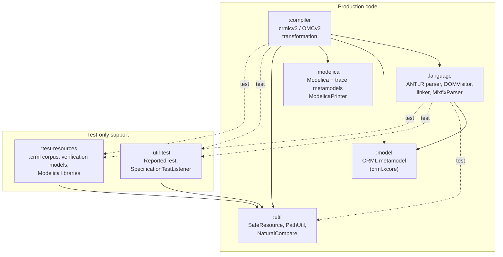

Solid arrows are `implementation`/`api` dependencies; dotted arrows are `testImplementation` only.

Two points about this graph:
- **`:modelica` does not depend on `:model`.** Trace links point at plain `EObject`s, so the Modelica side never sees the CRML metamodel types. Only `:compiler` sees both sides.
- `:model` and `:modelica` expose EMF (`ecore`, `common`, `xcore.lib`) as `api` dependencies. Projects that depend on them get `EObject` and `EList` without declaring EMF themselves.

### 2.2 Code generation inside the build

Three modules generate Java sources at build time. **None of the generated code is checked in**: everything lands under `build/`, and Gradle adds it as a source root automatically.

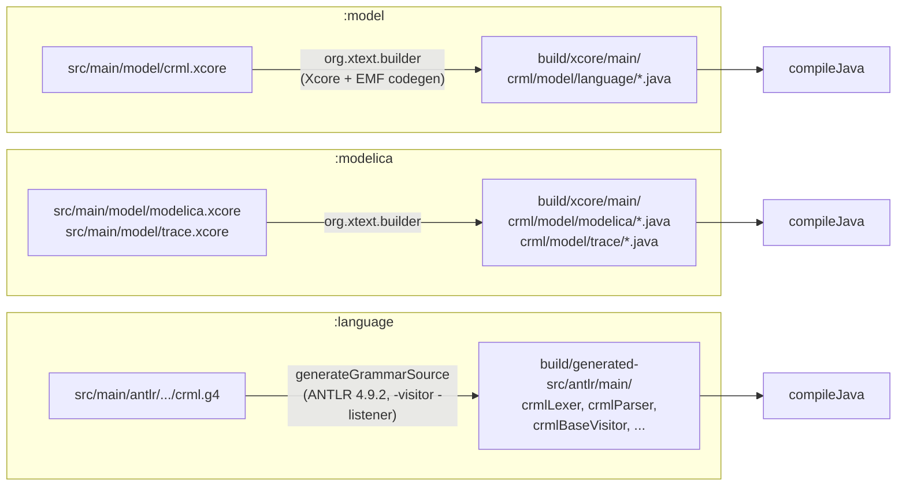

There is **no** Xtext grammar (`.xtext`), no MWE2 workflow and no `.ecore` file in the project. Xtext is used only as the engine that processes `.xcore` files. The sources of truth are:

| Artifact | Source of truth |
|---|---|
| CRML object model | [submodules/model/src/main/model/crml.xcore](../submodules/model/src/main/model/crml.xcore) |
| Modelica object model | [submodules/modelica/src/main/model/modelica.xcore](../submodules/modelica/src/main/model/modelica.xcore) |
| Trace model | [submodules/modelica/src/main/model/trace.xcore](../submodules/modelica/src/main/model/trace.xcore) |
| CRML concrete syntax | [submodules/language/src/main/antlr/crml/language/grammar/crml.g4](../submodules/language/src/main/antlr/crml/language/grammar/crml.g4) |
| Operator/type signatures | [submodules/language/src/main/resources/res/crml/language/typeinference.csv](../submodules/language/src/main/resources/res/crml/language/typeinference.csv) |
| Modelica emission target | `CRMLtoModelica.mo` (see §9) |

---

## 3. The compilation pipeline end to end

The active pipeline turns a `.crml` file into a `TranslationResult`. A `TranslationResult` holds:
- a Modelica object model;
- a trace model linking CRML elements to Modelica elements;
- a list of diagnostics;
- the printed `.mo` text.

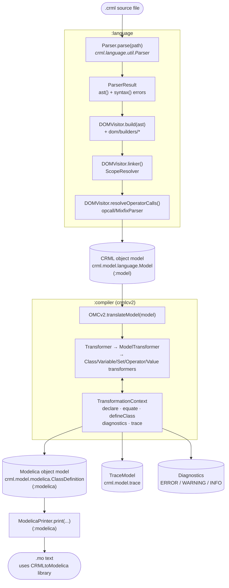

The same steps in code, as used by `OMCv2SpecificationTest`:

```java
ParserResult parsed = Parser.parse(path);                  // :language
DOMVisitor visitor = new DOMVisitor();
Model model = (Model) visitor.build(parsed.ast()).get();   // object model
visitor.linker();                                          // resolve names
visitor.resolveOperatorCalls();                            // mixfix → ComputedValue
TranslationResult r = OMCv2.translateModel(model);         // :compiler
String mo = r.text();                                      // ModelicaPrinter
```

`OMCv2.translate(model)` is a shortcut that returns only the text.

The pipeline is **diagnose-not-throw**:
- A construct that cannot be translated produces a `Diagnostic`.
- It also leaves a `Placeholder` comment in the `.mo` output.
- Only the declaration or equation that contains it is dropped. The rest of the model is still generated.

---

## 4. Submodule `model`: the CRML metamodel

**Path:** [submodules/model](../submodules/model) · **Package:** `crml.model.language` · **Depends on:** nothing

### Role

This module defines the CRML object model (often called the *DOM* in the code) as an EMF metamodel written in Xcore:
- `:language` builds instances of this model from parsed source.
- `:compiler` reads those instances.

All Java is generated. The only hand-written logic is a few operation bodies written directly in Xcore, such as `CustomOperator.getArity()` and `Sequence.tail()`.

### Important concepts in `crml.xcore`

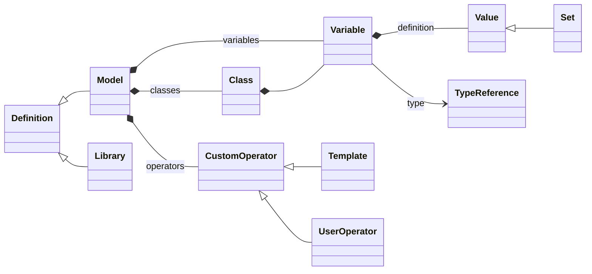

The diagram is a simplified excerpt. The main groups of elements are:

| Group | Elements |
|---|---|
| Structure | `Library`, `Model`, `Package`, `Class`, `Variable`, `Object`, `Set`, `Binding`, `ModelDependency` |
| Operators | `UnaryOperator` and `BinaryOperator` (with `BuiltinUnary/BinaryOperatorKind`); `CustomOperator` → `Template`, `UserOperator`. A custom operator's header is a list of `Keyword` and `Variable` elements. |
| Values | `VariableReference`, `ComputedValue`, `PeriodsValue`, `IntegrateValue`, `IfValue`, `ConstructorValue`, `ProjectionValue`, plus constants |
| Unresolved calls | `Sequence`, `SequenceValue`, `SequenceKeyword`: raw word sequences of a mixfix operator call, before `MixfixParser` turns them into `ComputedValue` |
| Types | `BuiltinTypeReference` (`BuiltinType` enum), `UserTypereference`, `IndirectTypeReference` |

### Gradle tasks

| Task | Purpose |
|---|---|
| `:model:build` | Runs the Xcore generator, then compiles. This happens automatically before `compileJava`. |
| `:model:generateGenModel` | Writes `build/generated/model.genmodel`. For inspection only. |
| `:model:generateMermaid` | Writes a Mermaid class diagram of the whole metamodel to `build/generated/crml-diagram.mmd`. It needs GitHub Packages credentials (`gpr.user`/`gpr.key` or `GITHUB_ACTOR`/`GITHUB_TOKEN`) for `emf-mermaid`; no other task needs them. |

### Development flow

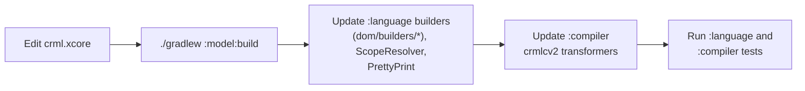

---

## 5. Submodule `language`: parser and object-model builder

**Path:** [submodules/language](../submodules/language) · **Packages:** `crml.language.*` · **Depends on:** `:model`

### Role

`:language` is the CRML front end. It turns `.crml` text into a linked `crml.model.language` object model in four stages:

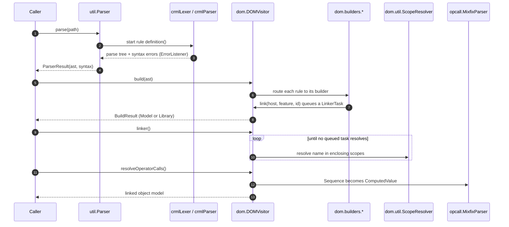

### Important parts

| Area | Location | Notes |
|---|---|---|
| Grammar | `src/main/antlr/crml/language/grammar/crml.g4` | A single combined grammar. Start rule: `definition`. |
| Parser entry | `util/Parser.java`, `util/ErrorListener.java` | `parse(File, Path, String or CharStream)` returns `ParserResult` with `ast()`, `syntax()` and `toPrettyTree()`. |
| Object-model construction | `dom/DOMVisitor.java`, `dom/BuildContext.java` | Extends the generated `crmlBaseVisitor<BuildResult>` and routes each rule to a builder. |
| Builders | `dom/builders/` | `RootBuilder`, `ClassBuilder`, `VariableBuilder`, `TypeReferenceBuilder`, `ExpressionBuilder` (with unary, binary, projection and periods helpers), `ConstantBuilder`, `ConstructorBuilder`, `UserOperatorBuilder`, `TemplateBuilder` |
| Linking | `dom/util/ScopeResolver.java`, `ScopeResolutionOptions.java` | Name references are queued during the build and resolved later by `linker()`. Lookup walks up the containers: Class, Model, and the operator header. The `CONSTRUCTOR_BINDING` strategy resolves binding names against the variables of the constructor's class. |
| Mixfix calls | `opcall/MixfixParser.java`, `SequenceCursor`, `Fix`, `Association`, `OperatorUtil`, `TypeCheck` | Resolves calls to user operators written as natural-language words. Must run **after** `linker()`. Type checking is currently a stub. |
| Debug output | `pretty/PrettyPrint.java`, `pretty/Misc.java` | Dumps the object model for debugging. This is not a CRML serializer. |
| Types | `types/TypeInference.java` | A skeleton. Today only constants get a return type. |

There is no separate validation layer. Errors surface as exceptions from `BuildContext.reportError` and from the linker.

### Tests

There are two parallel suites with the same 14 class names (`TypeBoolean`, `TypeClass`, `TypeClock`, …):

| Suite | Checks |
|---|---|
| `crml.language.specification.*` | Parsing only: a model is accepted exactly when it is valid. |
| `crml.language.dom.specification.*` | Parse, build and link without exceptions. Run with `make test-dom`. |

Test data comes from two places:
- `src/test/resources/specs/<category>/*.correct.crml` and `*.faulty.crml`. A `.disabled` suffix skips a file.
- The shared `testModels/spec-doc-examples/` corpus in `:test-resources`.

`crml.language.dom.DebugModelTest` reads `src/test/resources/debug/debug.crml` and prints every stage of the pipeline. It is a convenient scratch harness.

### Development flow

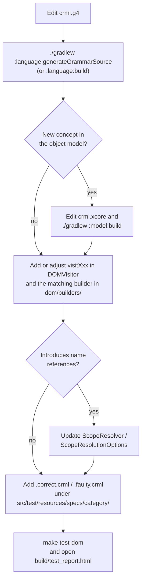

---

## 6. Submodule `modelica`: Modelica metamodel, trace model and printer

**Path:** [submodules/modelica](../submodules/modelica) · **Packages:** `crml.model.modelica`, `crml.model.trace`, `crml.modelica.*` · **Depends on:** nothing

### Role

This module replaced the compiler's old string-based code generation. It has three parts:
- **Modelica metamodel** (`modelica.xcore`). The compiler builds a tree of these objects.
- **Printer** (`ModelicaPrinter`). Turns any node of that tree into deterministic `.mo` text.
- **Trace metamodel** (`trace.xcore`). `TraceModel` holds `TraceLink`s. Each link records a CRML element, the Modelica element it produced, a `TraceLinkKind` and a note.

The metamodel only covers what the transformation produces:

| Category | Elements |
|---|---|
| Classes and components | `ClassDefinition` (with `ClassKind`), `ExtendsClause`, `ComponentDeclaration`, `ArrayDimension`, `ModificationElement` |
| Equations and statements | `Equation`, `Statement` |
| Gaps | `Placeholder`, printed as a comment where a diagnosed gap was left |
| Expressions | `ComponentReference`, binary and unary expressions, `FunctionCall`, `IfExpression`, `ArrayConstructor`, parenthesized expressions, literals |
| References | `Reference<T>` (see below) |

A `Reference<T>` names a type, an extended class or a function in one of two ways:
- **Resolved:** points at a target element. The printer computes the qualified name from the containment tree and quotes it.
- **Raw:** carries `rawText` and a `RawReason` (for example a library or builtin name). The printer prints the text unchanged.

[design/reference-resolution.md](design/reference-resolution.md) explains this design.

### Important classes

| Class | Purpose |
|---|---|
| `crml.modelica.build.Modelica` | Mixin interface of `default` factory helpers: `model`, `block`, `function`, `component`, `mod`, `eq`, `assign`, `call`, `binary`, `ifExpr`, `array`, `ref("a.b")`, `resolvedRef`, `rawRef`, `libraryRef`, `builtinRef`, `mslRef`, `placeholder`, the literals, and so on. Every compiler transformer `implements Modelica`, so it can call these helpers unqualified. |
| `crml.modelica.print.ModelicaPrinter` | `print(ModelicaElement[, PrinterOptions])` and `expression(Expression)`. |
| `print.Precedence` | Modelica operator precedence, used to add only the parentheses that are needed. |
| `print.Identifiers` | Reserved words, quoting and string escaping. |
| `print.IndentingWriter`, `print.PrinterOptions` | Output formatting. |

### Tests

- `ModelicaPrinterTest`: exact-text tests for every metamodel class.
- `LibraryRoundTripTest`: hand-builds `CRMLtoModelica.Types.Event` and `Functions.and4`, then checks that the printer reproduces them byte for byte.

Run them with `./gradlew :modelica:test`.

### Development flow

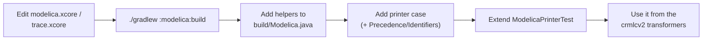

---

## 7. Submodule `compiler`: the CRML to Modelica transformation

**Path:** [submodules/compiler](../submodules/compiler) · **Main package:** `crml.compiler.crmlcv2` · **Depends on:** `:language`, `:model`, `:modelica`, `:util`

### 7.1 Two pipelines

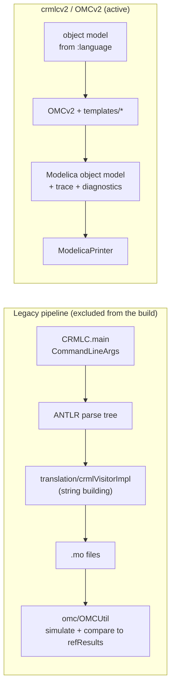

**Legacy pipeline** (`CRMLC.java`, `crml/compiler/translation/**`, tests in `src/test/java/ctests/**`):
- It walked the ANTLR parse tree and concatenated Modelica strings.
- It no longer compiles against the current grammar, so [compiler/build.gradle.kts](../submodules/compiler/build.gradle.kts) excludes it.
- It is kept on disk for reference, and the design docs still cite it as "LEGACY".

**crmlcv2** is the active pipeline:
- It reads the EMF object model, not the parse tree.
- It builds a typed Modelica object model and records traces and diagnostics along the way.
- It has no command-line entry point yet. It is reached through the `OMCv2` API and the tests.

These classes are still compiled but are used only by the legacy flow: `CommandLineArgs` and everything in `omc/` (`OMCUtil`, `CompileSettings`, `OMCmsg`, `runtime/OMCRunner`).

### 7.2 crmlcv2 structure

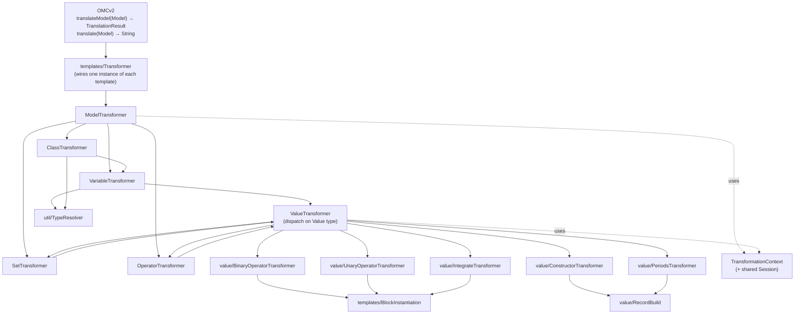

| Class | Responsibility |
|---|---|
| `OMCv2` | Facade. Returns a `TranslationResult` with `modelica()`, `trace()`, `diagnostics()`, `text()` and `hasErrors()`. |
| `TransformationContext` | Context for the class currently being generated, plus a `Session` shared across classes. **All IR is emitted through it**: `declare(component, src)`, `equate(equation, src)` and `defineClass(...)`. Each call adds a trace link automatically. It also provides deterministic name allocation (`allocateName(prefix)`, `allocateClassName`), diagnostics (`report`, `reportOnce`, `reportWithPlaceholder`), the registries of generated classes and operators, cycle detection, and `nested(target)` for nested classes. |
| `Diagnostic`, `Diagnostics` | Severity is ERROR, WARNING or INFO. Factories: `incompatibleTypes` (ERROR), and `unsupported`, `libraryGap`, `notYetImplemented` (all WARNING). |
| `UnsupportedConstruct` | Runtime exception that carries a `Diagnostic`. Value transformers throw it. The declaration or equation boundary catches it, drops only that element, and leaves a `Placeholder`. |
| `ModelTransformer` | CRML `Model` → Modelica `model`, marked `partial` when some variable has no binding. Order of work: (1) reserve names; (2) classes in two passes, shell first and body second, so forward references work without a link phase; (3) custom operators; (4) variables; (5) sets; (6) library and object features become library-gap placeholders. |
| `ClassTransformer` | CRML class → nested Modelica `model` (never a `record`). Superclasses become `extends`, partial classes become `partial`, and variable definitions become equations. |
| `VariableTransformer` | Variable → component with a binding. `constant` maps to CONSTANT. A set-valued variable becomes an array. |
| `OperatorTransformer` | Templates and user operators → nested classes named `op_<keywords>`. If the body needs no hoisted components, it becomes a **`function`** and calls become function calls. Otherwise it becomes a **`block`** (`out = expr`) and calls become instantiations. Each operator is emitted once, and recursion cycles are detected. |
| `SetTransformer` | Set → array literal `{a, b, c}` or an array component. |
| `ValueTransformer` | Dispatches on every `Value` subtype and always returns an `Expression` or throws `UnsupportedConstruct`. |
| `BlockInstantiation` | Hoists a stateful library block: declares `Block nameN;`, adds `nameN.r1 = …` equations, and returns `nameN.out`. |
| `RecordBuild` | Declares a library record together with its `_build` companion block, e.g. `CRMLClock cN(...)` + `CRMLClock_build`, or `Event` + `CRMLEvent_build`. |
| `TypeCategories` | "Is X or unknown" type predicates. They are needed because `Value.getReturnType()` is filled in only for constants. |
| `util/TypeResolver` | The single place that decides how a CRML type becomes a Modelica type reference (table below). |

`TypeResolver` maps types as follows:

| CRML type | Modelica reference |
|---|---|
| `Boolean`, `Requirement` | `CRMLtoModelica.Types.Boolean4` |
| `Period` / `Periods` | `Types.CRMLPeriod` / `Types.CRMLPeriods` |
| `Event` | `Types.Event` |
| `Clock` | `Types.CRMLClock` |
| `Real`, `Integer`, `String` | Modelica builtins |
| A CRML class | Resolved reference to the generated class |
| Anything else | Raw reference marked UNRESOLVED, plus an ERROR diagnostic. It never throws. |

### 7.3 How a value is transformed

This example shows how a typical stateful expression is lowered. `x` is a Real and `P` is a period.

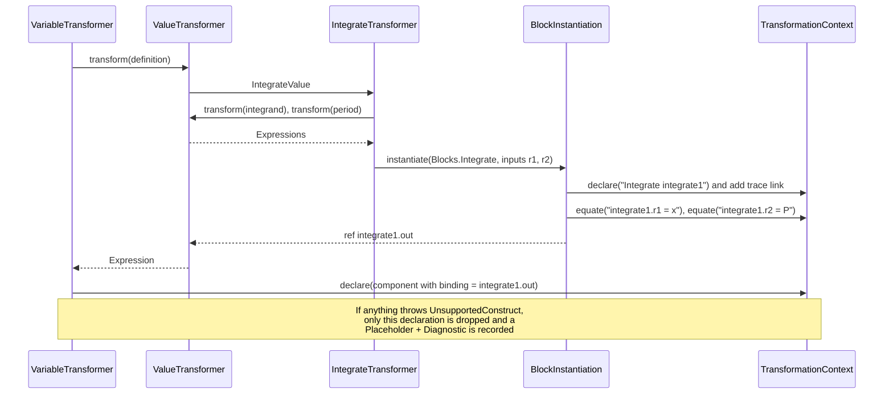

The main lowering conventions are:
- **Boolean4.** CRML Booleans are four-valued (`true4`, `false4`, `undecided`, `undefined`). Logic operators therefore become calls to `CRMLtoModelica.Functions.and4`, `or4`, `not4`, `add4` and `mul4`.
- **Comparisons and conditions.** Comparisons go through `cvBooleanToBoolean4`. An `if` condition is tested as `cond == Boolean4.true4`.
- **Pure operations** become `call(libraryRef(...))`.
- **Stateful operations** (`filter`, `integrate`, `card`, `tick`) are hoisted into block instances with `BlockInstantiation`.
- **Clocks, events and periods** are built with `RecordBuild`.
- **Math functions** (`sin`, `cos`, …) map to `Modelica.Math.*`, which requires the Modelica Standard Library.

### 7.4 Development flow: adding support for a CRML construct

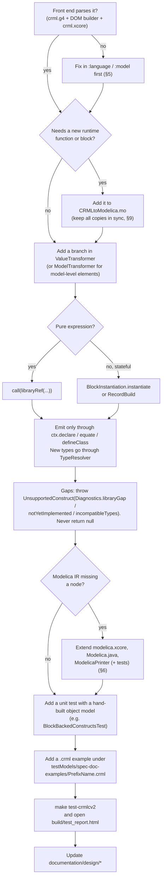

---

## 8. Support submodules: `util`, `util-test`, `test-resources`

### `util`

`util` holds small helpers used by the compiler and the tests:
- `SafeResource.get(name)`: turns a classpath resource into a `Path`.
- `PathUtil`: formats paths as UNIX or absolute strings, for example when building omc scripts.
- `NaturalCompare` and its nested `PathCompare`: natural-order sorting of file names.

### `util-test`

`util-test` is the shared JUnit 5 reporting framework. It is compiled as **main** code so that other modules can use it from their tests.

| Class | Purpose |
|---|---|
| `crml.test.ReportedTest` | Base class for parameterized spec tests. `emit(value, key)` attaches a section to the HTML report, such as the CRML source, the object model, the generated Modelica, the trace, diagnostics or an exception. |
| `crml.test.SharedParameter` | Per-test key/value store, implemented as a JUnit `ParameterResolver`. |
| `crml.test.SpecificationTestListener` | `TestExecutionListener` that writes **`build/test_report.html`** using ExtentReports and j2html. It is registered via `src/test/resources/META-INF/services/org.junit.platform.launcher.TestExecutionListener` in both `:language` and `:compiler`. |
| `crml.test.CustomHtmlReporter`, `FormatUtil` | Hooks for custom rendering of emitted values, and line-numbered code output. |

### `test-resources`

`test-resources` is the shared test corpus, shipped as classpath resources. `crml.test.TestResourcesRoot.RESOURCES` finds the root of the corpus through the marker file `testResourcesRoot`. The build also adds [resources/crml_tutorial](../resources/crml_tutorial) to these resources.

```
submodules/test-resources/src/main/resources/
├── testModels/                      213 .crml files
│   ├── spec-doc-examples/           examples from the specification, named <Type><Feature>[_no_ext].crml
│   ├── libraries/                   ETL.crml, FORM-L.crml, ETL_test/, FORML_test/
│   ├── use-cases/                   TwoTanks, Contract, ICS_educational (SRI), ...
│   └── crml-modelica-library-examples/TrafficLight/
├── verificationModels/<cat>/<Name>/ <Name>_verif.mo and <Name>_externals.mo (simulation harness)
├── refResults/<cat>/                <Name>_verif_ref.mat reference simulation results
├── modelica_libraries/              CRMLtoModelica.mo, CRML.mo (EDF), CRML_test/
└── testResourcesRoot                marker file
```

`verificationModels/` and `refResults/` were used by the legacy omc-based test flow (§10.3). The crmlcv2 tests do not use them at present.

---

## 9. The Modelica runtime library `CRMLtoModelica.mo`

Generated Modelica code refers to `CRMLtoModelica`, a small runtime library. It is the **only** emission target (decision #1 in [design/modelica-metamodel-plan.md](design/modelica-metamodel-plan.md)). It contains three packages:

| Package | Contents |
|---|---|
| `Types` | `Boolean4` (enum), `CRMLClock`, `CRMLPeriod`, `CRMLPeriods` and `Event`, each with a `_build` companion |
| `Functions` | `cvBooleanToBoolean4`, `and4`, `or4`, `not4`, `add4`, `mul4`, `PStart`, `PEnd`, `gEV`, `lEV`, `Event2Boolean`, truth tables |
| `Blocks` | `EventFilter`, `Integrate`, `ClockTick`, `CardClock`, `BoolTick`, `unaryBoolAnd`, `ClockAdd`, `setAnd` |

The library exists in **four copies**:

| Copy | Status |
|---|---|
| [CRMLtoModelica.mo](../CRMLtoModelica.mo) (repo root) | identical to the next two |
| `submodules/compiler/src/main/resources/modelica_libraries/CRMLtoModelica.mo` | identical |
| `submodules/test-resources/src/main/resources/modelica_libraries/CRMLtoModelica.mo` | identical; loaded at runtime by `OMCUtil` |
| `libraries/modelica/CRMLtoModelica.mo` | **differs** from the other three; loaded by CI |

When you change the library, update all copies, or better, reduce them to one.

---

## 10. Testing and HTML reports

### 10.1 Running tests

| Command | What it runs |
|---|---|
| `./gradlew test` / `make test` | All tests in all modules |
| `make test-dom` | `:language` object-model spec tests (`crml.language.dom.specification.*`) |
| `make test-crmlcv2` | `:compiler` crmlcv2 spec tests (`crml.compiler.crmlcv2.specification.*`) |
| `./gradlew :modelica:test` | Printer tests |
| `./gradlew :compiler:test --tests "crml.compiler.crmlcv2.specification.TypePeriod"` | A single spec class |

> **`ignoreFailures = true`** is set in `:language`, `:compiler`, `:util` and `:util-test`. Failing tests **do not fail the build**, so always read the report or the console summary.

### 10.2 Specification tests and reports

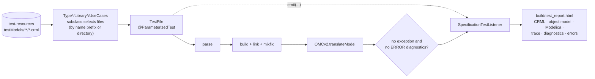

The compiler has two kinds of tests in `crml.compiler.crmlcv2`.

**Spec tests** (`specification/*`) run over the corpus:
- `TypeBoolean` … `TypeTemplate` select from `spec-doc-examples` by file-name prefix.
- `LibraryETL` and `LibraryFORML` use `libraries/ETL_test` and `libraries/FORML_test`.
- `UseCases` uses `use-cases`.

Models that fail to parse are skipped. WARNING diagnostics are allowed.

**Unit tests** use hand-built object models:

| Test | Covers |
|---|---|
| `OMCv2TransformationTest` | Partial models, equations, deterministic names, trace, diagnose-not-throw |
| `OperatorTransformationTest` | Function vs block, emitted once, cycles |
| `BlockBackedConstructsTest` | card, tick, filter, integrate, periods |
| `ClassAndSetTest` | Classes and sets |
| `DiagnosticFloorTest` | Every construct yields Modelica or a diagnostic |
| `ReferenceResolutionTest` | Raw vs resolved references, quoting, forward references |

`ClassAndSetTest` builds its models by hand because no class-bearing corpus model parses today.

The report sections are rendered by wrapper classes in `crml.compiler.util` (`CodeWrapper`, `TraceWrapper`, `DiagnosticsWrapper`, `ObjectModelWrapper`, …). Each implements `CustomHtmlReporter`.

### 10.3 OpenModelica simulation (legacy only)

The crmlcv2 tests check structure only. **They do not run `omc`.**

The legacy `ctests` (now excluded) did run `omc`, through `crml.compiler.omc.OMCUtil`:

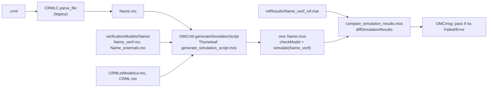

To bring simulation-based verification back for crmlcv2, connect `OMCv2.translate` to this flow (or to `omc/runtime/OMCRunner`). [design/modelica-metamodel-verification.md](design/modelica-metamodel-verification.md) records the corpus status at the last manual verification pass: 213 models, of which 153 translate and 57 fail to parse.

---

## 11. Development workflows

### 11.1 Day-to-day

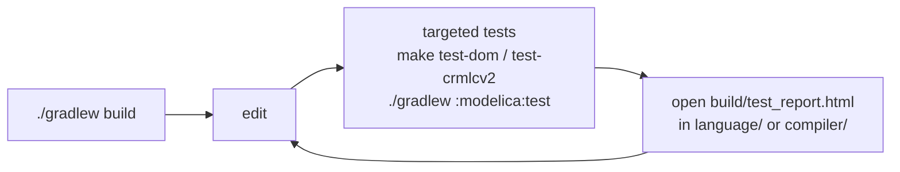

### 11.2 Which module do I change?

| You want to… | Change | Then |
|---|---|---|
| Accept new CRML syntax | `crml.g4` in `:language` | `DOMVisitor` + builder, spec files, `make test-dom` |
| Represent a new CRML concept | `crml.xcore` in `:model` | builders in `:language`, transformers in `:compiler` |
| Fix name lookup in CRML | `ScopeResolver` / `ScopeResolutionOptions` | `make test-dom` |
| Fix mixfix operator call resolution | `opcall/MixfixParser` | `DebugModelTest`, `make test-dom` |
| Generate different Modelica for a construct | `crmlcv2/templates/**` | unit test + `make test-crmlcv2` |
| Change how a CRML type maps to Modelica | `crmlcv2/util/TypeResolver` | `ReferenceResolutionTest` |
| Emit a new kind of Modelica node | `modelica.xcore`, `Modelica.java`, `ModelicaPrinter` | `:modelica:test` |
| Add a runtime block or function | `CRMLtoModelica.mo` (all copies) | the transformer that emits it |
| Add a test model | `test-resources/.../testModels/<cat>/` | picked up automatically by prefix or directory |

### 11.3 Conventions in crmlcv2

- Emit IR **only** through `TransformationContext` (`declare`, `equate`, `defineClass`), so that every element has a trace link.
- Value transformers return an `Expression` or throw `UnsupportedConstruct`. They never return `null`.
- Allocate names with `ctx.allocateName(prefix)`, never with static counters, so that output is deterministic.
- Look up generated classes by CRML object identity through the context registries, not by searching names.
- Decide raw vs resolved references in `TypeResolver` (for types) or at the point where the reference is built.
- Keep the code compatible with Java 8.

---

## 12. CI and distribution

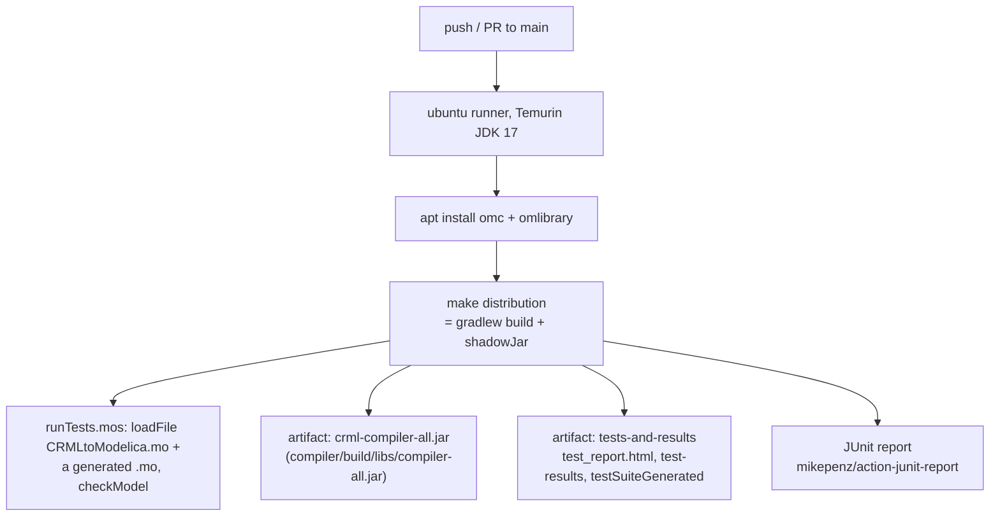

- The workflow is [.github/workflows/makefile.yml](../.github/workflows/makefile.yml).
- `make distribution` builds the fat jar `submodules/compiler/build/libs/compiler-all.jar` with the Shadow plugin.

---

## 13. Known loose ends

These issues were found while writing this guide. They are worth fixing or keeping in mind:

- **The jar has no working entry point.** `application.mainClass`, the jar manifest and the `crmlc` task all still name `crml.compiler.CRMLC`, which is excluded from compilation. `java -jar compiler-all.jar` fails, and the `--testsuite` flag described in the root README no longer exists. crmlcv2 needs a CLI.
- **The CI `omc` step checks nothing.** It checks `build/testSuiteGenerated/.../BooleanAccumulation.mo`, which only the legacy `ctests` wrote.
- **Two Makefile targets match nothing.** `make test-etl` and `make test-forml` select `ctests.*`, which is excluded from the build.
- **The runtime library has drifted.** The four copies of `CRMLtoModelica.mo` are now two different versions (§9).
- **Some leftovers can be deleted or fixed:**
  - `submodules/experiments/` and `submodules/server/` contain only stale build output.
  - The `:model` `application` main class `crml.model.Main` does not exist.
  - `:util` and `:util-test` apply the ANTLR plugin without having a grammar.
  - `refResults/META-INF/services/...` names a listener class that does not exist.
- **Gaps in the front end** (listed in [design/modelica-metamodel-verification.md](design/modelica-metamodel-verification.md) §6):
  - `class` bodies and `X filter (...)` do not parse.
  - `MixfixParser` does no type checking.
  - Type inference covers only constants.
  - Set-typed declarations lose their set-ness.
