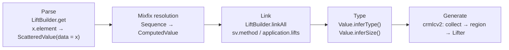
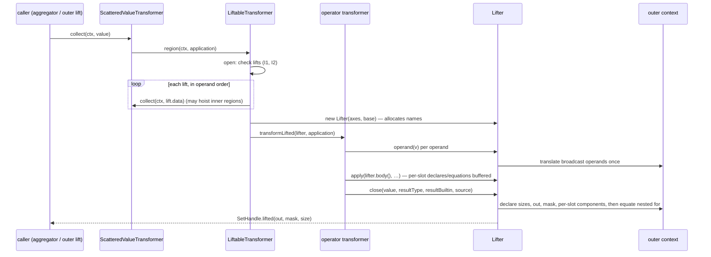

# Lifting `.element` in the crmlcv2 generator

Revision 3, 2026-11-24. Describes branch `elephant` at `200c489`, where lifting is implemented.
It replaces revision 2, which was the implementation specification. The decisions recorded there
are kept in §6, each with its reason.

All paths are relative to the repository root `CRML/`. Abbreviations:

| Short | Path |
|---|---|
| `crmlcv2/` | `submodules/compiler/src/main/java/org/openmodelica/crml/compiler/crmlcv2/` |
| `typing/` | `submodules/model/src/main/java/org/openmodelica/crml/model/base/typing/` |
| `testModels/` | `submodules/test-resources/src/main/resources/testModels/` |

Items marked **Experimental** are behaviour that the maintainer accepted for now and wants to
review once real models use it. Items marked **Temporary** are designs to be revisited.

---

## 1. What lifting is

In CRML, an operator that takes a single value can be applied to every element of a
collection. To do this, write `x.element` as the operand:

```crml
Operator [ Boolean ] 'negate' Boolean b = not b;
Boolean S is { b1, b2 };

Boolean all_negated is and ('negate' S.element);
```

`'negate' S.element` is the set `{ 'negate' b1, 'negate' b2 }`. The aggregator `and (…)` folds
that set into one Boolean.

The rules:

- **Application.** An `.element` lifts the application that it is a *direct operand* of. That
  application is a call to a user operator, a built-in unary operator, or a built-in binary
  operator. Parentheses around the `.element` are ignored (**Experimental**).
- **Cartesian product.** An application with *k* lifted operands is evaluated once for every
  combination of their elements. Each `.element` is a separate axis, even when two of them name
  the same collection: `'f' A.element 'with' A.element` has `n × n` results.
- **Broadcast.** Operands that are not lifted are evaluated once and are the same for every
  combination.
- **The result is a set.** It is valid only in a *set position*:
  - as the `x` of another `x.element`, which is called *chaining*:
    `'h' ('g' A.element).element 'with' B.element`;
  - as the operand of an aggregator: `and (…)`, `or (…)`.

  A set never turns into a single value on its own. `'f' ('g' A.element)` is an error.
- **`.element` under an aggregator** is not a lift. It denotes the set of the elements of `x`, so
  `and (S.element)` means `and (S)`.
- **`.element` anywhere else** is an error, for example under `if`, `integrate`, `new`, a set
  literal, or directly in a variable definition (**Experimental**).

You can lift over the following collections:
- a set literal;
- a variable defined by a set literal;
- the result of another lifted application;
- a `Periods` value. The generator supports this, but the bundled library does not yet (§7.1).

---

## 2. Core ideas of the translation

Modelica has fixed-size arrays and no comprehensions. So each lifted application becomes a
*region*: a fixed block of declarations and nested `for` loops in the class being generated.

| Idea | What it means |
|---|---|
| **Region** | One lifted application produces: one size parameter per axis and their product; a result array `out` and a mask array `mask`, both of that size; the components needed once per combination; and one `for` loop per axis. The result of the application is the pair (`out`, `mask`). |
| **Slot** | One combination of the axes' indices. The slot of `(i1, …, ik)` is numbered 1-based and row-major (Horner form): `(…((i1 − 1)·n2 + i2 − 1)·n3 + …)·nk + ik`. For one axis, the slot is `i1`. Slots are never compacted, so a slot's number does not change over time. |
| **Active slot, mask** | A collection is a fixed-size buffer. A `Periods` value would have room for `size(P.period, 1)` periods, but only the first `P.counter` exist at a given time. The application is evaluated in every slot, because array sizes are fixed. `mask[p]` records whether every axis is active at slot `p`. A plain array is always fully active, so its mask is `true`. |
| **`undefined` in inactive slots** | For a Boolean or Requirement result, `out[p] = if mask[p] then v else Boolean4.undefined`. `undefined` is the identity of `and4`, `or4` and `add4`, so an aggregator can fold `out` and ignore the mask. |
| **Set positions and scalar positions** | Values are translated through two entry points. `ValueTransformer.transform` is for positions that expect one value. `ScatteredValueTransformer.collect` is for positions that expect a collection, and it returns a `SetHandle`. A lifted application reached through `transform` is an error. |
| **Lifted mode of the context** | Each operator transformer reuses its scalar logic unchanged. It is given a `TransformationContext` in *lifted mode*. In that mode, `declare` turns a component into an array with one entry per slot, and `equate` places the equation inside the loop body. So a block-backed operator gets one instance per slot without knowing that it is lifted. |
| **Plan, body, emit** | The `Lifter` plans the region (axes and names), lets the operator build the body, and then emits everything at once in `close()`. If something fails before `close()`, nothing of the region reaches the class. |
| **Evaluate once** | Broadcast operands, and the collection of each axis, are translated in the *outer* context, before the loop exists. So they are computed once, and a stateful operand is not duplicated per slot. |

### 2.1 Example: real generated output

From `testModels/lifting/LiftOneAxis_no_ext.crml` (with the helper variables omitted). This
output passes `checkModel` and simulates.

```crml
Operator [ Boolean ] 'negate' Boolean b = not b;                                   // -> function
Operator [ Boolean ] 'evaluate' Boolean phi 'over' Period P = integrate phi on P;  // -> block
Boolean S is { b1, b2 };
Boolean all_negated   is and ('negate' S.element);
Boolean all_evaluated is and ('evaluate' S.element 'over' P1);   // P1 is broadcast
```

```modelica
    CRMLtoModelica.Types.Boolean4 S[2] = {b1, b2};
    // region of 'negate' S.element
    parameter Integer op_negate_n1 = size(S, 1);
    parameter Integer op_negate_size1 = op_negate_n1;
    CRMLtoModelica.Types.Boolean4 op_negate_out1[op_negate_size1];
    Boolean op_negate_mask1[op_negate_size1];
    // aggregator and (...)
    CRMLtoModelica.Types.Boolean4 and_acc1[op_negate_size1 + 1];
    CRMLtoModelica.Types.Boolean4 all_negated = and_acc1[op_negate_size1 + 1];
    // region of 'evaluate' S.element 'over' P1: one block instance per slot
    parameter Integer op_evaluate_over_n1 = size(S, 1);
    parameter Integer op_evaluate_over_size1 = op_evaluate_over_n1;
    CRMLtoModelica.Types.Boolean4 op_evaluate_over_out1[op_evaluate_over_size1];
    Boolean op_evaluate_over_mask1[op_evaluate_over_size1];
    op_evaluate_over op_evaluate_over_1[op_evaluate_over_size1];
    ...
equation
    for i1 in 1:op_negate_n1 loop
        op_negate_mask1[i1] = true;
        op_negate_out1[i1] = if op_negate_mask1[i1] then op_negate(S[i1]) else CRMLtoModelica.Types.Boolean4.undefined;
    end for;
    and_acc1[1] = CRMLtoModelica.Types.Boolean4.undefined;
    for i2 in 1:op_negate_size1 loop
        and_acc1[i2 + 1] = CRMLtoModelica.Functions.and4(and_acc1[i2], op_negate_out1[i2]);
    end for;
    for i3 in 1:op_evaluate_over_n1 loop
        op_evaluate_over_mask1[i3] = true;
        op_evaluate_over_1[i3].phi = S[i3];
        op_evaluate_over_1[i3].P = P1;                     // broadcast, not indexed
        op_evaluate_over_out1[i3] = if op_evaluate_over_mask1[i3] then op_evaluate_over_1[i3].out else CRMLtoModelica.Types.Boolean4.undefined;
    end for;
    ...
```

Two axes plus chaining, from `LiftTwoAxes_no_ext.crml`:
`or ('both' ('negate' S.element).element 'with' T.element)`. The inner region comes first. The
outer region uses the inner region's `out` as its elements and the inner region's `mask` as the
axis's active flag:

```modelica
    parameter Integer op_both_with_n5 = op_negate_size1;
    parameter Integer op_both_with_n6 = size(T, 1);
    parameter Integer op_both_with_size3 = op_both_with_n5 * op_both_with_n6;
    ...
    for i8 in 1:op_both_with_n5 loop
        for i9 in 1:op_both_with_n6 loop
            op_both_with_mask3[(i8 - 1) * op_both_with_n6 + i9] = op_negate_mask1[i8];
            op_both_with_out3[(i8 - 1) * op_both_with_n6 + i9] = if op_both_with_mask3[(i8 - 1) * op_both_with_n6 + i9] then op_both_with(op_negate_out1[i8], T[i9]) else CRMLtoModelica.Types.Boolean4.undefined;
        end for;
    end for;
```

To get this output for any model, run the verification test (§8.3). The generated files are
written under `submodules/compiler/build/testSuiteGenerated/verification/lifting/`.

---

## 3. Pipeline



### 3.1 Object model (`submodules/model/src/main/model/crml.xcore`)

| Class | Role in lifting |
|---|---|
| `ScatteredValue` | `x.element`. `data` is `x`. `method` refers to the application that it lifts, or is `null`. |
| `Liftable` | An abstract mixin with `refers ScatteredValue[] lifts opposite method`. Its lifts are kept **in operand order**, which is also the axis order. |
| `ComputedValue extends Value, Liftable` | A call to a user operator. |
| `UnaryOperator extends Operator, Value, Liftable` | A built-in unary operator. Parentheses are a `UnaryOperator(SUBEXPRESSION)`. They are `Liftable` because of their class, but they never receive lifts. |
| `BinaryOperator extends Operator, Value, Liftable` | A built-in binary operator. An aggregator is a `BinaryOperator` whose `lhs == null`. It is `Liftable` because of its class, but it never receives lifts. |

Note that `rhs` is declared before `lhs` in `BinaryOperator`. So a tree walk in feature order
visits `rhs` first. The linker does not rely on visiting order.

### 3.2 Linking (`submodules/language/src/main/java/org/openmodelica/crml/language/dom/builders/LiftBuilder.java`)

`linkAll(root)` runs after mixfix resolution, so calls already are `ComputedValue`s. It visits
every `ScatteredValue` and calls `link(sv)`:

1. Climb out of any parentheses that hold only the `.element` (`operandSlot`).
2. Look at the container:
   - a `Binding` of a `ComputedValue` → link to the call. The position is the index of the
     formal in `operator.getVariables()`.
   - a `UnaryOperator` → link to it, at position 0.
   - a `BinaryOperator` with `lhs != null` → link to it. The position is 0 for `lhs` and 1 for
     `rhs`.
   - anything else → leave `method == null`. This covers an aggregator operand (on purpose) and
     every other container. For the other containers, the generator reports the error.
3. Insert `sv` into `application.getLifts()` before the first lift with a larger position. The
   EMF opposite sets `sv.method`. `link` is idempotent.

Linking is also done inside libraries (`testModels/library-loading/lifting_in_library`).

### 3.3 Typing (`typing/TypeInference.java`, `typing/SizeInference.java`)

`Value.inferType()` returns a `ValueType`, which is a base type plus a `Multiplicity`
(`SINGLE` or `SET`):

- `ScatteredValue`: the element type of `data`. With a `method`, it is a single value: one
  element. Without a method, it is a set.
- A `Liftable` with lifts: the per-combination result type, as a set (`lifted(…)`).
- Aggregator `and (…)`: one value of the set's element type.

`Value.inferSize()` gives the number of elements at compile time: the product of the axes'
sizes for a lifted application, and `PERIODS_CAPACITY = 50` for a `Periods`. The generator does
**not** use it. Generated code always uses Modelica `size(…)` expressions, so no generated text
contains a literal buffer size.

The generator gets types from `inferType()`:
- `Lifter.resultBuiltin` declares the result array from the application's inferred base type;
- `Lifter.operandBuiltin` gives each operand's type, which the operator's type checks use;
- `SetHandle.elementBuiltin` gives the element type of each axis.

---

## 4. Generation

### 4.1 Components

| Component | File | Responsibility |
|---|---|---|
| `ScatteredValueTransformer` | `crmlcv2/templates/ScatteredValueTransformer.java` | `collect(ctx, value) → SetHandle` for set positions. `transform(ctx, sv)` for an `.element` that reaches a scalar position, which always throws. |
| `LiftableTransformer` | `crmlcv2/templates/LiftableTransformer.java` | `region(ctx, application)` dispatches to the right operator transformer. `open(ctx, application)` checks the lifts, collects the axes and creates the `Lifter`. `unparen(value)` removes parentheses. |
| `Lifter` (with nested `LoopFrame`) | `crmlcv2/Lifter.java` | One per application. It holds the operand proxies, the lifted-mode context and `close()`. |
| `SetHandle` | `crmlcv2/SetHandle.java` | What the generator knows about a collection: `size`, `element(k)`, `active(k)`, `values`, `mask`, and the element type. **Temporary** (§6). |
| `TransformationContext`, lifted mode | `crmlcv2/TransformationContext.java` | `lifted(frame)`, `declareLifted`, the buffering `equate`, and `root()`, which always returns a normal-mode context. |
| `transformLifted(Lifter, …)` | `OperatorTransformer`, `value/UnaryOperatorTransformer`, `value/BinaryOperatorTransformer` | The per-element part of each kind of application. |
| `aggregate` | `value/BinaryOperatorTransformer.java` | Folds a `SetHandle` with `and4`/`or4`. |
| `BlockInstantiation.instantiate` | `crmlcv2/templates/BlockInstantiation.java` | Builds port references from the reference that `declare` returns (`member(instance, port)`), so they work for `inst[p]` in lifted mode. |
| Modelica builders and printer | `submodules/modelica/…/build/Modelica.java`, `…/print/ModelicaPrinter.java`, `modelica.xcore` | `parameter`, `ForEquation` (with `start` and `stop`, with no range node), `subscripted`, `member`. |

`Transformer` registers the two new templates as `scatteredValues()` and `liftables()`.

### 4.2 Call flow



### 4.3 `collect`: values in set positions

After `unparen`, the value is handled by the first rule that matches:

1. A `Liftable` with lifts: `liftables().region(ctx, v)`. This is how chaining works.
2. A `ScatteredValue` with `method == null`: `collect(ctx, v.getData())`. This is only valid as
   an aggregator operand.
3. A `Set` literal: it is stored in `T set<n>[m] = {…}`, and the result is `SetHandle.array`.
4. A `VariableReference` to a variable defined by a set literal: `SetHandle.array(ref)`. The
   variable is already declared as an array.
5. A single `Periods`: the value is translated. If the result is not a reference, it is stored
   in `CRMLPeriods periods<n>`. The result is `SetHandle.periods(ref)`.
6. Anything else: `Lift.NotACollection`.

The three kinds of `SetHandle`:

| Kind | `size()` | `element(k)` | `active(k)` |
|---|---|---|---|
| `array` | `size(a, 1)` | `a[k]` | always active (`null`) |
| `periods` | `size(P.period, 1)` | `P.period[k]` | `k <= P.counter` |
| `lifted` | `base_size` | `base_out[k]` | `base_mask[k]` |

### 4.4 `open`: planning

1. For each lift, check that it is a direct operand of the application (invariant I1), and that
   its `method` is the application (invariant I2). Then `collect` its `data` in the outer
   context. Inner regions are emitted here, so they precede the outer region.
2. For a `ComputedValue`, check each lifted formal's type against the element type, where both
   are known built-in types. Boolean and Requirement count as the same type, and Integer is
   accepted where Real is expected. On a mismatch: `Lift.ElementType`.
3. Choose the name base:
   - for a user operator, the generated class name (`declare` generates the operator class now);
   - for a built-in operator, the lower-case operator kind (`not`, `lt`, `tick`, …).
4. `new Lifter(...)` allocates every name of the region, `i<n>`, `<base>_n<n>`,
   `<base>_size<n>`, `<base>_out<n>` and `<base>_mask<n>`, through `outer.allocateName`. It
   creates the lifted-mode context. **It adds nothing to the class.**

### 4.5 `Lifter`: body and emit

- `operand(v)`: for a lifted operand, `axis.element(i_j)`. For any other operand, it is
  translated in `outer()`. It returns a new tree on every call.
- `body()`: the lifted-mode context. The operator's `apply` runs in it.
- `close(value, resultType, resultBuiltin, source)` emits, in this order:
  1. `parameter Integer <base>_n<j> = axis.size()` for each axis, then
     `parameter Integer <base>_size = n1 * … * nk`;
  2. `resultType <base>_out[size]` and `Boolean <base>_mask[size]`;
  3. the per-slot components that the body declared;
  4. the loop body:
     - `mask[p] = active_1 and … and active_k`, or `true` when every axis is always active;
     - the equations that the body buffered;
     - `out[p] = v`, wrapped in the `undefined` substitution when the result type is Boolean or
       Requirement;
  5. the nested `for` loops, with the first axis outermost, added with one `outer.equate`;
  6. for `k ≥ 2` with per-slot components, an INFO diagnostic `Lift.InstanceCount`.

  It returns `SetHandle.lifted(out, mask, size, resultType, resultBuiltin)`.

### 4.6 Lifted mode of `TransformationContext`

A lifted-mode context shares the outer context's session, target class, name counters and used
names. It holds a `LoopFrame`. Only `Lifter` creates one, through the package-private
`lifted(frame)`.

| Operation | Normal mode | Lifted mode |
|---|---|---|
| `declare(d, src)` | Adds `d` to the class and returns `ref(name)`. | Copies `d` and inserts the slot dimension **first**, so `name[p]` selects one slot whatever dimensions `d` has of its own. A binding becomes the body equation `name[p] = binding`. Buffers the copy and returns `name[p]`. A component with modifications → `Lift.BodyModification`. |
| `equate(e, src)` | Adds `e` to the class. | Buffers `e` as a loop-body equation. |
| `allocateName`, `reserveName`, `defineClass`, `report*`, `nested` | — | Same as in normal mode. Classes are never generated per slot. |
| `root()` | The root context. | Always a **normal-mode** context, even when the target is the root class. So an operator class that is first generated from inside a lifted body is never generated in lifted mode. |

Trace links: `close` declares the per-slot components against the application, not against
their original CRML source. It records the loop-body equations with `linkNestedEquation`.

### 4.7 Operator transformers

Each transformer is split into *operand evaluation* followed by a private `apply`. The scalar
`transform` evaluates the operands in `ctx`, then calls `apply(ctx, …)`. Its behaviour is
unchanged. `transformLifted` gets the operands from the `Lifter`, calls
`apply(lifter.body(), …)`, then calls `close`.

- **User operator** (`OperatorTransformer.transformLifted`):
  - A `function` is called once per slot.
  - A `block` is instantiated through `blocks().instantiate(lifter.body(), …)`, which gives an
    instance array automatically.
  - The result type comes from `GeneratedOperator.resultType()`, a copy of the type of `out`.
- **Built-in operators**: the same `apply` switch as for scalars. A block-backed built-in
  (`tick`, `card`, `filter`) gets one instance per slot, for example
  `CRMLtoModelica.Blocks.ClockTick tick1[N]`. The result type comes from `Lifter.resultBuiltin`,
  which is `inferType()`.
- **A lift inside an operator body**: the body is generated in its own nested context. The
  region is hoisted into the operator's class, which therefore becomes a `block`
  (`library-loading/lifting_in_library/Temporal.crml`).

### 4.8 Aggregators

`BinaryOperatorTransformer.transform` sends any `BinaryOperator` with `lhs == null` to
`aggregate`. It does not use `isAggregator()`, which also requires `rhs.isCollection()`
(`inferType().isSet()`). Inference returns *unknown* for incomplete or untyped operands, so an
aggregator would then fall through to the binary-operator path and fail with "a value is
missing". Dispatching on structure alone lets `collect` report the actual problem
(`Lift.NotACollection`).

- **`and` / `or`.** `s = collect(ctx, rhs)`. The transformer declares
  `Boolean4 <op>_acc<n>[s.size() + 1]` and emits:

  ```modelica
  acc[1] = undefined;
  for i in 1:size loop
      acc[i + 1] = and4|or4(acc[i], x_i);
  end for;
  ```

  The result is `acc[size + 1]`, which is `undefined` for an empty set. `x_i` is `s.element(i)`
  when the inactive slots already hold `undefined` (`SetHandle.inactiveIsUndefined()`, true for
  a Boolean lifted result) or when the set is always active. Otherwise `x_i` is
  `if s.active(i) then s.element(i) else undefined`.
- **Element type** known and not Boolean or Requirement: `incompatibleTypes`.
- **`+`, `-`, `*`**: `notYetImplemented("BinaryOperator.<op>.aggregate")`.

An aggregator never receives lifts itself.

---

## 5. Diagnostics

All of these are thrown as `CRMLCompilerException.unsupported(d)`, except `Lift.InstanceCount`,
which is only reported. The declaration that contains the failure becomes a placeholder. Tests
assert on `constructKind`.

| `constructKind` | Severity | Anchored at | When |
|---|---|---|---|
| `Lift.NotDirectArgument` | ERROR | the lift | A lift listed on an application is not one of its operands. This is a defensive check of invariant I1. |
| `Lift.WrongMethod` | ERROR | the lift | A lift is listed on an application but refers to another one. This is a defensive check of invariant I2. |
| `Lift.NotACollection` | ERROR | the `x` | `x.element` where `x` is not a set, a `Periods` or a lifted application. Also raised for a set literal whose element type is unknown. |
| `Lift.ElementType` | ERROR | the binding | The element type does not fit the formal. |
| `Lift.Unlinked` | ERROR | the lift | A linked lift reached `ValueTransformer`. This is a compiler defect. |
| `Lift.NoApplication` (**Experimental**) | WARNING (not yet implemented) | the lift | `.element` that is not an operand of an operator or an aggregator. |
| `Lift.SetWhereValueExpected` | WARNING (not yet implemented) | the lifted application | A lifted application in a scalar position. |
| `Lift.UnknownResultType` | WARNING (not yet implemented) | the application | `inferType()` cannot type the result. |
| `Lift.BodyModification` | WARNING (not yet implemented) | the declaration's source | A component with modifications declared in lifted mode. |
| `Lift.InstanceCount` | INFO | the application | `k ≥ 2` axes with per-slot components. The message gives the instance count. |
| `BinaryOperator.<op>.aggregate` | WARNING (not yet implemented) | the aggregator | Aggregating with `+`, `-` or `*`. |

---

## 6. Design decisions

| # | Decision | Why |
|---|---|---|
| D1 | `Liftable.lifts` is many-valued and ordered. | It used to be single-valued, so linking a second `.element` silently cleared the first one through the opposite. That was a meta-model error. The order of the list is the axis order. |
| D2 | `UnaryOperator` and `BinaryOperator` extend `Liftable`. | Built-ins lift exactly like user operators: `not A.element`, `A.element < x`, `tick C.element`. Before this, the linker climbed past every built-in operator and lifted the nearest call instead. |
| D3 | The linker and the generator see through parentheses (**Experimental**). | `'f' (P.element)` should mean the same as `'f' P.element`. To be reviewed once the corpus uses it. |
| D4 | `.element` directly under an aggregator is not linked. | There, it denotes the set that the aggregator consumes, not an axis. |
| D5 | `.element` under any other non-`Liftable` value is not linked, and the generator reports it (**Experimental**). | Climbing to the next enclosing application, as the old linker did, gives the wrong semantics without any warning. |
| D6 | The `Periods` library gap is documented, not fixed (§7.1). | Changing the library is outside the compiler. |
| D7 | Separate `ScatteredValueTransformer` and `LiftableTransformer` classes, with a `Lifter` helper per application. | This keeps the loop skeleton out of the operator transformers. Each transformer only adds a short `transformLifted`. |
| D8 | Collection facts sit behind one `SetHandle` class with three factory methods (**Temporary**). | Small for now. To be evaluated: subclasses instead of factory methods; attribute projection (`set.attr.element`) as a decorator on `element`; whether `size()` can always be `size(values(), 1)`. |
| D9 | Modelica meta-model: an abstract `Equation` with the subclasses `SimpleEquation` and `ForEquation`, and `Variability.PARAMETER`. | `ForEquation` holds `start` and `stop` directly. There is no range expression node: `:` exists only in `for` headers, so the printer writes it there. A bound is parenthesised only if it is an `if`-expression. |
| D10 | The per-element context is a *mode* of `TransformationContext`, not a new class. | Operator transformers, `BlockInstantiation` and every nested value translation run unchanged in it. |
| — | Strict no-propagation (S5). | Generated formals are scalar, so passing an array would not pass `checkModel`. Implicit propagation would also make the scope of a lift unclear. |
| — | Evaluate broadcast operands and axis data in the outer context (S4). | Each is computed once. A stateful operand is never instantiated per slot. |
| — | Buffer the region and emit it in `close()`. | A region is all-or-nothing. A failure inside the body leaves no half-region of `_n`, `_out` or `_mask` names in the class. |
| — | Sizes are `parameter`s computed with `size(…)`, never literals. | The generated code stays valid when a library changes its buffer size. |
| — | Mask plus the `undefined` substitution for Boolean results. | Aggregators fold the values without consulting the mask. Later lifts still have the mask as the axis's active flag. |
| — | Result types come from `Value.inferType()`. The `typeinference.csv` table is not loaded at runtime. | Inference lives in the model module, which the language tools share. Loading resources under TeaVM is not established. |
| — | Every `SetHandle`, `subscripted` and `member` call returns a new tree. | An EMF node has exactly one parent. Reusing a node moves it. |

---

## 7. Known limitations and open questions

### 7.1 `Periods` library contract (open)

`SetHandle.periods` assumes this contract:
- `CRMLPeriods` has `CRMLPeriod period[<library constant>]` and `Integer counter`;
- `counter` is the number of periods opened so far, and entries `1..counter` are valid;
- the generator never writes the buffer size. It only uses `size(P.period, 1)`.

The bundled `submodules/compiler/src/main/resources/modelica_libraries/CRMLtoModelica.mo` has
**neither** field. `libraries/modelica/CRMLtoModelica.mo` declares `period[50]` and `counter`,
but never fills them. So code that lifts over `Periods` translates, but does not pass
`checkModel` with the bundled library.

`ETL_test/CheckOver_no_ext.crml`, the model that lifting was specified for, translates without
errors (specification test `LibraryETL`). Its OMC test `LiftCheckModelTest.checkOverNoExt` is
skipped automatically while the library lacks the fields.

Open: does `counter` count opened periods or closed periods? Who fixes the library, and when?

### 7.2 Other open items

| Item | Status / default |
|---|---|
| A lifted block that builds a clock (`testModels/lifting/LiftClockBlock_no_ext.crml`) | It translates and passes `checkModel`. It does not simulate on OpenModelica 1.26.7 ("under-determined system"): OpenModelica miscounts the equations of `CRMLClock_build` in an instance array. The model's comment contains a library-side workaround that was tested on a copy of the library only. This is a known failing case in `LiftCheckModelTest`. |
| `BlockInstantiation` binds record inputs by equation | An OMC probe showed a backend imbalance when an outer record input is bound by equation (`inst.P = P1`). Binding by modifier worked. Lifted instances keep their in-loop equations, which simulate. Check this again once `CRMLPeriods` holds `period[]`. If the problem reproduces, switch scalar instantiation to modifiers. |
| Rolling back hoists made in the outer context when an enclosing declaration fails | A pre-existing gap. A region itself is atomic. The axes' own hoists, such as a stored set literal or an inner region, are not removed. Follow-up: `TransformationContext.checkpoint()` and `rollback()`. |
| Aggregators `+`, `-`, `*` | Not yet implemented. |
| Set-valued definitions such as `Boolean r is 'f' P.element;` | Reported as `Lift.SetWhereValueExpected`. |
| Modifications on a component declared in lifted mode | Reported as `Lift.BodyModification`. |
| Gating stateful instances in inactive slots (`active` or `reset` inputs) | Not done. The mask and the `undefined` substitution are enough for aggregation. The reference `CheckOver.mo` does not gate either. |
| The `filter` idiom with `C.element` as a bound variable (`ETL.crml`) | Out of scope. `C.element` lifts `tick`, and the lifted result then reaches `>=` in a scalar position, so the model is rejected rather than translated with the wrong meaning. |
| The **Experimental** items D3 and D5 | Review them after the first ETL models translate. |
| The **Temporary** `SetHandle` (D8) | Review it after the generator has been evaluated. |

---

## 8. Working on lifting

### 8.1 Code map

| Concern | Location |
|---|---|
| Grammar `collection=exp '.' 'element'` | `submodules/language/src/main/antlr/crml/language/grammar/crml.g4` |
| Object model | `submodules/model/src/main/model/crml.xcore` (`Liftable`, `ScatteredValue`, `UnaryOperator`, `BinaryOperator`, `ComputedValue`) |
| Building and linking | `submodules/language/src/main/java/org/openmodelica/crml/language/dom/builders/LiftBuilder.java` |
| Type and size inference | `typing/TypeInference.java` (`caseScatteredValue`, `lifted`), `typing/SizeInference.java` |
| Set-position entry point | `crmlcv2/templates/ScatteredValueTransformer.java` |
| Scalar-position guard | `crmlcv2/templates/ValueTransformer.java` (the `ScatteredValue` case and the lifted-`Liftable` case, placed before the operator cases) |
| Region planning | `crmlcv2/templates/LiftableTransformer.java` |
| Region building | `crmlcv2/Lifter.java` |
| Collections | `crmlcv2/SetHandle.java` |
| Lifted mode | `crmlcv2/TransformationContext.java` (`lifted`, `declareLifted`, `equate`, `root`) |
| Per-element logic | `transformLifted` in `crmlcv2/templates/OperatorTransformer.java`, `crmlcv2/templates/value/UnaryOperatorTransformer.java`, `crmlcv2/templates/value/BinaryOperatorTransformer.java` |
| Aggregators | `BinaryOperatorTransformer.aggregate` |
| Block instances | `crmlcv2/templates/BlockInstantiation.java` |
| Modelica meta-model and printer | `submodules/modelica/src/main/model/modelica.xcore` (`Equation`, `SimpleEquation`, `ForEquation`, `Variability.PARAMETER`), `…/modelica/build/Modelica.java` (`parameter`, `forEq`, `subscripted`, `member`), `…/modelica/print/ModelicaPrinter.java` (`printForEquation`, `rangeBound`) |
| Runtime library | `submodules/compiler/src/main/resources/modelica_libraries/CRMLtoModelica.mo` (`and4`, `or4`, `Boolean4.undefined`, `CRMLPeriods`) |

### 8.2 Tests

| Test | Kind | What it covers |
|---|---|---|
| `submodules/language/src/test/java/org/openmodelica/crml/language/dom/LiftLinkingTest.java` | Unit, CRML text | Linking: two lifts of one call, a lift in parentheses, unary operators, binary-operator order (`lhs` before `rhs`), aggregator operands, other containers, chaining. |
| `submodules/compiler/src/test/java/org/openmodelica/crml/compiler/crmlcv2/LiftTransformationTest.java` | Unit, object models built by hand | Every `collect` kind, functions and blocks over 1, 2 and 3 axes, row-major indexing, the same collection twice, chaining, broadcast evaluated once, a lift inside an operator body, built-ins (including block-backed ones), every diagnostic, distinct names for repeated regions, aggregators, and modifications in lifted mode. Region tests also check balance: the loop body holds `2 + (instance inputs per slot)` equations. |
| `…/crmlcv2/specification/Lifting.java` | Specification report | Every model in `testModels/lifting` translates without errors. |
| `…/crmlcv2/verification/LiftCheckModelTest.java` | `@Tag("omc")` | Runs `checkModel` and `simulate` on `testModels/lifting/*`. `checkOverNoExt` is skipped until §7.1 is resolved. |
| `testModels/library-loading/lifting_in_library/` | Constraint files | Linking and generation of a lift inside a library operator. |

Test models: `testModels/lifting/LiftOneAxis_no_ext.crml` (a function, a block and a built-in
over one set, each aggregated), `LiftTwoAxes_no_ext.crml` (two axes and chaining), and
`LiftClockBlock_no_ext.crml` (the known OMC failure, §7.2).

Last recorded results in the local `build/test-results`:

| Suite | Date | Result |
|---|---|---|
| `LiftLinkingTest` | 2026-11-24 | 7/7 passed |
| `LiftTransformationTest` | 2026-11-24 | 29/29 passed |
| `Lifting` | 2026-11-24 | 3/3 passed |
| `LiftCheckModelTest` | 2026-11-23 | 2 passed, 1 failed (`LiftClockBlock_no_ext`, known), 1 skipped (`checkOverNoExt`) |

### 8.3 Running

```sh
./gradlew :modelica:test :language:test :compiler:test                      # unit and specification tests, omc excluded
./gradlew :compiler:verificationTest --tests "*LiftCheckModelTest"           # OMC; needs omc on PATH
```

- **Read the JUnit XML or the HTML report.** Both `test` and `verificationTest` set
  `ignoreFailures = true` (`submodules/compiler/build.gradle.kts`), so a green build proves
  nothing.
- `LiftCheckModelTest` is not named `Verification*`, so `make test-verification` does not run
  it. Run it as shown above.
- CI (`.github/workflows/makefile.yml`) runs only for `main` and never runs the `omc` tag. So
  the OMC tests are a local gate.
- The JVM/TeaVM comparison is in `.github/workflows/web-release.yml` and runs on `web-*` tags.
  Generator code must stay **Java 8 with no reflection**: no `String.repeat`, no
  `String.toLowerCase()` that depends on the locale (see `LiftableTransformer.lowerCase`), and no
  resource loading.

### 8.4 Making a new kind of application liftable

1. Make its class extend `Liftable` in `crml.xcore`.
2. Teach `LiftBuilder.application` and `LiftBuilder.position` to recognise it, and add a
   `LiftLinkingTest` case.
3. Add the operands to `LiftableTransformer.operands`, the name base to `open`, and a branch to
   `region`.
4. In its transformer, split the operand evaluation from an `apply(ctx, …)`. Add
   `transformLifted(Lifter l, …)`: operands through `l.operand(…)`, then
   `apply(l.body(), …)`, then `l.close(…)`.
5. Make sure `inferType()` returns the per-combination result type, wrapped by
   `TypeInference.lifted`.
6. Add `LiftTransformationTest` cases, and an OMC model in `testModels/lifting` if the case can
   run against the current library.

### 8.5 Gotchas

- **Containment.** An EMF node has one parent. Build every index expression, `x[p]` and element
  access fresh for each use. `LoopFrame.index()`, `SetHandle` accessors, `subscripted` and
  `member` already copy. Adding the same node twice silently moves it.
- **`ref("a.b")` splits on dots.** Never write subscripts into the string. Use `subscripted` and
  `member`.
- **Use the reference that `declare` returns.** In lifted mode it is `name[p]`, not `name`.
  Building `ref(name + "." + port)` from the name breaks per-slot instances. `BlockInstantiation`
  had this bug before lifting existed.
- **Order of output.** `open` collects the axes (and so emits inner regions) before `close`
  emits the outer region. So inner regions always come first. Do not emit anything for the
  region before `close`.
- **`root()` and `nested()` from lifted mode** return normal-mode contexts. Code that generates a
  class must not depend on the mode of the context that it was called from.
- **Broadcast operands** must be translated through `Lifter.operand`, which uses `outer()`, never
  through `lifter.body()`. In `body()`, a stateful operand would become an instance per slot.
- **Never call `ValueTransformer.transform` on a lifted application or a linked lift.** It
  reports `Lift.SetWhereValueExpected` or `Lift.Unlinked`. Set positions go through
  `ScatteredValueTransformer.collect`.
