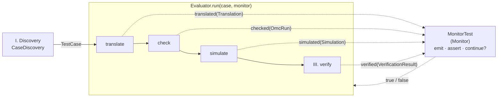
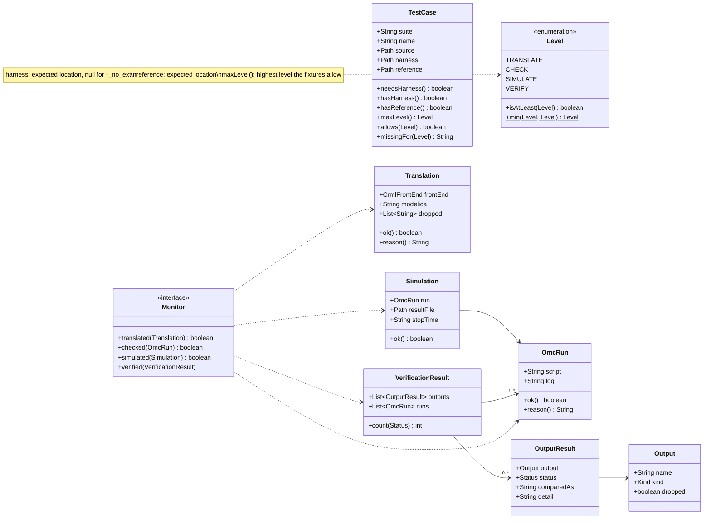
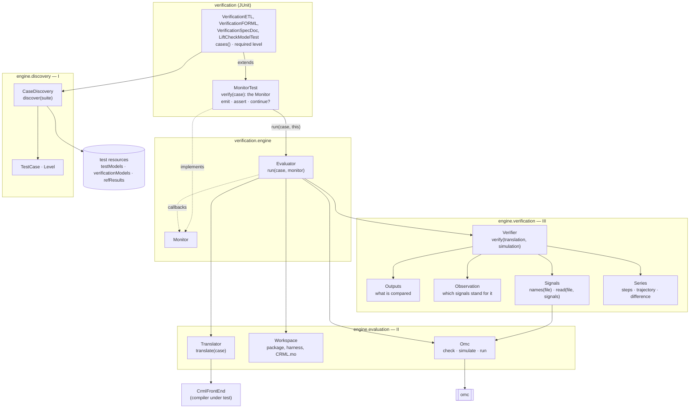
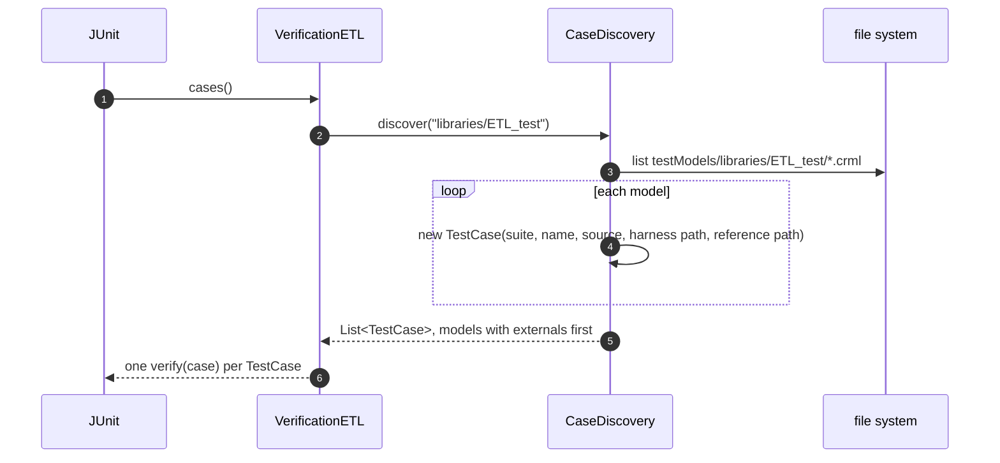
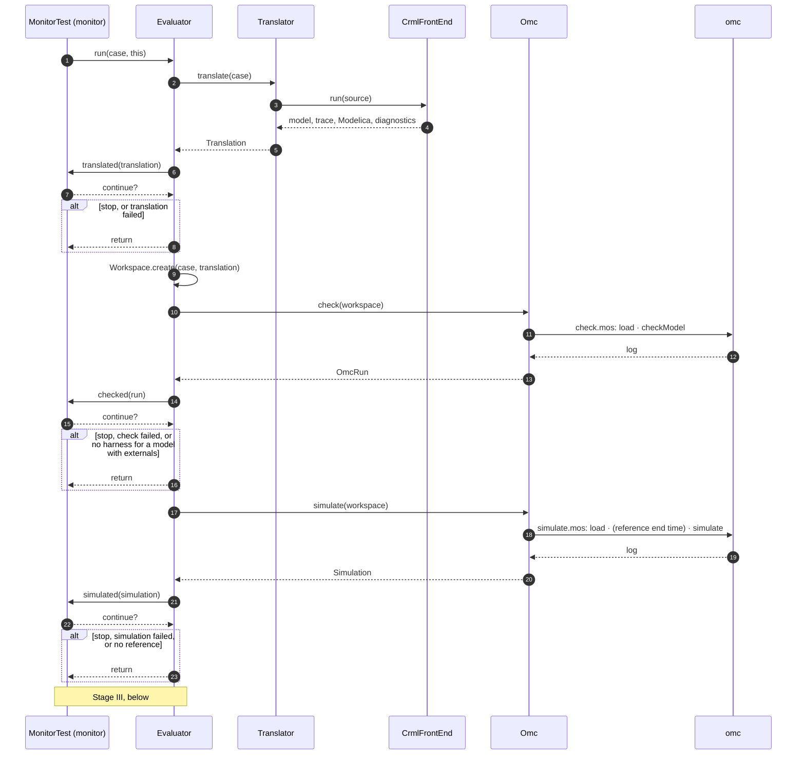
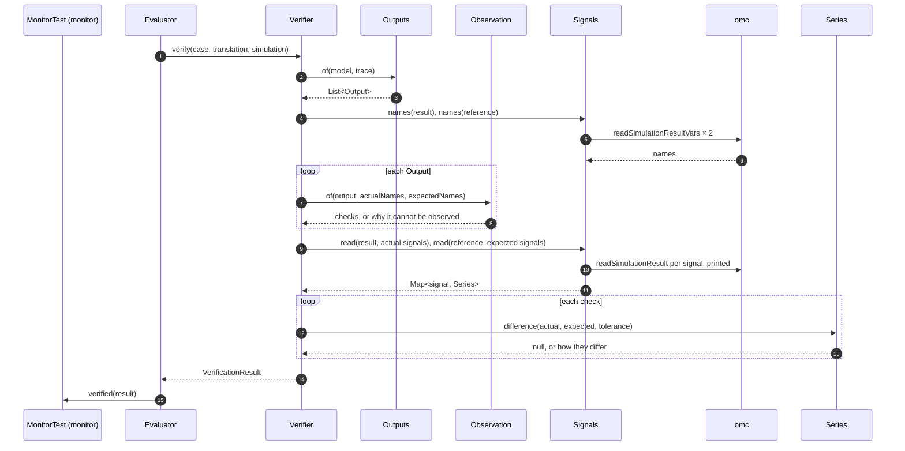
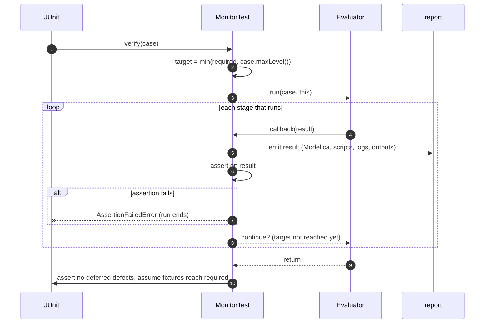
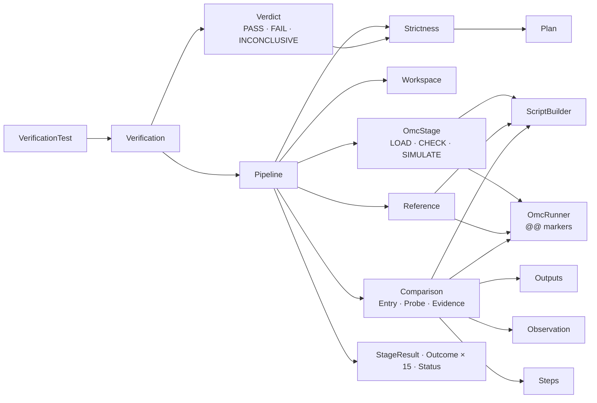

# Verification engine: stages and responsibilities

A proposal for a simpler verification engine. It describes what each stage is responsible
for, which data passes between the stages, and who calls whom. It does not describe the
current code; the section [Today](#today) shows that for comparison.

The diagrams are Mermaid, as in `VERIFICATION_README.md`.

## Overview

The engine runs the stages and hands each stage's result back to the test through a
callback. It decides nothing. The test reports the result, decides whether it is
acceptable, and says whether to go on:

> "Here is what came of this stage. Do what you want with it, and tell me whether to
> continue."

| Stage | Responsibility | Input | Result | Callback |
|---|---|---|---|---|
| I. Discovery | Find a suite's models; pair each with its harness and reference; say how far it can be verified | suite path | `List<TestCase>` | none: JUnit parameters |
| II. Evaluation: translate | Run the translation pipeline | `TestCase` | `Translation` | `translated` |
| II. Evaluation: check | Load the generated package (and harness) in omc, `checkModel` | `Translation` | `OmcRun` | `checked` |
| II. Evaluation: simulate | Simulate in omc | `Translation` | `Simulation` | `simulated` |
| III. Verification | Decide what the outputs are and how each is observed; compare them with the reference | `Translation`, `Simulation`, reference | `VerificationResult` | `verified` |



## Levels

A level is how far a case is verified. Each level includes the ones before it.

| Level | Meaning | Needs |
|---|---|---|
| `TRANSLATE` | CRML translates to Modelica | nothing; no omc |
| `CHECK` | omc loads the generated package (and the harness, if any), and `checkModel` passes | omc |
| `SIMULATE` | the simulated class simulates | omc; a harness if the model has externals |
| `VERIFY` | the outputs match the reference | a reference |

**Enums are comparable and sortable.** Every Java enum implements `Comparable<E>`, ordered
by declaration order (`ordinal()`), and `compareTo` is final, so the order cannot be
overridden by mistake. `Arrays.sort`, `TreeSet`, `EnumSet` and `Collections.max` all use
that order. There is no `<` operator for enums, so `Level` gets two helpers:

```java
public enum Level {
    TRANSLATE, CHECK, SIMULATE, VERIFY;   // declaration order is the verification order

    public boolean isAtLeast(Level other) { return compareTo(other) >= 0; }
    public static Level min(Level a, Level b) { return a.compareTo(b) <= 0 ? a : b; }
}
```

## The callback

```java
/** Told what came of each stage; answers whether the run goes on. */
public interface Monitor {
    boolean translated(Translation translation);
    boolean checked(OmcRun check);
    boolean simulated(Simulation simulation);
    void verified(VerificationResult result);
}
```

The contract has three rules:

- **Every stage that runs is reported**, whether it succeeded or failed, so the test can
  report the failure too.
- **The run goes on only if the monitor returns `true`, the stage succeeded, and the
  fixtures allow the next stage.** The engine stops by itself after a failed stage or
  where the fixtures end, because the next stage would have nothing to work with. These are
  facts about the inputs, not judgements.
- **The monitor may throw.** A JUnit assertion or assumption thrown from a callback ends
  the run and propagates out of `Evaluator.run`, so the engine never catches `Throwable`.

The whole engine is then:

```java
/** Runs case as far as monitor and its fixtures allow. */
public static void run(TestCase c, Monitor monitor) throws IOException, InterruptedException {
    Translation translation = Translator.translate(c);
    if (!monitor.translated(translation) || !translation.ok()) return;

    Workspace workspace = Workspace.create(c, translation);
    OmcRun check = Omc.check(workspace);
    if (!monitor.checked(check) || !check.ok() || !c.allows(SIMULATE)) return;

    Simulation simulation = Omc.simulate(workspace);
    if (!monitor.simulated(simulation) || !simulation.ok() || !c.allows(VERIFY)) return;

    monitor.verified(Verifier.verify(translation, simulation));
}
```

There are no strictness modes, no plan, no outcome enum and no verdict in the engine. What
used to be the judgement is ordinary JUnit code in the test's callbacks (see
[The test side](#the-test-side)).

## Data



Each result is immutable and carries everything the report needs: the scripts and logs of
its omc runs, the generated Modelica, and the diagnostics. Nothing is collected afterwards.

## Components



Dependencies only point from a stage to earlier stages: verification uses evaluation's
data, evaluation uses discovery's data, and nothing uses the stage after it. `Evaluator`
is the only class that knows every stage.

The package `engine.verification` repeats the parent package's name
(`…crmlcv2.verification.engine.verification`). If that reads badly, `engine.verify` is an
alternative.

## Stage I: Discovery

`CaseDiscovery.discover(suite)` lists `testModels/<suite>/*.crml` and makes one `TestCase`
for each, with the expected locations of its fixtures:

| Model | Harness | Reference |
|---|---|---|
| `<Name>.crml` (has externals) | `verificationModels/<suite>/<Name>/` | `refResults/<suite>/<Name>_verif_ref.mat` |
| `<Name>_no_ext.crml` | none needed | `refResults/<suite>/<Name>_no_ext_ref.mat` |

The predicates decide how far the case can be verified. Discovery only looks at the file
system and never runs anything.

```java
boolean needsHarness() { return !name.endsWith("_no_ext"); }
boolean hasHarness()   { return harness != null && Files.isDirectory(harness); }
boolean hasReference() { return Files.isRegularFile(reference); }

Level maxLevel() {
    if (needsHarness() && !hasHarness()) return Level.CHECK;   // its partial model still checks on its own
    return hasReference() ? Level.VERIFY : Level.SIMULATE;
}

boolean allows(Level level) { return maxLevel().isAtLeast(level); }

/** What is missing to reach level, or null. */
String missingFor(Level level)
```



## Stage II: Evaluation

There are three steps, each reported as soon as it is done:

- **Translate.** `Translator.translate(case)` runs the translation pipeline (parse, DOM,
  link, OMCv2) through `CrmlFrontEnd`. The `Translation` is `ok()` if Modelica was
  produced. Elements the translation dropped are listed in `dropped`; the test decides what
  that means.
- **Check.** `Workspace.create` writes the generated package, plus the harness and
  `CRML.mo` if the model has a harness. `Omc.check` loads it all and runs `checkModel` on
  the simulated class: `<Name>_verif` with a harness, `<Name>` without.
- **Simulate.** `Omc.simulate` loads again and simulates. If the case has a reference, it
  simulates over the reference's interval, whose end time it reads first.

Check and simulate are separate omc processes, so the test can stop after check. That
costs one more library load per simulated case, measured at about 0.1 s without the MSL
and 2.3 s with it, which only harness cases load: about one minute on the full default
run. If that matters, the test can declare its target up front and the engine can run
check and simulate as one script; the callbacks stay the same.



## Stage III: Verification

`Verifier.verify(translation, simulation)` answers three questions, each handled by
its own class:

1. **What is compared:** `Outputs.of(model, trace)`. These are the model's CRML variables,
   with class instances walked into their members and sets into their elements. Externals
   are inputs, and variables with no trace link were dropped. (Unchanged from today.)
2. **How each output is seen:** `Observation.of(output, actualNames, expectedNames)`. It
   matches signals by meaning, because the compiler's library and the reference models
   store Clock, Period and Event differently. (Unchanged from today.)
3. **Do they agree:** the signals are read into Java as time series, and `Series` compares
   them:
   - discrete signals (Boolean4, Integer, period open flags, event times, clock ticks) as
     steps, which is today's `Steps`;
   - Real signals as trajectories, interpolated, within tolerance.

Reading the signals takes two omc calls per result file through `Signals`: one lists the
names the file records (`readSimulationResultVars`), the other prints the (time, value)
points of the chosen signals (`readSimulationResult`). They are printed rather than exported
to CSV because a constant output is stored as a parameter, and omc exports parameters only
to `.mat`, which Java cannot read. All comparing then happens in Java, which replaces
`diffSimulationResults` and `compare.mos`.



Each output gets one status:

| Status | Meaning |
|---|---|
| `MATCH` | equal to the reference |
| `DIFFERS` | not equal; the detail shows the first difference |
| `MISSING` | the reference records it, the result does not |
| `DROPPED` | the translation produced no component for it |
| `NOT_IN_REFERENCE` | the reference does not record it |
| `NO_RULE` | its type has no comparison yet (Periods) |
| `INPUT` | an external, bound by the harness |

## The test side

`MonitorTest`, the JUnit base class of the suites, is the `Monitor` itself. JUnit makes a
new test instance for every case (the default `PER_METHOD` lifecycle also applies to each
parameterized invocation), so the state of one case lives in plain fields. Each callback
first emits what the stage produced, then asserts on it, then answers whether to go on.
Each suite sets only its required level.

```java
@Tag("omc")
public abstract class MonitorTest extends ReportedTest implements Monitor {

    protected abstract Level level();   // null: as far as each case's fixtures allow

    private Level target;                                   // as far as asked and the fixtures allow
    private final List<String> defects = new ArrayList<>(); // found, but not a reason to stop

    @ParameterizedTest
    @MethodSource("cases")
    public void verify(TestCase c) throws IOException, InterruptedException {
        Level required = level() == null ? c.maxLevel() : level();
        target = Level.min(required, c.maxLevel());
        if (target.isAtLeast(CHECK)) assumeTrue(Omc.available(), "omc not found");
        Evaluator.run(c, this);
        assertTrue(defects.isEmpty(), String.join("; ", defects));
        assumeTrue(c.allows(required), c.missingFor(required));   // fixtures short: skipped
    }

    @Override
    public boolean translated(Translation t) {
        emit(t.modelica(), "Modelica");
        emit(t.diagnostics(), "Diagnostics");
        assertTrue(t.ok(), t.reason());
        if (!t.dropped().isEmpty()) defects.add("dropped: " + t.dropped());
        return target.isAtLeast(CHECK);
    }

    @Override
    public boolean checked(OmcRun check) {
        emitRun(check);
        assertTrue(check.ok(), check.reason());
        return target.isAtLeast(SIMULATE);
    }

    @Override
    public boolean simulated(Simulation s) {
        emitRun(s.run());
        assertTrue(s.ok(), s.run().reason());
        return target.isAtLeast(VERIFY);
    }

    @Override
    public void verified(VerificationResult r) {
        r.runs().forEach(this::emitRun);
        emit(OutputsWrapper.of(r.outputs()), "Outputs");
        assertEquals(0, r.count(DIFFERS) + r.count(MISSING) + r.count(DROPPED), "outputs differ or are missing");
        assertTrue(r.count(MATCH) > 0, "nothing could be compared");
    }
}
```

The suites keep their names (`VerificationETL extends MonitorTest`, and so on), so
`make test-verification`, which filters on `Verification*`, still finds them.

The rules are ordinary JUnit, in one place, read top to bottom:

- An error at any stage fails the case, and stops it there.
- Dropped elements fail the case, but only at the end, so the later stages still run and
  report what they show.
- A case whose fixtures cannot reach the required level is skipped, unless it found a
  defect on the way.
- A suite that wants other rules overrides a callback.



| Suite | Required level | Effect |
|---|---|---|
| ETL, FORML | `VERIFY` | models with externals and `*_no_ext` models with a reference are verified; a model without its fixtures is skipped |
| spec-doc | none: each case's `maxLevel()` | each case passes at the highest level its fixtures allow (today's `BEST_EFFORT`) |
| lifting | `SIMULATE` | simulate; there are no references |

`verified` also writes `summary.txt`, one line per output, to the working directory.

## Today

For comparison, the engine as it is now, after the first refactor:



| Today | Proposed |
|---|---|
| `VerificationCase` | `TestCase` + `CaseDiscovery` |
| `Strictness` (3 modes), `Plan`, `Verdict`, `Outcome` (15), `StageResult` | the test's callbacks, and a required `Level` per suite |
| `Stage` (5) | `Level` (4): `LOAD` is part of `CHECK` |
| `VerificationTest` | `MonitorTest`, which implements `Monitor` |
| `Pipeline`, `OmcStage`, `Reference` | `Evaluator.run` (~15 lines), `Translator`, `Omc` |
| `Comparison` (`Entry`, `Probe`, `Evidence`), `compare.mos`, `diffSimulationResults` | `Verifier` + `Signals` + `Series` |
| `OmcRunner` (`@@` markers), `ScriptBuilder` | `Omc`: run a script, return an `OmcRun` |
| `Verification` (the run record) | gone: each callback gets its stage's result |
| `Outputs`, `Observation`, `Steps` | unchanged; `Steps` becomes part of `Series` |

## Open decisions

1. **Outputs the reference does not record:** they are listed but do not fail the case,
   while a verification that compared nothing fails. "Inconclusive" disappears. A suite
   that wants otherwise overrides `verified`.
2. **Separate omc processes for check and simulate:** simpler, and about a minute slower
   on the full default run (see [Stage II](#stage-ii-evaluation)).
3. **Comparison in Java:** Real signals get a Java trajectory comparison
   instead of `diffSimulationResults`. This is the only change that can move results; the
   baseline from the first refactor (`capture.sh` / `compare.py`) will show any difference.
4. **Reference interval:** a case with a reference is always simulated over the
   reference's interval, even when the test stops at `SIMULATE`. Today that happens only
   when it is compared.
