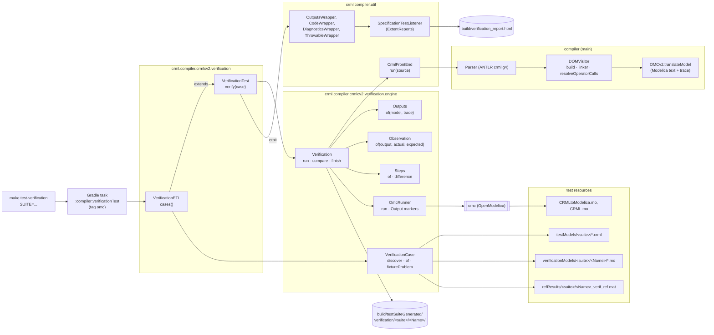
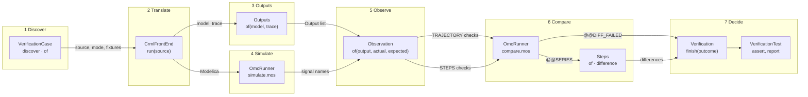
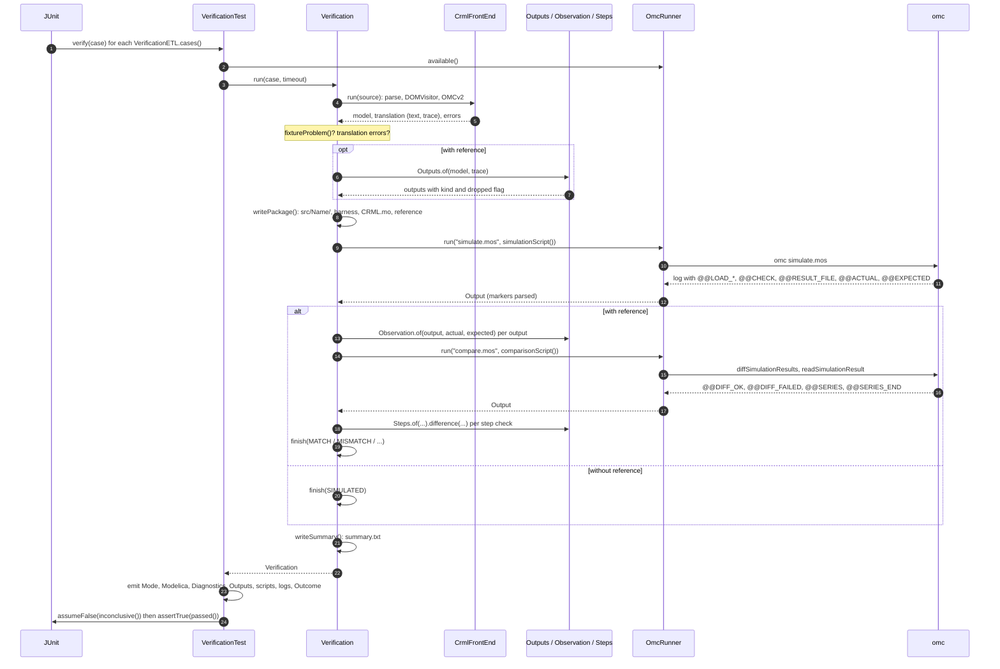
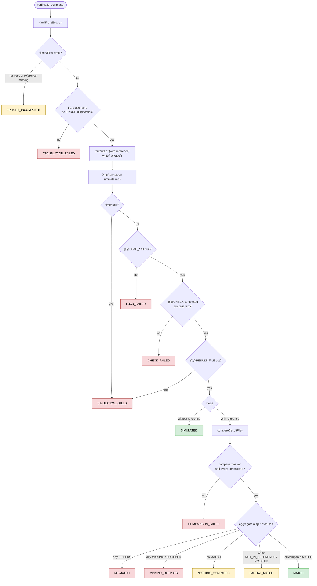
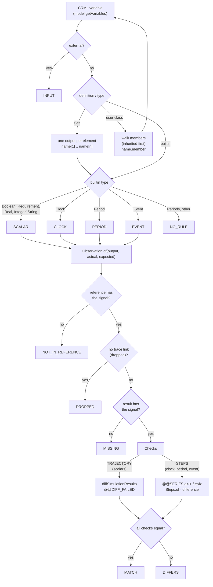

# Verification tests

End-to-end checks of the crmlcv2 compiler. Each CRML model is translated to Modelica and
simulated with OpenModelica. A model with a reference is then compared against it.

From the repository root:

```
make test-verification              # every suite: crml.compiler.crmlcv2.verification.Verification*
make test-verification SUITE=ETL    # one suite: VerificationETL
```

A new suite named `Verification<Suite>` in that package is picked up without changing the
Makefile. The target calls `./gradlew :compiler:verificationTest` with a `--tests` filter.

You need `omc` on the `PATH` (or `OPENMODELICAHOME` set). Without it every case is skipped.
The normal `test` task excludes these tests, which are tagged `omc`.

## The two modes

The cases of a suite come grouped by mode: first those with a reference, then those without.
Each case is numbered `[i]` as in the other reports, and its entry states its mode.

| Mode | Which models | Simulated class | Passes when |
|---|---|---|---|
| **with reference** | every model not named `*_no_ext`; needs the harness `verificationModels/<suite>/<Name>/` and `refResults/<suite>/<Name>_verif_ref.mat` | `<Name>_verif`, which extends the model and binds its externals | every output matches the reference |
| **without reference** | `*_no_ext` models, which bind all their variables themselves | `<Name>` itself | it simulates; the values are not checked |

A model with a reference is simulated over the reference's time span. A model without one
uses its own `experiment` annotation, or `omc`'s default of 0 to 1 s. Any `*_no_ext_ref.mat`
file is not used.

The references are Dymola simulations of hand-written Modelica models (in
`libraries/modelica/CRML_test`), not output of any compiler. A mismatch therefore means
either the compiler or the reference is wrong. Never regenerate a reference from compiler
output.

## Where to look

- `build/verification_report.html` has one entry per case: the mode, the outcome, the
  generated Modelica, the diagnostics, the Outputs table (with a reference), the scripts and
  the `omc` output. Long blocks start collapsed.
- `build/testSuiteGenerated/verification/<suite>/<Name>/` is each case's working directory:
  - `summary.txt`: the mode, the outcome, and every output with its status;
  - `src/<Name>/`: the generated package and the harness, which you can load into OMEdit
    to debug;
  - `simulate.mos` / `simulate.log`, `compare.mos` / `compare.log`: what `omc` ran and
    printed;
  - `<Name>_res.mat` (the simulation) and `*_ref.mat` (the reference);
  - `diff.<var>.csv`: one file per scalar output that differs.

## Outcomes

Outcomes are listed in pipeline order. Each one means every earlier stage passed.

| Outcome | Mode | JUnit | Meaning |
|---|---|---|---|
| `FIXTURE_INCOMPLETE` | with | aborted | The harness or the reference is missing. A model without externals should be named `*_no_ext`. |
| `TRANSLATION_FAILED` | both | failed | A syntax error, an exception, or an ERROR diagnostic. The reason names which. |
| `LOAD_FAILED` | both | failed | `omc` could not load a library or the generated package. |
| `CHECK_FAILED` | both | failed | `checkModel` rejected the model or the harness. The reason lists `omc`'s errors. |
| `SIMULATION_FAILED` | both | failed | No result file, or `omc` timed out. See `simulate.log`. |
| `SIMULATED` | without | passed | The model simulated. |
| `COMPARISON_FAILED` | with | failed | The comparison script itself failed. See `compare.log`. |
| `MISMATCH` | with | failed | At least one output differs from the reference. |
| `MISSING_OUTPUTS` | with | failed | The reference records outputs that the result lacks. |
| `NOTHING_COMPARED` | with | aborted | No output could be compared, so nothing was verified. |
| `PARTIAL_MATCH` | with | aborted | Everything compared matches, but some outputs could not be compared. |
| `MATCH` | with | passed | Every output matches the reference. |

"Aborted" outcomes are neither a pass nor a defect: they mean the case could not be
verified.

## Outputs (with reference)

The outputs are the model's own CRML variables. They are found through the translation trace
and named as in the generated Modelica:

- a scalar variable is `x`;
- a class instance is each of its members, inherited ones included, as `p.member`, and a
  member that is itself a class instance is walked the same way (`p.v.open`);
- a set is each element, `R[1]` to `R[n]`.

Externals are inputs bound by the harness. They are listed, but not compared. Internal names,
such as block instances and hoisted helpers, are ignored.

A Clock, Period or Event is compared by what it means, not by the record that implements it.
The compiler's library (`CRMLtoModelica.mo`) and the reference models (`CRML.mo`) store
these types differently:

| Type | Compiled model | Reference | Compared as |
|---|---|---|---|
| scalar (Boolean, Requirement, Real, Integer, String) | `x` | `x` | trajectory, with `diffSimulationResults` |
| Clock | `c.counter` | `c.counter` (the same record, as for an external clock), or the `activationCount` of the synchronous clock that holds the harness's `show_c` or `showEvent_c` block | tick count over time |
| Period | `P.is_open`, `P.isLeft/RightBoundaryIncluded` | `P.timePeriod` (or `P.is_open`), and the same boundary flags | open/closed changes and boundary flags |
| Event | `e.t` | `e.t` | event time over time |

"Over time" compares the steps of a discrete signal: the same values, changing at the same
instants within 1e-4 × the stop time. Changes closer together than that count as one, so
zero-width pulses and before/after samples at an event don't matter. Everything else in
those records is implementation and is not compared: the tick buffer, a period's start and
close events, and a time locator's slots and index. Periods (plural) have no rule yet.

| Status | Meaning |
|---|---|
| `MATCH` | Equal to the reference. |
| `DIFFERS` | Not equal. The detail column shows the first difference, or names `diff.<var>.csv`. |
| `MISSING` | The reference records it, but the simulation result doesn't have the signal. |
| `DROPPED` | The translation produced no component for this variable or class member, or for the instance that contains it. |
| `NOT_IN_REFERENCE` | The reference doesn't record it, or (for a clock) has no tick count tied to its name. |
| `NO_RULE` | Its type has no comparison defined, such as Periods. |
| `INPUT` | An external, bound by the harness. |
| `NOT_REACHED` | Comparable, but the case stopped before the comparison. The outcome says where. |

Boolean values appear as `Boolean4` ordinals: 1 = undefined, 2 = undecided, 3 = false,
4 = true. To read a value at a given time, put this in a `.mos` file in the case
directory and run `omc probe.mos` there:

```
print(String(val(b1, 0.5, "<Name>_res.mat")) + " vs " + String(val(b1, 0.5, "<Name>_ref.mat")) + "\n");
```

## Adding a suite

Subclass `VerificationTest` and pass the suite's path to `VerificationCase.discover(...)`.
See `VerificationETL`.

## Code layout

| Package | Contents |
|---|---|
| `crml.compiler.crmlcv2.verification` | The tests only: `VerificationTest`, the base class, and one subclass per suite. |
| `crml.compiler.crmlcv2.verification.engine` | What runs a case: `VerificationCase` (fixtures and mode), `Verification` (the stages and outcomes), `Outputs` (what a model's outputs are), `Observation` (which signals stand for each output), `Steps` (comparing discrete signals), and `OmcRunner` (runs `omc` scripts). |
| `crml.compiler.util` | The report wrappers shared with the other compiler tests, including `OutputsWrapper`, and `CrmlFrontEnd`. |

## Architecture

The diagrams are Mermaid. GitHub, GitLab and VS Code's Markdown preview (with a Mermaid
extension) render them.

### Components



### Engine classes

Each engine classes automate the steps of the verification process from translating models to comparing simulation results. Each class focuses on separate tasks in this process.

The diagram follows one case from left to right. Each class sits in the stage where it does
its work, and each arrow is what one stage hands to a later one. `Verification` drives every
stage, so it appears only at the end, where it decides the outcome.



A case without a reference skips stages 3, 5 and 6: once it has simulated, it goes
straight to the decision.

Why each class exists, and why `Verification` needs it:

- **`VerificationCase`** separates which cases a suite has from how one is run. It finds a
  suite's models and decides each one's mode from its name. For a model with a reference,
  it locates the harness and the reference, and reports if either is missing.
  `Verification` uses it to know what to translate, what to simulate, and whether there is
  anything to compare against.
- **`CrmlFrontEnd`** is the compiler under test, the same front end as the other compiler
  tests. `Verification` needs its Modelica text to simulate. It also needs its CRML model
  and trace, because those, not the result files, decide what the outputs are.
- **`Outputs`** decides **what** is compared: the model's own CRML variables, with class
  instances walked into members and sets into elements, each with its kind. Externals are
  marked as inputs, and variables that were not translated as dropped. Without it, the
  comparison would be over whichever names happen to be in both result files.
- **`Observation`** decides **how** each output is seen in the two results. It builds on
  `Outputs`: it takes an `Outputs.Output` and chooses its signals by the output's kind, so
  a new kind in `Outputs` needs a rule here. The compiler's
  library and the reference models implement Clock, Period and Event differently, so the
  same output is a different signal on each side, such as `c.counter` against a clock's
  `activationCount`. Each check says whether it is a trajectory or steps, which decides
  whether `diffSimulationResults` or `Steps` compares it. It also tells `Verification`
  when the reference has no such signal.
- **`Steps`** compares the signals that `diffSimulationResults` can't: those of
  `Observation`'s `STEPS` checks. It knows nothing about outputs or checks, only two series
  of (time, value) points. A tick count, an
  open flag or an event time changes at instants, and the two simulators sample those
  instants differently. It compares the sequence of changes within a time tolerance.
- **`OmcRunner`** is the only class that talks to OpenModelica. It runs a script that
  `Verification` wrote and returns what the script printed, keyed by `@@` markers. All
  decisions stay in Java, which never parses `omc`'s free-form output.
- **`Verification`** ties them together for one case. It translates, simulates and
  compares, stopping at the first stage that fails, and records the outcome and each
  output's status. `VerificationTest` reports these and turns them into a JUnit result.

### What happens to one case

`VerificationTest.verify` hands the case to `Verification.run`, then puts what it produced
into the report and turns the outcome into a JUnit result.



### Stages and outcomes

Each stage of `Verification.run()` either ends the case with an outcome or passes it on.
The JUnit result follows from `passed()` and `inconclusive()`.



Red is failed, green passed, yellow aborted. `compare` applies the `agg` branches in the
order drawn: a mismatch wins over a missing output, which wins over the rest.

### How an output gets its status

`Outputs.of` decides what an output is. `Verification.initialStatus` gives it a first
status, and `compare` refines it through `Observation.of` and the comparison script.



The signals each check reads, per kind, are in the table under
[Outputs (with reference)](#outputs-with-reference). An output that the case never got to
compare keeps the status `NOT_REACHED`.
