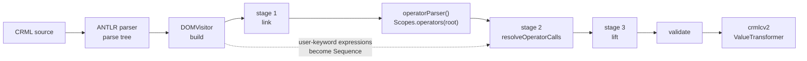
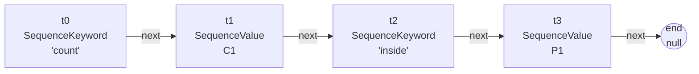
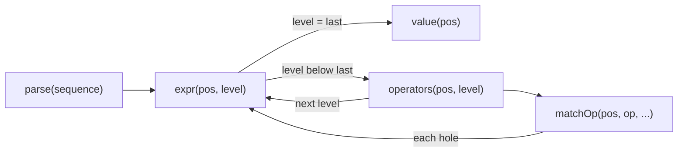
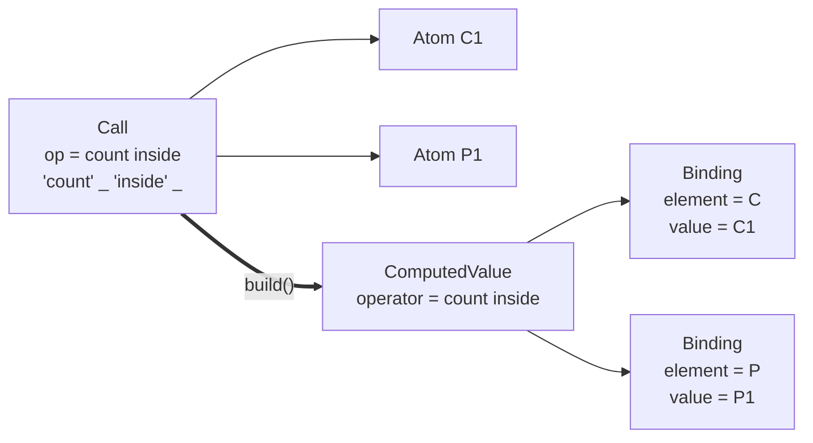
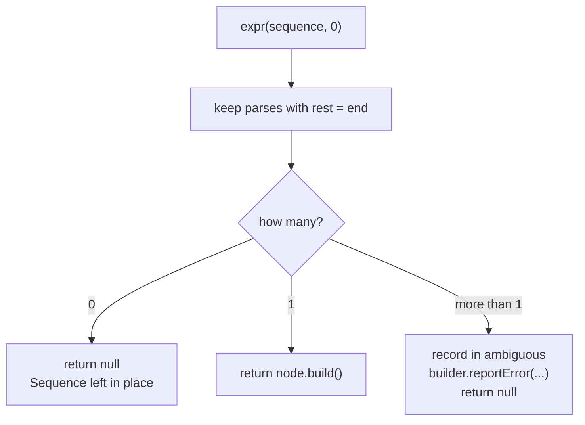
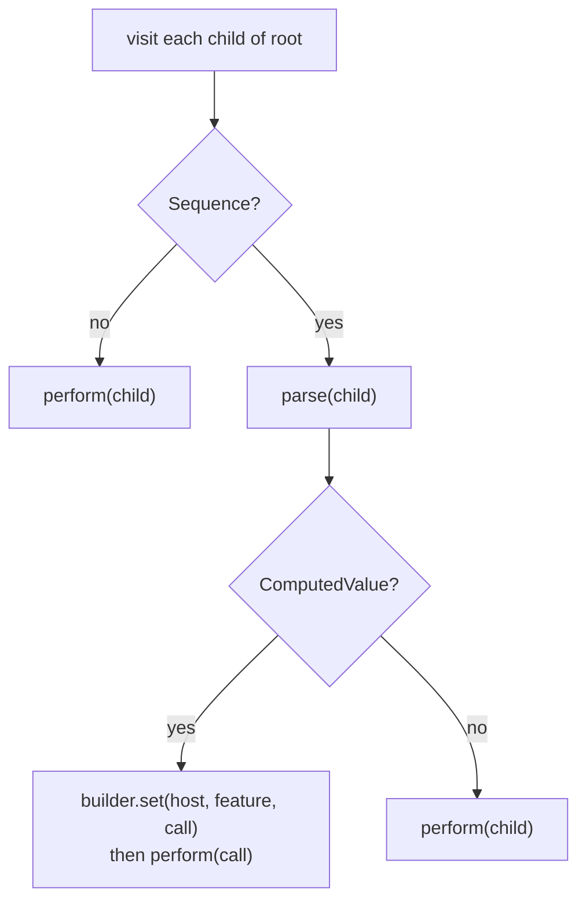

# Mixfix parser

This document is for contributors and maintainers of the `:language` module. Part 1
describes what the mixfix parser does and how a CRML author sees it. Part 2 covers how it
works, how it fits into the pipeline, and what to watch out for when changing it.

The code is in
[`org.openmodelica.crml.language.opcall.MixfixParser`](src/main/java/org/openmodelica/crml/language/opcall/MixfixParser.java).

---

# Part 1: Overview

## What problem it solves

CRML lets a model declare its own operators. An operator's *header* mixes quoted keywords
with operand slots (*holes*), and a call to the operator is written the same way:

```
Operator [ Clock ]   Clock C 'inside' Period P         = C filter (...);
Operator [ Integer ] 'count' Clock C 'inside' Period P = card (C 'inside' P);

Integer n is 'count' C1 'inside' P1;
```

These are two operators. This document calls them by their keywords:
- **`inside`**: the infix operator `_ 'inside' _`, which returns a Clock.
- **`count inside`**: the operator `'count' _ 'inside' _`, which returns an Integer. It is
  one operator with two keywords. There is no operator called `count`, and `count inside`
  does not call `inside`.

The call `'count' C1 'inside' P1` calls `count inside` with the operands `C1` and `P1`. In
parse trees, the calls are written `inside(a, b)` and `countInside(a, b)`.

The ANTLR grammar cannot parse `'count' C1 'inside' P1` as a call. Which operators exist, and
where each operand starts and ends, depends on the declarations in scope, and the grammar
doesn't know about those. So the grammar only records the call as a flat list of keywords and
values, a `Sequence`. After the model is built and its names are linked, the mixfix parser
matches each `Sequence` against the declared operators. It replaces the `Sequence` with a
`ComputedValue`: a call to one operator, with each operand bound to a parameter.

Later stages (lifting, validation, the crmlcv2 compiler) only see `ComputedValue`s. A
`Sequence` that is still in the model after this stage is an error.

## Rules a CRML author sees

**Which operators can be called this way.** An operator whose header has at least one
keyword (`OperatorUtil.isMixfix`). An operator whose header is only parameters
(`Operator [ Boolean ] Boolean a Boolean b = ...`) gives the parser nothing to anchor on, so
it is left out. It can only be called by name, and if it has no name, the validation rule
`UnnamedOperatorHasKeyword` reports an error.

**Which operators are in scope.** For each file, the operators declared in its root `model`
or `library`, followed by those of the libraries it depends on (`model M is Lib union { ... }`).
See `Scopes.operators` and [SCOPING_SPEC.md](SCOPING_SPEC.md), section 5. These limits also
apply:
- Operators declared inside a `class` are not in scope.
- An operator cannot call itself in its own body. It is left out while that body is parsed.
- An own operator hides a library operator that has the same keyword signature (`_ 'or' _`).

**Precedence.** Each operator is a precedence level of its own, in the order of the scope
list. **An operator that comes earlier in the list binds more loosely.** In practice:
- Within one file, an operator declared later binds tighter than one declared earlier.
- Own operators come before library operators, so a library's operators bind tighter than
  the model's own.
- Built-in operators (`and`, `+`, `filter`, `not`, ...) are parsed by the grammar and bind
  tighter than any user operator. In `x and y 'p' not z`, the operands of `'p'` are
  `x and y` and `not z`.
- Every user operator is left-associative: `a 'p' b 'p' c` reads `(a 'p' b) 'p' c`.

For example, with these two operators declared in this order:

```
Template a 'implies' b = ...;
Template a 'or' b      = ...;

Boolean r is x 'implies' y 'or' z;    // x 'implies' (y 'or' z)
```

**Parentheses.** A parenthesised expression is a single operand to the parser. Use
parentheses to override precedence or to resolve an ambiguity.

**What happens to each call.** For each call, one of three things happens:

| Outcome | Result in the model | Diagnostic |
|---|---|---|
| exactly one way to read the call | `ComputedValue` | none |
| no operator in scope matches it | stays a `Sequence` | `OPERATOR_CALL` error at its first element: `Unresolved operator call _ 'nope' _: no operator in scope matches it` |
| more than one reading | stays a `Sequence` | `OPERATOR_CALL` error at the call: `Ambiguous operator call ..., it can be read as: ... or ...` |

The parser never picks one reading of an ambiguous call for the author. The author adds
parentheses instead.

---

# Part 2: Technical details

## Where it runs



`CrmlWorkspace.resolve()` binds the library dependencies of every loaded file and orders the
files so that dependencies come first. It then runs these stages on each file:

| Step | What happens to an operator call |
|---|---|
| build | `ExpressionBuilder` turns each expression with a user keyword (`'...'`) into a `Sequence`. Nested user-keyword expressions are spliced into one flat list. |
| `link` (stage 1) | Variable references are resolved, including those inside sequences. The parser runs after this stage, so it can rely on operator declarations, and the library roots they come from, being linked. |
| `operatorParser` | `DOMVisitor.operatorParser()` returns `new MixfixParser(root, visitor)` if the root is a `Library` (a `Model` is one too), and `null` otherwise. That constructor takes its operator list from `new Scopes().operators(root)`. |
| `resolveOperatorCalls` (stage 2) | `DOMVisitor.resolveOperatorCalls(parser)` calls `parser.perform(root)`, then `modify()`, which applies the queued replacements. The workspace then collects the errors the parser reported (`takeErrors`) and reports every `Sequence` that is still in the model and not ambiguous as `Unresolved operator call`. |
| `lift` (stage 3) | Links `x.element` to the application it lifts. It needs the `ComputedValue`s from stage 2. |
| crmlcv2 | `ValueTransformer` translates a `ComputedValue` into an instance of the operator's block. A model with language errors is normally not translated. If a `Sequence` still gets here, the transformer throws an `unsupported` error, `unresolved operator call ...`. |

When a stage throws (`RuntimeException` or `StackOverflowError`), the workspace catches it and
reports an `OPERATOR_CALL` diagnostic at the start of the file, with the exception as its
cause. The later stages still run.

`CrmlWorkspace.resolve()` is called by the CLI (`Job`), the compiler test front end
(`CrmlFrontEnd`), `CrmlWeb` and the language tests.

## Input: the Sequence list

A `Sequence` is a linked list of two node types:
- A `SequenceKeyword` holds a keyword, as written, with its quotes.
- A `SequenceValue` holds an already built `Value`: a variable reference, a literal, a
  built-in expression, a parenthesised expression (a `UnaryOperator` of kind
  `SUBEXPRESSION`), and so on.

The metamodel makes `next` a containment, and a `SequenceValue` can only be followed by a
`SequenceKeyword`. So two values never sit side by side, but two keywords can. Every
sequence the builder produces holds at least one keyword.

`'count' C1 'inside' P1` arrives as:



The parser identifies a position by the `Sequence` node it starts at, with `null` for the
end. Parsing never changes the list. Only `Node.build()` changes it, for the reading that is
chosen (see [Parse trees](#parse-trees-and-building-the-model)).

## Operators, levels and holes

Each `CustomOperator` (a `UserOperator` or a `Template`) has a header: a list of
`OperatorHeaderElement`s, each a `Keyword` or a `Variable`. Each variable is a *hole* for an
operand.

The constructor puts each operator in a **precedence level** of its own, in list order. The
first operator gets level 0, which is the outermost level and binds loosest. Above the last
level there is one more level, `levels.size()`, which only reads atoms (a single
`SequenceValue`). `levels` is a `List<List<CustomOperator>>`, so the parser could hold
several operators per level, but the constructor always creates singleton levels.

At its own level, an operator has one of two roles, depending on how its header starts
(`CustomOperator.startsWithValue()`):

| Header starts with | Fixity (see `Fix`) | Role at its level | Example |
|---|---|---|---|
| a keyword | prefix, closed | starts an expression | `'count' C 'inside' P` |
| a hole | infix, postfix | extends an expression already parsed to its left | `C 'inside' P` |

The level an operand is parsed at depends on where its hole sits:

| Hole | Parsed at | Why |
|---|---|---|
| the first hole of an infix or postfix operator | already parsed: it is the left expression being extended | |
| a hole followed by a keyword (*inner hole*) | level 0: any expression | the next keyword marks where the operand ends |
| the last hole of an operator that ends with one (*outer-right hole*, `endsWithValue()`) | `level + 1` if left-associative, `level` if right-associative (`rightLevel`) | nothing marks where the operand ends, so precedence decides |

`OperatorUtil.getAssoc` returns `LEFT` for every operator at present. The `RIGHT` and `NON`
branches exist but are never taken.

This is the grammar the parser implements, for a level `l`:

```
E(l)    ::= Start(l) Ext(l)*          l < number of operators
E(last) ::= atom

Start(l) ::= prefix-or-closed-operator-at-l    -- all its holes filled
           | E(l+1)

Ext(l)   ::= the rest of an infix-or-postfix-operator-at-l after its first hole
```

## The algorithm

### Every reading, and where it ends

A run of tokens can often be read in more than one way, and the parser can't tell which
reading is right until it sees what comes next. Take the call `'count' C1 'inside' P1` from
the example above. The first operand of `count inside` starts after `'count'`, at
`C1 'inside' P1`. Read on its own, that text starts with either of these:

| Reading | Tokens used | Ends before |
|---|---|---|
| the value `C1` | `C1` | `'inside'` (`t2`) |
| the call `inside(C1, P1)` | `C1 'inside' P1` | the end of the list |

So the parser does not choose. Each parsing function returns **every** reading it finds,
each with the position where that reading ends. In the code, this pair is a `Parse`: a parse
tree (`node`) and the position after it (`rest`).

The caller then keeps only the readings that the following tokens fit. `count inside` needs
its own keyword `'inside'` after its first operand, so it keeps the first reading and drops the second. The
top-level `parse` keeps only the readings that end at the end of the list.

### The functions



Every function takes a position and returns a `List<Parse>`:

| Function | Returns every reading of ... |
|---|---|
| `expr(pos, level)` | an expression at `level` or above, starting at `pos`. It returns the cached result if there is one, and otherwise calls `value` or `operators`. |
| `value(pos)` | a single atom. That is one reading if `pos` is a `SequenceValue`, and none otherwise. |
| `operators(pos, level)` | an expression built from the operator at `level`, or from higher levels. |
| `matchOp(pos, op, startIdx, level, prepend)` | one call to `op`, starting at `pos`. |

The recursion ends because every path uses up at least one token before it comes back to the
same position (see [Termination](#termination)).

### `parse(sequence)`

`parse(sequence)` prepares the state for one sequence, then runs the search:
1. It sets `excluded` to the `CustomOperator` whose body contains the sequence, if there is
   one (`enclosingOperator`). `operators` skips that operator, so an operator cannot call
   itself.
2. It clears `memo` and creates one empty cache per level.
3. It calls `expr(sequence, 0)` and keeps the readings whose `rest` is `null`. See
   [Choosing the result](#choosing-the-result-no-parse-one-parse-ambiguous).

### `operators(pos, level)`

`operators` builds its readings in two steps.

**1. Readings that start here.** These come from two sources:
- for each prefix or closed operator at `level`: `matchOp(pos, op, 0, level, null)`. The
  operator must match its first keyword at `pos`.
- `expr(pos, level + 1)`: everything the higher levels can read.

**2. Readings that extend a reading to the left.** For each reading collected so far, and
each infix or postfix operator at `level`, the reading is used as the operator's first
operand: `matchOp(left.rest, op, 1, level, left.node)` matches the rest of the header from
where the reading ends. Each success is a new reading.

A new reading made by a left-associative operator goes back on the `pending` work queue, so
it can be extended again. That is how `a op b op c` becomes `((a op b) op c)`.
Right-associative and non-associative operators are not extended again.

`operators` returns every reading from both steps, whether it was extended or not. The
caller decides which ones it can use.

### `matchOp(pos, op, startIdx, level, prepend)`

`matchOp` reads `op`'s header from left to right, starting at element `startIdx`. It keeps a
list of *partial matches*, each a `Call` that holds the operands found so far, together with
the position reached. It starts with a single partial match at `pos`. For an infix or postfix
operator, that partial match already holds `prepend`, the left operand, and `startIdx` is 1.

At each header element, the list is updated:

| Header element | Each partial match becomes ... |
|---|---|
| keyword `'k'` | itself, moved past `'k'`, if the next token is `'k'`. Otherwise it is dropped. |
| hole | one new partial match for each reading of `expr(rest, subLevel)` that passes `checkArg`, with that reading added as an operand |

`subLevel` comes from the [holes table](#operators-levels-and-holes): 0 for an inner hole,
`rightLevel(level, op)` for the outer-right hole. The list can grow at a hole (several
readings of the operand) and shrink at a keyword. Each partial match that reaches the end of
the header is one reading of the call. If the list becomes empty, the operator does not match
at `pos`.

Keywords are compared as strings, quotes included.

### Caching

`expr` caches its results by `(level, pos)`. `memo` holds one `IdentityHashMap<Sequence,
List<Parse>>` per level, and the key `null` stands for the end of the list. `parse` clears
the cache at the start of each sequence. Holes of different operators often start at the same
position, and the cache makes sure each `(level, pos)` is parsed only once. That keeps the
search polynomial in the length of the list.

## Worked example: `'count' C1 'inside' P1`

`CountInside.crml`
(`test-resources/src/main/resources/testModels/libraries/ETL_test/`) declares the operator
`inside` first and the operator `count inside` second. That gives these levels:

| Level | Operator | Header |
|---|---|---|
| 0 | `inside` (infix) | `C 'inside' P` |
| 1 | `count inside` (prefix) | `'count' C 'inside' P` |
| 2 | atoms only | |

The keyword `'inside'` appears in both headers. In the call, the parser must decide whether the
`'inside'` at `t2` belongs to `count inside` or starts a call to the operator `inside`. That
is what makes this example interesting.

The tokens, from the [input](#input-the-sequence-list) diagram, are:

```
position:   t0        t1     t2         t3     end
token:      'count'   C1     'inside'   P1
```

In the header of `count inside`, the hole `C` is followed by the keyword `'inside'`, so `C` is
parsed from level 0, where the operator `inside` is available. That gives the hole two
readings. Only one of them leaves the keyword `'inside'` that `count inside` needs next:

```
            t0        t1     t2         t3     end
            'count'   C1     'inside'   P1
hole C, reading 1:    [C1]                          ends at t2:  'inside' follows   -> kept
hole C, reading 2:    [C1    'inside'   P1]         ends at end: nothing follows    -> dropped
```

The full run follows, in the order the calls happen (indentation shows nesting). In it,
`countInside[...]` is a partial match of `count inside` and lists the operands found so far.
`countInside(C1, P1)` and `inside(C1, P1)` are complete calls.

1. `parse` calls `expr(t0, 0)`, which calls `operators(t0, 0)`.
   1. Level 0 has no prefix operators. Its only source of starting readings is
      `expr(t0, 1)` → `operators(t0, 1)`:
      1. **`matchOp(t0, 'count' _ 'inside' _, 0, 1, null)`**, the operator `count inside`:
         - keyword `'count'`: `t0` is `'count'`. One partial match: `countInside[]`, at
           `t1`.
         - hole `C`, followed by a keyword, so level 0: `expr(t1, 0)` → `operators(t1, 0)`:
           - starting readings: `expr(t1, 1)`. `count inside` doesn't match at `t1`,
             because `t1` is `C1` and not `'count'`. `expr(t1, 2)` reads the atom:
             **`C1`, ending at `t2`**.
           - extending `C1` with the operator `inside`: the keyword `'inside'` is at `t2`.
             The last hole `P` is at level 0 + 1: `expr(t3, 1)` finds `P1` through
             `expr(t3, 2)`. Result: **`inside(C1, P1)`, ending at the end**. Extending that
             again fails, because there is no `'inside'` at the end.
           - result: two readings, `C1` (at `t2`) and `inside(C1, P1)` (at the end).

           Two partial matches: `countInside[C1]` at `t2`, and
           `countInside[inside(C1, P1)]` at the end.
         - keyword `'inside'` of `count inside`: `countInside[C1]` finds it at `t2` and
           moves on to `t3`. `countInside[inside(C1, P1)]` is at the end, so it is
           **dropped**.
         - hole `P`, the last one, so level 1 + 1: `expr(t3, 2)` is a **cache hit** from
           the previous step: `P1`, ending at the end.
         - result: **`countInside(C1, P1)`, ending at the end**.
      2. `expr(t0, 2)`: `t0` is a keyword, not an atom. No readings.
      3. Level 1 has no infix operators, so nothing is extended.
         Result: `countInside(C1, P1)`.
   2. Extending `countInside(C1, P1)` with the operator `inside` fails, because there is
      no `'inside'` at the end. Result: `countInside(C1, P1)`.
2. `parse` keeps the readings that end at the end. There is exactly one,
   `countInside(C1, P1)`, and it is built into a `ComputedValue`.

A parser that kept only the longest reading of each hole would take reading 2, find no
keyword `'inside'` left for `count inside`, and fail with no way back. The parser used to work that way and left
this call unresolved. Returning every reading is what fixes it.

## Parse trees and building the model

Parse trees are kept as lightweight `Node`s:
- an `Atom` wraps a `Value`;
- a `Call` holds an operator and its argument `Node`s.

Candidate trees share their atoms, and an EMF `Value` can only be contained in one place. If
a `ComputedValue` were built for every candidate, shared atoms would move from one candidate
into another. So only the chosen reading is turned into EMF objects, by `Node.build()`:



`Call.build()` binds argument *i* to the *i*-th `Variable` of the header
(`op.getVariables()`). Setting an atom's `Value` as a binding's value moves it out of its
`SequenceValue`, because EMF containment allows only one container.

## Choosing the result: no parse, one parse, ambiguous

`parse(sequence)` keeps only the parses whose `rest` is `null`, that is, the parses that
used the whole list:



- **No parse.** The list does not spell a call to any operator in scope. `parse` returns
  `null` and the `Sequence` stays in the model. The workspace reports it afterwards as
  `Unresolved operator call ...` at its first element. That way a consumer never receives a
  wrong tree.
- **One parse.** `parse` returns `node.build()`. For a whole sequence this is a
  `ComputedValue`, because the sequence contains a keyword and only a `Call` consumes
  keywords.
- **More than one.** The call is ambiguous, and the parser does not choose. It adds the
  sequence to `ambiguous` and calls `builder.reportError(sequence, OPERATOR_CALL, ...)`.
  That *records* a diagnostic at the position of the sequence and does not throw, so the
  rest of the file is still parsed. `isAmbiguous(sequence)` lets the workspace skip the
  sequence when it reports unresolved calls, so it is not reported twice. The message lists
  each reading with its calls in brackets and values shown as `_`. The message is a single
  line:

  ```
  Ambiguous operator call 'count' _ 'inside' _ 'inside' _, it can be read as: ('count' (_ 'inside' _) 'inside' _) or (('count' _ 'inside' _) 'inside' _)
  ```

  The two readings are `countInside(inside(C1, P1), P2)` and
  `inside(countInside(C1, P1), P2)`, for the call `'count' C1 'inside' P1 'inside' P2`.

  To resolve the ambiguity, the author adds parentheses. A parenthesised expression is a
  single `SequenceValue`, so the parser reads it as one atom.

The static `MixfixParser.describe(sequence)` renders a sequence as written, with values as
`_`. The workspace and crmlcv2 use it in their messages too.

## `perform`: walking the model

`perform(root)` visits every object below `root`:



`builder.set` does not change the model straight away. `DOMVisitor` queues a
`ModificationTask`, and `modify()` applies the queue after `perform` returns. It also updates
the source map, so the `ComputedValue` takes over the position of the `Sequence` it replaces.

The parser visits the arguments of a resolved call again, because an argument can contain
its own sequence. For example, `'count' (A 'inside' B) 'inside' P` holds a parenthesised
sub-expression.

The parser also walks an unresolved sequence, so that sequences nested in its values are
still resolved. Since `next` is a containment, this walk also reaches the suffixes of the
list, and it parses each one as if it were a sequence of its own. That is a bug; see
[Known issues](#known-issues).

## Termination

Each path through the search uses up at least one node of the list before it can reach the
same `(level, pos)` again:

- A prefix or closed operator matches its first keyword before it parses any hole.
- An infix or postfix operator only extends a reading that already exists, and that
  reading used up at least one node.
- Falling through to `level + 1` happens at most once per level, and the top level only
  reads one atom.

So no call of `expr` depends on itself, and the cache is filled in a well-defined order.
`expr` has no guard against re-entering a `(level, pos)` that is still being computed, so
a change that breaks one of these three properties will loop. Keyword-less operators are
excluded from the scope list partly for this reason.

## Code map and tests

| Where | What |
|---|---|
| [`opcall/MixfixParser.java`](src/main/java/org/openmodelica/crml/language/opcall/MixfixParser.java) | the parser |
| [`opcall/OperatorUtil.java`](src/main/java/org/openmodelica/crml/language/opcall/OperatorUtil.java) | `isMixfix` (which operators take part), `getAssoc` (always `LEFT`) |
| [`opcall/Association.java`](src/main/java/org/openmodelica/crml/language/opcall/Association.java), [`opcall/Fix.java`](src/main/java/org/openmodelica/crml/language/opcall/Fix.java) | associativity and fixity enums. The parser uses `startsWithValue`/`endsWithValue` and not `Fix`. |
| [`opcall/TypeCheck.java`](src/main/java/org/openmodelica/crml/language/opcall/TypeCheck.java) | hook for type-based filtering, stored but not used yet |
| [`scope/Scopes.java`](src/main/java/org/openmodelica/crml/language/scope/Scopes.java) | `operators(root)`: the operator list and its order |
| [`dom/builders/ExpressionBuilder.java`](src/main/java/org/openmodelica/crml/language/dom/builders/ExpressionBuilder.java) | builds `Sequence`s from user-keyword expressions |
| [`dom/DOMVisitor.java`](src/main/java/org/openmodelica/crml/language/dom/DOMVisitor.java) | `operatorParser()`, `resolveOperatorCalls()`, `set()`/`modify()` |
| [`workspace/CrmlWorkspace.java`](src/main/java/org/openmodelica/crml/language/workspace/CrmlWorkspace.java) | the stages, and the `Unresolved operator call` diagnostics |
| `model/src/main/model/crml.xcore` | `Sequence`, `SequenceKeyword`, `SequenceValue`, `CustomOperator`, `ComputedValue`, `Binding` |

There is no unit test for `MixfixParser` alone. It is covered through the workspace:
- `CrmlWorkspaceTest`: `ambiguousCallIsReportedAtItsPosition`,
  `unresolvedCallIsReportedAtItsFirstElement`, `stageExceptionKeepsItsCause`, and the stage
  trace through `InspectingWorkspace`.
- `ScopesTest`: `operatorsOwnFirstThenDependencies`,
  `anOwnOperatorHidesALibraryOperatorWithTheSameSignature`,
  `operatorsWithoutKeywordsAreNotGivenToTheMixfixParser`,
  `anOperatorCannotCallItselfInItsBody`.
- The crmlcv2 specification and verification tests, which compile the models in
  `test-resources` (for example `ETL_test/CountInside.crml` and
  `library-loading/etl/CountInside.crml`).

## Current limitations

| Limitation | Effect |
|---|---|
| `checkArg` accepts every argument, and the `TypeCheck` hook is not used | Operand types never rule out a reading. Some ambiguous calls would have only one well-typed reading. For example, in `'count' C1 'inside' P1 'inside' P2`, the reading `inside(countInside(C1, P1), P2)` passes the Integer result of `count inside` where `inside` expects a Clock. These calls are still reported as ambiguous. |
| `OperatorUtil.getAssoc` always returns `LEFT` | Associativity cannot be declared. |
| One operator per level, in scope-list order | Precedence depends on declaration order, and own operators bind more loosely than library operators. Precedence can't be declared explicitly. |
| The parser is built per root, from `Scopes.operators(root)` | Operators declared in a `class` are not in scope, not even inside that class. |
| Operators with the same keyword signature are not overloads | They give an ambiguous call. In one namespace, `NameConflicts` reports them. Across a root and its library, the own operator hides the library one. |
| Values are shown as `_` in messages | `Atom.describe()` doesn't print the value, although variable references are already linked when the parser runs. |

## Known issues

**A suffix of an unresolved sequence that parses crashes the stage.** When `parse` returns
`null`, `perform` recurses into the `Sequence`. Its `next` is a contained `Sequence`, so
`perform` parses every suffix of the list as a sequence of its own. If a suffix resolves to a
`ComputedValue`, `perform` calls `builder.set` with a `Sequence` as the host. `DOMVisitor.set`
then throws `CRMLLanguageException` ("Why are we setting a Seauence?"). This has the
following effects:
- The stage fails with one `OPERATOR_CALL` diagnostic at the start of the file (0:0).
- `modify()` never runs, so **no call in the file is resolved**, including calls that parsed
  correctly.
- The `Unresolved operator call` diagnostics are not reported.

Two examples, each with the operators from the worked example and a prefix operator
`'neg' Boolean a`:
- `x 'nope' 'neg' x`: no operator matches, but the suffix `'neg' x` does.
- `'count' C1 'inside' P1 'inside' P1`: the call is ambiguous, but the suffix
  `C1 'inside' P1 'inside' P1` reads as `inside(inside(C1, P1), P1)`. Here the ambiguity
  error is still reported, next to the crash.

A suffix that parses to a single atom is harmless: `build()` returns the plain `Value`, which
is not a `ComputedValue`, so `perform` keeps walking. A fix is to skip `next` when walking an
unresolved sequence and recurse only into the `value` of each `SequenceValue` node.
