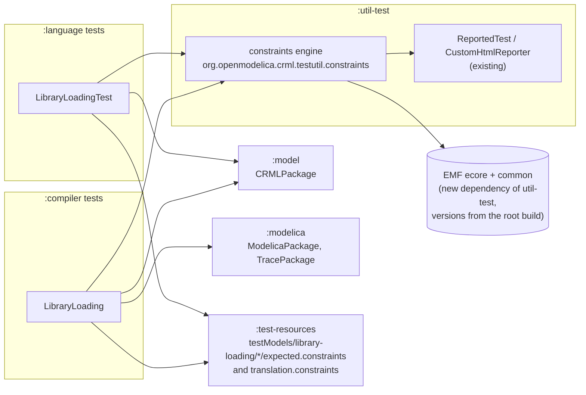
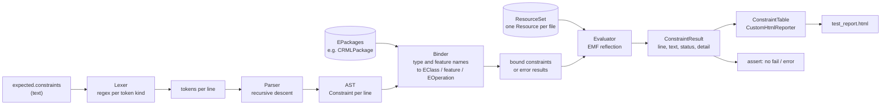
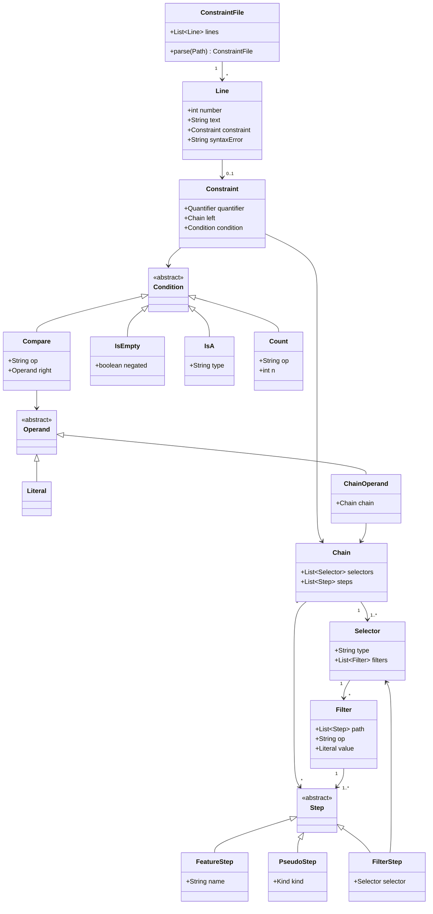
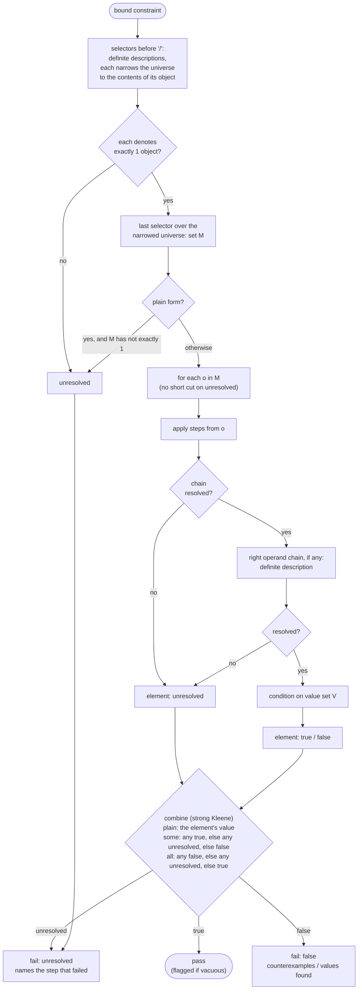
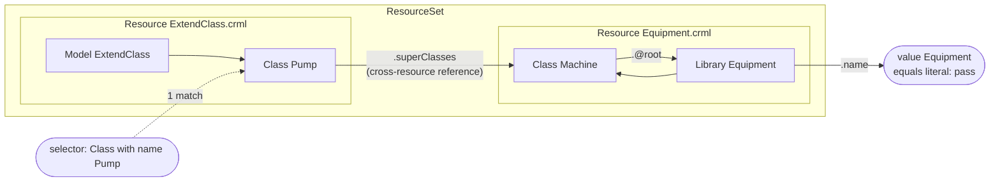
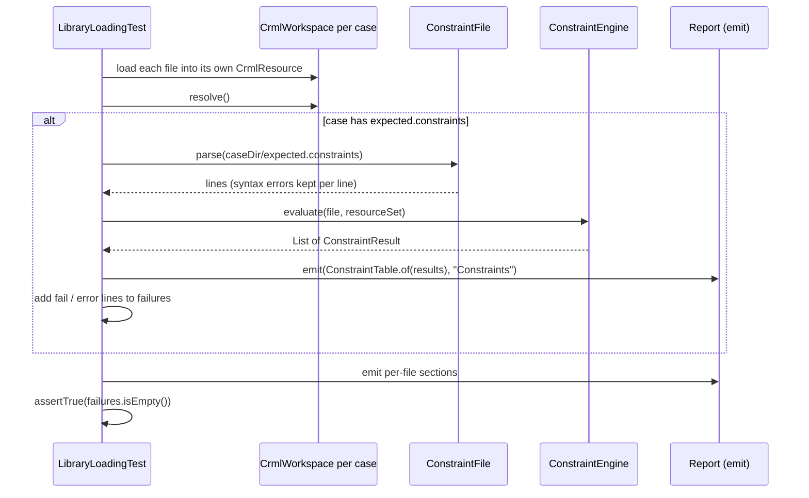
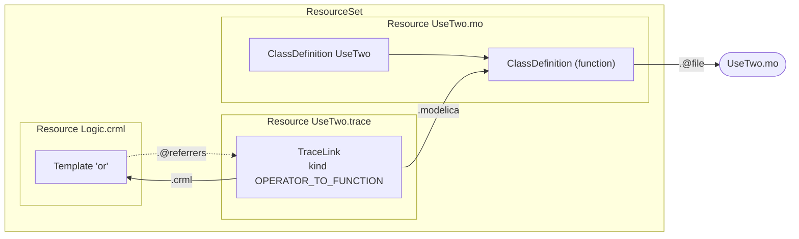

# Model constraint language

A small text language for stating facts about a built and linked EMF model, checked by
tests. A test loads a constraint file, evaluates each line against a `ResourceSet`, and
shows the results as one table in the test report.

The first user is `LibraryLoadingTest` in `:language`. It checks that after a CRML model
and its libraries are loaded, each name refers to the right object in the right file:

```
# class_extends/expected.constraints
[Class::name == "Pump"].superClasses contains [Class::name == "Machine"]
[Class::name == "Pump"].superClasses.@root.name == "Equipment"
```

The second user is `LibraryLoading` in `:compiler`. It translates the models of a case and
checks that the elements of the models and of their libraries reach the generated
Modelica, by following the trace of the translation back from each CRML element:

```
# two_libraries/translation.constraints
all [CustomOperator::@container.name == "Logic"].@referrers[TraceLink::kind != "UNSUPPORTED"].modelica.@file contains "UseTwo.mo"
```

Status: **implemented** in
[`org.openmodelica.crml.testutil.constraints`](src/main/java/org/openmodelica/crml/testutil/constraints),
with unit tests in [`src/test`](src/test/java/org/openmodelica/crml/testutil/constraints).
`LibraryLoadingTest` evaluates the `expected.constraints` file of each case that has one,
`LibraryLoading` the `translation.constraints` file (see
[Checking a translation](#checking-a-translation)).

## Goals and non-goals

Goals:

- **Readable test data.** One fact per line, written in metamodel terms: class names and
  feature names as the `.xcore` file declares them.
- **Sound and strict.** Quantifiers mean what they mean in logic (∀, ∃, "the unique").
  A chain that cannot be followed is *unresolved*, not false, and an unresolved result
  fails the test. A typo, a renamed feature or a dangling reference therefore fails the
  test instead of passing silently. The only passes on an empty set are vacuous ∀
  passes, and the report flags them.
- **Independent of the metamodel.** The engine knows nothing about CRML. It works on any
  `EPackage` and any `ResourceSet`, which is why it lives in `:util-test`.
- **Small.** A regex-based lexer and a hand-written recursive-descent parser. No ANTLR
  grammar, no OCL, Java 8 only.

Non-goals: arithmetic, variables, user-defined functions, changing the model, and any
check on diagnostics (validation results are not EObjects; see [Open questions](#open-questions)).

## The language by example

Each example comes from a case in `testModels/library-loading`.

```
# A comment. Blank lines are ignored.

# class_type: the variable's type and the constructor binding point into the library.
[Variable::name == "pump1"].domain.domain.@root.name == "Equipment"
[Variable::name == "pump1"].definition.bindings.element.@root.name == "Equipment"

# local_and_library: 'implies' is the model's own; the 'or' inside it is Logic's.
[Variable::name == "x_implies_y"].definition.operator.@root.name == "MixLocal"
[Template::keywords.keyword contains "'implies'"].definition.operator.@root.name == "Logic"

# diamond: Logic's 'or' exists once in the whole resource set.
count [Template::keywords.keyword contains "'or'"] == 1

# shared_library: a name used in two models; "/" searches inside one model only.
[Model::name == "Second"] / [Variable::name == "a_or_b"].definition.operator.@file == "Logic.crml"

# two_libraries: every variable of UseTwo has a type (∀; vacuously true if it had none) ...
all [Model::name == "UseTwo"] / [Variable].domain is not empty
# ... and the line below rules out the vacuous case.
count [Model::name == "UseTwo"] / [Variable] >= 1

# local_and_library: some operator declared in MixLocal calls into Logic (∃). The 'implies'
# template is a witness; 'negation of' (body "not b", no .operator) is unresolved, which
# does not matter once a witness is found.
some [Model::name == "MixLocal"] / [CustomOperator].definition.operator.@root.name == "Logic"

# not_in_scope_without_union: the call stays an unresolved Sequence.
[Variable::name == "x_or_y"].definition is a Sequence

# Filter paths may use pseudo steps: the top-level operators of Logic, not the ones
# nested deeper in it.
count [CustomOperator::@container.name == "Logic"] == 1

# .@referrers goes against the direction of references, and a selector after a step
# keeps the values that match it: the trace links that point to Logic's operators.
all [CustomOperator::@container.name == "Logic"].@referrers[TraceLink::kind != "UNSUPPORTED"] is not empty
```

Keywords keep their quotes in the model (`Keyword.keyword` is the token text, `'or'`),
so the string literal is `"'or'"`.

## Syntax

One constraint per line. A `#` starts a comment that runs to the end of the line, except
inside a string.

```
line        ::= constraint? comment?
constraint  ::= quantifier? chain condition
              | "count" chain compare INT
quantifier  ::= "all" | "some"
chain       ::= selector ( "/" selector )* step*
selector    ::= "[" TYPE ( "::" filter ( "," filter )* )? "]"
filter      ::= path ( "==" | "!=" | "contains" ) literal
path        ::= segment ( "." segment )*
step        ::= "." segment | selector
segment     ::= NAME | "@" PSEUDO
condition   ::= ( "==" | "!=" | "contains" | "not" "contains" ) operand
              | "is" "empty" | "is" "not" "empty"
              | "is" "a" TYPE
operand     ::= literal | chain
compare     ::= "==" | "!=" | "<" | "<=" | ">" | ">="
literal     ::= STRING | INT | "true" | "false"
PSEUDO      ::= "root" | "container" | "file" | "referrers"
```

Tokens, matched in this order by one regex per token kind:

| Token | Regex |
|---|---|
| comment | `#.*` |
| STRING | `"(?:[^"\\]|\\.)*"` (escapes `\"` and `\\`) |
| INT | `-?\d+` |
| operator | `==\|!=\|<=\|>=\|<\|>\|::\|[\[\],./@]` |
| word | `[A-Za-z_][A-Za-z0-9_]*` |

Words are keywords (`all`, `some`, `count`, `is`, `a`, `not`, `empty`, `contains`, `true`,
`false`) only where the grammar expects one. Everywhere else they are names, so a feature
can be called `count`.

A selector after the first selector is a scope selector when `/` precedes it, and a
[filter step](#filter-steps) otherwise: in `[A] / [B]` the universe narrows to the contents
of the one `A`, in `[A][B]` the set `[A]` denotes is filtered by `B`.

## Semantics

### Values

A chain evaluates to an **ordered set**: objects, or attribute values (strings, numbers,
booleans, enum literals). Order is the order in which values are first reached. Objects
are compared by identity, attribute values with `equals`. Duplicates are dropped, so
`count` counts distinct objects. This is what makes the `diamond` check meaningful.

### Selectors

A selector `[T::φ₁, …, φₖ]` applied to a universe `U` denotes the set

  `{ o ∈ U | o is an instance of T, and φ₁(o), …, φₖ(o) are all true }`

Instances of subtypes count, as in EMF's `isInstance`. `TYPE` is looked up by name among
the `EClass`es of the packages given to the engine. Since `Model` extends `Library`,
`[Library::…]` also selects models; use `is a` or a name filter to tell them apart.

- **Universe.** The universe of the first selector is every object of every resource in
  the `ResourceSet`, in resource order and then tree order, roots included.
- **Filters** follow their path on the candidate, with the same meaning as steps (so
  `@container.name` is the name of the candidate's container), and compare the resulting
  set with the literal (`==`: the set is `{lit}`; `!=`: it is not; `contains`: `lit` is in it). A
  candidate is selected only if every filter is **true**. A filter whose path cannot be
  followed on that candidate is not true, so the candidate is not selected. That is what
  set comprehension means, not a special leniency rule.
- **Scope.** `A / B` means: `A` must denote exactly one object `a` (see definite
  descriptions below), and `B` is applied to the universe of all objects contained in
  `a`, at any depth.

### Definite descriptions and quantifiers

A chain `σ₁ / … / σₙ . s₁ … sₘ` has one **quantified position**: the last selector `σₙ`,
the one the steps start from. Every other selector, and every chain used as a right
operand, is a **definite description**: it must denote exactly one object ("*the* class
named `Machine`"). Zero or several matches leave it unresolved.

Let `M` be the set the last selector denotes, and `P(o)` the condition applied to the
value set the steps reach from `o`. The leading word chooses how `P` is applied to `M`:

| Written | Meaning | When `M` is empty |
|---|---|---|
| (nothing) | `M = {o}` for exactly one `o`, and `P(o)` | unresolved |
| `all` | `∀ o ∈ M : P(o)` | **true** (vacuous) |
| `some` | `∃ o ∈ M : P(o)` | false |
| `count` | `\|S\| op n`, with `S` the union of the value sets of all `o ∈ M` | `\|S\| = 0` |

The usual identities hold: `some … P` has the same truth value as "not `all` … not P";
and when `M` has exactly one element, the plain form, `all` and `some` agree.

`all` over an empty set passes, as ∀ must. When that would hide a mistake (a misspelled
type, or a selector that no longer matches), pair it with a `count … >= 1` line. The
report flags every vacuous pass (see [Report format](#report-format)).

Examples:

- `[Model::name == "Second"] / [Variable::name == "a_or_b"]`: *the* model `Second` (definite
  description), and in it *the* variable `a_or_b` (plain form, so exactly one).
- `all [Model::name == "UseTwo"] / [Variable].domain is not empty`: every variable of
  *the* model `UseTwo` has a type.
- `count [Template::keywords.keyword contains "'or'"] == 1`: the `'or'` template exists
  exactly once in the resource set.

### Steps

A step maps every value of the current set and flattens the results into one set.

| Step | Meaning |
|---|---|
| `.name`: structural feature | `eGet`. Many-valued: all elements, possibly none. Single-valued: the value. |
| `.name`: operation | A parameterless `EOperation` (e.g. `keywords`, which is `getKeywords()`), via `eInvoke`. |
| `.@root` | `EcoreUtil.getRootContainer`: the top object of the resource, a CRML model or library. |
| `.@container` | `eContainer()`. |
| `.@file` | The last segment of the object's resource URI, as a string. |
| `.@referrers` | The objects of the universe that refer to the object, see below. |
| `[T::φ…]` | A filter step: the values that are instances of `T` and pass the filters, see below. |

Pseudo steps carry `@` so that they never clash with a feature of the metamodel.

#### Referrers

`.@referrers` maps an object `o` to every object `r` of the universe that holds `o` in a
non-containment reference, in universe order. It is the inverse of all such references
together, whatever their name:

- containment and container references are left out (`.@container` covers them), and so
  are derived references, which only repeat what other features hold;
- an object nobody refers to gives the empty set. `.@referrers` is never unresolved, also
  for an object outside every resource: its referrers are still looked up in the universe.

The index is built on the first `.@referrers` of an evaluation, over the whole universe.

#### Filter steps

A selector used as a step keeps the values that are objects of its type and pass its
filters, with the same meaning as in a selector, and drops every other value, attribute
values included. It never makes a chain unresolved: a filter that cannot be followed on a
value drops that value. A filter step is how a quantifier ranges over one feature's values
and a condition then tests what is left, e.g. ∀ operator ∃ trace link of a kind:

```
all [CustomOperator::@container.name == "Logic"].@referrers[TraceLink::kind != "UNSUPPORTED"] is not empty
```

### Unresolved chains: three-valued logic

Following a chain can fail partway. Each element's result is therefore one of three
values: **true**, **false** or **unresolved**. A chain is unresolved when:

1. a definite description (a selector before `/`, a right operand, or the last selector
   in the plain form) does not denote exactly one object;
2. a step names a feature that the value's class does not have (e.g. `.operator` on a
   `Sequence`);
3. a single-valued step returns `null` (an unset reference or attribute);
4. `.@root`, `.@container` or `.@file` has nothing to return (an object outside a resource).

`.@referrers` and filter steps never make a chain unresolved: they can only give an
empty set.

An empty **many-valued** feature is not unresolved. It yields an empty set, which
`is empty` can test.

Quantifiers combine the per-element results with the standard (strong Kleene) rules for
partial predicates. An element that decides the answer decides it, whatever the others
are:

| Quantifier | Value |
|---|---|
| `some` | **true** if at least one element is true; otherwise **unresolved** if at least one element is unresolved; otherwise **false** |
| `all` | **false** if at least one element is false; otherwise **unresolved** if at least one element is unresolved; otherwise **true** |
| (plain) | the element's own value; unresolved if `M` does not have exactly one element |

Over an empty `M`, these rules give `some` = false and `all` = true. `count` has no per-element
predicate: if any element's chain is unresolved, the count is unresolved.

A constraint **passes only if its value is true**. False and unresolved both fail it,
with different details in the report, so a chain that cannot be resolved always fails
the test unless the quantifier is already decided without it. To expect that something
did *not* resolve, test its type rather than walking past it:
`….definition is a Sequence`.

### Conditions

| Condition | Holds when |
|---|---|
| `== x` | the set is exactly `{x}` |
| `!= x` | the set is not `{x}` |
| `contains x` | `x` is in the set |
| `not contains x` | `x` is not in the set |
| `is empty` / `is not empty` | the set is empty / is not empty |
| `is a T` | every value is an instance of `T` (`∀ v ∈ V`; true for an empty set) |
| `count … op n` | the number of values compares with `n` |

Here `V` is the value set the steps reach from one object. Once `V` is resolved, every
condition is two-valued. The only way to get *unresolved* is a chain that cannot be
followed. `is a T` is a ∀ like any other, so it is vacuously true for an empty `V`. To
also require a value, add `is not empty` on another line. For a single-valued feature
this never comes up: an unset feature is already unresolved.

A literal is compared with an attribute value after conversion to the attribute's type:
a string for `EString`, an integer for `EInt` and its relatives, a boolean, or the name
of an enum literal. Comparing a literal with an object is a check error, reported when
the line is evaluated.

### Results

Each line yields one result:

| Status | Meaning |
|---|---|
| `pass` | the constraint is true |
| `fail` | the constraint is false, or unresolved (the detail says which) |
| `error` | the line is malformed: syntax, an unknown type, or a name that is no feature or operation of any class in the packages |

The test fails if any line is `fail` or `error`. An `error` line does not stop the other
lines from being evaluated.

## Architecture

### Modules



`:util-test` gets `org.eclipse.emf.ecore` and `org.eclipse.emf.common` as
`implementation` dependencies, with the versions the root build already pins
(`emfCoreVersion`, `emfCommonVersion`). It does not depend on `:model`: the test passes
the `EPackage`s in, so the engine also works for the Modelica or trace metamodels.

### Pipeline



Each stage turns its own problems into results instead of exceptions. A line the parser
rejects becomes an `error` result, and the remaining lines still go through binding and
evaluation.

### Components

| Class | Role |
|---|---|
| `ConstraintFile` | Entry point. `parse(Path)` / `parse(String)`: splits lines, runs the lexer and parser, and keeps each line's number and source text. |
| `Lexer` | Turns one line into tokens with the regexes above. Reports the column of an unexpected character. |
| `Parser` | Recursive descent over the token list, one method per grammar rule. Builds the AST. |
| AST classes | `Constraint`, `Chain`, `Selector`, `Filter`, `Step`, `Condition`, `Operand`. Immutable, Java 8 (final classes, no records). |
| `Binder` | Resolves `TYPE` to an `EClass`, also in filter steps, and checks that each step or filter name is a feature or parameterless operation of *some* class in the packages, which catches typos. Which class actually has it is only known at evaluation time, because a chain can pass through `@root` or through a supertype. |
| `Evaluator` | Walks chains with `eGet` / `eInvoke`, and keeps the inverse-reference index for `.@referrers`. A chain yields a value set or an `Unresolved(reason)` naming the step or definite description that failed. Conditions turn each element into a `Truth` (`TRUE`, `FALSE`, `UNRESOLVED`), and the quantifier combines them with the strong Kleene rules. All elements are evaluated, so the detail can list every counterexample. |
| `Describer` | Short text for a value in the report: `Class Machine (Equipment.crml)`, `"'or'"`, `3`. Uses the `name` attribute if the class has one, else the class name. |
| `ConstraintResult` | Line number, source text, status, detail. |
| `ConstraintTable` | `CustomHtmlReporter`: one table, one row per line, in the style of the verification report's `OutputsWrapper`. |
| `ConstraintEngine` | Facade: `new ConstraintEngine(EPackage...)`, then `evaluate(ConstraintFile, ResourceSet)` returns a `List<ConstraintResult>`. |

### AST



`Compare` covers `==`, `!=`, `contains` and `not contains`. `Count` keeps its chain in
`Constraint.left`, with no quantifier. `PseudoStep.Kind` is `ROOT`, `CONTAINER`, `FILE` or
`REFERRERS`. A filter path holds only `FeatureStep`s and `PseudoStep`s.

### Evaluating one constraint



### Data flow across resources

How `[Class::name == "Pump"].superClasses.@root.name == "Equipment"` walks the
`class_extends` case. Each file is its own resource. The chain crosses from the model's
resource into the library's through a cross-reference set by the linker.



### Use in a test



In the report, the `Constraints` table comes right after the case summary: Case folder,
Resource set, Constraints, then the per-file sections. Leaving out the file is allowed.
Such a case only gets the existing checks (grammar and DOM building).

## Checking a translation

`LibraryLoading` in `:compiler` evaluates the `translation.constraints` file of a
`testModels/library-loading` case on the result of translating it:

1. one `CrmlWorkspace` per case, with the case folder as library path;
2. every valid model of the case (no error marker, declares a `model`) is translated in it;
3. each translation is added to the resource set as two resources: `<Model>.mo` holds the
   generated Modelica class, `<Model>.trace` the trace;
4. the file is evaluated with the CRML, Modelica and trace packages. They declare no class
   of the same name, so every type name stays unambiguous.

A `TraceLink` refers to a CRML object (`crml`) and to what was generated for it
(`modelica`), with a `kind`. The translation reads the libraries' own objects, so the
`crml` end of a link into a library is the object in the library's resource, and
`.@referrers` leads from it to its links:



The usual lines of a case, per model (here `UseTwo`, whose class is
`[TraceLink::@file == "UseTwo.trace", kind == "MODEL_TO_CLASS"].modelica`):

```
# nothing dropped at any depth, no unresolved name, no reference into another model
count [TraceLink::@file == "UseTwo.trace", kind == "UNSUPPORTED"] == 0
count [Placeholder::@file == "UseTwo.mo"] == 0
count [Reference::@file == "UseTwo.mo", reason == "UNRESOLVED", rawText != ""] == 0
count [Reference::@file == "UseTwo.mo", target.@file != "UseTwo.mo"] == 0
# each element of a reached library once, of the right kind, directly in the model's class
count [CustomOperator::@container.name == "Logic"].@referrers[TraceLink::@file == "UseTwo.trace", kind == "OPERATOR_TO_FUNCTION"] == 1
all [CustomOperator::@container.name == "Logic"].@referrers[TraceLink::@file == "UseTwo.trace"].modelica.@container == [TraceLink::@file == "UseTwo.trace", kind == "MODEL_TO_CLASS"].modelica
# a call site reaches the right function
[Variable::name == "nor"].@referrers[TraceLink::@file == "UseTwo.trace", kind == "VARIABLE_TO_COMPONENT"].modelica.binding.function.target == [CustomOperator::@container.name == "Negation"].@referrers[TraceLink::@file == "UseTwo.trace"].modelica
```

A reference to a library type such as `CRMLtoModelica.Blocks.Integrate` is raw: it has
`rawText` and no `target`. A chain through `.target` over a mix of both is therefore
filtered first, e.g. `.components.declaredType[Reference::target.name != ""].target`.

Not expressible yet: that a single-valued feature is unset (e.g. an external variable's
component has no `binding`); the step makes the chain unresolved (see open question 3).

Links are filtered by `@file == "<Model>.trace"`: when several models of a case use a
library, each of its elements has a link from each model's trace. "Top level" is
`@container`, the model or library itself; members of classes and operator parameters are
not traced on their own.

A construct the translation drops leaves a `Placeholder` in the class and a link of kind
`UNSUPPORTED` from the CRML object the diagnostic is about. That makes some translation
diagnostics visible to constraints, e.g. in `unresolved_name_in_library`:

```
[TraceLink::kind == "UNSUPPORTED"].crml is a VariableReference
[TraceLink::kind == "UNSUPPORTED"].modelica is a Placeholder
```

## Report format

One table under the key `Constraints`, always shown expanded, so a failing case can be
read at a glance:

| # | Constraint | Status | Detail |
|---|---|---|---|
| 3 | `[Class::name == "Pump"].superClasses contains [Class::name == "Machine"]` | pass | |
| 4 | `[Variable::name == "x_or_y"].definition.operator.@root.name == "Logic"` | fail | unresolved: step .operator on SequenceValue (UseTemplate.crml): no such feature |
| 7 | `count [Template::keywords.keyword contains "'or'"] == 1` | fail | false: found 2: {Template (Left.crml), Template (Right.crml)} |
| 9 | `[Clas::name == "Pump"] is empty` | error | unknown type Clas |

A Template has no `name`, so it is shown by its class and file only.

- `#` is the line number in the constraint file.
- The constraint is shown as written.
- Detail depends on the status:
  - `pass`: empty, except for a vacuous pass (`all` over an empty set), which says
    "vacuously true: 0 objects matched".
  - `fail` when the value is false: for `all`, the counterexamples; for `some`, how many
    objects were tried; for the plain form, the values found. At most 5 values are
    listed, then "… and n more".
  - `fail` when the value is unresolved: the step or definite description that could not
    be resolved, and the object it was applied to.
  - `error`: the parse or binding message.

## Testing the engine

Unit tests in `:util-test` build a small metamodel in code (`EcoreFactory`): a few
classes with an attribute, a containment, a many-valued cross-reference and a
parameterless operation. They spread instances over two resources. This keeps
`:util-test` free of CRML. Cases to cover:

- lexer: every token kind, strings with escapes, a comment after a constraint;
- parser: each grammar rule, and a column in every syntax error;
- binder: unknown type, unknown feature, operation accepted as a step;
- selectors: subtype matching, `/` scoping, a lenient filter on an object without the
  feature;
- quantifiers: zero, one and two matches for the plain form, `all` and `some`, including
  the empty set (`all` true and flagged as vacuous, `some` false);
- three-valued logic: every combination of true, false and unresolved elements under
  `all` and `some`, checked against the rules above, and that all elements are evaluated
  (no short cut) so the detail is complete;
- definite descriptions: a scope selector or right operand with zero and with two matches;
- unresolved chains: missing feature, unset single reference, and an empty many-valued
  reference (not unresolved);
- pseudo steps across two resources, and on an object outside any resource;
- `.@referrers`: across resources, containment left out, an object nobody refers to,
  an object outside every resource;
- filter steps: with and without filters, attribute values dropped, an unknown type or
  feature as an error; pseudo steps in filter paths;
- every condition, literal conversion, deduplication for `count`;
- results: `error` on one line does not stop the others.

## Open questions

1. **File name.** One `expected.constraints` per case folder is assumed. One file per
   `.crml` file is possible, but the facts usually span files.
2. **Diagnostics.** Error cases want to state *which* validation error appears. EMF
   `Diagnostic`s are not EObjects. One option is a pseudo-selector `[@Diagnostic::…]`
   over the validator's result, with `message`, `code`, `severity` and `@target`. For the
   translation, `UNSUPPORTED` trace links and `Placeholder`s already show where a
   diagnostic was reported, but not its message or severity.
3. **Optional steps.** Walking past an unset reference makes the chain unresolved. If a case
   needs "either unset or X", a `?.` step could be added later. Not planned now.
4. **Keyword lookup.** `[Template::keywords.keyword contains "'or'"]` is verbose. A
   per-metamodel shorthand is possible but would tie the engine to CRML, so it is left out.
